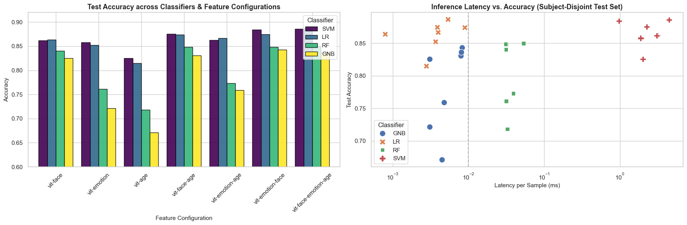

# 3.0 Comparative Evaluation of Multi-Domain ViT Classifiers
**Dataset:** DemogPairs (10,800 images total, 2,160 subject-disjoint test images from 120 held-out subjects)  
**Evaluation Protocol:** Strict Subject-Disjoint Partitioning (Zero Identity Leakage)  
**Evaluated Classifiers:**
1. Support Vector Machine (`SVM` / `LinearSVC` / `RBF SVC`)
2. Logistic Regression (`LR` / `L-BFGS`)
3. Random Forest (`RF`)
4. Gaussian Naive Bayes (`GNB`)

**Feature Configurations (7 Ablation Setups):**
- Single-Domain: `vit-face`, `vit-emotion`, `vit-age`
- Dual-Domain: `vit-face-age`, `vit-emotion-age`, `vit-emotion-face`
- Tri-Domain: `vit-face-emotion-age`


```python
import os
import json
import pandas as pd
import matplotlib.pyplot as plt
import seaborn as sns
import utils as u

```


```python
# Load all result files from results/
rpaths = [p for p in os.listdir('results') if p.endswith('.json')]
print(f'Found {len(rpaths)} result files')

results = []
for f in rpaths:
    rm = u.load_json(f'results/{f}')
    # Parse filename: demogpairs_{classifier}_{feature}_{model}.json
    parts = f.replace('.json', '').split('_')
    classifier = parts[1]  # svm, gnb, rf, lr
    feature = '_'.join(parts[2:-1])  # vit-face, vit-emotion-age, etc.
    row = {
        'Classifier': classifier.upper(),
        'Features': feature,
        'Accuracy': round(rm['test_accuracy'], 4),
        'Precision': round(rm['test_precision'], 4),
        'Recall': round(rm['test_recall'], 4),
        'F1-Score': round(rm['test_f1'], 4),
        'Latency (ms)': round(rm.get('latency_ms_per_sample', 0), 4),
        'Model Size (MB)': round(rm.get('model_size_mb', 0), 2),
    }
    results.append(row)

df = pd.DataFrame(results)
print(f'Total results: {len(df)}')
df

```

    Found 28 result files
    Total results: 28
    


<div>
<style scoped>
    .dataframe tbody tr th:only-of-type {
        vertical-align: middle;
    }

    .dataframe tbody tr th {
        vertical-align: top;
    }

    .dataframe thead th {
        text-align: right;
    }
</style>
<table border="1" class="dataframe">
  <thead>
    <tr style="text-align: right;">
      <th></th>
      <th>Classifier</th>
      <th>Features</th>
      <th>Accuracy</th>
      <th>Precision</th>
      <th>Recall</th>
      <th>F1-Score</th>
      <th>Latency (ms)</th>
      <th>Model Size (MB)</th>
    </tr>
  </thead>
  <tbody>
    <tr>
      <th>0</th>
      <td>GNB</td>
      <td>vit-age</td>
      <td>0.6708</td>
      <td>0.6691</td>
      <td>0.6708</td>
      <td>0.6686</td>
      <td>0.0045</td>
      <td>0.37</td>
    </tr>
    <tr>
      <th>1</th>
      <td>GNB</td>
      <td>vit-emotion-age</td>
      <td>0.7588</td>
      <td>0.7597</td>
      <td>0.7588</td>
      <td>0.7578</td>
      <td>0.0048</td>
      <td>0.24</td>
    </tr>
    <tr>
      <th>2</th>
      <td>GNB</td>
      <td>vit-emotion-face</td>
      <td>0.8431</td>
      <td>0.8437</td>
      <td>0.8431</td>
      <td>0.8430</td>
      <td>0.0083</td>
      <td>0.78</td>
    </tr>
    <tr>
      <th>3</th>
      <td>GNB</td>
      <td>vit-emotion</td>
      <td>0.7213</td>
      <td>0.7251</td>
      <td>0.7213</td>
      <td>0.7199</td>
      <td>0.0031</td>
      <td>0.13</td>
    </tr>
    <tr>
      <th>4</th>
      <td>GNB</td>
      <td>vit-face-age</td>
      <td>0.8306</td>
      <td>0.8347</td>
      <td>0.8306</td>
      <td>0.8310</td>
      <td>0.0080</td>
      <td>0.75</td>
    </tr>
    <tr>
      <th>5</th>
      <td>GNB</td>
      <td>vit-face-emotion-age</td>
      <td>0.8361</td>
      <td>0.8379</td>
      <td>0.8361</td>
      <td>0.8364</td>
      <td>0.0081</td>
      <td>1.36</td>
    </tr>
    <tr>
      <th>6</th>
      <td>GNB</td>
      <td>vit-face</td>
      <td>0.8255</td>
      <td>0.8268</td>
      <td>0.8255</td>
      <td>0.8250</td>
      <td>0.0031</td>
      <td>0.19</td>
    </tr>
    <tr>
      <th>7</th>
      <td>LR</td>
      <td>vit-age</td>
      <td>0.8148</td>
      <td>0.8145</td>
      <td>0.8148</td>
      <td>0.8146</td>
      <td>0.0028</td>
      <td>0.06</td>
    </tr>
    <tr>
      <th>8</th>
      <td>LR</td>
      <td>vit-emotion-age</td>
      <td>0.8667</td>
      <td>0.8668</td>
      <td>0.8667</td>
      <td>0.8667</td>
      <td>0.0040</td>
      <td>0.08</td>
    </tr>
    <tr>
      <th>9</th>
      <td>LR</td>
      <td>vit-emotion-face</td>
      <td>0.8745</td>
      <td>0.8759</td>
      <td>0.8745</td>
      <td>0.8749</td>
      <td>0.0039</td>
      <td>0.08</td>
    </tr>
    <tr>
      <th>10</th>
      <td>LR</td>
      <td>vit-emotion</td>
      <td>0.8523</td>
      <td>0.8535</td>
      <td>0.8523</td>
      <td>0.8527</td>
      <td>0.0037</td>
      <td>0.06</td>
    </tr>
    <tr>
      <th>11</th>
      <td>LR</td>
      <td>vit-face-age</td>
      <td>0.8741</td>
      <td>0.8744</td>
      <td>0.8741</td>
      <td>0.8740</td>
      <td>0.0090</td>
      <td>0.11</td>
    </tr>
    <tr>
      <th>12</th>
      <td>LR</td>
      <td>vit-face-emotion-age</td>
      <td>0.8866</td>
      <td>0.8875</td>
      <td>0.8866</td>
      <td>0.8868</td>
      <td>0.0054</td>
      <td>0.11</td>
    </tr>
    <tr>
      <th>13</th>
      <td>LR</td>
      <td>vit-face</td>
      <td>0.8639</td>
      <td>0.8646</td>
      <td>0.8639</td>
      <td>0.8640</td>
      <td>0.0008</td>
      <td>0.04</td>
    </tr>
    <tr>
      <th>14</th>
      <td>RF</td>
      <td>vit-age</td>
      <td>0.7181</td>
      <td>0.7176</td>
      <td>0.7181</td>
      <td>0.7170</td>
      <td>0.0327</td>
      <td>11.21</td>
    </tr>
    <tr>
      <th>15</th>
      <td>RF</td>
      <td>vit-emotion-age</td>
      <td>0.7731</td>
      <td>0.7734</td>
      <td>0.7731</td>
      <td>0.7728</td>
      <td>0.0392</td>
      <td>12.35</td>
    </tr>
    <tr>
      <th>16</th>
      <td>RF</td>
      <td>vit-emotion-face</td>
      <td>0.8486</td>
      <td>0.8493</td>
      <td>0.8486</td>
      <td>0.8479</td>
      <td>0.0316</td>
      <td>8.58</td>
    </tr>
    <tr>
      <th>17</th>
      <td>RF</td>
      <td>vit-emotion</td>
      <td>0.7611</td>
      <td>0.7602</td>
      <td>0.7611</td>
      <td>0.7603</td>
      <td>0.0316</td>
      <td>10.34</td>
    </tr>
    <tr>
      <th>18</th>
      <td>RF</td>
      <td>vit-face-age</td>
      <td>0.8486</td>
      <td>0.8488</td>
      <td>0.8486</td>
      <td>0.8478</td>
      <td>0.0310</td>
      <td>6.19</td>
    </tr>
    <tr>
      <th>19</th>
      <td>RF</td>
      <td>vit-face-emotion-age</td>
      <td>0.8500</td>
      <td>0.8506</td>
      <td>0.8500</td>
      <td>0.8493</td>
      <td>0.0537</td>
      <td>6.19</td>
    </tr>
    <tr>
      <th>20</th>
      <td>RF</td>
      <td>vit-face</td>
      <td>0.8403</td>
      <td>0.8413</td>
      <td>0.8403</td>
      <td>0.8403</td>
      <td>0.0314</td>
      <td>5.99</td>
    </tr>
    <tr>
      <th>21</th>
      <td>SVM</td>
      <td>vit-age</td>
      <td>0.8255</td>
      <td>0.8268</td>
      <td>0.8255</td>
      <td>0.8258</td>
      <td>2.0104</td>
      <td>18.22</td>
    </tr>
    <tr>
      <th>22</th>
      <td>SVM</td>
      <td>vit-emotion-age</td>
      <td>0.8625</td>
      <td>0.8626</td>
      <td>0.8625</td>
      <td>0.8624</td>
      <td>3.1451</td>
      <td>32.76</td>
    </tr>
    <tr>
      <th>23</th>
      <td>SVM</td>
      <td>vit-emotion-face</td>
      <td>0.8843</td>
      <td>0.8850</td>
      <td>0.8843</td>
      <td>0.8844</td>
      <td>0.9707</td>
      <td>15.27</td>
    </tr>
    <tr>
      <th>24</th>
      <td>SVM</td>
      <td>vit-emotion</td>
      <td>0.8579</td>
      <td>0.8584</td>
      <td>0.8579</td>
      <td>0.8580</td>
      <td>1.8871</td>
      <td>15.30</td>
    </tr>
    <tr>
      <th>25</th>
      <td>SVM</td>
      <td>vit-face-age</td>
      <td>0.8755</td>
      <td>0.8766</td>
      <td>0.8755</td>
      <td>0.8757</td>
      <td>2.2581</td>
      <td>23.48</td>
    </tr>
    <tr>
      <th>26</th>
      <td>SVM</td>
      <td>vit-face-emotion-age</td>
      <td>0.8861</td>
      <td>0.8871</td>
      <td>0.8861</td>
      <td>0.8863</td>
      <td>4.4481</td>
      <td>36.60</td>
    </tr>
    <tr>
      <th>27</th>
      <td>SVM</td>
      <td>vit-face</td>
      <td>0.8616</td>
      <td>0.8624</td>
      <td>0.8616</td>
      <td>0.8619</td>
      <td>3.0653</td>
      <td>7.56</td>
    </tr>
  </tbody>
</table>
</div>


## 1. Support Vector Machine (SVM)


```python
svm_results = df[df['Classifier'] == 'SVM'].sort_values('Accuracy', ascending=False).reset_index(drop=True)
svm_results.insert(0, 'No', range(1, len(svm_results) + 1))
_ = u.display_table(svm_results.to_dict('records'))

```


<table style="width: 100%; border-collapse: collapse;">
  <tr>
    <th style="border: 1px solid black; padding: 8px;  text-align: left;">No</th>
    <th style="border: 1px solid black; padding: 8px;  text-align: left;">Classifier</th>
    <th style="border: 1px solid black; padding: 8px;  text-align: left;">Features</th>
    <th style="border: 1px solid black; padding: 8px;  text-align: left;">Accuracy</th>
    <th style="border: 1px solid black; padding: 8px;  text-align: left;">Precision</th>
    <th style="border: 1px solid black; padding: 8px;  text-align: left;">Recall</th>
    <th style="border: 1px solid black; padding: 8px;  text-align: left;">F1-Score</th>
    <th style="border: 1px solid black; padding: 8px;  text-align: left;">Latency (ms)</th>
    <th style="border: 1px solid black; padding: 8px;  text-align: left;">Model Size (MB)</th>
  </tr>
  <tr>
    <td style="border: 1px solid black; padding: 8px;  text-align: left;">1</td>
    <td style="border: 1px solid black; padding: 8px;  text-align: left;">SVM</td>
    <td style="border: 1px solid black; padding: 8px;  text-align: left;">vit-face-emotion-age</td>
    <td style="border: 1px solid black; padding: 8px;  text-align: left;">0.8861</td>
    <td style="border: 1px solid black; padding: 8px;  text-align: left;">0.8871</td>
    <td style="border: 1px solid black; padding: 8px;  text-align: left;">0.8861</td>
    <td style="border: 1px solid black; padding: 8px;  text-align: left;">0.8863</td>
    <td style="border: 1px solid black; padding: 8px;  text-align: left;">4.4481</td>
    <td style="border: 1px solid black; padding: 8px;  text-align: left;">36.6</td>
  </tr>
  <tr>
    <td style="border: 1px solid black; padding: 8px;  text-align: left;">2</td>
    <td style="border: 1px solid black; padding: 8px;  text-align: left;">SVM</td>
    <td style="border: 1px solid black; padding: 8px;  text-align: left;">vit-emotion-face</td>
    <td style="border: 1px solid black; padding: 8px;  text-align: left;">0.8843</td>
    <td style="border: 1px solid black; padding: 8px;  text-align: left;">0.885</td>
    <td style="border: 1px solid black; padding: 8px;  text-align: left;">0.8843</td>
    <td style="border: 1px solid black; padding: 8px;  text-align: left;">0.8844</td>
    <td style="border: 1px solid black; padding: 8px;  text-align: left;">0.9707</td>
    <td style="border: 1px solid black; padding: 8px;  text-align: left;">15.27</td>
  </tr>
  <tr>
    <td style="border: 1px solid black; padding: 8px;  text-align: left;">3</td>
    <td style="border: 1px solid black; padding: 8px;  text-align: left;">SVM</td>
    <td style="border: 1px solid black; padding: 8px;  text-align: left;">vit-face-age</td>
    <td style="border: 1px solid black; padding: 8px;  text-align: left;">0.8755</td>
    <td style="border: 1px solid black; padding: 8px;  text-align: left;">0.8766</td>
    <td style="border: 1px solid black; padding: 8px;  text-align: left;">0.8755</td>
    <td style="border: 1px solid black; padding: 8px;  text-align: left;">0.8757</td>
    <td style="border: 1px solid black; padding: 8px;  text-align: left;">2.2581</td>
    <td style="border: 1px solid black; padding: 8px;  text-align: left;">23.48</td>
  </tr>
  <tr>
    <td style="border: 1px solid black; padding: 8px;  text-align: left;">4</td>
    <td style="border: 1px solid black; padding: 8px;  text-align: left;">SVM</td>
    <td style="border: 1px solid black; padding: 8px;  text-align: left;">vit-emotion-age</td>
    <td style="border: 1px solid black; padding: 8px;  text-align: left;">0.8625</td>
    <td style="border: 1px solid black; padding: 8px;  text-align: left;">0.8626</td>
    <td style="border: 1px solid black; padding: 8px;  text-align: left;">0.8625</td>
    <td style="border: 1px solid black; padding: 8px;  text-align: left;">0.8624</td>
    <td style="border: 1px solid black; padding: 8px;  text-align: left;">3.1451</td>
    <td style="border: 1px solid black; padding: 8px;  text-align: left;">32.76</td>
  </tr>
  <tr>
    <td style="border: 1px solid black; padding: 8px;  text-align: left;">5</td>
    <td style="border: 1px solid black; padding: 8px;  text-align: left;">SVM</td>
    <td style="border: 1px solid black; padding: 8px;  text-align: left;">vit-face</td>
    <td style="border: 1px solid black; padding: 8px;  text-align: left;">0.8616</td>
    <td style="border: 1px solid black; padding: 8px;  text-align: left;">0.8624</td>
    <td style="border: 1px solid black; padding: 8px;  text-align: left;">0.8616</td>
    <td style="border: 1px solid black; padding: 8px;  text-align: left;">0.8619</td>
    <td style="border: 1px solid black; padding: 8px;  text-align: left;">3.0653</td>
    <td style="border: 1px solid black; padding: 8px;  text-align: left;">7.56</td>
  </tr>
  <tr>
    <td style="border: 1px solid black; padding: 8px;  text-align: left;">6</td>
    <td style="border: 1px solid black; padding: 8px;  text-align: left;">SVM</td>
    <td style="border: 1px solid black; padding: 8px;  text-align: left;">vit-emotion</td>
    <td style="border: 1px solid black; padding: 8px;  text-align: left;">0.8579</td>
    <td style="border: 1px solid black; padding: 8px;  text-align: left;">0.8584</td>
    <td style="border: 1px solid black; padding: 8px;  text-align: left;">0.8579</td>
    <td style="border: 1px solid black; padding: 8px;  text-align: left;">0.858</td>
    <td style="border: 1px solid black; padding: 8px;  text-align: left;">1.8871</td>
    <td style="border: 1px solid black; padding: 8px;  text-align: left;">15.3</td>
  </tr>
  <tr>
    <td style="border: 1px solid black; padding: 8px;  text-align: left;">7</td>
    <td style="border: 1px solid black; padding: 8px;  text-align: left;">SVM</td>
    <td style="border: 1px solid black; padding: 8px;  text-align: left;">vit-age</td>
    <td style="border: 1px solid black; padding: 8px;  text-align: left;">0.8255</td>
    <td style="border: 1px solid black; padding: 8px;  text-align: left;">0.8268</td>
    <td style="border: 1px solid black; padding: 8px;  text-align: left;">0.8255</td>
    <td style="border: 1px solid black; padding: 8px;  text-align: left;">0.8258</td>
    <td style="border: 1px solid black; padding: 8px;  text-align: left;">2.0104</td>
    <td style="border: 1px solid black; padding: 8px;  text-align: left;">18.22</td>
  </tr>
</table>


## 2. Gaussian Naive Bayes (GNB)


```python
gnb_results = df[df['Classifier'] == 'GNB'].sort_values('Accuracy', ascending=False).reset_index(drop=True)
gnb_results.insert(0, 'No', range(1, len(gnb_results) + 1))
_ = u.display_table(gnb_results.to_dict('records'))

```


<table style="width: 100%; border-collapse: collapse;">
  <tr>
    <th style="border: 1px solid black; padding: 8px;  text-align: left;">No</th>
    <th style="border: 1px solid black; padding: 8px;  text-align: left;">Classifier</th>
    <th style="border: 1px solid black; padding: 8px;  text-align: left;">Features</th>
    <th style="border: 1px solid black; padding: 8px;  text-align: left;">Accuracy</th>
    <th style="border: 1px solid black; padding: 8px;  text-align: left;">Precision</th>
    <th style="border: 1px solid black; padding: 8px;  text-align: left;">Recall</th>
    <th style="border: 1px solid black; padding: 8px;  text-align: left;">F1-Score</th>
    <th style="border: 1px solid black; padding: 8px;  text-align: left;">Latency (ms)</th>
    <th style="border: 1px solid black; padding: 8px;  text-align: left;">Model Size (MB)</th>
  </tr>
  <tr>
    <td style="border: 1px solid black; padding: 8px;  text-align: left;">1</td>
    <td style="border: 1px solid black; padding: 8px;  text-align: left;">GNB</td>
    <td style="border: 1px solid black; padding: 8px;  text-align: left;">vit-emotion-face</td>
    <td style="border: 1px solid black; padding: 8px;  text-align: left;">0.8431</td>
    <td style="border: 1px solid black; padding: 8px;  text-align: left;">0.8437</td>
    <td style="border: 1px solid black; padding: 8px;  text-align: left;">0.8431</td>
    <td style="border: 1px solid black; padding: 8px;  text-align: left;">0.843</td>
    <td style="border: 1px solid black; padding: 8px;  text-align: left;">0.0083</td>
    <td style="border: 1px solid black; padding: 8px;  text-align: left;">0.78</td>
  </tr>
  <tr>
    <td style="border: 1px solid black; padding: 8px;  text-align: left;">2</td>
    <td style="border: 1px solid black; padding: 8px;  text-align: left;">GNB</td>
    <td style="border: 1px solid black; padding: 8px;  text-align: left;">vit-face-emotion-age</td>
    <td style="border: 1px solid black; padding: 8px;  text-align: left;">0.8361</td>
    <td style="border: 1px solid black; padding: 8px;  text-align: left;">0.8379</td>
    <td style="border: 1px solid black; padding: 8px;  text-align: left;">0.8361</td>
    <td style="border: 1px solid black; padding: 8px;  text-align: left;">0.8364</td>
    <td style="border: 1px solid black; padding: 8px;  text-align: left;">0.0081</td>
    <td style="border: 1px solid black; padding: 8px;  text-align: left;">1.36</td>
  </tr>
  <tr>
    <td style="border: 1px solid black; padding: 8px;  text-align: left;">3</td>
    <td style="border: 1px solid black; padding: 8px;  text-align: left;">GNB</td>
    <td style="border: 1px solid black; padding: 8px;  text-align: left;">vit-face-age</td>
    <td style="border: 1px solid black; padding: 8px;  text-align: left;">0.8306</td>
    <td style="border: 1px solid black; padding: 8px;  text-align: left;">0.8347</td>
    <td style="border: 1px solid black; padding: 8px;  text-align: left;">0.8306</td>
    <td style="border: 1px solid black; padding: 8px;  text-align: left;">0.831</td>
    <td style="border: 1px solid black; padding: 8px;  text-align: left;">0.008</td>
    <td style="border: 1px solid black; padding: 8px;  text-align: left;">0.75</td>
  </tr>
  <tr>
    <td style="border: 1px solid black; padding: 8px;  text-align: left;">4</td>
    <td style="border: 1px solid black; padding: 8px;  text-align: left;">GNB</td>
    <td style="border: 1px solid black; padding: 8px;  text-align: left;">vit-face</td>
    <td style="border: 1px solid black; padding: 8px;  text-align: left;">0.8255</td>
    <td style="border: 1px solid black; padding: 8px;  text-align: left;">0.8268</td>
    <td style="border: 1px solid black; padding: 8px;  text-align: left;">0.8255</td>
    <td style="border: 1px solid black; padding: 8px;  text-align: left;">0.825</td>
    <td style="border: 1px solid black; padding: 8px;  text-align: left;">0.0031</td>
    <td style="border: 1px solid black; padding: 8px;  text-align: left;">0.19</td>
  </tr>
  <tr>
    <td style="border: 1px solid black; padding: 8px;  text-align: left;">5</td>
    <td style="border: 1px solid black; padding: 8px;  text-align: left;">GNB</td>
    <td style="border: 1px solid black; padding: 8px;  text-align: left;">vit-emotion-age</td>
    <td style="border: 1px solid black; padding: 8px;  text-align: left;">0.7588</td>
    <td style="border: 1px solid black; padding: 8px;  text-align: left;">0.7597</td>
    <td style="border: 1px solid black; padding: 8px;  text-align: left;">0.7588</td>
    <td style="border: 1px solid black; padding: 8px;  text-align: left;">0.7578</td>
    <td style="border: 1px solid black; padding: 8px;  text-align: left;">0.0048</td>
    <td style="border: 1px solid black; padding: 8px;  text-align: left;">0.24</td>
  </tr>
  <tr>
    <td style="border: 1px solid black; padding: 8px;  text-align: left;">6</td>
    <td style="border: 1px solid black; padding: 8px;  text-align: left;">GNB</td>
    <td style="border: 1px solid black; padding: 8px;  text-align: left;">vit-emotion</td>
    <td style="border: 1px solid black; padding: 8px;  text-align: left;">0.7213</td>
    <td style="border: 1px solid black; padding: 8px;  text-align: left;">0.7251</td>
    <td style="border: 1px solid black; padding: 8px;  text-align: left;">0.7213</td>
    <td style="border: 1px solid black; padding: 8px;  text-align: left;">0.7199</td>
    <td style="border: 1px solid black; padding: 8px;  text-align: left;">0.0031</td>
    <td style="border: 1px solid black; padding: 8px;  text-align: left;">0.13</td>
  </tr>
  <tr>
    <td style="border: 1px solid black; padding: 8px;  text-align: left;">7</td>
    <td style="border: 1px solid black; padding: 8px;  text-align: left;">GNB</td>
    <td style="border: 1px solid black; padding: 8px;  text-align: left;">vit-age</td>
    <td style="border: 1px solid black; padding: 8px;  text-align: left;">0.6708</td>
    <td style="border: 1px solid black; padding: 8px;  text-align: left;">0.6691</td>
    <td style="border: 1px solid black; padding: 8px;  text-align: left;">0.6708</td>
    <td style="border: 1px solid black; padding: 8px;  text-align: left;">0.6686</td>
    <td style="border: 1px solid black; padding: 8px;  text-align: left;">0.0045</td>
    <td style="border: 1px solid black; padding: 8px;  text-align: left;">0.37</td>
  </tr>
</table>


## 3. Random Forest (RF)


```python
rf_results = df[df['Classifier'] == 'RF'].sort_values('Accuracy', ascending=False).reset_index(drop=True)
rf_results.insert(0, 'No', range(1, len(rf_results) + 1))
_ = u.display_table(rf_results.to_dict('records'))

```


<table style="width: 100%; border-collapse: collapse;">
  <tr>
    <th style="border: 1px solid black; padding: 8px;  text-align: left;">No</th>
    <th style="border: 1px solid black; padding: 8px;  text-align: left;">Classifier</th>
    <th style="border: 1px solid black; padding: 8px;  text-align: left;">Features</th>
    <th style="border: 1px solid black; padding: 8px;  text-align: left;">Accuracy</th>
    <th style="border: 1px solid black; padding: 8px;  text-align: left;">Precision</th>
    <th style="border: 1px solid black; padding: 8px;  text-align: left;">Recall</th>
    <th style="border: 1px solid black; padding: 8px;  text-align: left;">F1-Score</th>
    <th style="border: 1px solid black; padding: 8px;  text-align: left;">Latency (ms)</th>
    <th style="border: 1px solid black; padding: 8px;  text-align: left;">Model Size (MB)</th>
  </tr>
  <tr>
    <td style="border: 1px solid black; padding: 8px;  text-align: left;">1</td>
    <td style="border: 1px solid black; padding: 8px;  text-align: left;">RF</td>
    <td style="border: 1px solid black; padding: 8px;  text-align: left;">vit-face-emotion-age</td>
    <td style="border: 1px solid black; padding: 8px;  text-align: left;">0.85</td>
    <td style="border: 1px solid black; padding: 8px;  text-align: left;">0.8506</td>
    <td style="border: 1px solid black; padding: 8px;  text-align: left;">0.85</td>
    <td style="border: 1px solid black; padding: 8px;  text-align: left;">0.8493</td>
    <td style="border: 1px solid black; padding: 8px;  text-align: left;">0.0537</td>
    <td style="border: 1px solid black; padding: 8px;  text-align: left;">6.19</td>
  </tr>
  <tr>
    <td style="border: 1px solid black; padding: 8px;  text-align: left;">2</td>
    <td style="border: 1px solid black; padding: 8px;  text-align: left;">RF</td>
    <td style="border: 1px solid black; padding: 8px;  text-align: left;">vit-face-age</td>
    <td style="border: 1px solid black; padding: 8px;  text-align: left;">0.8486</td>
    <td style="border: 1px solid black; padding: 8px;  text-align: left;">0.8488</td>
    <td style="border: 1px solid black; padding: 8px;  text-align: left;">0.8486</td>
    <td style="border: 1px solid black; padding: 8px;  text-align: left;">0.8478</td>
    <td style="border: 1px solid black; padding: 8px;  text-align: left;">0.031</td>
    <td style="border: 1px solid black; padding: 8px;  text-align: left;">6.19</td>
  </tr>
  <tr>
    <td style="border: 1px solid black; padding: 8px;  text-align: left;">3</td>
    <td style="border: 1px solid black; padding: 8px;  text-align: left;">RF</td>
    <td style="border: 1px solid black; padding: 8px;  text-align: left;">vit-emotion-face</td>
    <td style="border: 1px solid black; padding: 8px;  text-align: left;">0.8486</td>
    <td style="border: 1px solid black; padding: 8px;  text-align: left;">0.8493</td>
    <td style="border: 1px solid black; padding: 8px;  text-align: left;">0.8486</td>
    <td style="border: 1px solid black; padding: 8px;  text-align: left;">0.8479</td>
    <td style="border: 1px solid black; padding: 8px;  text-align: left;">0.0316</td>
    <td style="border: 1px solid black; padding: 8px;  text-align: left;">8.58</td>
  </tr>
  <tr>
    <td style="border: 1px solid black; padding: 8px;  text-align: left;">4</td>
    <td style="border: 1px solid black; padding: 8px;  text-align: left;">RF</td>
    <td style="border: 1px solid black; padding: 8px;  text-align: left;">vit-face</td>
    <td style="border: 1px solid black; padding: 8px;  text-align: left;">0.8403</td>
    <td style="border: 1px solid black; padding: 8px;  text-align: left;">0.8413</td>
    <td style="border: 1px solid black; padding: 8px;  text-align: left;">0.8403</td>
    <td style="border: 1px solid black; padding: 8px;  text-align: left;">0.8403</td>
    <td style="border: 1px solid black; padding: 8px;  text-align: left;">0.0314</td>
    <td style="border: 1px solid black; padding: 8px;  text-align: left;">5.99</td>
  </tr>
  <tr>
    <td style="border: 1px solid black; padding: 8px;  text-align: left;">5</td>
    <td style="border: 1px solid black; padding: 8px;  text-align: left;">RF</td>
    <td style="border: 1px solid black; padding: 8px;  text-align: left;">vit-emotion-age</td>
    <td style="border: 1px solid black; padding: 8px;  text-align: left;">0.7731</td>
    <td style="border: 1px solid black; padding: 8px;  text-align: left;">0.7734</td>
    <td style="border: 1px solid black; padding: 8px;  text-align: left;">0.7731</td>
    <td style="border: 1px solid black; padding: 8px;  text-align: left;">0.7728</td>
    <td style="border: 1px solid black; padding: 8px;  text-align: left;">0.0392</td>
    <td style="border: 1px solid black; padding: 8px;  text-align: left;">12.35</td>
  </tr>
  <tr>
    <td style="border: 1px solid black; padding: 8px;  text-align: left;">6</td>
    <td style="border: 1px solid black; padding: 8px;  text-align: left;">RF</td>
    <td style="border: 1px solid black; padding: 8px;  text-align: left;">vit-emotion</td>
    <td style="border: 1px solid black; padding: 8px;  text-align: left;">0.7611</td>
    <td style="border: 1px solid black; padding: 8px;  text-align: left;">0.7602</td>
    <td style="border: 1px solid black; padding: 8px;  text-align: left;">0.7611</td>
    <td style="border: 1px solid black; padding: 8px;  text-align: left;">0.7603</td>
    <td style="border: 1px solid black; padding: 8px;  text-align: left;">0.0316</td>
    <td style="border: 1px solid black; padding: 8px;  text-align: left;">10.34</td>
  </tr>
  <tr>
    <td style="border: 1px solid black; padding: 8px;  text-align: left;">7</td>
    <td style="border: 1px solid black; padding: 8px;  text-align: left;">RF</td>
    <td style="border: 1px solid black; padding: 8px;  text-align: left;">vit-age</td>
    <td style="border: 1px solid black; padding: 8px;  text-align: left;">0.7181</td>
    <td style="border: 1px solid black; padding: 8px;  text-align: left;">0.7176</td>
    <td style="border: 1px solid black; padding: 8px;  text-align: left;">0.7181</td>
    <td style="border: 1px solid black; padding: 8px;  text-align: left;">0.717</td>
    <td style="border: 1px solid black; padding: 8px;  text-align: left;">0.0327</td>
    <td style="border: 1px solid black; padding: 8px;  text-align: left;">11.21</td>
  </tr>
</table>


## 4. Logistic Regression (LR)


```python
lr_results = df[df['Classifier'] == 'LR'].sort_values('Accuracy', ascending=False).reset_index(drop=True)
lr_results.insert(0, 'No', range(1, len(lr_results) + 1))
_ = u.display_table(lr_results.to_dict('records'))

```


<table style="width: 100%; border-collapse: collapse;">
  <tr>
    <th style="border: 1px solid black; padding: 8px;  text-align: left;">No</th>
    <th style="border: 1px solid black; padding: 8px;  text-align: left;">Classifier</th>
    <th style="border: 1px solid black; padding: 8px;  text-align: left;">Features</th>
    <th style="border: 1px solid black; padding: 8px;  text-align: left;">Accuracy</th>
    <th style="border: 1px solid black; padding: 8px;  text-align: left;">Precision</th>
    <th style="border: 1px solid black; padding: 8px;  text-align: left;">Recall</th>
    <th style="border: 1px solid black; padding: 8px;  text-align: left;">F1-Score</th>
    <th style="border: 1px solid black; padding: 8px;  text-align: left;">Latency (ms)</th>
    <th style="border: 1px solid black; padding: 8px;  text-align: left;">Model Size (MB)</th>
  </tr>
  <tr>
    <td style="border: 1px solid black; padding: 8px;  text-align: left;">1</td>
    <td style="border: 1px solid black; padding: 8px;  text-align: left;">LR</td>
    <td style="border: 1px solid black; padding: 8px;  text-align: left;">vit-face-emotion-age</td>
    <td style="border: 1px solid black; padding: 8px;  text-align: left;">0.8866</td>
    <td style="border: 1px solid black; padding: 8px;  text-align: left;">0.8875</td>
    <td style="border: 1px solid black; padding: 8px;  text-align: left;">0.8866</td>
    <td style="border: 1px solid black; padding: 8px;  text-align: left;">0.8868</td>
    <td style="border: 1px solid black; padding: 8px;  text-align: left;">0.0054</td>
    <td style="border: 1px solid black; padding: 8px;  text-align: left;">0.11</td>
  </tr>
  <tr>
    <td style="border: 1px solid black; padding: 8px;  text-align: left;">2</td>
    <td style="border: 1px solid black; padding: 8px;  text-align: left;">LR</td>
    <td style="border: 1px solid black; padding: 8px;  text-align: left;">vit-emotion-face</td>
    <td style="border: 1px solid black; padding: 8px;  text-align: left;">0.8745</td>
    <td style="border: 1px solid black; padding: 8px;  text-align: left;">0.8759</td>
    <td style="border: 1px solid black; padding: 8px;  text-align: left;">0.8745</td>
    <td style="border: 1px solid black; padding: 8px;  text-align: left;">0.8749</td>
    <td style="border: 1px solid black; padding: 8px;  text-align: left;">0.0039</td>
    <td style="border: 1px solid black; padding: 8px;  text-align: left;">0.08</td>
  </tr>
  <tr>
    <td style="border: 1px solid black; padding: 8px;  text-align: left;">3</td>
    <td style="border: 1px solid black; padding: 8px;  text-align: left;">LR</td>
    <td style="border: 1px solid black; padding: 8px;  text-align: left;">vit-face-age</td>
    <td style="border: 1px solid black; padding: 8px;  text-align: left;">0.8741</td>
    <td style="border: 1px solid black; padding: 8px;  text-align: left;">0.8744</td>
    <td style="border: 1px solid black; padding: 8px;  text-align: left;">0.8741</td>
    <td style="border: 1px solid black; padding: 8px;  text-align: left;">0.874</td>
    <td style="border: 1px solid black; padding: 8px;  text-align: left;">0.009</td>
    <td style="border: 1px solid black; padding: 8px;  text-align: left;">0.11</td>
  </tr>
  <tr>
    <td style="border: 1px solid black; padding: 8px;  text-align: left;">4</td>
    <td style="border: 1px solid black; padding: 8px;  text-align: left;">LR</td>
    <td style="border: 1px solid black; padding: 8px;  text-align: left;">vit-emotion-age</td>
    <td style="border: 1px solid black; padding: 8px;  text-align: left;">0.8667</td>
    <td style="border: 1px solid black; padding: 8px;  text-align: left;">0.8668</td>
    <td style="border: 1px solid black; padding: 8px;  text-align: left;">0.8667</td>
    <td style="border: 1px solid black; padding: 8px;  text-align: left;">0.8667</td>
    <td style="border: 1px solid black; padding: 8px;  text-align: left;">0.004</td>
    <td style="border: 1px solid black; padding: 8px;  text-align: left;">0.08</td>
  </tr>
  <tr>
    <td style="border: 1px solid black; padding: 8px;  text-align: left;">5</td>
    <td style="border: 1px solid black; padding: 8px;  text-align: left;">LR</td>
    <td style="border: 1px solid black; padding: 8px;  text-align: left;">vit-face</td>
    <td style="border: 1px solid black; padding: 8px;  text-align: left;">0.8639</td>
    <td style="border: 1px solid black; padding: 8px;  text-align: left;">0.8646</td>
    <td style="border: 1px solid black; padding: 8px;  text-align: left;">0.8639</td>
    <td style="border: 1px solid black; padding: 8px;  text-align: left;">0.864</td>
    <td style="border: 1px solid black; padding: 8px;  text-align: left;">0.0008</td>
    <td style="border: 1px solid black; padding: 8px;  text-align: left;">0.04</td>
  </tr>
  <tr>
    <td style="border: 1px solid black; padding: 8px;  text-align: left;">6</td>
    <td style="border: 1px solid black; padding: 8px;  text-align: left;">LR</td>
    <td style="border: 1px solid black; padding: 8px;  text-align: left;">vit-emotion</td>
    <td style="border: 1px solid black; padding: 8px;  text-align: left;">0.8523</td>
    <td style="border: 1px solid black; padding: 8px;  text-align: left;">0.8535</td>
    <td style="border: 1px solid black; padding: 8px;  text-align: left;">0.8523</td>
    <td style="border: 1px solid black; padding: 8px;  text-align: left;">0.8527</td>
    <td style="border: 1px solid black; padding: 8px;  text-align: left;">0.0037</td>
    <td style="border: 1px solid black; padding: 8px;  text-align: left;">0.06</td>
  </tr>
  <tr>
    <td style="border: 1px solid black; padding: 8px;  text-align: left;">7</td>
    <td style="border: 1px solid black; padding: 8px;  text-align: left;">LR</td>
    <td style="border: 1px solid black; padding: 8px;  text-align: left;">vit-age</td>
    <td style="border: 1px solid black; padding: 8px;  text-align: left;">0.8148</td>
    <td style="border: 1px solid black; padding: 8px;  text-align: left;">0.8145</td>
    <td style="border: 1px solid black; padding: 8px;  text-align: left;">0.8148</td>
    <td style="border: 1px solid black; padding: 8px;  text-align: left;">0.8146</td>
    <td style="border: 1px solid black; padding: 8px;  text-align: left;">0.0028</td>
    <td style="border: 1px solid black; padding: 8px;  text-align: left;">0.06</td>
  </tr>
</table>


## 5. All Classifiers - Ranked by Accuracy (Leaderboard)


```python
all_results = df.sort_values('Accuracy', ascending=False).reset_index(drop=True)
all_results.insert(0, 'No', range(1, len(all_results) + 1))
_ = u.display_table(all_results.to_dict('records'))

```


<table style="width: 100%; border-collapse: collapse;">
  <tr>
    <th style="border: 1px solid black; padding: 8px;  text-align: left;">No</th>
    <th style="border: 1px solid black; padding: 8px;  text-align: left;">Classifier</th>
    <th style="border: 1px solid black; padding: 8px;  text-align: left;">Features</th>
    <th style="border: 1px solid black; padding: 8px;  text-align: left;">Accuracy</th>
    <th style="border: 1px solid black; padding: 8px;  text-align: left;">Precision</th>
    <th style="border: 1px solid black; padding: 8px;  text-align: left;">Recall</th>
    <th style="border: 1px solid black; padding: 8px;  text-align: left;">F1-Score</th>
    <th style="border: 1px solid black; padding: 8px;  text-align: left;">Latency (ms)</th>
    <th style="border: 1px solid black; padding: 8px;  text-align: left;">Model Size (MB)</th>
  </tr>
  <tr>
    <td style="border: 1px solid black; padding: 8px;  text-align: left;">1</td>
    <td style="border: 1px solid black; padding: 8px;  text-align: left;">LR</td>
    <td style="border: 1px solid black; padding: 8px;  text-align: left;">vit-face-emotion-age</td>
    <td style="border: 1px solid black; padding: 8px;  text-align: left;">0.8866</td>
    <td style="border: 1px solid black; padding: 8px;  text-align: left;">0.8875</td>
    <td style="border: 1px solid black; padding: 8px;  text-align: left;">0.8866</td>
    <td style="border: 1px solid black; padding: 8px;  text-align: left;">0.8868</td>
    <td style="border: 1px solid black; padding: 8px;  text-align: left;">0.0054</td>
    <td style="border: 1px solid black; padding: 8px;  text-align: left;">0.11</td>
  </tr>
  <tr>
    <td style="border: 1px solid black; padding: 8px;  text-align: left;">2</td>
    <td style="border: 1px solid black; padding: 8px;  text-align: left;">SVM</td>
    <td style="border: 1px solid black; padding: 8px;  text-align: left;">vit-face-emotion-age</td>
    <td style="border: 1px solid black; padding: 8px;  text-align: left;">0.8861</td>
    <td style="border: 1px solid black; padding: 8px;  text-align: left;">0.8871</td>
    <td style="border: 1px solid black; padding: 8px;  text-align: left;">0.8861</td>
    <td style="border: 1px solid black; padding: 8px;  text-align: left;">0.8863</td>
    <td style="border: 1px solid black; padding: 8px;  text-align: left;">4.4481</td>
    <td style="border: 1px solid black; padding: 8px;  text-align: left;">36.6</td>
  </tr>
  <tr>
    <td style="border: 1px solid black; padding: 8px;  text-align: left;">3</td>
    <td style="border: 1px solid black; padding: 8px;  text-align: left;">SVM</td>
    <td style="border: 1px solid black; padding: 8px;  text-align: left;">vit-emotion-face</td>
    <td style="border: 1px solid black; padding: 8px;  text-align: left;">0.8843</td>
    <td style="border: 1px solid black; padding: 8px;  text-align: left;">0.885</td>
    <td style="border: 1px solid black; padding: 8px;  text-align: left;">0.8843</td>
    <td style="border: 1px solid black; padding: 8px;  text-align: left;">0.8844</td>
    <td style="border: 1px solid black; padding: 8px;  text-align: left;">0.9707</td>
    <td style="border: 1px solid black; padding: 8px;  text-align: left;">15.27</td>
  </tr>
  <tr>
    <td style="border: 1px solid black; padding: 8px;  text-align: left;">4</td>
    <td style="border: 1px solid black; padding: 8px;  text-align: left;">SVM</td>
    <td style="border: 1px solid black; padding: 8px;  text-align: left;">vit-face-age</td>
    <td style="border: 1px solid black; padding: 8px;  text-align: left;">0.8755</td>
    <td style="border: 1px solid black; padding: 8px;  text-align: left;">0.8766</td>
    <td style="border: 1px solid black; padding: 8px;  text-align: left;">0.8755</td>
    <td style="border: 1px solid black; padding: 8px;  text-align: left;">0.8757</td>
    <td style="border: 1px solid black; padding: 8px;  text-align: left;">2.2581</td>
    <td style="border: 1px solid black; padding: 8px;  text-align: left;">23.48</td>
  </tr>
  <tr>
    <td style="border: 1px solid black; padding: 8px;  text-align: left;">5</td>
    <td style="border: 1px solid black; padding: 8px;  text-align: left;">LR</td>
    <td style="border: 1px solid black; padding: 8px;  text-align: left;">vit-emotion-face</td>
    <td style="border: 1px solid black; padding: 8px;  text-align: left;">0.8745</td>
    <td style="border: 1px solid black; padding: 8px;  text-align: left;">0.8759</td>
    <td style="border: 1px solid black; padding: 8px;  text-align: left;">0.8745</td>
    <td style="border: 1px solid black; padding: 8px;  text-align: left;">0.8749</td>
    <td style="border: 1px solid black; padding: 8px;  text-align: left;">0.0039</td>
    <td style="border: 1px solid black; padding: 8px;  text-align: left;">0.08</td>
  </tr>
  <tr>
    <td style="border: 1px solid black; padding: 8px;  text-align: left;">6</td>
    <td style="border: 1px solid black; padding: 8px;  text-align: left;">LR</td>
    <td style="border: 1px solid black; padding: 8px;  text-align: left;">vit-face-age</td>
    <td style="border: 1px solid black; padding: 8px;  text-align: left;">0.8741</td>
    <td style="border: 1px solid black; padding: 8px;  text-align: left;">0.8744</td>
    <td style="border: 1px solid black; padding: 8px;  text-align: left;">0.8741</td>
    <td style="border: 1px solid black; padding: 8px;  text-align: left;">0.874</td>
    <td style="border: 1px solid black; padding: 8px;  text-align: left;">0.009</td>
    <td style="border: 1px solid black; padding: 8px;  text-align: left;">0.11</td>
  </tr>
  <tr>
    <td style="border: 1px solid black; padding: 8px;  text-align: left;">7</td>
    <td style="border: 1px solid black; padding: 8px;  text-align: left;">LR</td>
    <td style="border: 1px solid black; padding: 8px;  text-align: left;">vit-emotion-age</td>
    <td style="border: 1px solid black; padding: 8px;  text-align: left;">0.8667</td>
    <td style="border: 1px solid black; padding: 8px;  text-align: left;">0.8668</td>
    <td style="border: 1px solid black; padding: 8px;  text-align: left;">0.8667</td>
    <td style="border: 1px solid black; padding: 8px;  text-align: left;">0.8667</td>
    <td style="border: 1px solid black; padding: 8px;  text-align: left;">0.004</td>
    <td style="border: 1px solid black; padding: 8px;  text-align: left;">0.08</td>
  </tr>
  <tr>
    <td style="border: 1px solid black; padding: 8px;  text-align: left;">8</td>
    <td style="border: 1px solid black; padding: 8px;  text-align: left;">LR</td>
    <td style="border: 1px solid black; padding: 8px;  text-align: left;">vit-face</td>
    <td style="border: 1px solid black; padding: 8px;  text-align: left;">0.8639</td>
    <td style="border: 1px solid black; padding: 8px;  text-align: left;">0.8646</td>
    <td style="border: 1px solid black; padding: 8px;  text-align: left;">0.8639</td>
    <td style="border: 1px solid black; padding: 8px;  text-align: left;">0.864</td>
    <td style="border: 1px solid black; padding: 8px;  text-align: left;">0.0008</td>
    <td style="border: 1px solid black; padding: 8px;  text-align: left;">0.04</td>
  </tr>
  <tr>
    <td style="border: 1px solid black; padding: 8px;  text-align: left;">9</td>
    <td style="border: 1px solid black; padding: 8px;  text-align: left;">SVM</td>
    <td style="border: 1px solid black; padding: 8px;  text-align: left;">vit-emotion-age</td>
    <td style="border: 1px solid black; padding: 8px;  text-align: left;">0.8625</td>
    <td style="border: 1px solid black; padding: 8px;  text-align: left;">0.8626</td>
    <td style="border: 1px solid black; padding: 8px;  text-align: left;">0.8625</td>
    <td style="border: 1px solid black; padding: 8px;  text-align: left;">0.8624</td>
    <td style="border: 1px solid black; padding: 8px;  text-align: left;">3.1451</td>
    <td style="border: 1px solid black; padding: 8px;  text-align: left;">32.76</td>
  </tr>
  <tr>
    <td style="border: 1px solid black; padding: 8px;  text-align: left;">10</td>
    <td style="border: 1px solid black; padding: 8px;  text-align: left;">SVM</td>
    <td style="border: 1px solid black; padding: 8px;  text-align: left;">vit-face</td>
    <td style="border: 1px solid black; padding: 8px;  text-align: left;">0.8616</td>
    <td style="border: 1px solid black; padding: 8px;  text-align: left;">0.8624</td>
    <td style="border: 1px solid black; padding: 8px;  text-align: left;">0.8616</td>
    <td style="border: 1px solid black; padding: 8px;  text-align: left;">0.8619</td>
    <td style="border: 1px solid black; padding: 8px;  text-align: left;">3.0653</td>
    <td style="border: 1px solid black; padding: 8px;  text-align: left;">7.56</td>
  </tr>
  <tr>
    <td style="border: 1px solid black; padding: 8px;  text-align: left;">11</td>
    <td style="border: 1px solid black; padding: 8px;  text-align: left;">SVM</td>
    <td style="border: 1px solid black; padding: 8px;  text-align: left;">vit-emotion</td>
    <td style="border: 1px solid black; padding: 8px;  text-align: left;">0.8579</td>
    <td style="border: 1px solid black; padding: 8px;  text-align: left;">0.8584</td>
    <td style="border: 1px solid black; padding: 8px;  text-align: left;">0.8579</td>
    <td style="border: 1px solid black; padding: 8px;  text-align: left;">0.858</td>
    <td style="border: 1px solid black; padding: 8px;  text-align: left;">1.8871</td>
    <td style="border: 1px solid black; padding: 8px;  text-align: left;">15.3</td>
  </tr>
  <tr>
    <td style="border: 1px solid black; padding: 8px;  text-align: left;">12</td>
    <td style="border: 1px solid black; padding: 8px;  text-align: left;">LR</td>
    <td style="border: 1px solid black; padding: 8px;  text-align: left;">vit-emotion</td>
    <td style="border: 1px solid black; padding: 8px;  text-align: left;">0.8523</td>
    <td style="border: 1px solid black; padding: 8px;  text-align: left;">0.8535</td>
    <td style="border: 1px solid black; padding: 8px;  text-align: left;">0.8523</td>
    <td style="border: 1px solid black; padding: 8px;  text-align: left;">0.8527</td>
    <td style="border: 1px solid black; padding: 8px;  text-align: left;">0.0037</td>
    <td style="border: 1px solid black; padding: 8px;  text-align: left;">0.06</td>
  </tr>
  <tr>
    <td style="border: 1px solid black; padding: 8px;  text-align: left;">13</td>
    <td style="border: 1px solid black; padding: 8px;  text-align: left;">RF</td>
    <td style="border: 1px solid black; padding: 8px;  text-align: left;">vit-face-emotion-age</td>
    <td style="border: 1px solid black; padding: 8px;  text-align: left;">0.85</td>
    <td style="border: 1px solid black; padding: 8px;  text-align: left;">0.8506</td>
    <td style="border: 1px solid black; padding: 8px;  text-align: left;">0.85</td>
    <td style="border: 1px solid black; padding: 8px;  text-align: left;">0.8493</td>
    <td style="border: 1px solid black; padding: 8px;  text-align: left;">0.0537</td>
    <td style="border: 1px solid black; padding: 8px;  text-align: left;">6.19</td>
  </tr>
  <tr>
    <td style="border: 1px solid black; padding: 8px;  text-align: left;">14</td>
    <td style="border: 1px solid black; padding: 8px;  text-align: left;">RF</td>
    <td style="border: 1px solid black; padding: 8px;  text-align: left;">vit-emotion-face</td>
    <td style="border: 1px solid black; padding: 8px;  text-align: left;">0.8486</td>
    <td style="border: 1px solid black; padding: 8px;  text-align: left;">0.8493</td>
    <td style="border: 1px solid black; padding: 8px;  text-align: left;">0.8486</td>
    <td style="border: 1px solid black; padding: 8px;  text-align: left;">0.8479</td>
    <td style="border: 1px solid black; padding: 8px;  text-align: left;">0.0316</td>
    <td style="border: 1px solid black; padding: 8px;  text-align: left;">8.58</td>
  </tr>
  <tr>
    <td style="border: 1px solid black; padding: 8px;  text-align: left;">15</td>
    <td style="border: 1px solid black; padding: 8px;  text-align: left;">RF</td>
    <td style="border: 1px solid black; padding: 8px;  text-align: left;">vit-face-age</td>
    <td style="border: 1px solid black; padding: 8px;  text-align: left;">0.8486</td>
    <td style="border: 1px solid black; padding: 8px;  text-align: left;">0.8488</td>
    <td style="border: 1px solid black; padding: 8px;  text-align: left;">0.8486</td>
    <td style="border: 1px solid black; padding: 8px;  text-align: left;">0.8478</td>
    <td style="border: 1px solid black; padding: 8px;  text-align: left;">0.031</td>
    <td style="border: 1px solid black; padding: 8px;  text-align: left;">6.19</td>
  </tr>
  <tr>
    <td style="border: 1px solid black; padding: 8px;  text-align: left;">16</td>
    <td style="border: 1px solid black; padding: 8px;  text-align: left;">GNB</td>
    <td style="border: 1px solid black; padding: 8px;  text-align: left;">vit-emotion-face</td>
    <td style="border: 1px solid black; padding: 8px;  text-align: left;">0.8431</td>
    <td style="border: 1px solid black; padding: 8px;  text-align: left;">0.8437</td>
    <td style="border: 1px solid black; padding: 8px;  text-align: left;">0.8431</td>
    <td style="border: 1px solid black; padding: 8px;  text-align: left;">0.843</td>
    <td style="border: 1px solid black; padding: 8px;  text-align: left;">0.0083</td>
    <td style="border: 1px solid black; padding: 8px;  text-align: left;">0.78</td>
  </tr>
  <tr>
    <td style="border: 1px solid black; padding: 8px;  text-align: left;">17</td>
    <td style="border: 1px solid black; padding: 8px;  text-align: left;">RF</td>
    <td style="border: 1px solid black; padding: 8px;  text-align: left;">vit-face</td>
    <td style="border: 1px solid black; padding: 8px;  text-align: left;">0.8403</td>
    <td style="border: 1px solid black; padding: 8px;  text-align: left;">0.8413</td>
    <td style="border: 1px solid black; padding: 8px;  text-align: left;">0.8403</td>
    <td style="border: 1px solid black; padding: 8px;  text-align: left;">0.8403</td>
    <td style="border: 1px solid black; padding: 8px;  text-align: left;">0.0314</td>
    <td style="border: 1px solid black; padding: 8px;  text-align: left;">5.99</td>
  </tr>
  <tr>
    <td style="border: 1px solid black; padding: 8px;  text-align: left;">18</td>
    <td style="border: 1px solid black; padding: 8px;  text-align: left;">GNB</td>
    <td style="border: 1px solid black; padding: 8px;  text-align: left;">vit-face-emotion-age</td>
    <td style="border: 1px solid black; padding: 8px;  text-align: left;">0.8361</td>
    <td style="border: 1px solid black; padding: 8px;  text-align: left;">0.8379</td>
    <td style="border: 1px solid black; padding: 8px;  text-align: left;">0.8361</td>
    <td style="border: 1px solid black; padding: 8px;  text-align: left;">0.8364</td>
    <td style="border: 1px solid black; padding: 8px;  text-align: left;">0.0081</td>
    <td style="border: 1px solid black; padding: 8px;  text-align: left;">1.36</td>
  </tr>
  <tr>
    <td style="border: 1px solid black; padding: 8px;  text-align: left;">19</td>
    <td style="border: 1px solid black; padding: 8px;  text-align: left;">GNB</td>
    <td style="border: 1px solid black; padding: 8px;  text-align: left;">vit-face-age</td>
    <td style="border: 1px solid black; padding: 8px;  text-align: left;">0.8306</td>
    <td style="border: 1px solid black; padding: 8px;  text-align: left;">0.8347</td>
    <td style="border: 1px solid black; padding: 8px;  text-align: left;">0.8306</td>
    <td style="border: 1px solid black; padding: 8px;  text-align: left;">0.831</td>
    <td style="border: 1px solid black; padding: 8px;  text-align: left;">0.008</td>
    <td style="border: 1px solid black; padding: 8px;  text-align: left;">0.75</td>
  </tr>
  <tr>
    <td style="border: 1px solid black; padding: 8px;  text-align: left;">20</td>
    <td style="border: 1px solid black; padding: 8px;  text-align: left;">GNB</td>
    <td style="border: 1px solid black; padding: 8px;  text-align: left;">vit-face</td>
    <td style="border: 1px solid black; padding: 8px;  text-align: left;">0.8255</td>
    <td style="border: 1px solid black; padding: 8px;  text-align: left;">0.8268</td>
    <td style="border: 1px solid black; padding: 8px;  text-align: left;">0.8255</td>
    <td style="border: 1px solid black; padding: 8px;  text-align: left;">0.825</td>
    <td style="border: 1px solid black; padding: 8px;  text-align: left;">0.0031</td>
    <td style="border: 1px solid black; padding: 8px;  text-align: left;">0.19</td>
  </tr>
  <tr>
    <td style="border: 1px solid black; padding: 8px;  text-align: left;">21</td>
    <td style="border: 1px solid black; padding: 8px;  text-align: left;">SVM</td>
    <td style="border: 1px solid black; padding: 8px;  text-align: left;">vit-age</td>
    <td style="border: 1px solid black; padding: 8px;  text-align: left;">0.8255</td>
    <td style="border: 1px solid black; padding: 8px;  text-align: left;">0.8268</td>
    <td style="border: 1px solid black; padding: 8px;  text-align: left;">0.8255</td>
    <td style="border: 1px solid black; padding: 8px;  text-align: left;">0.8258</td>
    <td style="border: 1px solid black; padding: 8px;  text-align: left;">2.0104</td>
    <td style="border: 1px solid black; padding: 8px;  text-align: left;">18.22</td>
  </tr>
  <tr>
    <td style="border: 1px solid black; padding: 8px;  text-align: left;">22</td>
    <td style="border: 1px solid black; padding: 8px;  text-align: left;">LR</td>
    <td style="border: 1px solid black; padding: 8px;  text-align: left;">vit-age</td>
    <td style="border: 1px solid black; padding: 8px;  text-align: left;">0.8148</td>
    <td style="border: 1px solid black; padding: 8px;  text-align: left;">0.8145</td>
    <td style="border: 1px solid black; padding: 8px;  text-align: left;">0.8148</td>
    <td style="border: 1px solid black; padding: 8px;  text-align: left;">0.8146</td>
    <td style="border: 1px solid black; padding: 8px;  text-align: left;">0.0028</td>
    <td style="border: 1px solid black; padding: 8px;  text-align: left;">0.06</td>
  </tr>
  <tr>
    <td style="border: 1px solid black; padding: 8px;  text-align: left;">23</td>
    <td style="border: 1px solid black; padding: 8px;  text-align: left;">RF</td>
    <td style="border: 1px solid black; padding: 8px;  text-align: left;">vit-emotion-age</td>
    <td style="border: 1px solid black; padding: 8px;  text-align: left;">0.7731</td>
    <td style="border: 1px solid black; padding: 8px;  text-align: left;">0.7734</td>
    <td style="border: 1px solid black; padding: 8px;  text-align: left;">0.7731</td>
    <td style="border: 1px solid black; padding: 8px;  text-align: left;">0.7728</td>
    <td style="border: 1px solid black; padding: 8px;  text-align: left;">0.0392</td>
    <td style="border: 1px solid black; padding: 8px;  text-align: left;">12.35</td>
  </tr>
  <tr>
    <td style="border: 1px solid black; padding: 8px;  text-align: left;">24</td>
    <td style="border: 1px solid black; padding: 8px;  text-align: left;">RF</td>
    <td style="border: 1px solid black; padding: 8px;  text-align: left;">vit-emotion</td>
    <td style="border: 1px solid black; padding: 8px;  text-align: left;">0.7611</td>
    <td style="border: 1px solid black; padding: 8px;  text-align: left;">0.7602</td>
    <td style="border: 1px solid black; padding: 8px;  text-align: left;">0.7611</td>
    <td style="border: 1px solid black; padding: 8px;  text-align: left;">0.7603</td>
    <td style="border: 1px solid black; padding: 8px;  text-align: left;">0.0316</td>
    <td style="border: 1px solid black; padding: 8px;  text-align: left;">10.34</td>
  </tr>
  <tr>
    <td style="border: 1px solid black; padding: 8px;  text-align: left;">25</td>
    <td style="border: 1px solid black; padding: 8px;  text-align: left;">GNB</td>
    <td style="border: 1px solid black; padding: 8px;  text-align: left;">vit-emotion-age</td>
    <td style="border: 1px solid black; padding: 8px;  text-align: left;">0.7588</td>
    <td style="border: 1px solid black; padding: 8px;  text-align: left;">0.7597</td>
    <td style="border: 1px solid black; padding: 8px;  text-align: left;">0.7588</td>
    <td style="border: 1px solid black; padding: 8px;  text-align: left;">0.7578</td>
    <td style="border: 1px solid black; padding: 8px;  text-align: left;">0.0048</td>
    <td style="border: 1px solid black; padding: 8px;  text-align: left;">0.24</td>
  </tr>
  <tr>
    <td style="border: 1px solid black; padding: 8px;  text-align: left;">26</td>
    <td style="border: 1px solid black; padding: 8px;  text-align: left;">GNB</td>
    <td style="border: 1px solid black; padding: 8px;  text-align: left;">vit-emotion</td>
    <td style="border: 1px solid black; padding: 8px;  text-align: left;">0.7213</td>
    <td style="border: 1px solid black; padding: 8px;  text-align: left;">0.7251</td>
    <td style="border: 1px solid black; padding: 8px;  text-align: left;">0.7213</td>
    <td style="border: 1px solid black; padding: 8px;  text-align: left;">0.7199</td>
    <td style="border: 1px solid black; padding: 8px;  text-align: left;">0.0031</td>
    <td style="border: 1px solid black; padding: 8px;  text-align: left;">0.13</td>
  </tr>
  <tr>
    <td style="border: 1px solid black; padding: 8px;  text-align: left;">27</td>
    <td style="border: 1px solid black; padding: 8px;  text-align: left;">RF</td>
    <td style="border: 1px solid black; padding: 8px;  text-align: left;">vit-age</td>
    <td style="border: 1px solid black; padding: 8px;  text-align: left;">0.7181</td>
    <td style="border: 1px solid black; padding: 8px;  text-align: left;">0.7176</td>
    <td style="border: 1px solid black; padding: 8px;  text-align: left;">0.7181</td>
    <td style="border: 1px solid black; padding: 8px;  text-align: left;">0.717</td>
    <td style="border: 1px solid black; padding: 8px;  text-align: left;">0.0327</td>
    <td style="border: 1px solid black; padding: 8px;  text-align: left;">11.21</td>
  </tr>
  <tr>
    <td style="border: 1px solid black; padding: 8px;  text-align: left;">28</td>
    <td style="border: 1px solid black; padding: 8px;  text-align: left;">GNB</td>
    <td style="border: 1px solid black; padding: 8px;  text-align: left;">vit-age</td>
    <td style="border: 1px solid black; padding: 8px;  text-align: left;">0.6708</td>
    <td style="border: 1px solid black; padding: 8px;  text-align: left;">0.6691</td>
    <td style="border: 1px solid black; padding: 8px;  text-align: left;">0.6708</td>
    <td style="border: 1px solid black; padding: 8px;  text-align: left;">0.6686</td>
    <td style="border: 1px solid black; padding: 8px;  text-align: left;">0.0045</td>
    <td style="border: 1px solid black; padding: 8px;  text-align: left;">0.37</td>
  </tr>
</table>


## 6. Best Classifier per Feature Configuration


```python
best_per_config = df.loc[df.groupby('Features')['Accuracy'].idxmax()]
best_per_config = best_per_config.sort_values('Accuracy', ascending=False).reset_index(drop=True)
best_per_config.insert(0, 'No', range(1, len(best_per_config) + 1))
_ = u.display_table(best_per_config.to_dict('records'))

```


<table style="width: 100%; border-collapse: collapse;">
  <tr>
    <th style="border: 1px solid black; padding: 8px;  text-align: left;">No</th>
    <th style="border: 1px solid black; padding: 8px;  text-align: left;">Classifier</th>
    <th style="border: 1px solid black; padding: 8px;  text-align: left;">Features</th>
    <th style="border: 1px solid black; padding: 8px;  text-align: left;">Accuracy</th>
    <th style="border: 1px solid black; padding: 8px;  text-align: left;">Precision</th>
    <th style="border: 1px solid black; padding: 8px;  text-align: left;">Recall</th>
    <th style="border: 1px solid black; padding: 8px;  text-align: left;">F1-Score</th>
    <th style="border: 1px solid black; padding: 8px;  text-align: left;">Latency (ms)</th>
    <th style="border: 1px solid black; padding: 8px;  text-align: left;">Model Size (MB)</th>
  </tr>
  <tr>
    <td style="border: 1px solid black; padding: 8px;  text-align: left;">1</td>
    <td style="border: 1px solid black; padding: 8px;  text-align: left;">LR</td>
    <td style="border: 1px solid black; padding: 8px;  text-align: left;">vit-face-emotion-age</td>
    <td style="border: 1px solid black; padding: 8px;  text-align: left;">0.8866</td>
    <td style="border: 1px solid black; padding: 8px;  text-align: left;">0.8875</td>
    <td style="border: 1px solid black; padding: 8px;  text-align: left;">0.8866</td>
    <td style="border: 1px solid black; padding: 8px;  text-align: left;">0.8868</td>
    <td style="border: 1px solid black; padding: 8px;  text-align: left;">0.0054</td>
    <td style="border: 1px solid black; padding: 8px;  text-align: left;">0.11</td>
  </tr>
  <tr>
    <td style="border: 1px solid black; padding: 8px;  text-align: left;">2</td>
    <td style="border: 1px solid black; padding: 8px;  text-align: left;">SVM</td>
    <td style="border: 1px solid black; padding: 8px;  text-align: left;">vit-emotion-face</td>
    <td style="border: 1px solid black; padding: 8px;  text-align: left;">0.8843</td>
    <td style="border: 1px solid black; padding: 8px;  text-align: left;">0.885</td>
    <td style="border: 1px solid black; padding: 8px;  text-align: left;">0.8843</td>
    <td style="border: 1px solid black; padding: 8px;  text-align: left;">0.8844</td>
    <td style="border: 1px solid black; padding: 8px;  text-align: left;">0.9707</td>
    <td style="border: 1px solid black; padding: 8px;  text-align: left;">15.27</td>
  </tr>
  <tr>
    <td style="border: 1px solid black; padding: 8px;  text-align: left;">3</td>
    <td style="border: 1px solid black; padding: 8px;  text-align: left;">SVM</td>
    <td style="border: 1px solid black; padding: 8px;  text-align: left;">vit-face-age</td>
    <td style="border: 1px solid black; padding: 8px;  text-align: left;">0.8755</td>
    <td style="border: 1px solid black; padding: 8px;  text-align: left;">0.8766</td>
    <td style="border: 1px solid black; padding: 8px;  text-align: left;">0.8755</td>
    <td style="border: 1px solid black; padding: 8px;  text-align: left;">0.8757</td>
    <td style="border: 1px solid black; padding: 8px;  text-align: left;">2.2581</td>
    <td style="border: 1px solid black; padding: 8px;  text-align: left;">23.48</td>
  </tr>
  <tr>
    <td style="border: 1px solid black; padding: 8px;  text-align: left;">4</td>
    <td style="border: 1px solid black; padding: 8px;  text-align: left;">LR</td>
    <td style="border: 1px solid black; padding: 8px;  text-align: left;">vit-emotion-age</td>
    <td style="border: 1px solid black; padding: 8px;  text-align: left;">0.8667</td>
    <td style="border: 1px solid black; padding: 8px;  text-align: left;">0.8668</td>
    <td style="border: 1px solid black; padding: 8px;  text-align: left;">0.8667</td>
    <td style="border: 1px solid black; padding: 8px;  text-align: left;">0.8667</td>
    <td style="border: 1px solid black; padding: 8px;  text-align: left;">0.004</td>
    <td style="border: 1px solid black; padding: 8px;  text-align: left;">0.08</td>
  </tr>
  <tr>
    <td style="border: 1px solid black; padding: 8px;  text-align: left;">5</td>
    <td style="border: 1px solid black; padding: 8px;  text-align: left;">LR</td>
    <td style="border: 1px solid black; padding: 8px;  text-align: left;">vit-face</td>
    <td style="border: 1px solid black; padding: 8px;  text-align: left;">0.8639</td>
    <td style="border: 1px solid black; padding: 8px;  text-align: left;">0.8646</td>
    <td style="border: 1px solid black; padding: 8px;  text-align: left;">0.8639</td>
    <td style="border: 1px solid black; padding: 8px;  text-align: left;">0.864</td>
    <td style="border: 1px solid black; padding: 8px;  text-align: left;">0.0008</td>
    <td style="border: 1px solid black; padding: 8px;  text-align: left;">0.04</td>
  </tr>
  <tr>
    <td style="border: 1px solid black; padding: 8px;  text-align: left;">6</td>
    <td style="border: 1px solid black; padding: 8px;  text-align: left;">SVM</td>
    <td style="border: 1px solid black; padding: 8px;  text-align: left;">vit-emotion</td>
    <td style="border: 1px solid black; padding: 8px;  text-align: left;">0.8579</td>
    <td style="border: 1px solid black; padding: 8px;  text-align: left;">0.8584</td>
    <td style="border: 1px solid black; padding: 8px;  text-align: left;">0.8579</td>
    <td style="border: 1px solid black; padding: 8px;  text-align: left;">0.858</td>
    <td style="border: 1px solid black; padding: 8px;  text-align: left;">1.8871</td>
    <td style="border: 1px solid black; padding: 8px;  text-align: left;">15.3</td>
  </tr>
  <tr>
    <td style="border: 1px solid black; padding: 8px;  text-align: left;">7</td>
    <td style="border: 1px solid black; padding: 8px;  text-align: left;">SVM</td>
    <td style="border: 1px solid black; padding: 8px;  text-align: left;">vit-age</td>
    <td style="border: 1px solid black; padding: 8px;  text-align: left;">0.8255</td>
    <td style="border: 1px solid black; padding: 8px;  text-align: left;">0.8268</td>
    <td style="border: 1px solid black; padding: 8px;  text-align: left;">0.8255</td>
    <td style="border: 1px solid black; padding: 8px;  text-align: left;">0.8258</td>
    <td style="border: 1px solid black; padding: 8px;  text-align: left;">2.0104</td>
    <td style="border: 1px solid black; padding: 8px;  text-align: left;">18.22</td>
  </tr>
</table>


## 7. Feature Ablation Delta (vs. Baseline `vit-face`)
Peningkatan akurasi ($\Delta 	ext{Acc}$) dan F1-Score ($\Delta 	ext{F1}$) dari penambahan domain fitur terhadap baseline `vit-face`.


```python
ablation_rows = []
for clf in ['SVM', 'LR', 'RF', 'GNB']:
    sub_df = df[df['Classifier'] == clf].set_index('Features')
    if 'vit-face' in sub_df.index:
        base_acc = sub_df.loc['vit-face', 'Accuracy']
        base_f1 = sub_df.loc['vit-face', 'F1-Score']
        for feat in ['vit-age', 'vit-emotion', 'vit-face-age', 'vit-emotion-age', 'vit-emotion-face', 'vit-face-emotion-age']:
            if feat in sub_df.index:
                acc = sub_df.loc[feat, 'Accuracy']
                f1 = sub_df.loc[feat, 'F1-Score']
                ablation_rows.append({
                    'Classifier': clf,
                    'Feature Configuration': feat,
                    'Accuracy': acc,
                    'Delta Acc (%)': round((acc - base_acc) * 100, 2),
                    'F1-Score': f1,
                    'Delta F1 (%)': round((f1 - base_f1) * 100, 2)
                })

ablation_df = pd.DataFrame(ablation_rows)
ablation_df.insert(0, 'No', range(1, len(ablation_df) + 1))
_ = u.display_table(ablation_df.to_dict('records'))

```


<table style="width: 100%; border-collapse: collapse;">
  <tr>
    <th style="border: 1px solid black; padding: 8px;  text-align: left;">No</th>
    <th style="border: 1px solid black; padding: 8px;  text-align: left;">Classifier</th>
    <th style="border: 1px solid black; padding: 8px;  text-align: left;">Feature Configuration</th>
    <th style="border: 1px solid black; padding: 8px;  text-align: left;">Accuracy</th>
    <th style="border: 1px solid black; padding: 8px;  text-align: left;">Delta Acc (%)</th>
    <th style="border: 1px solid black; padding: 8px;  text-align: left;">F1-Score</th>
    <th style="border: 1px solid black; padding: 8px;  text-align: left;">Delta F1 (%)</th>
  </tr>
  <tr>
    <td style="border: 1px solid black; padding: 8px;  text-align: left;">1</td>
    <td style="border: 1px solid black; padding: 8px;  text-align: left;">SVM</td>
    <td style="border: 1px solid black; padding: 8px;  text-align: left;">vit-age</td>
    <td style="border: 1px solid black; padding: 8px;  text-align: left;">0.8255</td>
    <td style="border: 1px solid black; padding: 8px;  text-align: left;">-3.61</td>
    <td style="border: 1px solid black; padding: 8px;  text-align: left;">0.8258</td>
    <td style="border: 1px solid black; padding: 8px;  text-align: left;">-3.61</td>
  </tr>
  <tr>
    <td style="border: 1px solid black; padding: 8px;  text-align: left;">2</td>
    <td style="border: 1px solid black; padding: 8px;  text-align: left;">SVM</td>
    <td style="border: 1px solid black; padding: 8px;  text-align: left;">vit-emotion</td>
    <td style="border: 1px solid black; padding: 8px;  text-align: left;">0.8579</td>
    <td style="border: 1px solid black; padding: 8px;  text-align: left;">-0.37</td>
    <td style="border: 1px solid black; padding: 8px;  text-align: left;">0.858</td>
    <td style="border: 1px solid black; padding: 8px;  text-align: left;">-0.39</td>
  </tr>
  <tr>
    <td style="border: 1px solid black; padding: 8px;  text-align: left;">3</td>
    <td style="border: 1px solid black; padding: 8px;  text-align: left;">SVM</td>
    <td style="border: 1px solid black; padding: 8px;  text-align: left;">vit-face-age</td>
    <td style="border: 1px solid black; padding: 8px;  text-align: left;">0.8755</td>
    <td style="border: 1px solid black; padding: 8px;  text-align: left;">1.39</td>
    <td style="border: 1px solid black; padding: 8px;  text-align: left;">0.8757</td>
    <td style="border: 1px solid black; padding: 8px;  text-align: left;">1.38</td>
  </tr>
  <tr>
    <td style="border: 1px solid black; padding: 8px;  text-align: left;">4</td>
    <td style="border: 1px solid black; padding: 8px;  text-align: left;">SVM</td>
    <td style="border: 1px solid black; padding: 8px;  text-align: left;">vit-emotion-age</td>
    <td style="border: 1px solid black; padding: 8px;  text-align: left;">0.8625</td>
    <td style="border: 1px solid black; padding: 8px;  text-align: left;">0.09</td>
    <td style="border: 1px solid black; padding: 8px;  text-align: left;">0.8624</td>
    <td style="border: 1px solid black; padding: 8px;  text-align: left;">0.05</td>
  </tr>
  <tr>
    <td style="border: 1px solid black; padding: 8px;  text-align: left;">5</td>
    <td style="border: 1px solid black; padding: 8px;  text-align: left;">SVM</td>
    <td style="border: 1px solid black; padding: 8px;  text-align: left;">vit-emotion-face</td>
    <td style="border: 1px solid black; padding: 8px;  text-align: left;">0.8843</td>
    <td style="border: 1px solid black; padding: 8px;  text-align: left;">2.27</td>
    <td style="border: 1px solid black; padding: 8px;  text-align: left;">0.8844</td>
    <td style="border: 1px solid black; padding: 8px;  text-align: left;">2.25</td>
  </tr>
  <tr>
    <td style="border: 1px solid black; padding: 8px;  text-align: left;">6</td>
    <td style="border: 1px solid black; padding: 8px;  text-align: left;">SVM</td>
    <td style="border: 1px solid black; padding: 8px;  text-align: left;">vit-face-emotion-age</td>
    <td style="border: 1px solid black; padding: 8px;  text-align: left;">0.8861</td>
    <td style="border: 1px solid black; padding: 8px;  text-align: left;">2.45</td>
    <td style="border: 1px solid black; padding: 8px;  text-align: left;">0.8863</td>
    <td style="border: 1px solid black; padding: 8px;  text-align: left;">2.44</td>
  </tr>
  <tr>
    <td style="border: 1px solid black; padding: 8px;  text-align: left;">7</td>
    <td style="border: 1px solid black; padding: 8px;  text-align: left;">LR</td>
    <td style="border: 1px solid black; padding: 8px;  text-align: left;">vit-age</td>
    <td style="border: 1px solid black; padding: 8px;  text-align: left;">0.8148</td>
    <td style="border: 1px solid black; padding: 8px;  text-align: left;">-4.91</td>
    <td style="border: 1px solid black; padding: 8px;  text-align: left;">0.8146</td>
    <td style="border: 1px solid black; padding: 8px;  text-align: left;">-4.94</td>
  </tr>
  <tr>
    <td style="border: 1px solid black; padding: 8px;  text-align: left;">8</td>
    <td style="border: 1px solid black; padding: 8px;  text-align: left;">LR</td>
    <td style="border: 1px solid black; padding: 8px;  text-align: left;">vit-emotion</td>
    <td style="border: 1px solid black; padding: 8px;  text-align: left;">0.8523</td>
    <td style="border: 1px solid black; padding: 8px;  text-align: left;">-1.16</td>
    <td style="border: 1px solid black; padding: 8px;  text-align: left;">0.8527</td>
    <td style="border: 1px solid black; padding: 8px;  text-align: left;">-1.13</td>
  </tr>
  <tr>
    <td style="border: 1px solid black; padding: 8px;  text-align: left;">9</td>
    <td style="border: 1px solid black; padding: 8px;  text-align: left;">LR</td>
    <td style="border: 1px solid black; padding: 8px;  text-align: left;">vit-face-age</td>
    <td style="border: 1px solid black; padding: 8px;  text-align: left;">0.8741</td>
    <td style="border: 1px solid black; padding: 8px;  text-align: left;">1.02</td>
    <td style="border: 1px solid black; padding: 8px;  text-align: left;">0.874</td>
    <td style="border: 1px solid black; padding: 8px;  text-align: left;">1.0</td>
  </tr>
  <tr>
    <td style="border: 1px solid black; padding: 8px;  text-align: left;">10</td>
    <td style="border: 1px solid black; padding: 8px;  text-align: left;">LR</td>
    <td style="border: 1px solid black; padding: 8px;  text-align: left;">vit-emotion-age</td>
    <td style="border: 1px solid black; padding: 8px;  text-align: left;">0.8667</td>
    <td style="border: 1px solid black; padding: 8px;  text-align: left;">0.28</td>
    <td style="border: 1px solid black; padding: 8px;  text-align: left;">0.8667</td>
    <td style="border: 1px solid black; padding: 8px;  text-align: left;">0.27</td>
  </tr>
  <tr>
    <td style="border: 1px solid black; padding: 8px;  text-align: left;">11</td>
    <td style="border: 1px solid black; padding: 8px;  text-align: left;">LR</td>
    <td style="border: 1px solid black; padding: 8px;  text-align: left;">vit-emotion-face</td>
    <td style="border: 1px solid black; padding: 8px;  text-align: left;">0.8745</td>
    <td style="border: 1px solid black; padding: 8px;  text-align: left;">1.06</td>
    <td style="border: 1px solid black; padding: 8px;  text-align: left;">0.8749</td>
    <td style="border: 1px solid black; padding: 8px;  text-align: left;">1.09</td>
  </tr>
  <tr>
    <td style="border: 1px solid black; padding: 8px;  text-align: left;">12</td>
    <td style="border: 1px solid black; padding: 8px;  text-align: left;">LR</td>
    <td style="border: 1px solid black; padding: 8px;  text-align: left;">vit-face-emotion-age</td>
    <td style="border: 1px solid black; padding: 8px;  text-align: left;">0.8866</td>
    <td style="border: 1px solid black; padding: 8px;  text-align: left;">2.27</td>
    <td style="border: 1px solid black; padding: 8px;  text-align: left;">0.8868</td>
    <td style="border: 1px solid black; padding: 8px;  text-align: left;">2.28</td>
  </tr>
  <tr>
    <td style="border: 1px solid black; padding: 8px;  text-align: left;">13</td>
    <td style="border: 1px solid black; padding: 8px;  text-align: left;">RF</td>
    <td style="border: 1px solid black; padding: 8px;  text-align: left;">vit-age</td>
    <td style="border: 1px solid black; padding: 8px;  text-align: left;">0.7181</td>
    <td style="border: 1px solid black; padding: 8px;  text-align: left;">-12.22</td>
    <td style="border: 1px solid black; padding: 8px;  text-align: left;">0.717</td>
    <td style="border: 1px solid black; padding: 8px;  text-align: left;">-12.33</td>
  </tr>
  <tr>
    <td style="border: 1px solid black; padding: 8px;  text-align: left;">14</td>
    <td style="border: 1px solid black; padding: 8px;  text-align: left;">RF</td>
    <td style="border: 1px solid black; padding: 8px;  text-align: left;">vit-emotion</td>
    <td style="border: 1px solid black; padding: 8px;  text-align: left;">0.7611</td>
    <td style="border: 1px solid black; padding: 8px;  text-align: left;">-7.92</td>
    <td style="border: 1px solid black; padding: 8px;  text-align: left;">0.7603</td>
    <td style="border: 1px solid black; padding: 8px;  text-align: left;">-8.0</td>
  </tr>
  <tr>
    <td style="border: 1px solid black; padding: 8px;  text-align: left;">15</td>
    <td style="border: 1px solid black; padding: 8px;  text-align: left;">RF</td>
    <td style="border: 1px solid black; padding: 8px;  text-align: left;">vit-face-age</td>
    <td style="border: 1px solid black; padding: 8px;  text-align: left;">0.8486</td>
    <td style="border: 1px solid black; padding: 8px;  text-align: left;">0.83</td>
    <td style="border: 1px solid black; padding: 8px;  text-align: left;">0.8478</td>
    <td style="border: 1px solid black; padding: 8px;  text-align: left;">0.75</td>
  </tr>
  <tr>
    <td style="border: 1px solid black; padding: 8px;  text-align: left;">16</td>
    <td style="border: 1px solid black; padding: 8px;  text-align: left;">RF</td>
    <td style="border: 1px solid black; padding: 8px;  text-align: left;">vit-emotion-age</td>
    <td style="border: 1px solid black; padding: 8px;  text-align: left;">0.7731</td>
    <td style="border: 1px solid black; padding: 8px;  text-align: left;">-6.72</td>
    <td style="border: 1px solid black; padding: 8px;  text-align: left;">0.7728</td>
    <td style="border: 1px solid black; padding: 8px;  text-align: left;">-6.75</td>
  </tr>
  <tr>
    <td style="border: 1px solid black; padding: 8px;  text-align: left;">17</td>
    <td style="border: 1px solid black; padding: 8px;  text-align: left;">RF</td>
    <td style="border: 1px solid black; padding: 8px;  text-align: left;">vit-emotion-face</td>
    <td style="border: 1px solid black; padding: 8px;  text-align: left;">0.8486</td>
    <td style="border: 1px solid black; padding: 8px;  text-align: left;">0.83</td>
    <td style="border: 1px solid black; padding: 8px;  text-align: left;">0.8479</td>
    <td style="border: 1px solid black; padding: 8px;  text-align: left;">0.76</td>
  </tr>
  <tr>
    <td style="border: 1px solid black; padding: 8px;  text-align: left;">18</td>
    <td style="border: 1px solid black; padding: 8px;  text-align: left;">RF</td>
    <td style="border: 1px solid black; padding: 8px;  text-align: left;">vit-face-emotion-age</td>
    <td style="border: 1px solid black; padding: 8px;  text-align: left;">0.85</td>
    <td style="border: 1px solid black; padding: 8px;  text-align: left;">0.97</td>
    <td style="border: 1px solid black; padding: 8px;  text-align: left;">0.8493</td>
    <td style="border: 1px solid black; padding: 8px;  text-align: left;">0.9</td>
  </tr>
  <tr>
    <td style="border: 1px solid black; padding: 8px;  text-align: left;">19</td>
    <td style="border: 1px solid black; padding: 8px;  text-align: left;">GNB</td>
    <td style="border: 1px solid black; padding: 8px;  text-align: left;">vit-age</td>
    <td style="border: 1px solid black; padding: 8px;  text-align: left;">0.6708</td>
    <td style="border: 1px solid black; padding: 8px;  text-align: left;">-15.47</td>
    <td style="border: 1px solid black; padding: 8px;  text-align: left;">0.6686</td>
    <td style="border: 1px solid black; padding: 8px;  text-align: left;">-15.64</td>
  </tr>
  <tr>
    <td style="border: 1px solid black; padding: 8px;  text-align: left;">20</td>
    <td style="border: 1px solid black; padding: 8px;  text-align: left;">GNB</td>
    <td style="border: 1px solid black; padding: 8px;  text-align: left;">vit-emotion</td>
    <td style="border: 1px solid black; padding: 8px;  text-align: left;">0.7213</td>
    <td style="border: 1px solid black; padding: 8px;  text-align: left;">-10.42</td>
    <td style="border: 1px solid black; padding: 8px;  text-align: left;">0.7199</td>
    <td style="border: 1px solid black; padding: 8px;  text-align: left;">-10.51</td>
  </tr>
  <tr>
    <td style="border: 1px solid black; padding: 8px;  text-align: left;">21</td>
    <td style="border: 1px solid black; padding: 8px;  text-align: left;">GNB</td>
    <td style="border: 1px solid black; padding: 8px;  text-align: left;">vit-face-age</td>
    <td style="border: 1px solid black; padding: 8px;  text-align: left;">0.8306</td>
    <td style="border: 1px solid black; padding: 8px;  text-align: left;">0.51</td>
    <td style="border: 1px solid black; padding: 8px;  text-align: left;">0.831</td>
    <td style="border: 1px solid black; padding: 8px;  text-align: left;">0.6</td>
  </tr>
  <tr>
    <td style="border: 1px solid black; padding: 8px;  text-align: left;">22</td>
    <td style="border: 1px solid black; padding: 8px;  text-align: left;">GNB</td>
    <td style="border: 1px solid black; padding: 8px;  text-align: left;">vit-emotion-age</td>
    <td style="border: 1px solid black; padding: 8px;  text-align: left;">0.7588</td>
    <td style="border: 1px solid black; padding: 8px;  text-align: left;">-6.67</td>
    <td style="border: 1px solid black; padding: 8px;  text-align: left;">0.7578</td>
    <td style="border: 1px solid black; padding: 8px;  text-align: left;">-6.72</td>
  </tr>
  <tr>
    <td style="border: 1px solid black; padding: 8px;  text-align: left;">23</td>
    <td style="border: 1px solid black; padding: 8px;  text-align: left;">GNB</td>
    <td style="border: 1px solid black; padding: 8px;  text-align: left;">vit-emotion-face</td>
    <td style="border: 1px solid black; padding: 8px;  text-align: left;">0.8431</td>
    <td style="border: 1px solid black; padding: 8px;  text-align: left;">1.76</td>
    <td style="border: 1px solid black; padding: 8px;  text-align: left;">0.843</td>
    <td style="border: 1px solid black; padding: 8px;  text-align: left;">1.8</td>
  </tr>
  <tr>
    <td style="border: 1px solid black; padding: 8px;  text-align: left;">24</td>
    <td style="border: 1px solid black; padding: 8px;  text-align: left;">GNB</td>
    <td style="border: 1px solid black; padding: 8px;  text-align: left;">vit-face-emotion-age</td>
    <td style="border: 1px solid black; padding: 8px;  text-align: left;">0.8361</td>
    <td style="border: 1px solid black; padding: 8px;  text-align: left;">1.06</td>
    <td style="border: 1px solid black; padding: 8px;  text-align: left;">0.8364</td>
    <td style="border: 1px solid black; padding: 8px;  text-align: left;">1.14</td>
  </tr>
</table>


## 8. Visualizations: Accuracy Comparison & Efficiency Pareto Frontier


```python
# Set visualization style
sns.set_theme(style="whitegrid")
fig, axes = plt.subplots(1, 2, figsize=(18, 6))

# Plot 1: Accuracy Comparison across Classifiers and Configurations
feat_order = ['vit-face', 'vit-emotion', 'vit-age', 'vit-face-age', 'vit-emotion-age', 'vit-emotion-face', 'vit-face-emotion-age']
clf_order = ['SVM', 'LR', 'RF', 'GNB']

pivot_acc = df.pivot(index='Features', columns='Classifier', values='Accuracy').reindex(feat_order)[clf_order]
pivot_acc.plot(kind='bar', ax=axes[0], colormap='viridis', width=0.8, edgecolor='black', alpha=0.9)
axes[0].set_title('Test Accuracy across Classifiers & Feature Configurations', fontsize=13, fontweight='bold')
axes[0].set_ylabel('Accuracy', fontsize=11)
axes[0].set_xlabel('Feature Configuration', fontsize=11)
axes[0].set_ylim(0.60, 0.92)
axes[0].tick_params(axis='x', rotation=45)
axes[0].legend(title='Classifier', frameon=True)

# Plot 2: Latency vs Accuracy (Efficiency Analysis)
sns.scatterplot(
    data=df,
    x='Latency (ms)',
    y='Accuracy',
    hue='Classifier',
    style='Classifier',
    s=120,
    palette='deep',
    ax=axes[1]
)
axes[1].set_title('Inference Latency vs. Accuracy (Subject-Disjoint Test Set)', fontsize=13, fontweight='bold')
axes[1].set_xlabel('Latency per Sample (ms)', fontsize=11)
axes[1].set_ylabel('Test Accuracy', fontsize=11)
axes[1].set_xscale('log')
axes[1].axvline(0.01, color='gray', linestyle='--', alpha=0.5, label='10 µs threshold')

plt.tight_layout()
os.makedirs('images', exist_ok=True)
plot_path = 'images/compare_accuracy_and_latency.png'
plt.savefig(plot_path, dpi=300, bbox_inches='tight')
plt.show()
print(f'Figure saved to {plot_path}')

```


    

    


    Figure saved to images/compare_accuracy_and_latency.png
    
