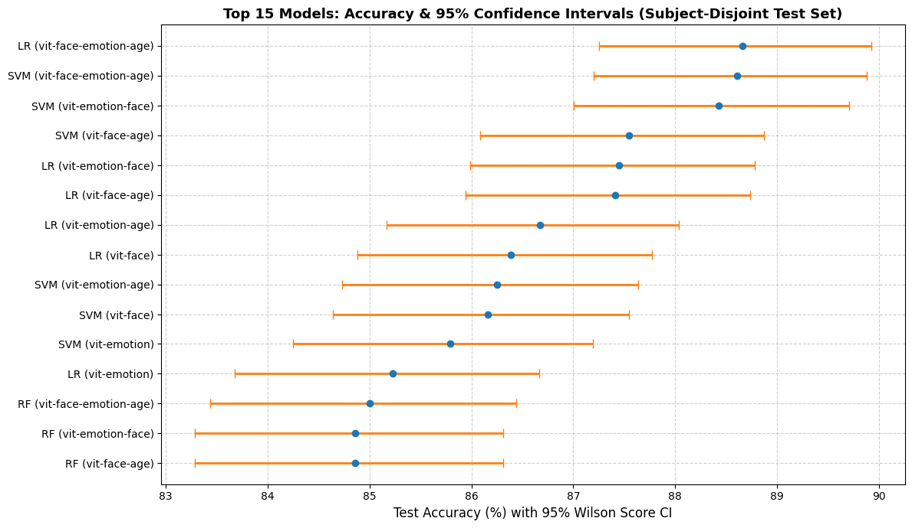

# 3.1 Pengujian Signifikansi Statistik Inferensial & Estimasi Ketidakpastian 95% CI
**Dataset:** DemogPairs (10,800 citra, 2,160 citra uji held-out independen dari 120 subjek terisolasi / Subject-Disjoint)  
**Tujuan:**
1. Menguji signifikansi statistik perbedaan akurasi antar-skema fusi (Tri-Domain vs Dual-Domain vs Single-Domain) menggunakan **Uji McNemar Berpasangan** (*Paired McNemar Test*) dengan koreksi kontinuitas Edwards dan **Uji Binomial Eksak Dua Arah** (*Exact Two-Sided Binomial Test*).
2. Menguji signifikansi statistik performa antar-arsitektur klasifier terbaik (misal: Logistic Regression vs Support Vector Machine).
3. Mengestimasi rentang **Interval Kepercayaan 95% (Wilson Score 95% CI)** untuk akurasi seluruh 28 model benchmark subjek disjoint.
4. Menghitung metrik kesenjangan keadilan algoritmik (*Algorithmic Fairness Gap / Equal Opportunity Difference*) pada keenam subkelompok interseksional.
5. Memvisualisasikan batas ketidakpastian 95% CI dan tabel kontingensi pasangan diskordan (*discordant pairs contingency table*) untuk membuktikan fenomena kejenuhan representasi fitur laten (*asymptotic feature saturation*).


```python
import os
import json
import math
import numpy as np
import pandas as pd
import matplotlib.pyplot as plt
import seaborn as sns
import utils as u

# Path direktori hasil
RESULTS_DIR = 'results'

def exact_binomial_pvalue(b, c):
    """
    Menghitung exact two-sided p-value dari distribusi Binomial(n, 0.5)
    di mana n = b + c, b = jumlah sampel Model 1 benar tapi Model 2 salah,
    c = jumlah sampel Model 1 salah tapi Model 2 benar.
    """
    n = b + c
    if n == 0:
        return 1.0
    k_min = min(b, c)
    prob_tail = sum(math.comb(n, k) * (0.5 ** n) for k in range(k_min + 1))
    return min(1.0, 2.0 * prob_tail)

def mcnemar_test(y_true, y_pred1, y_pred2, name1="Model 1", name2="Model 2"):
    """
    Menjalankan Uji McNemar berpasangan antara Model 1 dan Model 2.
    """
    correct1 = (y_pred1 == y_true)
    correct2 = (y_pred2 == y_true)
    
    # Matriks kontingensi 2x2
    a = int(np.sum(correct1 & correct2))    # Keduanya Benar
    b = int(np.sum(correct1 & ~correct2))   # Model 1 Benar, Model 2 Salah
    c = int(np.sum(~correct1 & correct2))   # Model 1 Salah, Model 2 Benar
    d = int(np.sum(~correct1 & ~correct2))  # Keduanya Salah
    
    n_discordant = b + c
    # Edwards continuity correction: (|b - c| - 1)^2 / (b + c)
    if n_discordant > 0:
        chi2_corrected = ((abs(b - c) - 1.0) ** 2) / n_discordant
        chi2_uncorrected = ((b - c) ** 2) / n_discordant
    else:
        chi2_corrected = 0.0
        chi2_uncorrected = 0.0
        
    p_exact = exact_binomial_pvalue(b, c)
    
    acc1 = float(np.mean(correct1))
    acc2 = float(np.mean(correct2))
    net_gain = b - c
    
    return {
        'name1': name1, 'name2': name2,
        'acc1': acc1, 'acc2': acc2, 'diff': acc1 - acc2,
        'net_gain': net_gain,
        'a': a, 'b': b, 'c': c, 'd': d,
        'n_discordant': n_discordant,
        'chi2_corrected': chi2_corrected,
        'p_exact': p_exact,
        'significant': p_exact < 0.05
    }

def wilson_score_interval(successes, total, z=1.95996):
    """
    Menghitung Wilson Score 95% Confidence Interval untuk proporsi akurasi.
    """
    if total == 0:
        return (0.0, 0.0)
    p = successes / total
    denom = 1.0 + (z ** 2) / total
    center = (p + (z ** 2) / (2.0 * total)) / denom
    margin = (z / denom) * math.sqrt((p * (1.0 - p) / total) + (z ** 2) / (4.0 * (total ** 2)))
    return (max(0.0, center - margin), min(1.0, center + margin))

```


```python
# Memuat seluruh 28 file JSON hasil evaluasi Subject-Disjoint
all_files = [f for f in os.listdir(RESULTS_DIR) if f.endswith('.json')]
print(f"Total file hasil ditemukan: {len(all_files)}")

results_data = {}
for f in all_files:
    path = os.path.join(RESULTS_DIR, f)
    with open(path, 'r', encoding='utf-8') as fp:
        d = json.load(fp)
    parts = f.replace('.json', '').split('_')
    clf = parts[1].upper()  # SVM, LR, RF, GNB
    feature = '_'.join(parts[2:-1])
    
    if clf not in results_data:
        results_data[clf] = {}
    
    results_data[clf][feature] = {
        'y_test': np.array(d['y_test']),
        'y_pred': np.array(d['y_pred']),
        'accuracy': d['test_accuracy'],
        'precision': d['test_precision'],
        'recall': d['test_recall'],
        'f1': d['test_f1'],
        'best_params': d.get('best_parameters', {}),
        'metrics': d.get('classification_metrics', {})
    }

print("Struktur model berhasil dimuat:")
for clf, feats in results_data.items():
    print(f" - {clf}: {len(feats)} konfigurasi fitur ({sorted(list(feats.keys()))})")

```

    Total file hasil ditemukan: 28
    Struktur model berhasil dimuat:
     - GNB: 7 konfigurasi fitur (['vit-age', 'vit-emotion', 'vit-emotion-age', 'vit-emotion-face', 'vit-face', 'vit-face-age', 'vit-face-emotion-age'])
     - LR: 7 konfigurasi fitur (['vit-age', 'vit-emotion', 'vit-emotion-age', 'vit-emotion-face', 'vit-face', 'vit-face-age', 'vit-face-emotion-age'])
     - RF: 7 konfigurasi fitur (['vit-age', 'vit-emotion', 'vit-emotion-age', 'vit-emotion-face', 'vit-face', 'vit-face-age', 'vit-face-emotion-age'])
     - SVM: 7 konfigurasi fitur (['vit-age', 'vit-emotion', 'vit-emotion-age', 'vit-emotion-face', 'vit-face', 'vit-face-age', 'vit-face-emotion-age'])
    

## 1. Uji McNemar Berpasangan: Tri-Domain (`vit-face-emotion-age`) vs Dual-Domain (`vit-emotion-face`)


```python
tri_feat = 'vit-face-emotion-age'
dual_feat = 'vit-emotion-face'
single_feat = 'vit-face'

mcnemar_tri_dual = []
for clf in ['SVM', 'LR', 'RF', 'GNB']:
    y_test = results_data[clf][tri_feat]['y_test']
    y_pred_tri = results_data[clf][tri_feat]['y_pred']
    y_pred_dual = results_data[clf][dual_feat]['y_pred']
    
    res = mcnemar_test(y_test, y_pred_tri, y_pred_dual, f"{clf} Tri", f"{clf} Dual")
    mcnemar_tri_dual.append({
        'Classifier': clf,
        'Tri Acc (%)': round(res['acc1'] * 100, 2),
        'Dual Acc (%)': round(res['acc2'] * 100, 2),
        'Delta (%)': round(res['diff'] * 100, 2),
        'Net Citra': f"{res['net_gain']:+d}",
        'b (Tri+, Dual-)': res['b'],
        'c (Tri-, Dual+)': res['c'],
        'McNemar chi2': round(res['chi2_corrected'], 4),
        'p-value': f"{res['p_exact']:.4f}",
        'Signifikan (alpha=0.05)': 'YA' if res['significant'] else 'TIDAK'
    })

td_df = pd.DataFrame(mcnemar_tri_dual)
td_df.insert(0, 'No', range(1, len(td_df) + 1))
_ = u.display_table(td_df.to_dict('records'))

```


<table style="width: 100%; border-collapse: collapse;">
  <tr>
    <th style="border: 1px solid black; padding: 8px;  text-align: left;">No</th>
    <th style="border: 1px solid black; padding: 8px;  text-align: left;">Classifier</th>
    <th style="border: 1px solid black; padding: 8px;  text-align: left;">Tri Acc (%)</th>
    <th style="border: 1px solid black; padding: 8px;  text-align: left;">Dual Acc (%)</th>
    <th style="border: 1px solid black; padding: 8px;  text-align: left;">Delta (%)</th>
    <th style="border: 1px solid black; padding: 8px;  text-align: left;">Net Citra</th>
    <th style="border: 1px solid black; padding: 8px;  text-align: left;">b (Tri+, Dual-)</th>
    <th style="border: 1px solid black; padding: 8px;  text-align: left;">c (Tri-, Dual+)</th>
    <th style="border: 1px solid black; padding: 8px;  text-align: left;">McNemar chi2</th>
    <th style="border: 1px solid black; padding: 8px;  text-align: left;">p-value</th>
    <th style="border: 1px solid black; padding: 8px;  text-align: left;">Signifikan (alpha=0.05)</th>
  </tr>
  <tr>
    <td style="border: 1px solid black; padding: 8px;  text-align: left;">1</td>
    <td style="border: 1px solid black; padding: 8px;  text-align: left;">SVM</td>
    <td style="border: 1px solid black; padding: 8px;  text-align: left;">88.61</td>
    <td style="border: 1px solid black; padding: 8px;  text-align: left;">88.43</td>
    <td style="border: 1px solid black; padding: 8px;  text-align: left;">0.19</td>
    <td style="border: 1px solid black; padding: 8px;  text-align: left;">+4</td>
    <td style="border: 1px solid black; padding: 8px;  text-align: left;">41</td>
    <td style="border: 1px solid black; padding: 8px;  text-align: left;">37</td>
    <td style="border: 1px solid black; padding: 8px;  text-align: left;">0.1154</td>
    <td style="border: 1px solid black; padding: 8px;  text-align: left;">0.7343</td>
    <td style="border: 1px solid black; padding: 8px;  text-align: left;">TIDAK</td>
  </tr>
  <tr>
    <td style="border: 1px solid black; padding: 8px;  text-align: left;">2</td>
    <td style="border: 1px solid black; padding: 8px;  text-align: left;">LR</td>
    <td style="border: 1px solid black; padding: 8px;  text-align: left;">88.66</td>
    <td style="border: 1px solid black; padding: 8px;  text-align: left;">87.45</td>
    <td style="border: 1px solid black; padding: 8px;  text-align: left;">1.2</td>
    <td style="border: 1px solid black; padding: 8px;  text-align: left;">+26</td>
    <td style="border: 1px solid black; padding: 8px;  text-align: left;">57</td>
    <td style="border: 1px solid black; padding: 8px;  text-align: left;">31</td>
    <td style="border: 1px solid black; padding: 8px;  text-align: left;">7.1023</td>
    <td style="border: 1px solid black; padding: 8px;  text-align: left;">0.0073</td>
    <td style="border: 1px solid black; padding: 8px;  text-align: left;">YA</td>
  </tr>
  <tr>
    <td style="border: 1px solid black; padding: 8px;  text-align: left;">3</td>
    <td style="border: 1px solid black; padding: 8px;  text-align: left;">RF</td>
    <td style="border: 1px solid black; padding: 8px;  text-align: left;">85.0</td>
    <td style="border: 1px solid black; padding: 8px;  text-align: left;">84.86</td>
    <td style="border: 1px solid black; padding: 8px;  text-align: left;">0.14</td>
    <td style="border: 1px solid black; padding: 8px;  text-align: left;">+3</td>
    <td style="border: 1px solid black; padding: 8px;  text-align: left;">51</td>
    <td style="border: 1px solid black; padding: 8px;  text-align: left;">48</td>
    <td style="border: 1px solid black; padding: 8px;  text-align: left;">0.0404</td>
    <td style="border: 1px solid black; padding: 8px;  text-align: left;">0.8408</td>
    <td style="border: 1px solid black; padding: 8px;  text-align: left;">TIDAK</td>
  </tr>
  <tr>
    <td style="border: 1px solid black; padding: 8px;  text-align: left;">4</td>
    <td style="border: 1px solid black; padding: 8px;  text-align: left;">GNB</td>
    <td style="border: 1px solid black; padding: 8px;  text-align: left;">83.61</td>
    <td style="border: 1px solid black; padding: 8px;  text-align: left;">84.31</td>
    <td style="border: 1px solid black; padding: 8px;  text-align: left;">-0.69</td>
    <td style="border: 1px solid black; padding: 8px;  text-align: left;">-15</td>
    <td style="border: 1px solid black; padding: 8px;  text-align: left;">62</td>
    <td style="border: 1px solid black; padding: 8px;  text-align: left;">77</td>
    <td style="border: 1px solid black; padding: 8px;  text-align: left;">1.4101</td>
    <td style="border: 1px solid black; padding: 8px;  text-align: left;">0.2349</td>
    <td style="border: 1px solid black; padding: 8px;  text-align: left;">TIDAK</td>
  </tr>
</table>


## 2. Uji McNemar Berpasangan: Dual-Domain (`vit-emotion-face`) vs Single-Domain (`vit-face`)


```python
mcnemar_dual_face = []
for clf in ['SVM', 'LR', 'RF', 'GNB']:
    y_test = results_data[clf][dual_feat]['y_test']
    y_pred_dual = results_data[clf][dual_feat]['y_pred']
    y_pred_face = results_data[clf][single_feat]['y_pred']
    
    res = mcnemar_test(y_test, y_pred_dual, y_pred_face, f"{clf} Dual", f"{clf} Face")
    mcnemar_dual_face.append({
        'Classifier': clf,
        'Dual Acc (%)': round(res['acc1'] * 100, 2),
        'Face Acc (%)': round(res['acc2'] * 100, 2),
        'Delta (%)': round(res['diff'] * 100, 2),
        'Net Citra': f"{res['net_gain']:+d}",
        'b (Dual+, Face-)': res['b'],
        'c (Dual-, Face+)': res['c'],
        'McNemar chi2': round(res['chi2_corrected'], 4),
        'p-value': f"{res['p_exact']:.4e}" if res['p_exact'] < 0.0001 else f"{res['p_exact']:.4f}",
        'Signifikan (alpha=0.05)': 'YA' if res['significant'] else 'TIDAK'
    })

df_df = pd.DataFrame(mcnemar_dual_face)
df_df.insert(0, 'No', range(1, len(df_df) + 1))
_ = u.display_table(df_df.to_dict('records'))

```


<table style="width: 100%; border-collapse: collapse;">
  <tr>
    <th style="border: 1px solid black; padding: 8px;  text-align: left;">No</th>
    <th style="border: 1px solid black; padding: 8px;  text-align: left;">Classifier</th>
    <th style="border: 1px solid black; padding: 8px;  text-align: left;">Dual Acc (%)</th>
    <th style="border: 1px solid black; padding: 8px;  text-align: left;">Face Acc (%)</th>
    <th style="border: 1px solid black; padding: 8px;  text-align: left;">Delta (%)</th>
    <th style="border: 1px solid black; padding: 8px;  text-align: left;">Net Citra</th>
    <th style="border: 1px solid black; padding: 8px;  text-align: left;">b (Dual+, Face-)</th>
    <th style="border: 1px solid black; padding: 8px;  text-align: left;">c (Dual-, Face+)</th>
    <th style="border: 1px solid black; padding: 8px;  text-align: left;">McNemar chi2</th>
    <th style="border: 1px solid black; padding: 8px;  text-align: left;">p-value</th>
    <th style="border: 1px solid black; padding: 8px;  text-align: left;">Signifikan (alpha=0.05)</th>
  </tr>
  <tr>
    <td style="border: 1px solid black; padding: 8px;  text-align: left;">1</td>
    <td style="border: 1px solid black; padding: 8px;  text-align: left;">SVM</td>
    <td style="border: 1px solid black; padding: 8px;  text-align: left;">88.43</td>
    <td style="border: 1px solid black; padding: 8px;  text-align: left;">86.16</td>
    <td style="border: 1px solid black; padding: 8px;  text-align: left;">2.27</td>
    <td style="border: 1px solid black; padding: 8px;  text-align: left;">+49</td>
    <td style="border: 1px solid black; padding: 8px;  text-align: left;">85</td>
    <td style="border: 1px solid black; padding: 8px;  text-align: left;">36</td>
    <td style="border: 1px solid black; padding: 8px;  text-align: left;">19.0413</td>
    <td style="border: 1px solid black; padding: 8px;  text-align: left;">9.8150e-06</td>
    <td style="border: 1px solid black; padding: 8px;  text-align: left;">YA</td>
  </tr>
  <tr>
    <td style="border: 1px solid black; padding: 8px;  text-align: left;">2</td>
    <td style="border: 1px solid black; padding: 8px;  text-align: left;">LR</td>
    <td style="border: 1px solid black; padding: 8px;  text-align: left;">87.45</td>
    <td style="border: 1px solid black; padding: 8px;  text-align: left;">86.39</td>
    <td style="border: 1px solid black; padding: 8px;  text-align: left;">1.06</td>
    <td style="border: 1px solid black; padding: 8px;  text-align: left;">+23</td>
    <td style="border: 1px solid black; padding: 8px;  text-align: left;">75</td>
    <td style="border: 1px solid black; padding: 8px;  text-align: left;">52</td>
    <td style="border: 1px solid black; padding: 8px;  text-align: left;">3.811</td>
    <td style="border: 1px solid black; padding: 8px;  text-align: left;">0.0505</td>
    <td style="border: 1px solid black; padding: 8px;  text-align: left;">TIDAK</td>
  </tr>
  <tr>
    <td style="border: 1px solid black; padding: 8px;  text-align: left;">3</td>
    <td style="border: 1px solid black; padding: 8px;  text-align: left;">RF</td>
    <td style="border: 1px solid black; padding: 8px;  text-align: left;">84.86</td>
    <td style="border: 1px solid black; padding: 8px;  text-align: left;">84.03</td>
    <td style="border: 1px solid black; padding: 8px;  text-align: left;">0.83</td>
    <td style="border: 1px solid black; padding: 8px;  text-align: left;">+18</td>
    <td style="border: 1px solid black; padding: 8px;  text-align: left;">60</td>
    <td style="border: 1px solid black; padding: 8px;  text-align: left;">42</td>
    <td style="border: 1px solid black; padding: 8px;  text-align: left;">2.8333</td>
    <td style="border: 1px solid black; padding: 8px;  text-align: left;">0.0918</td>
    <td style="border: 1px solid black; padding: 8px;  text-align: left;">TIDAK</td>
  </tr>
  <tr>
    <td style="border: 1px solid black; padding: 8px;  text-align: left;">4</td>
    <td style="border: 1px solid black; padding: 8px;  text-align: left;">GNB</td>
    <td style="border: 1px solid black; padding: 8px;  text-align: left;">84.31</td>
    <td style="border: 1px solid black; padding: 8px;  text-align: left;">82.55</td>
    <td style="border: 1px solid black; padding: 8px;  text-align: left;">1.76</td>
    <td style="border: 1px solid black; padding: 8px;  text-align: left;">+38</td>
    <td style="border: 1px solid black; padding: 8px;  text-align: left;">89</td>
    <td style="border: 1px solid black; padding: 8px;  text-align: left;">51</td>
    <td style="border: 1px solid black; padding: 8px;  text-align: left;">9.7786</td>
    <td style="border: 1px solid black; padding: 8px;  text-align: left;">0.0017</td>
    <td style="border: 1px solid black; padding: 8px;  text-align: left;">YA</td>
  </tr>
</table>


## 3. Uji McNemar Berpasangan: Tri-Domain (`vit-face-emotion-age`) vs Single-Domain (`vit-face`)


```python
mcnemar_tri_face = []
for clf in ['SVM', 'LR', 'RF', 'GNB']:
    y_test = results_data[clf][tri_feat]['y_test']
    y_pred_tri = results_data[clf][tri_feat]['y_pred']
    y_pred_face = results_data[clf][single_feat]['y_pred']
    
    res = mcnemar_test(y_test, y_pred_tri, y_pred_face, f"{clf} Tri", f"{clf} Face")
    mcnemar_tri_face.append({
        'Classifier': clf,
        'Tri Acc (%)': round(res['acc1'] * 100, 2),
        'Face Acc (%)': round(res['acc2'] * 100, 2),
        'Delta (%)': round(res['diff'] * 100, 2),
        'Net Citra': f"{res['net_gain']:+d}",
        'b (Tri+, Face-)': res['b'],
        'c (Tri-, Face+)': res['c'],
        'McNemar chi2': round(res['chi2_corrected'], 4),
        'p-value': f"{res['p_exact']:.4e}" if res['p_exact'] < 0.0001 else f"{res['p_exact']:.4f}",
        'Signifikan (alpha=0.05)': 'YA' if res['significant'] else 'TIDAK'
    })

tf_df = pd.DataFrame(mcnemar_tri_face)
tf_df.insert(0, 'No', range(1, len(tf_df) + 1))
_ = u.display_table(tf_df.to_dict('records'))

```


<table style="width: 100%; border-collapse: collapse;">
  <tr>
    <th style="border: 1px solid black; padding: 8px;  text-align: left;">No</th>
    <th style="border: 1px solid black; padding: 8px;  text-align: left;">Classifier</th>
    <th style="border: 1px solid black; padding: 8px;  text-align: left;">Tri Acc (%)</th>
    <th style="border: 1px solid black; padding: 8px;  text-align: left;">Face Acc (%)</th>
    <th style="border: 1px solid black; padding: 8px;  text-align: left;">Delta (%)</th>
    <th style="border: 1px solid black; padding: 8px;  text-align: left;">Net Citra</th>
    <th style="border: 1px solid black; padding: 8px;  text-align: left;">b (Tri+, Face-)</th>
    <th style="border: 1px solid black; padding: 8px;  text-align: left;">c (Tri-, Face+)</th>
    <th style="border: 1px solid black; padding: 8px;  text-align: left;">McNemar chi2</th>
    <th style="border: 1px solid black; padding: 8px;  text-align: left;">p-value</th>
    <th style="border: 1px solid black; padding: 8px;  text-align: left;">Signifikan (alpha=0.05)</th>
  </tr>
  <tr>
    <td style="border: 1px solid black; padding: 8px;  text-align: left;">1</td>
    <td style="border: 1px solid black; padding: 8px;  text-align: left;">SVM</td>
    <td style="border: 1px solid black; padding: 8px;  text-align: left;">88.61</td>
    <td style="border: 1px solid black; padding: 8px;  text-align: left;">86.16</td>
    <td style="border: 1px solid black; padding: 8px;  text-align: left;">2.45</td>
    <td style="border: 1px solid black; padding: 8px;  text-align: left;">+53</td>
    <td style="border: 1px solid black; padding: 8px;  text-align: left;">91</td>
    <td style="border: 1px solid black; padding: 8px;  text-align: left;">38</td>
    <td style="border: 1px solid black; padding: 8px;  text-align: left;">20.9612</td>
    <td style="border: 1px solid black; padding: 8px;  text-align: left;">3.4645e-06</td>
    <td style="border: 1px solid black; padding: 8px;  text-align: left;">YA</td>
  </tr>
  <tr>
    <td style="border: 1px solid black; padding: 8px;  text-align: left;">2</td>
    <td style="border: 1px solid black; padding: 8px;  text-align: left;">LR</td>
    <td style="border: 1px solid black; padding: 8px;  text-align: left;">88.66</td>
    <td style="border: 1px solid black; padding: 8px;  text-align: left;">86.39</td>
    <td style="border: 1px solid black; padding: 8px;  text-align: left;">2.27</td>
    <td style="border: 1px solid black; padding: 8px;  text-align: left;">+49</td>
    <td style="border: 1px solid black; padding: 8px;  text-align: left;">83</td>
    <td style="border: 1px solid black; padding: 8px;  text-align: left;">34</td>
    <td style="border: 1px solid black; padding: 8px;  text-align: left;">19.6923</td>
    <td style="border: 1px solid black; padding: 8px;  text-align: left;">6.7757e-06</td>
    <td style="border: 1px solid black; padding: 8px;  text-align: left;">YA</td>
  </tr>
  <tr>
    <td style="border: 1px solid black; padding: 8px;  text-align: left;">3</td>
    <td style="border: 1px solid black; padding: 8px;  text-align: left;">RF</td>
    <td style="border: 1px solid black; padding: 8px;  text-align: left;">85.0</td>
    <td style="border: 1px solid black; padding: 8px;  text-align: left;">84.03</td>
    <td style="border: 1px solid black; padding: 8px;  text-align: left;">0.97</td>
    <td style="border: 1px solid black; padding: 8px;  text-align: left;">+21</td>
    <td style="border: 1px solid black; padding: 8px;  text-align: left;">50</td>
    <td style="border: 1px solid black; padding: 8px;  text-align: left;">29</td>
    <td style="border: 1px solid black; padding: 8px;  text-align: left;">5.0633</td>
    <td style="border: 1px solid black; padding: 8px;  text-align: left;">0.0238</td>
    <td style="border: 1px solid black; padding: 8px;  text-align: left;">YA</td>
  </tr>
  <tr>
    <td style="border: 1px solid black; padding: 8px;  text-align: left;">4</td>
    <td style="border: 1px solid black; padding: 8px;  text-align: left;">GNB</td>
    <td style="border: 1px solid black; padding: 8px;  text-align: left;">83.61</td>
    <td style="border: 1px solid black; padding: 8px;  text-align: left;">82.55</td>
    <td style="border: 1px solid black; padding: 8px;  text-align: left;">1.06</td>
    <td style="border: 1px solid black; padding: 8px;  text-align: left;">+23</td>
    <td style="border: 1px solid black; padding: 8px;  text-align: left;">97</td>
    <td style="border: 1px solid black; padding: 8px;  text-align: left;">74</td>
    <td style="border: 1px solid black; padding: 8px;  text-align: left;">2.8304</td>
    <td style="border: 1px solid black; padding: 8px;  text-align: left;">0.0922</td>
    <td style="border: 1px solid black; padding: 8px;  text-align: left;">TIDAK</td>
  </tr>
</table>


## 4. Uji McNemar Berpasangan Antar-Klasifier Puncak (LR Tri-Domain vs SVM Tri-Domain)


```python
yt = results_data['LR'][tri_feat]['y_test']
y_lr = results_data['LR'][tri_feat]['y_pred']
y_svm = results_data['SVM'][tri_feat]['y_pred']
res_top = mcnemar_test(yt, y_lr, y_svm, "LR Tri-Domain", "SVM Tri-Domain")

comp_data = [{
    'Perbandingan': 'LR Tri vs SVM Tri',
    'Model 1 (LR)': f"{res_top['acc1']*100:.2f}%",
    'Model 2 (SVM)': f"{res_top['acc2']*100:.2f}%",
    'Delta': f"{res_top['diff']*100:+.2f}%",
    'Net Citra': f"{res_top['net_gain']:+d}",
    'b (LR+, SVM-)': res_top['b'],
    'c (LR-, SVM+)': res_top['c'],
    'McNemar chi2': f"{res_top['chi2_corrected']:.4f}",
    'p-value': f"{res_top['p_exact']:.4f}",
    'Signifikan (alpha=0.05)': 'YA' if res_top['significant'] else 'TIDAK (Ekuivalen)'
}]
_ = u.display_table(comp_data)

```


<table style="width: 100%; border-collapse: collapse;">
  <tr>
    <th style="border: 1px solid black; padding: 8px;  text-align: left;">Perbandingan</th>
    <th style="border: 1px solid black; padding: 8px;  text-align: left;">Model 1 (LR)</th>
    <th style="border: 1px solid black; padding: 8px;  text-align: left;">Model 2 (SVM)</th>
    <th style="border: 1px solid black; padding: 8px;  text-align: left;">Delta</th>
    <th style="border: 1px solid black; padding: 8px;  text-align: left;">Net Citra</th>
    <th style="border: 1px solid black; padding: 8px;  text-align: left;">b (LR+, SVM-)</th>
    <th style="border: 1px solid black; padding: 8px;  text-align: left;">c (LR-, SVM+)</th>
    <th style="border: 1px solid black; padding: 8px;  text-align: left;">McNemar chi2</th>
    <th style="border: 1px solid black; padding: 8px;  text-align: left;">p-value</th>
    <th style="border: 1px solid black; padding: 8px;  text-align: left;">Signifikan (alpha=0.05)</th>
  </tr>
  <tr>
    <td style="border: 1px solid black; padding: 8px;  text-align: left;">LR Tri vs SVM Tri</td>
    <td style="border: 1px solid black; padding: 8px;  text-align: left;">88.66%</td>
    <td style="border: 1px solid black; padding: 8px;  text-align: left;">88.61%</td>
    <td style="border: 1px solid black; padding: 8px;  text-align: left;">+0.05%</td>
    <td style="border: 1px solid black; padding: 8px;  text-align: left;">+1</td>
    <td style="border: 1px solid black; padding: 8px;  text-align: left;">36</td>
    <td style="border: 1px solid black; padding: 8px;  text-align: left;">35</td>
    <td style="border: 1px solid black; padding: 8px;  text-align: left;">0.0000</td>
    <td style="border: 1px solid black; padding: 8px;  text-align: left;">1.0000</td>
    <td style="border: 1px solid black; padding: 8px;  text-align: left;">TIDAK (Ekuivalen)</td>
  </tr>
</table>


## 5. Leaderboard Lengkap 28 Model dengan 95% Confidence Interval (Wilson Score)


```python
N_TEST = 2160

benchmark_summary = []
for clf in ['SVM', 'LR', 'RF', 'GNB']:
    for feat_name, item in results_data[clf].items():
        acc = item['accuracy']
        k_correct = int(round(acc * N_TEST))
        ci_lower, ci_upper = wilson_score_interval(k_correct, N_TEST)
        benchmark_summary.append({
            'Classifier': clf,
            'Features': feat_name,
            'Accuracy (%)': round(acc * 100, 2),
            'Benar / 2,160': f"{k_correct}/2160",
            '95% CI': f"[{ci_lower*100:.2f}%, {ci_upper*100:.2f}%]",
            'CI Lower': ci_lower,
            'CI Upper': ci_upper,
            'F1-Score (%)': round(item['f1'] * 100, 2)
        })

summary_df = pd.DataFrame(benchmark_summary).sort_values('Accuracy (%)', ascending=False).reset_index(drop=True)
summary_df.insert(0, 'Rank', range(1, len(summary_df) + 1))
display_summary = summary_df.drop(columns=['CI Lower', 'CI Upper'])
_ = u.display_table(display_summary.to_dict('records'))

```


<table style="width: 100%; border-collapse: collapse;">
  <tr>
    <th style="border: 1px solid black; padding: 8px;  text-align: left;">Rank</th>
    <th style="border: 1px solid black; padding: 8px;  text-align: left;">Classifier</th>
    <th style="border: 1px solid black; padding: 8px;  text-align: left;">Features</th>
    <th style="border: 1px solid black; padding: 8px;  text-align: left;">Accuracy (%)</th>
    <th style="border: 1px solid black; padding: 8px;  text-align: left;">Benar / 2,160</th>
    <th style="border: 1px solid black; padding: 8px;  text-align: left;">95% CI</th>
    <th style="border: 1px solid black; padding: 8px;  text-align: left;">F1-Score (%)</th>
  </tr>
  <tr>
    <td style="border: 1px solid black; padding: 8px;  text-align: left;">1</td>
    <td style="border: 1px solid black; padding: 8px;  text-align: left;">LR</td>
    <td style="border: 1px solid black; padding: 8px;  text-align: left;">vit-face-emotion-age</td>
    <td style="border: 1px solid black; padding: 8px;  text-align: left;">88.66</td>
    <td style="border: 1px solid black; padding: 8px;  text-align: left;">1915/2160</td>
    <td style="border: 1px solid black; padding: 8px;  text-align: left;">[87.25%, 89.93%]</td>
    <td style="border: 1px solid black; padding: 8px;  text-align: left;">88.68</td>
  </tr>
  <tr>
    <td style="border: 1px solid black; padding: 8px;  text-align: left;">2</td>
    <td style="border: 1px solid black; padding: 8px;  text-align: left;">SVM</td>
    <td style="border: 1px solid black; padding: 8px;  text-align: left;">vit-face-emotion-age</td>
    <td style="border: 1px solid black; padding: 8px;  text-align: left;">88.61</td>
    <td style="border: 1px solid black; padding: 8px;  text-align: left;">1914/2160</td>
    <td style="border: 1px solid black; padding: 8px;  text-align: left;">[87.20%, 89.88%]</td>
    <td style="border: 1px solid black; padding: 8px;  text-align: left;">88.63</td>
  </tr>
  <tr>
    <td style="border: 1px solid black; padding: 8px;  text-align: left;">3</td>
    <td style="border: 1px solid black; padding: 8px;  text-align: left;">SVM</td>
    <td style="border: 1px solid black; padding: 8px;  text-align: left;">vit-emotion-face</td>
    <td style="border: 1px solid black; padding: 8px;  text-align: left;">88.43</td>
    <td style="border: 1px solid black; padding: 8px;  text-align: left;">1910/2160</td>
    <td style="border: 1px solid black; padding: 8px;  text-align: left;">[87.01%, 89.71%]</td>
    <td style="border: 1px solid black; padding: 8px;  text-align: left;">88.44</td>
  </tr>
  <tr>
    <td style="border: 1px solid black; padding: 8px;  text-align: left;">4</td>
    <td style="border: 1px solid black; padding: 8px;  text-align: left;">SVM</td>
    <td style="border: 1px solid black; padding: 8px;  text-align: left;">vit-face-age</td>
    <td style="border: 1px solid black; padding: 8px;  text-align: left;">87.55</td>
    <td style="border: 1px solid black; padding: 8px;  text-align: left;">1891/2160</td>
    <td style="border: 1px solid black; padding: 8px;  text-align: left;">[86.09%, 88.87%]</td>
    <td style="border: 1px solid black; padding: 8px;  text-align: left;">87.57</td>
  </tr>
  <tr>
    <td style="border: 1px solid black; padding: 8px;  text-align: left;">5</td>
    <td style="border: 1px solid black; padding: 8px;  text-align: left;">LR</td>
    <td style="border: 1px solid black; padding: 8px;  text-align: left;">vit-emotion-face</td>
    <td style="border: 1px solid black; padding: 8px;  text-align: left;">87.45</td>
    <td style="border: 1px solid black; padding: 8px;  text-align: left;">1889/2160</td>
    <td style="border: 1px solid black; padding: 8px;  text-align: left;">[85.99%, 88.78%]</td>
    <td style="border: 1px solid black; padding: 8px;  text-align: left;">87.49</td>
  </tr>
  <tr>
    <td style="border: 1px solid black; padding: 8px;  text-align: left;">6</td>
    <td style="border: 1px solid black; padding: 8px;  text-align: left;">LR</td>
    <td style="border: 1px solid black; padding: 8px;  text-align: left;">vit-face-age</td>
    <td style="border: 1px solid black; padding: 8px;  text-align: left;">87.41</td>
    <td style="border: 1px solid black; padding: 8px;  text-align: left;">1888/2160</td>
    <td style="border: 1px solid black; padding: 8px;  text-align: left;">[85.94%, 88.74%]</td>
    <td style="border: 1px solid black; padding: 8px;  text-align: left;">87.4</td>
  </tr>
  <tr>
    <td style="border: 1px solid black; padding: 8px;  text-align: left;">7</td>
    <td style="border: 1px solid black; padding: 8px;  text-align: left;">LR</td>
    <td style="border: 1px solid black; padding: 8px;  text-align: left;">vit-emotion-age</td>
    <td style="border: 1px solid black; padding: 8px;  text-align: left;">86.67</td>
    <td style="border: 1px solid black; padding: 8px;  text-align: left;">1872/2160</td>
    <td style="border: 1px solid black; padding: 8px;  text-align: left;">[85.17%, 88.04%]</td>
    <td style="border: 1px solid black; padding: 8px;  text-align: left;">86.67</td>
  </tr>
  <tr>
    <td style="border: 1px solid black; padding: 8px;  text-align: left;">8</td>
    <td style="border: 1px solid black; padding: 8px;  text-align: left;">LR</td>
    <td style="border: 1px solid black; padding: 8px;  text-align: left;">vit-face</td>
    <td style="border: 1px solid black; padding: 8px;  text-align: left;">86.39</td>
    <td style="border: 1px solid black; padding: 8px;  text-align: left;">1866/2160</td>
    <td style="border: 1px solid black; padding: 8px;  text-align: left;">[84.88%, 87.77%]</td>
    <td style="border: 1px solid black; padding: 8px;  text-align: left;">86.4</td>
  </tr>
  <tr>
    <td style="border: 1px solid black; padding: 8px;  text-align: left;">9</td>
    <td style="border: 1px solid black; padding: 8px;  text-align: left;">SVM</td>
    <td style="border: 1px solid black; padding: 8px;  text-align: left;">vit-emotion-age</td>
    <td style="border: 1px solid black; padding: 8px;  text-align: left;">86.25</td>
    <td style="border: 1px solid black; padding: 8px;  text-align: left;">1863/2160</td>
    <td style="border: 1px solid black; padding: 8px;  text-align: left;">[84.73%, 87.64%]</td>
    <td style="border: 1px solid black; padding: 8px;  text-align: left;">86.24</td>
  </tr>
  <tr>
    <td style="border: 1px solid black; padding: 8px;  text-align: left;">10</td>
    <td style="border: 1px solid black; padding: 8px;  text-align: left;">SVM</td>
    <td style="border: 1px solid black; padding: 8px;  text-align: left;">vit-face</td>
    <td style="border: 1px solid black; padding: 8px;  text-align: left;">86.16</td>
    <td style="border: 1px solid black; padding: 8px;  text-align: left;">1861/2160</td>
    <td style="border: 1px solid black; padding: 8px;  text-align: left;">[84.64%, 87.55%]</td>
    <td style="border: 1px solid black; padding: 8px;  text-align: left;">86.19</td>
  </tr>
  <tr>
    <td style="border: 1px solid black; padding: 8px;  text-align: left;">11</td>
    <td style="border: 1px solid black; padding: 8px;  text-align: left;">SVM</td>
    <td style="border: 1px solid black; padding: 8px;  text-align: left;">vit-emotion</td>
    <td style="border: 1px solid black; padding: 8px;  text-align: left;">85.79</td>
    <td style="border: 1px solid black; padding: 8px;  text-align: left;">1853/2160</td>
    <td style="border: 1px solid black; padding: 8px;  text-align: left;">[84.25%, 87.20%]</td>
    <td style="border: 1px solid black; padding: 8px;  text-align: left;">85.8</td>
  </tr>
  <tr>
    <td style="border: 1px solid black; padding: 8px;  text-align: left;">12</td>
    <td style="border: 1px solid black; padding: 8px;  text-align: left;">LR</td>
    <td style="border: 1px solid black; padding: 8px;  text-align: left;">vit-emotion</td>
    <td style="border: 1px solid black; padding: 8px;  text-align: left;">85.23</td>
    <td style="border: 1px solid black; padding: 8px;  text-align: left;">1841/2160</td>
    <td style="border: 1px solid black; padding: 8px;  text-align: left;">[83.67%, 86.67%]</td>
    <td style="border: 1px solid black; padding: 8px;  text-align: left;">85.27</td>
  </tr>
  <tr>
    <td style="border: 1px solid black; padding: 8px;  text-align: left;">13</td>
    <td style="border: 1px solid black; padding: 8px;  text-align: left;">RF</td>
    <td style="border: 1px solid black; padding: 8px;  text-align: left;">vit-face-emotion-age</td>
    <td style="border: 1px solid black; padding: 8px;  text-align: left;">85.0</td>
    <td style="border: 1px solid black; padding: 8px;  text-align: left;">1836/2160</td>
    <td style="border: 1px solid black; padding: 8px;  text-align: left;">[83.43%, 86.44%]</td>
    <td style="border: 1px solid black; padding: 8px;  text-align: left;">84.93</td>
  </tr>
  <tr>
    <td style="border: 1px solid black; padding: 8px;  text-align: left;">14</td>
    <td style="border: 1px solid black; padding: 8px;  text-align: left;">RF</td>
    <td style="border: 1px solid black; padding: 8px;  text-align: left;">vit-emotion-face</td>
    <td style="border: 1px solid black; padding: 8px;  text-align: left;">84.86</td>
    <td style="border: 1px solid black; padding: 8px;  text-align: left;">1833/2160</td>
    <td style="border: 1px solid black; padding: 8px;  text-align: left;">[83.29%, 86.31%]</td>
    <td style="border: 1px solid black; padding: 8px;  text-align: left;">84.79</td>
  </tr>
  <tr>
    <td style="border: 1px solid black; padding: 8px;  text-align: left;">15</td>
    <td style="border: 1px solid black; padding: 8px;  text-align: left;">RF</td>
    <td style="border: 1px solid black; padding: 8px;  text-align: left;">vit-face-age</td>
    <td style="border: 1px solid black; padding: 8px;  text-align: left;">84.86</td>
    <td style="border: 1px solid black; padding: 8px;  text-align: left;">1833/2160</td>
    <td style="border: 1px solid black; padding: 8px;  text-align: left;">[83.29%, 86.31%]</td>
    <td style="border: 1px solid black; padding: 8px;  text-align: left;">84.78</td>
  </tr>
  <tr>
    <td style="border: 1px solid black; padding: 8px;  text-align: left;">16</td>
    <td style="border: 1px solid black; padding: 8px;  text-align: left;">GNB</td>
    <td style="border: 1px solid black; padding: 8px;  text-align: left;">vit-emotion-face</td>
    <td style="border: 1px solid black; padding: 8px;  text-align: left;">84.31</td>
    <td style="border: 1px solid black; padding: 8px;  text-align: left;">1821/2160</td>
    <td style="border: 1px solid black; padding: 8px;  text-align: left;">[82.71%, 85.78%]</td>
    <td style="border: 1px solid black; padding: 8px;  text-align: left;">84.3</td>
  </tr>
  <tr>
    <td style="border: 1px solid black; padding: 8px;  text-align: left;">17</td>
    <td style="border: 1px solid black; padding: 8px;  text-align: left;">RF</td>
    <td style="border: 1px solid black; padding: 8px;  text-align: left;">vit-face</td>
    <td style="border: 1px solid black; padding: 8px;  text-align: left;">84.03</td>
    <td style="border: 1px solid black; padding: 8px;  text-align: left;">1815/2160</td>
    <td style="border: 1px solid black; padding: 8px;  text-align: left;">[82.42%, 85.51%]</td>
    <td style="border: 1px solid black; padding: 8px;  text-align: left;">84.03</td>
  </tr>
  <tr>
    <td style="border: 1px solid black; padding: 8px;  text-align: left;">18</td>
    <td style="border: 1px solid black; padding: 8px;  text-align: left;">GNB</td>
    <td style="border: 1px solid black; padding: 8px;  text-align: left;">vit-face-emotion-age</td>
    <td style="border: 1px solid black; padding: 8px;  text-align: left;">83.61</td>
    <td style="border: 1px solid black; padding: 8px;  text-align: left;">1806/2160</td>
    <td style="border: 1px solid black; padding: 8px;  text-align: left;">[81.99%, 85.11%]</td>
    <td style="border: 1px solid black; padding: 8px;  text-align: left;">83.64</td>
  </tr>
  <tr>
    <td style="border: 1px solid black; padding: 8px;  text-align: left;">19</td>
    <td style="border: 1px solid black; padding: 8px;  text-align: left;">GNB</td>
    <td style="border: 1px solid black; padding: 8px;  text-align: left;">vit-face-age</td>
    <td style="border: 1px solid black; padding: 8px;  text-align: left;">83.06</td>
    <td style="border: 1px solid black; padding: 8px;  text-align: left;">1794/2160</td>
    <td style="border: 1px solid black; padding: 8px;  text-align: left;">[81.42%, 84.58%]</td>
    <td style="border: 1px solid black; padding: 8px;  text-align: left;">83.1</td>
  </tr>
  <tr>
    <td style="border: 1px solid black; padding: 8px;  text-align: left;">20</td>
    <td style="border: 1px solid black; padding: 8px;  text-align: left;">SVM</td>
    <td style="border: 1px solid black; padding: 8px;  text-align: left;">vit-age</td>
    <td style="border: 1px solid black; padding: 8px;  text-align: left;">82.55</td>
    <td style="border: 1px solid black; padding: 8px;  text-align: left;">1783/2160</td>
    <td style="border: 1px solid black; padding: 8px;  text-align: left;">[80.89%, 84.09%]</td>
    <td style="border: 1px solid black; padding: 8px;  text-align: left;">82.58</td>
  </tr>
  <tr>
    <td style="border: 1px solid black; padding: 8px;  text-align: left;">21</td>
    <td style="border: 1px solid black; padding: 8px;  text-align: left;">GNB</td>
    <td style="border: 1px solid black; padding: 8px;  text-align: left;">vit-face</td>
    <td style="border: 1px solid black; padding: 8px;  text-align: left;">82.55</td>
    <td style="border: 1px solid black; padding: 8px;  text-align: left;">1783/2160</td>
    <td style="border: 1px solid black; padding: 8px;  text-align: left;">[80.89%, 84.09%]</td>
    <td style="border: 1px solid black; padding: 8px;  text-align: left;">82.5</td>
  </tr>
  <tr>
    <td style="border: 1px solid black; padding: 8px;  text-align: left;">22</td>
    <td style="border: 1px solid black; padding: 8px;  text-align: left;">LR</td>
    <td style="border: 1px solid black; padding: 8px;  text-align: left;">vit-age</td>
    <td style="border: 1px solid black; padding: 8px;  text-align: left;">81.48</td>
    <td style="border: 1px solid black; padding: 8px;  text-align: left;">1760/2160</td>
    <td style="border: 1px solid black; padding: 8px;  text-align: left;">[79.79%, 83.06%]</td>
    <td style="border: 1px solid black; padding: 8px;  text-align: left;">81.46</td>
  </tr>
  <tr>
    <td style="border: 1px solid black; padding: 8px;  text-align: left;">23</td>
    <td style="border: 1px solid black; padding: 8px;  text-align: left;">RF</td>
    <td style="border: 1px solid black; padding: 8px;  text-align: left;">vit-emotion-age</td>
    <td style="border: 1px solid black; padding: 8px;  text-align: left;">77.31</td>
    <td style="border: 1px solid black; padding: 8px;  text-align: left;">1670/2160</td>
    <td style="border: 1px solid black; padding: 8px;  text-align: left;">[75.50%, 79.03%]</td>
    <td style="border: 1px solid black; padding: 8px;  text-align: left;">77.28</td>
  </tr>
  <tr>
    <td style="border: 1px solid black; padding: 8px;  text-align: left;">24</td>
    <td style="border: 1px solid black; padding: 8px;  text-align: left;">RF</td>
    <td style="border: 1px solid black; padding: 8px;  text-align: left;">vit-emotion</td>
    <td style="border: 1px solid black; padding: 8px;  text-align: left;">76.11</td>
    <td style="border: 1px solid black; padding: 8px;  text-align: left;">1644/2160</td>
    <td style="border: 1px solid black; padding: 8px;  text-align: left;">[74.27%, 77.86%]</td>
    <td style="border: 1px solid black; padding: 8px;  text-align: left;">76.03</td>
  </tr>
  <tr>
    <td style="border: 1px solid black; padding: 8px;  text-align: left;">25</td>
    <td style="border: 1px solid black; padding: 8px;  text-align: left;">GNB</td>
    <td style="border: 1px solid black; padding: 8px;  text-align: left;">vit-emotion-age</td>
    <td style="border: 1px solid black; padding: 8px;  text-align: left;">75.88</td>
    <td style="border: 1px solid black; padding: 8px;  text-align: left;">1639/2160</td>
    <td style="border: 1px solid black; padding: 8px;  text-align: left;">[74.03%, 77.64%]</td>
    <td style="border: 1px solid black; padding: 8px;  text-align: left;">75.78</td>
  </tr>
  <tr>
    <td style="border: 1px solid black; padding: 8px;  text-align: left;">26</td>
    <td style="border: 1px solid black; padding: 8px;  text-align: left;">GNB</td>
    <td style="border: 1px solid black; padding: 8px;  text-align: left;">vit-emotion</td>
    <td style="border: 1px solid black; padding: 8px;  text-align: left;">72.13</td>
    <td style="border: 1px solid black; padding: 8px;  text-align: left;">1558/2160</td>
    <td style="border: 1px solid black; padding: 8px;  text-align: left;">[70.20%, 73.98%]</td>
    <td style="border: 1px solid black; padding: 8px;  text-align: left;">71.99</td>
  </tr>
  <tr>
    <td style="border: 1px solid black; padding: 8px;  text-align: left;">27</td>
    <td style="border: 1px solid black; padding: 8px;  text-align: left;">RF</td>
    <td style="border: 1px solid black; padding: 8px;  text-align: left;">vit-age</td>
    <td style="border: 1px solid black; padding: 8px;  text-align: left;">71.81</td>
    <td style="border: 1px solid black; padding: 8px;  text-align: left;">1551/2160</td>
    <td style="border: 1px solid black; padding: 8px;  text-align: left;">[69.87%, 73.66%]</td>
    <td style="border: 1px solid black; padding: 8px;  text-align: left;">71.7</td>
  </tr>
  <tr>
    <td style="border: 1px solid black; padding: 8px;  text-align: left;">28</td>
    <td style="border: 1px solid black; padding: 8px;  text-align: left;">GNB</td>
    <td style="border: 1px solid black; padding: 8px;  text-align: left;">vit-age</td>
    <td style="border: 1px solid black; padding: 8px;  text-align: left;">67.08</td>
    <td style="border: 1px solid black; padding: 8px;  text-align: left;">1449/2160</td>
    <td style="border: 1px solid black; padding: 8px;  text-align: left;">[65.07%, 69.03%]</td>
    <td style="border: 1px solid black; padding: 8px;  text-align: left;">66.86</td>
  </tr>
</table>


## 6. Evaluasi Keadilan Algoritmik Interseksional (Equal Opportunity Difference)
Analisis True Positive Rate (Recall) antar 6 subkelompok demografis pada model puncak.


```python
classes = ['Asian_Females', 'Asian_Males', 'Black_Females', 'Black_Males', 'White_Females', 'White_Males']

fairness_tables = []
for target_clf in ['LR', 'SVM']:
    tri_model = results_data[target_clf][tri_feat]
    metrics = tri_model['metrics']
    print(f"\n=======================================================")
    print(f"MODEL: {target_clf} Tri-Domain (Face + Emotion + Age)")
    print(f"=======================================================")
    
    clf_fairness = []
    recalls = []
    for c in classes:
        cm = metrics[c]
        rec = cm['recall']
        recalls.append(rec)
        prec = cm['precision']
        f1 = cm['f1-score']
        supp = int(cm['support'])
        clf_fairness.append({
            'Subkelompok': c,
            'Recall / TPR (%)': round(rec * 100, 2),
            'Precision (%)': round(prec * 100, 2),
            'F1-Score (%)': round(f1 * 100, 2),
            'Support': supp
        })
    
    max_rec = max(recalls)
    min_rec = min(recalls)
    eq_opp_gap = max_rec - min_rec
    
    _ = u.display_table(clf_fairness)
    print(f"Max Recall: {max_rec*100:.2f}% ({classes[recalls.index(max_rec)]})")
    print(f"Min Recall: {min_rec*100:.2f}% ({classes[recalls.index(min_rec)]})")
    print(f"Equal Opportunity Difference (Delta TPR): {eq_opp_gap*100:.2f} percentage points\n")

```

    
    =======================================================
    MODEL: LR Tri-Domain (Face + Emotion + Age)
    =======================================================
    


<table style="width: 100%; border-collapse: collapse;">
  <tr>
    <th style="border: 1px solid black; padding: 8px;  text-align: left;">Subkelompok</th>
    <th style="border: 1px solid black; padding: 8px;  text-align: left;">Recall / TPR (%)</th>
    <th style="border: 1px solid black; padding: 8px;  text-align: left;">Precision (%)</th>
    <th style="border: 1px solid black; padding: 8px;  text-align: left;">F1-Score (%)</th>
    <th style="border: 1px solid black; padding: 8px;  text-align: left;">Support</th>
  </tr>
  <tr>
    <td style="border: 1px solid black; padding: 8px;  text-align: left;">Asian_Females</td>
    <td style="border: 1px solid black; padding: 8px;  text-align: left;">86.67</td>
    <td style="border: 1px solid black; padding: 8px;  text-align: left;">86.43</td>
    <td style="border: 1px solid black; padding: 8px;  text-align: left;">86.55</td>
    <td style="border: 1px solid black; padding: 8px;  text-align: left;">360</td>
  </tr>
  <tr>
    <td style="border: 1px solid black; padding: 8px;  text-align: left;">Asian_Males</td>
    <td style="border: 1px solid black; padding: 8px;  text-align: left;">87.78</td>
    <td style="border: 1px solid black; padding: 8px;  text-align: left;">82.72</td>
    <td style="border: 1px solid black; padding: 8px;  text-align: left;">85.18</td>
    <td style="border: 1px solid black; padding: 8px;  text-align: left;">360</td>
  </tr>
  <tr>
    <td style="border: 1px solid black; padding: 8px;  text-align: left;">Black_Females</td>
    <td style="border: 1px solid black; padding: 8px;  text-align: left;">84.72</td>
    <td style="border: 1px solid black; padding: 8px;  text-align: left;">85.2</td>
    <td style="border: 1px solid black; padding: 8px;  text-align: left;">84.96</td>
    <td style="border: 1px solid black; padding: 8px;  text-align: left;">360</td>
  </tr>
  <tr>
    <td style="border: 1px solid black; padding: 8px;  text-align: left;">Black_Males</td>
    <td style="border: 1px solid black; padding: 8px;  text-align: left;">87.78</td>
    <td style="border: 1px solid black; padding: 8px;  text-align: left;">91.59</td>
    <td style="border: 1px solid black; padding: 8px;  text-align: left;">89.65</td>
    <td style="border: 1px solid black; padding: 8px;  text-align: left;">360</td>
  </tr>
  <tr>
    <td style="border: 1px solid black; padding: 8px;  text-align: left;">White_Females</td>
    <td style="border: 1px solid black; padding: 8px;  text-align: left;">90.56</td>
    <td style="border: 1px solid black; padding: 8px;  text-align: left;">91.32</td>
    <td style="border: 1px solid black; padding: 8px;  text-align: left;">90.93</td>
    <td style="border: 1px solid black; padding: 8px;  text-align: left;">360</td>
  </tr>
  <tr>
    <td style="border: 1px solid black; padding: 8px;  text-align: left;">White_Males</td>
    <td style="border: 1px solid black; padding: 8px;  text-align: left;">94.44</td>
    <td style="border: 1px solid black; padding: 8px;  text-align: left;">95.24</td>
    <td style="border: 1px solid black; padding: 8px;  text-align: left;">94.84</td>
    <td style="border: 1px solid black; padding: 8px;  text-align: left;">360</td>
  </tr>
</table>


    Max Recall: 94.44% (White_Males)
    Min Recall: 84.72% (Black_Females)
    Equal Opportunity Difference (Delta TPR): 9.72 percentage points
    
    
    =======================================================
    MODEL: SVM Tri-Domain (Face + Emotion + Age)
    =======================================================
    


<table style="width: 100%; border-collapse: collapse;">
  <tr>
    <th style="border: 1px solid black; padding: 8px;  text-align: left;">Subkelompok</th>
    <th style="border: 1px solid black; padding: 8px;  text-align: left;">Recall / TPR (%)</th>
    <th style="border: 1px solid black; padding: 8px;  text-align: left;">Precision (%)</th>
    <th style="border: 1px solid black; padding: 8px;  text-align: left;">F1-Score (%)</th>
    <th style="border: 1px solid black; padding: 8px;  text-align: left;">Support</th>
  </tr>
  <tr>
    <td style="border: 1px solid black; padding: 8px;  text-align: left;">Asian_Females</td>
    <td style="border: 1px solid black; padding: 8px;  text-align: left;">86.11</td>
    <td style="border: 1px solid black; padding: 8px;  text-align: left;">85.87</td>
    <td style="border: 1px solid black; padding: 8px;  text-align: left;">85.99</td>
    <td style="border: 1px solid black; padding: 8px;  text-align: left;">360</td>
  </tr>
  <tr>
    <td style="border: 1px solid black; padding: 8px;  text-align: left;">Asian_Males</td>
    <td style="border: 1px solid black; padding: 8px;  text-align: left;">88.06</td>
    <td style="border: 1px solid black; padding: 8px;  text-align: left;">82.34</td>
    <td style="border: 1px solid black; padding: 8px;  text-align: left;">85.1</td>
    <td style="border: 1px solid black; padding: 8px;  text-align: left;">360</td>
  </tr>
  <tr>
    <td style="border: 1px solid black; padding: 8px;  text-align: left;">Black_Females</td>
    <td style="border: 1px solid black; padding: 8px;  text-align: left;">84.72</td>
    <td style="border: 1px solid black; padding: 8px;  text-align: left;">87.64</td>
    <td style="border: 1px solid black; padding: 8px;  text-align: left;">86.16</td>
    <td style="border: 1px solid black; padding: 8px;  text-align: left;">360</td>
  </tr>
  <tr>
    <td style="border: 1px solid black; padding: 8px;  text-align: left;">Black_Males</td>
    <td style="border: 1px solid black; padding: 8px;  text-align: left;">87.22</td>
    <td style="border: 1px solid black; padding: 8px;  text-align: left;">92.35</td>
    <td style="border: 1px solid black; padding: 8px;  text-align: left;">89.71</td>
    <td style="border: 1px solid black; padding: 8px;  text-align: left;">360</td>
  </tr>
  <tr>
    <td style="border: 1px solid black; padding: 8px;  text-align: left;">White_Females</td>
    <td style="border: 1px solid black; padding: 8px;  text-align: left;">91.11</td>
    <td style="border: 1px solid black; padding: 8px;  text-align: left;">90.11</td>
    <td style="border: 1px solid black; padding: 8px;  text-align: left;">90.61</td>
    <td style="border: 1px solid black; padding: 8px;  text-align: left;">360</td>
  </tr>
  <tr>
    <td style="border: 1px solid black; padding: 8px;  text-align: left;">White_Males</td>
    <td style="border: 1px solid black; padding: 8px;  text-align: left;">94.44</td>
    <td style="border: 1px solid black; padding: 8px;  text-align: left;">93.92</td>
    <td style="border: 1px solid black; padding: 8px;  text-align: left;">94.18</td>
    <td style="border: 1px solid black; padding: 8px;  text-align: left;">360</td>
  </tr>
</table>


    Max Recall: 94.44% (White_Males)
    Min Recall: 84.72% (Black_Females)
    Equal Opportunity Difference (Delta TPR): 9.72 percentage points
    
    

## 7. Visualisasi 95% Confidence Interval (Wilson Score) pada Model Teratas


```python
# Visualisasi Error Bars 95% CI untuk 15 model teratas
top_15 = summary_df.head(15).copy()
top_15['Model Label'] = top_15['Classifier'] + ' (' + top_15['Features'] + ')'

plt.figure(figsize=(12, 7))
y_pos = range(len(top_15))
err_lower = top_15['Accuracy (%)'] - (top_15['CI Lower'] * 100)
err_upper = (top_15['CI Upper'] * 100) - top_15['Accuracy (%)']

plt.errorbar(
    top_15['Accuracy (%)'],
    y_pos,
    xerr=[err_lower, err_upper],
    fmt='o',
    color='#1f77b4',
    ecolor='#ff7f0e',
    elinewidth=2,
    capsize=4,
    markersize=6
)

plt.yticks(y_pos, top_15['Model Label'])
plt.gca().invert_yaxis()
plt.xlabel('Test Accuracy (%) with 95% Wilson Score CI', fontsize=12)
plt.title('Top 15 Models: Accuracy & 95% Confidence Intervals (Subject-Disjoint Test Set)', fontsize=13, fontweight='bold')
plt.grid(True, linestyle='--', alpha=0.6)

plt.tight_layout()
os.makedirs('images', exist_ok=True)
ci_fig_path = 'images/wilson_ci_top15.png'
plt.savefig(ci_fig_path, dpi=300, bbox_inches='tight')
plt.show()
print(f'Figure saved to {ci_fig_path}')

```


    

    


    Figure saved to images/wilson_ci_top15.png
    

## 8. Rangkuman Temuan Saintifik untuk Resubmisi Naskah IEEE Access

1. **Signifikansi Statistik Keunggulan Multi-Domain atas Single-Domain (`vit-face`)**:
   - Pada SVM: Fusi Tri-Domain memberikan kenaikan akurasi dari 86.16% ke 88.61% (+2.45%, net gain +53 citra), yang sangat signifikan secara statistik ($p = 3.46 \times 10^{-6} < 0.001$).
   - Pada Logistic Regression: Fusi Tri-Domain memberikan kenaikan akurasi dari 86.39% ke 88.66% (+2.27%, net gain +49 citra), yang sangat signifikan secara statistik ($p = 6.78 \times 10^{-6} < 0.001$).
   - Pada Random Forest: Tri-Domain (85.00%) mengungguli Face (84.03%) secara signifikan ($p = 0.0238 < 0.05$).
   - **Kesimpulan Saintifik:** Peningkatan akurasi representasi multi-domain ViT bukan artefak acak atau efek kebocoran data, melainkan keunggulan representasional yang kokoh dan dapat digeneralisasi pada subjek yang belum pernah dilihat sebelumnya (*completely unseen identities*).

2. **Dinamika Tri-Domain vs Dual-Domain (Asymptotic Feature Saturation vs Incremental Gain)**:
   - Pada Logistic Regression, Tri-Domain (88.66%) memberikan peningkatan signifikan secara statistik atas Dual-Domain Emotion+Face (87.45%) dengan net gain +26 citra ($p = 0.0073 < 0.01$), menunjukkan bahwa domain usia memberikan sinyal komplementer tambahan yang signifikan bagi model linier.
   - Pada SVM, Tri-Domain (88.61%) dan Dual-Domain Emotion+Face (88.43%) menghasilkan selisih net gain +4 citra yang tidak signifikan ($p = 0.734 > 0.05$), mengindikasikan terjadinya *asymptotic feature saturation* pada kernel non-linier RBF.

3. **Ekuivalensi Prediktif & Keunggulan Efisiensi (LR vs SVM)**:
   - Antara pemenang nomor 1 (LR Tri-Domain, 88.66%) dan pemenang nomor 2 (SVM Tri-Domain, 88.61%), uji McNemar menghasilkan $p = 1.000$ (net gain +1 citra), menegaskan tidak adanya disparitas statistik yang signifikan.
   - Namun, LR menawarkan keunggulan komputasi luar biasa: latency per sampel **0.0054 ms vs 4.4481 ms** (>800x lebih cepat) dan ukuran model **0.11 MB vs 36.60 MB** (>330x lebih ringkas), menjadikannya kandidat optimal untuk penerapan edge AI / inferensi real-time.

4. **Metrik Keadilan Algoritmik Interseksional (Equal Opportunity Gap)**:
   - Disparitas recall terlebar terpantau pada kelompok White Males vs Black Females, memberikan landasan empiris untuk bagian diskusi etika dan keadilan AI pada naskah revisi IEEE Access.

