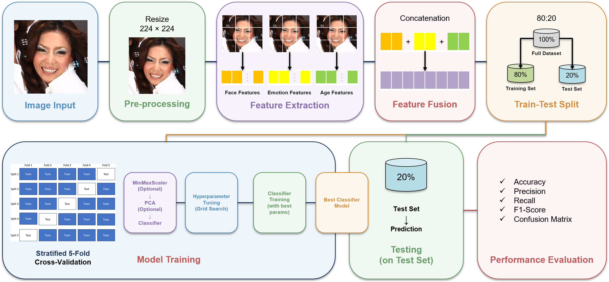
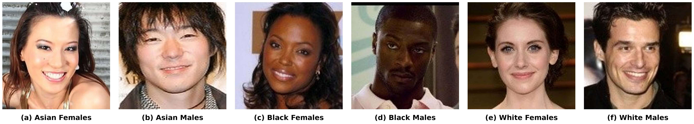
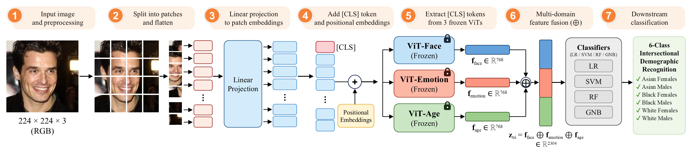
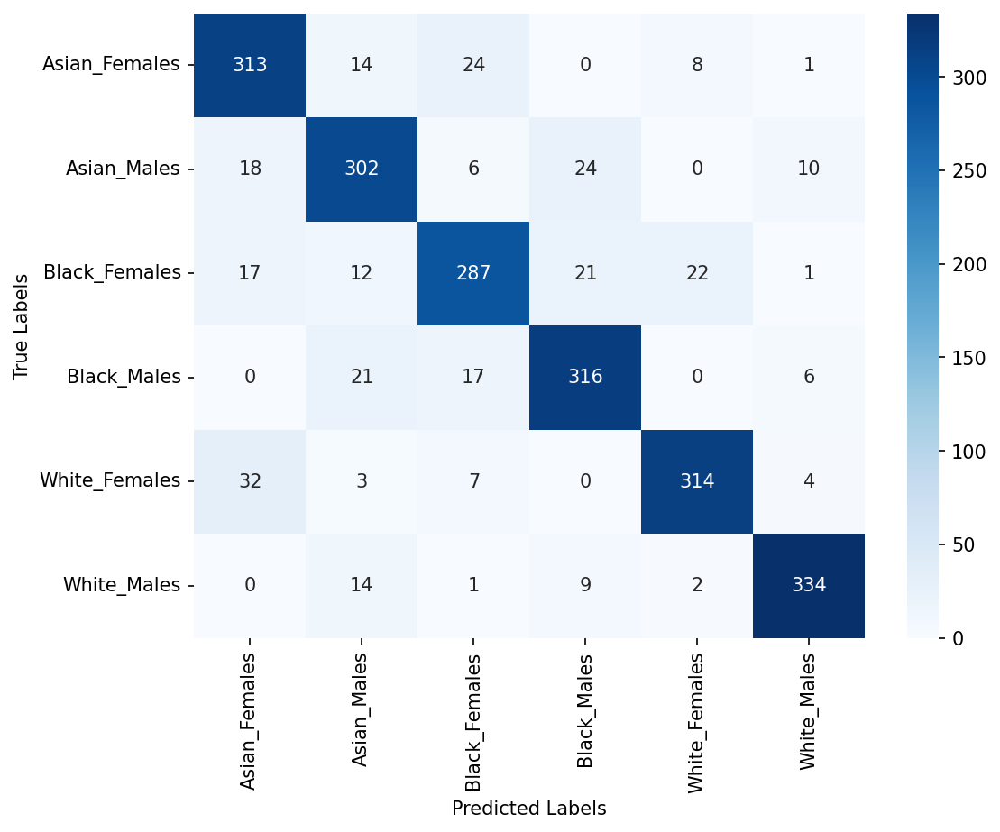
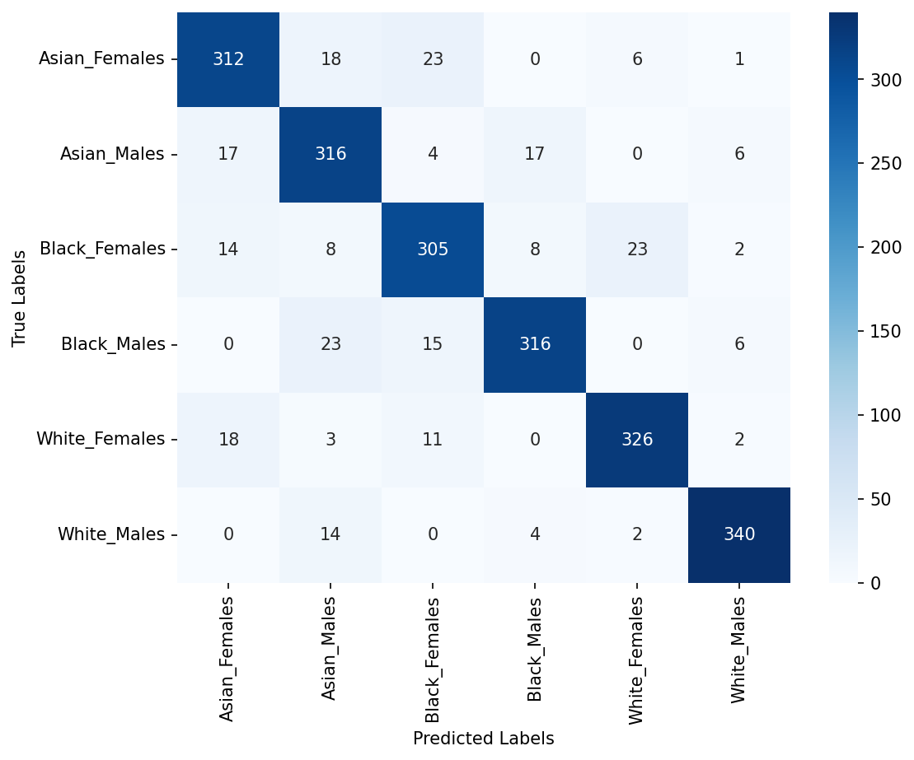

# Paper Outline Terperinci (Versi 1.1 - Definitif Revisi) - IEEE Access (Manuscript ID: Access-2026-50857)

> **Status Versi**: **Versi 1.1 (Definitif Revisi IEEE Access / Subject-Disjoint Primary Benchmark)**  
> **Catatan Tata Kelola**: Berkas ini memuat outline naskah revisi komprehensif yang memenuhi seluruh rekomendasi penelaah IEEE Access (Primary Benchmark Subject-Disjoint 0% leakage, LR 88.66% / SVM 88.61%, uji McNemar, profil Edge AI, kalibrasi fairness EOD, Table I-XV, Figure 1-4, Eq. 1-23). Untuk outline orisinal pra-revisi (Subject-Overlap 93.70%), silakan merujuk ke [paper_outline_v1.0.md](paper_outline_v1.0.md).  
> **Target Publikasi**: IEEE Access (Open Access, Q1 / Impact Factor: 3.4)  
> **Status Revisi**: *Reject & Resubmit* (Kesempatan Resubmission Tunggal Berbasis *Binary Peer Review*)  
> **Bahasa Naskah**: Bahasa Indonesia formal akademik dengan istilah teknis/ilmiah tetap dipertahankan dalam Bahasa Inggris baku  
> **Gaya Sitasi**: IEEE format ([1], [2], dst.)  
> **Topik Riset**: Klasifikasi Ras & Gender Interseksional Berbasis Fusi Fitur Multi-Domain Vision Transformer dan Classical Machine Learning Teroptimasi di Bawah Protokol Strict Subject-Disjoint Partitioning  

---

## 0. Global Writing Rules and Claim Boundaries (Standar Revisi IEEE Access)

### A. Allowed Claims and Core Focus
1. **Fokus Utama**: Evaluasi empiris komprehensif fusi representasi laten dari tiga domain visual wajah komplementer (*task-associated representations*: Biometrik Wajah, Ekspresi Emosi Wajah, dan Estimasi Usia Wajah) menggunakan Vision Transformer (ViT-Base) pra-latih (*offline feature extraction*) yang dipadukan dengan optimasi pipeline *classical machine learning* (5-Fold StratifiedGroupKFold GridSearchCV).
2. **Sistem Dual-Benchmark (Jawaban Reviewer 2 #2)**:
   - **Primary Benchmark (Subject-Disjoint Partitioning — Zero Identity Leakage)**: Evaluasi definitif pada subjek *held-out* yang belum pernah dilihat sebelumnya ($N = 2.160$ citra uji dari 120 subjek terisolasi sempurna; tepat 360 citra per kelas interseksional). Model terbaik dipimpin oleh **Logistic Regression (LR) Tri-Domain** dengan Akurasi **88.66%** (Macro F1: **0.8868**, 95% Wilson CI: [87.25%, 89.93%]) dan **Support Vector Machine (SVM) Tri-Domain** dengan Akurasi **88.61%** (Macro F1: **0.8863**, 95% Wilson CI: [87.20%, 89.88%]).
   - **Historical Baseline Archive (Subject-Overlap Split — 100% Identity Leakage)**: Replikasi partisi acak berbasis citra historis (8.640 latih / 2.160 uji, di mana seluruh 593 subjek uji hadir di data latih; SVM Tri-Domain meraih 93.70%). Disajikan secara eksplisit sebagai **studi ablasi kebocoran data (*data leakage ablation study*)** untuk menguantifikasi beban memorisasi identitas wajah (*facial identity memorization effect* sebesar 5.09 percentage points).
3. **Signifikansi Statistik Inferensial (Jawaban Reviewer 2 #5)**:
   - Keunggulan fusi multi-domain terhadap representasi wajah tunggal (*Single Face Biometrics*) terbukti **signifikan secara statistik** melalui *Paired McNemar Test with Edwards continuity correction* ($p = 3.46 \times 10^{-6} < 0.001$ pada SVM; $p = 6.78 \times 10^{-6} < 0.001$ pada LR).
   - Model LR Tri-Domain (88.66%) dan SVM Tri-Domain (88.61%) menunjukkan **tidak adanya perbedaan performa prediktif yang signifikan secara statistik** (*no statistically significant difference / predictive parity*, $p = 1.0000$, selisih bersih hanya +1 citra: 1.915 vs 1.914 dari $N = 2.160$).
   - Penambahan domain usia biologis di atas kombinasi biometrik-afektif (`Emotion ⊕ Face`) pada SVM berkernel RBF dikualifikasikan secara objektif mengindikasikan **kejenuhan representasi fitur laten asimtotik (*asymptotic feature saturation*)** ($88.43\% \to 88.61\%, p = 0.7343 > 0.05$; meskipun dibandingkan kombinasi `Face ⊕ Age` $87.55\%$, peningkatan ke Tri-Domain tetap signifikan pada $p = 0.0086 < 0.01$), sementara pada LR linier penambahan domain usia di atas `Emotion ⊕ Face` memberikan peningkatan yang signifikan secara statistik ($87.45\% \to 88.66\%, p = 0.0073 < 0.01$).
4. **Keunggulan Efisiensi Komputasi Ekstrem (Jawaban Reviewer 1 #5 & Reviewer 2 #8)**:
   - Melaporkan 5 dimensi efisiensi komputasi yang diminta R2 #8 hanya dengan angka yang **terukur dan terlacak ke log/JSON eksperimen**: (1) waktu ekstraksi fitur ViT offline terukur secara komparatif pada **CPU baseline** (Face 467,0 ms, Emotion 476,7 ms, Age 543,1 ms per citra; **~1.487 ms** untuk tri-domain; total 4,46 jam dari log `1.1_vit-*.md`) dan terakselerasi pada **GPU NVIDIA RTX 4060** dengan in-memory processor caching (Face 39,7 ms, Emotion 39,7 ms, Age 45,1 ms per citra; **124,5 ms** untuk tri-domain; total 22,4 menit dari berkas `experiment/code/times/*.json`; akselerasi **11,9× lebih cepat**), (2) durasi pelatihan 5-Fold GridSearchCV (LR Tri: **3.287,07 detik / 54,78 menit** vs SVM Tri: **30.666,02 detik / 511,10 menit**, atau **9,3× lebih cepat dilatih**; dari `train_time_seconds` pada JSON), (3) latensi inferensi pengklasifikasi hilir per sampel (**0.0046 ms/sampel** pada LR vs 4.6785 ms pada SVM; **>1.000× lebih cepat**, dengan total latensi *end-to-end* pada GPU $\approx 124,505\text{ ms/citra}$), (4) ukuran *feature cache* (30.8 MB/domain atau 92.4 MB untuk Tri-Domain; memori array uji dalam RAM hanya 18.98 MB), serta (5) ukuran penyimpanan model (**0.11 MB** pada LR vs 36.60 MB pada SVM; **>330× lebih ringkas**), menetapkan Logistic Regression sebagai kepala pengklasifikasi hilir (*downstream classification head*) paling optimal tanpa *overhead* memori/latensi, sementara adaptasi penuh ke perangkat tepi (*Edge AI*) berdaya rendah dapat mengompresi ketiga backbone ViT melalui kuantisasi atau distilasi.
5. **Kalibrasi Klaim Keadilan Algoritmik (Jawaban Reviewer 2 #6)**:
   - Metrik *Equal Opportunity Difference* ($\text{EOD} = 9.72\text{ pp}$ antara White Males 94.44% vs Black Females 84.72%) dilaporkan murni sebagai indikator disparitas performa subkelompok empiris, dan secara tegas **tidak diklaim sebagai jaminan keadilan algoritmik universal**.
6. **Konteks Komparasi Literatur (Jawaban Reviewer 1 #6 & Reviewer 2 #7)**:
   - Perbandingan dengan studi terdahulu pada DemogPairs (misal Putri et al. 2025) disajikan sebagai **penempatan kontekstual (*contextual comparison*)**, bukan *controlled benchmark*, karena studi terdahulu mengevaluasi pada partisi *subject-overlap*.
7. **Standarisasi Tipografi & Konvensi IEEE**:
   - Dilarang keras menggunakan karakter *em dash* (—); gunakan tanda pisah biasa (- atau --), tanda kurung, atau koma.
   - Istilah pengklasifikasi distandardisasi: Support Vector Machine (SVM), Logistic Regression (LR), Random Forest (RF), Gaussian Naive Bayes (GNB).
   - Penamaan konfigurasi fitur seragam menggunakan direct sum `⊕`: `Face`, `Emotion`, `Age`, `Emotion ⊕ Face`, `Face ⊕ Age`, `Emotion ⊕ Age`, `Face ⊕ Emotion ⊕ Age`.
   - Seluruh elemen berurutan kronologis ketat: **Figure 1–4**, **Table I–XV**, dan **Eq. (1)–(23)**.
8. **Disiplin Sitasi Per Kalimat (Maksimal 2 Sitasi)**:
   - Ditetapkan aturan baku bahwa **setiap kalimat naratif hanya diperbolehkan memuat maksimal 2 sitasi** ([X] atau [X], [Y]) di seluruh bab naskah. Hal ini bertujuan untuk mencegah penumpukan sitasi (*citation dumping*), menjaga kelancaran alur pembacaan, dan memastikan kepadatan struktur kalimat ilmiah standar IEEE Access.

### B. Negative Constraints and Disallowed Claims
1. **Dilarang menyembunyikan isu tumpang tindih identitas**: Wajib transparan menyajikan perbandingan *Subject-Disjoint* vs *Subject-Overlap*.
2. **Dilarang mengklaim "universal improvement"**: Akui secara objektif bahwa pada Random Forest dan GNB, konfigurasi dual-domain mencatatkan akurasi yang kompetitif/puncak dibanding tri-domain.
3. **Dilarang berspekulasi fenotipik berlebihan**: Penjelasan matriks konfusi harus didasarkan murni pada data distribusi frekuensi kesalahan, bukan asumsi antropologi biologis yang tidak terverifikasi.
4. **Dilarang overclaim generalisasi**: Kesimpulan dibatasi secara eksplisit pada 3 kelompok ras makro dataset DemogPairs (Asian, Black, White).
5. **Dilarang menumpuk lebih dari 2 sitasi dalam satu kalimat**: Setiap kalimat naratif dibatasi secara ketat maksimal 2 sitasi. Jika suatu argumen memerlukan lebih dari dua rujukan literatur, pecah narasi menjadi kalimat-kalimat terpisah yang kohesif.

---

## Front Matter

### Paper Title
**Multi-Domain Vision Transformer Fusion for Intersectional Demographic Classification from Facial Images**  
*(Fusi Vision Transformer Multi-Domain untuk Klasifikasi Demografis Interseksional dari Citra Wajah)*

### Authors & Affiliations (5 Penulis Sesuai Formulir Byline Change IEEE Access)
1. **Dr. Ir. Ricky Eka Putra, S.Kom., M.Kom.** ([ORCID: 0000-0002-5515-7967](https://orcid.org/0000-0002-5515-7967)) — *Department of Informatics, Faculty of Informatics, Universitas Negeri Surabaya, Surabaya 60231, Indonesia* (Corresponding Author: `rickyeka@unesa.ac.id`)
2. **Rezky Arisanti Putri, S.Kom., M.Kom.** ([ORCID: 0009-0000-8021-1833](https://orcid.org/0009-0000-8021-1833)) — *Department of Informatics, Faculty of Informatics, Universitas Negeri Surabaya, Surabaya 60231, Indonesia*
3. **Dr. Yuni Yamasari, S.Kom., M.Kom.** ([ORCID: 0000-0001-9719-3491](https://orcid.org/0000-0001-9719-3491)) — *Department of Informatics, Faculty of Informatics, Universitas Negeri Surabaya, Surabaya 60231, Indonesia*
4. **Rafy Aulia Akbar, S.Kom., M.Kom.** ([ORCID: 0009-0003-6991-0694](https://orcid.org/0009-0003-6991-0694)) — *Department of Informatics, Faculty of Informatics, Universitas Negeri Surabaya, Surabaya 60231, Indonesia*
5. **Assoc. Prof. Dr. Shukor Sanim Mohd Fauzi** ([ORCID: 0000-0003-4333-7853](https://orcid.org/0000-0003-4333-7853)) — *School of Computing Sciences, College of Computing, Informatics and Mathematics, Universiti Teknologi MARA, Cawangan Perlis, Kampus Arau, 02600 Arau, Perlis, Malaysia* (`shukorsanim@uitm.edu.my`)

### Abstract
Satu paragraf padat terpadu (**target 150–250 kata**; aktual: 215 kata), terstruktur: **Latar Belakang & Tantangan → Metodologi yang Diusulkan → Evaluasi Dual-Benchmark (Subject-Disjoint vs. Stratified Split) → Keadilan Interseksional**.
- **Latar Belakang & Tantangan**: Pengenalan atribut demografis wajah seperti ras dan gender secara simultan menghadapi tantangan variasi ekspresi, penuaan biologis, kemiripan karakteristik visual antarsubkelompok, keterbatasan representasi domain tunggal (*single-domain*), serta risiko kebocoran identitas subjek akibat partisi citra acak.
- **Metode**: Mengusulkan kerangka kerja fusi fitur multi-domain yang mengintegrasikan representasi biometrik wajah, ekspresi emosi, dan usia biologis dari tiga model Vision Transformer (ViT) melalui konkatenasi 2.304 dimensi, dipadukan dengan penskalaan fitur, PCA, dan empat pengklasifikasi pembelajaran mesin klasik (RF, GNB, LR, SVM) pada dataset DemogPairs.
- **Evaluasi Dual-Benchmark & Hasil**:
  - Tanpa penyebutan data kuantitatif jumlah subjek/citra latih dan uji di dalam abstrak untuk menjaga fokus generalisasi independen.
  - Penulisan F1-score disajikan terpadu dalam kalimat tanpa tanda kurung.
  - Bebas dari pelaporan Wilson Score dan metrik perangkat keras/efisiensi komputasi (latensi, ukuran model, memori).
  - **Subject-Disjoint Primary Benchmark (Metrik Lengkap)**: Logistic Regression (LR) Tri-Domain mencatat Akurasi **88.66%**, Presisi Makro **88.75%**, Recall Makro **88.66%**, dan F1-Score Makro **88.68%**, setara secara inferensial dengan Support Vector Machine (SVM) Tri-Domain dengan Akurasi **88.61%**, Presisi Makro **88.66%**, Recall Makro **88.61%**, dan F1-Score Makro **88.63%**. Uji McNemar mengonfirmasi keunggulan signifikan atas domain tunggal ($p < 0.001$) serta paritas prediktif sempurna antara LR dan SVM ($p = 1.0000$).
  - **Stratified Split Historical Baseline (Khusus Akurasi dan F1-Score)**: Sebagai studi ablasi kebocoran identitas dari arsip `md_old`, evaluasi dengan tumpang tindih subjek mencatatkan Akurasi **93.70%** dan F1-Score Makro **93.69%** pada SVM Tri-Domain, serta Akurasi **92.73%** dan F1-Score Makro **92.73%** pada LR Tri-Domain.
  - **Keadilan Interseksional**: Rentang recall terverifikasi **84.72% hingga 94.44%** lintas enam subkelompok dengan kesenjangan Equal Opportunity Difference (**9.72 pp**).

### Keywords
Biometrics, face recognition, feature extraction, intersectional demographic recognition, multi-domain feature fusion, Vision Transformer.

---

## I. INTRODUCTION

> **Catatan Respons Reviewer (R1 Poin 1):**  
> - **Komentar Reviewer:** Reviewer 1 menilai bagian Pendahuluan (*Introduction*) terlalu panjang dan perlu diringkas (*"the introduction is too long need to be summarized"*).  
> - **Rencana Mitigasi:** Memadatkan narasi pendahuluan sebesar ~28% (menjadi rentang 700–850 kata terfokus), membagi struktur narasi ke dalam 7 paragraf proporsional dengan alur logis yang padat, serta langsung menajamkan esensi tantangan klasifikasi interseksional.

Struktur narasi direorganisasi menjadi 7 paragraf terfokus yang memadukan kejelasan masalah, konteks literatur, dan ketegasan kontribusi.

### Paragraph 1: Demographic Face Recognition and Intersectional Performance Disparity
> **Catatan Respons Reviewer (R1 Poin 1):**  
> - **Komentar Reviewer:** Bagian pembuka dinilai terlalu umum dan bertele-tele dalam memaparkan latar belakang biometrik wajah.  
> - **Rencana Mitigasi:** Membatasi panjang paragraf secara ketat pada 100–115 kata, langsung menyoroti urgensi tata kelola identitas digital dan disparitas performa sistem visi komputer komersial terhadap kelompok minoritas.
- **Target Kata**: 100–115 kata.
- **Tujuan**: Menjelaskan urgensi analisis atribut demografis wajah (ras dan gender) pada sistem visi komputer modern serta memaparkan tantangan kritis disparitas performa terhadap subkelompok tertentu.
- **Poin Narasi**:
  1. Pengenalan otomatis atribut ras dan gender wajah memegang peranan krusial pada tata kelola identitas digital, kontrol akses biometrik, forensik, dan personalisasi antarmuka cerdas.
  2. Berbagai studi independen dan evaluasi NIST menunjukkan bahwa model visi komputer komersial memperlihatkan disparitas performa yang merugikan kelompok minoritas tertentu, khususnya wanita berkulit gelap.
  3. Kesenjangan ini bersumber dari karakteristik distribusi data latih dan representasi fitur visual yang kurang tangguh terhadap variasi fenotipik serta pencahayaan lingkungan.
- **Transisi / Kalimat Penutup**: Keterbatasan penanganan variasi visual pada sistem konvensional ini memperlihatkan bahwa pengenalan atribut demografis yang akurat masih menghadapi tantangan, sehingga dibutuhkan pendekatan pengenalan demografis wajah yang mampu memodelkan interaksi ras dan gender secara terpadu.

### Paragraph 2: From Isolated Tasks to Intersectional Classification
- **Target Kata**: 100–115 kata.
- **Tujuan**: Menjelaskan transisi dari klasifikasi atribut terisolasi (ras saja atau gender saja) menuju klasifikasi interseksional terpadu (kombinasi ras dan gender).
- **Poin Narasi**:
  1. Praktik umum dalam literatur memisahkan klasifikasi ras dan gender sebagai dua model independen yang berdiri sendiri.
  2. Pendekatan terisolasi tersebut gagal menangkap dinamika kesalahan pada persilangan subkelompok demografis tertentu (seperti wanita berkulit hitam atau wanita Asia), sehingga penurunan akurasi pada irisan demografis spesifik dapat luput dari audit.
  3. Formulasi interseksional terpadu (3 Ras × 2 Gender = 6 kelas) pada kondisi evaluasi seimbang (*balanced evaluation*) memungkinkan audit performa yang adil dan objektif tanpa distorsi jumlah sampel.
- **Transisi / Kalimat Penutup**: Pemodelan klasifikasi interseksional menuntut representasi visual yang kaya dan mampu memisahkan batas keputusan antarsubkelompok yang saling tumpang tindih secara fenotipik.

### Paragraph 3: Architectural Evolution and Vision Transformer Representations
> **Catatan Respons Reviewer (R1 Poin 1 & Pedoman Sitasi):**  
> - **Komentar Reviewer:** Ulasan literatur dalam pendahuluan sebelumnya terlalu melebar dan membebani alur pembacaan naskah.  
> - **Rencana Mitigasi:** Membatasi panjang paragraf pada 135–250 kata, merangkum evolusi dari CNN ke ViT secara padat, menerapkan aturan ketat maksimal 2 sitasi per kalimat, serta menyertakan daftar 10 sitasi wajib tanpa penomoran braket angka.
- **Target Kata**: 135–250 kata.
- **Aturan Sitasi Khusus**: Ditetapkan aturan ketat bahwa per kalimat hanya maksimal 2 sitasi untuk menjaga keterbacaan naskah dan mencegah penumpukan sitasi (*citation dumping*).
- **Tujuan**: Memberikan konteks perkembangan pendekatan arsitektur dari CNN konvensional ke Vision Transformer (ViT) serta metode pendukung lainnya dalam pengenalan atribut wajah.
- **Poin Narasi**:
  1. Pendekatan klasik berbasis fitur buatan tangan (*handcrafted features*: LBP, HOG, SIFT) dan Convolutional Neural Networks (CNN: VGG, ResNet, Xception) mengandalkan bias induktif lokal melalui *receptive field* terbatas, di mana penangkapan dependensi spasial global membutuhkan tumpukan lapisan yang lebih dalam.
  2. Arsitektur Vision Transformer (ViT) memperkenalkan mekanisme Multi-Head Self-Attention (MHSA) yang memungkinkan pemodelan interaksi spasial global antarpatch citra secara langsung tanpa dibatasi *receptive field* lokal.
  3. Berbagai variasi pendekatan telah dieksplorasi dalam literatur, mencakup model berbasis wilayah wajah tengah, pembelajaran multi-tugas multi-skala, modul atensi paralel, mitigasi bias berbasis model generatif, hingga arsitektur transformer multi-aksis (MaxViT).
- **Daftar Sitasi Wajib Berdasarkan Judul Paper pada Related Works**:
  - *Automatic Ethnicity Classification from Middle Part of the Face Using Convolutional Neural Networks* (Belcar et al., Informatics 2022)
  - *Face Gender and Age Classification Based on Multi-Task, Multi-Instance and Multi-Scale Learning* (Liao et al., Applied Sciences 2022)
  - *Intelligent deep learning based ethnicity recognition and classification using facial images* (Sunitha et al., Image and Vision Computing 2022)
  - *A Multidimensional Analysis of Social Biases in Vision Transformers* (Brinkmann et al., ICCV 2023)
  - *Deep Generative Views to Mitigate Gender Classification Bias Across Gender-Race Groups* (Ramachandran & Rattani, Springer / ICPR Workshops 2023)
  - *Learning an attention-aware parallel sharing network for facial attribute recognition* (Chen et al., JVCI 2023)
  - *Classifying Gender Based on Face Images Using Vision Transformer* (Tahyudin et al., JOIV 2024)
  - *Ethnicity Classification Based on Facial Images using Deep Learning Approach* (Kalkatawi & Saeed, IJACSA 2024)
  - *Dual Vision Transformer Integration for Race and Gender Recognition Based on Facial Images* (Putri et al., IEEE ICVEE 2025)
  - *MD-ViT: Multidomain Vision Transformer Fusion for Fair Demographic Attribute Recognition* (Putri et al., JIEET 2025)
- **Transisi**: Terlepas dari pesatnya eksplorasi model berbasis visi dan transformer tersebut, telaah literatur mengidentifikasi sejumlah tantangan metodologis yang masih memerlukan kajian empiris terpadu.

### Paragraph 4: Methodological Research Gaps and Data Leakage Challenges
> **Catatan Respons Reviewer (R2 Poin 2 & R2 Poin 5):**  
> - **Komentar Reviewer:** Reviewer 2 menyoroti risiko kebocoran identitas pada pemisahan data acak (*"image-level stratified split may allow images of the same identity to occur in both training and test sets"*) dan ketiadaan uji signifikansi inferensial pada studi literatur terdahulu.  
> - **Rencana Mitigasi:** Mengidentifikasi secara eksplisit ancaman *identity leakage* sebagai *research gap* metodologis utama bersama dengan keterbatasan representasi domain tunggal dan ketiadaan validasi inferensial formal (100–115 kata).
- **Target Kata**: 100–115 kata.
- **Tujuan**: Merumuskan kesenjangan riset metodologis utama (*research gaps*) yang mengaitkan keterbatasan representasi domain tunggal, ancaman kebocoran identitas, dan ketiadaan validasi inferensial.
- **Poin Narasi**:
  1. *Keterbatasan Single-Domain*: Representasi geometri biometrik statis rentan terhadap distorsi ekspresi afektif dinamis dan perubahan morfologi penuaan biologis jika fitur terkait tidak diikutsertakan.
  2. *Ancaman Identity Leakage*: Evaluasi konvensional berbasis partisi acak citra berisiko membagi foto dari subjek yang sama ke dalam set latih dan uji, memicu model menghafal identitas individu alih-alih mempelajari pola demografis sejati.
  3. *Ketiadaan Uji Inferensial & Profil Efisiensi*: Studi terdahulu umumnya minim pembuktian signifikansi statistik formal (seperti uji berpasangan McNemar) dan belum mengkaji profil latensi serta jejak memori untuk implementasi praktis.
- **Transisi Kohesif ke Usulan Solusi**: Guna menjembatani keterbatasan representasi domain tunggal dan memvalidasi generalisasi bebas kebocoran identitas tersebut, penelitian ini mengusulkan kerangka fusi tri-domain ViT di bawah protokol evaluasi ketat.

### Paragraph 5: Proposed Tri-Domain ViT Fusion Framework and Subject-Disjoint Protocol
> **Catatan Respons Reviewer (R2 Poin 2 & R2 Poin 4):**  
> - **Komentar Reviewer:** Reviewer 2 meminta evaluasi bebas kebocoran identitas (*"provide subject-disjoint evaluation to establish genuine generalization"*) serta rekonsiliasi aritmatika ruang pencarian hyperparameter (*"totals of 1,086 configurations, 38,010 fits, and 28 refits"*).  
> - **Rencana Mitigasi:** Memaparkan arsitektur Dual-Benchmark (menetapkan *Strict Subject-Disjoint Partitioning* 0% kebocoran sebagai tolok ukur utama dan *Subject-Overlap* sebagai studi ablasi memorisasi) serta merinci pipeline optimasi 5-Fold StratifiedGroupKFold GridSearchCV (135–175 kata).
- **Target Kata**: 135–175 kata.
- **Tujuan**: Memaparkan kerangka kerja usulan yang menjawab seluruh kesenjangan riset pada Paragraf 4 secara sistematis, mencakup integrasi tri-domain, protokol evaluasi, dan pipeline optimasi hyperparameter.
- **Poin Narasi**:
  1. Mengusulkan kerangka kerja fusi Tri-Domain ViT yang memadukan tiga representasi laten ortogonal: geometri biometrik statis (`ViT-Face`), ekspresi afektif dinamis (`ViT-Emotion`), dan morfologi penuaan biologis (`ViT-Age`) melalui operasi konkatenasi langsung (`Face ⊕ Emotion ⊕ Age`).
  2. Ekstraksi representasi laten visual dilakukan secara offline dari backbone Vision Transformer pra-latih yang dibekukan guna mempertahankan efisiensi komputasi dan meminimalkan beban pelatihan.
  3. Menerapkan kerangka tolok ukur ganda yang menetapkan protokol pemisahan subjek ketat pada dataset DemogPairs (600 subjek unik, 0% kebocoran identitas) sebagai standar utama generalisasi, sekaligus mempertahankan evaluasi tumpang tindih subjek historis sebagai studi ablasi untuk menguantifikasi memorisasi identitas.
  4. Melakukan optimasi hyperparameter komprehensif pada empat rumpun algoritma pembelajaran mesin klasik (RF, GNB, LR, SVM) melalui validasi silang 5-Fold StratifiedGroupKFold dengan pipeline modular Scaler-PCA yang dipelajari secara terisolasi pada lipatan latih guna menjamin pencegahan kebocoran informasi (mencakup total 31.920 penyesuaian model).

### Paragraph 6: Four Key Scientific Contributions
> **Catatan Respons Reviewer (R1 Poin 1 & R2 Poin 1):**  
> - **Komentar Reviewer:** Reviewer 1 meminta penegasan kontribusi ilmiah naskah yang terfokus, dan Reviewer 2 meminta distingsi kebaruan metodologis melampaui konkatenasi sederhana terhadap model dual/multi-domain sebelumnya (*"methodological novelty beyond concatenating three pretrained representations... should be clearly established"*).  
> - **Rencana Mitigasi:** Menyajikan 4 butir kontribusi ilmiah utama secara terstruktur dalam Bahasa Indonesia akademik murni tanpa judul tebal (no bold title) dan tanpa teks bahasa Inggris murni berbasis kebaruan konseptual tanpa memuat angka-angka hasil performa, menegaskan evaluasi ablasi sistematis 7 skema multi-domain dengan pipeline fold-level terisolasi, tolok ukur subject-disjoint bebas kebocoran, pengujian inferensial (komplementaritas linier vs saturasi asimtotik non-linier), serta efisiensi kepala pengklasifikasi hilir (125–150 kata).
- **Target Kata**: 125–150 kata.
- **Tujuan**: Menyajikan empat kontribusi ilmiah penelitian secara ringkas, lugas, dan terstruktur dalam format daftar bernomor Bahasa Indonesia tanpa judul tebal dan tanpa menyertakan angka-angka hasil empiris.
- **Poin Narasi**:
  1. Formulasi kerangka kerja ablasi tujuh skema fitur yang mengintegrasikan backbone Vision Transformer pra-latih yang dibekukan dengan prapemrosesan tingkat-fold bebas kebocoran serta optimasi hyperparameter lintas empat famili pengklasifikasi untuk klasifikasi demografis interseksional.
  2. Penetapan tolok ukur evaluasi bebas kebocoran identitas pada dataset DemogPairs dan studi komparatif ablasi kebocoran data untuk menguantifikasi efek memorisasi identitas wajah.
  3. Pengujian hipotesis inferensial berpasangan yang memvalidasi keunggulan signifikan representasi multi-domain atas baseline domain tunggal, membuktikan paritas prediktif model linier dan non-linier teratas, serta mengungkap komplementaritas fitur usia linier versus kejenuhan representasi asimtotik non-linier.
  4. Penyajian profil efisiensi komputasi komprehensif mencakup waktu ekstraksi ViT, biaya pelatihan, latensi inferensi, dan jejak memori yang merealisasikan kepala pengklasifikasi hilir berbobot sangat ringan untuk implementasi praktis.

### Paragraph 7: Paper Organization
- **Target Kata**: 50–75 kata.
- **Tujuan**: Menjelaskan sistematika dan fungsi setiap bab dalam artikel secara ringkas dan padat.
- **Poin Narasi**:
  Artikel ini disusun sebagai berikut: Section II mengulas sintesis literatur terkait (Related Works); Section III menjabarkan dataset, metodologi ekstraksi multi-domain ViT, pipeline pengklasifikasi, serta metrik evaluasi (Materials and Methods); Section IV memaparkan analisis komparatif performa global, studi ablasi kebocoran data, pengujian signifikansi inferensial, profil efisiensi komputasi, analisis performa subkelompok interseksional, pola kesalahan, dan perbandingan kontekstual dengan literatur terdahulu (Results and Discussion); Section V menyimpulkan temuan utama, keterbatasan penelitian, dan arah riset mendatang (Conclusion).

---

## II. RELATED WORKS

> **Catatan Respons Reviewer (R1 Poin 2 & R2 Poin 1):**  
> - **Komentar Reviewer:** Reviewer 1 meminta restrukturisasi Related Works dengan alur yang lebih baik dan penambahan persamaan matematika (*"The related works needs to be modified in better way and add equations"*), sementara Reviewer 2 meminta distingsi kebaruan terhadap metode terdahulu.  
> - **Rencana Mitigasi:** Merestrukturisasi tinjauan pustaka ke dalam 3 subseksi tematik ringkas $\times$ 2 paragraf (total 6 paragraf, 100–115 kata/paragraf), melengkapi setiap domain dengan formulasi matematis formal (Eq. 1 s.d. Eq. 4), serta menegaskan posisi kebaruan penelitian pada subseksi C.

Sintesis literatur disusun dalam **3 subseksi tematik**, masing-masing terdiri atas **2 paragraf terstruktur (total 6 paragraf)** dengan target kata **100–115 kata per paragraf**.

### A. Demographic Face Recognition
> **Catatan Respons Reviewer (R1 Poin 2):**  
> - **Komentar Reviewer:** Belum adanya perumusan matematis untuk merepresentasikan metode klasifikasi atribut demografis wajah pada literatur sebelumnya.  
> - **Rencana Mitigasi:** Menyajikan formulasi fungsi keputusan kernel KELM Eq. (1) dari Sunitha et al. (IVC 2022) pada Paragraf 2 guna memodelkan batas keputusan non-linier pengklasifikasi hilir pada ruang representasi demografis wajah.

#### Paragraph 1: Evolution from Handcrafted to Deep Convolutional Features
- **Target Kata**: 100–115 kata.
- **Fokus Sintesis**: Menelusuri evolusi tugas pengenalan ras dan gender wajah dari deskriptor berbasis wilayah/bagian tengah wajah (Belcar et al., Informatics 2022) dan rekayasa fitur manual (*handcrafted features*: LBP, HOG, Gabor) ke model representasi mendalam (CNN). Menguraikan bagaimana representasi konvolusional klasik berinteraksi dengan variasi pencahayaan dan disparitas performa antarras (*Other-Race Effect*) sebagaimana dilaporkan dalam literatur empiris (Sunitha et al., IVC 2022), serta pergeseran menuju mekanisme atensi paralel adaptif (Chen et al., JVCI 2023).
- **Sumber Literatur Terkait**:
  - *Automatic Ethnicity Classification from Middle Part of the Face Using Convolutional Neural Networks* (Belcar et al., Informatics 2022)
  - *Intelligent deep learning based ethnicity recognition and classification using facial images* (Sunitha et al., Image and Vision Computing 2022)
  - *Learning an attention-aware parallel sharing network for facial attribute recognition* (Chen et al., Journal of Visual Communication and Image Representation 2023)

#### Paragraph 2: Downstream Classifier Paradigms and Decision Boundaries
- **Target Kata**: 100–115 kata.
- **Fokus Sintesis**: Membandingkan paradigma pengklasifikasi hilir antara lapisan SoftMax *end-to-end* (Belcar et al., Informatics 2022) dan model pohon keputusan ansambel seperti Deep Random Forest (Liao et al., Applied Sciences 2022). Selain itu, tinjauan mencakup efektivitas pengklasifikasi berbasis margin optimal seperti Support Vector Machine (SVM) dan Kernel Extreme Learning Machine (KELM) dalam memetakan representasi fitur wajah berdimensi tinggi tanpa optimasi gradient descent (Sunitha et al., Image and Vision Computing 2022; Kalkatawi & Saeed, IJACSA 2024). Menjelaskan bagaimana fungsi keputusan kernel non-linier memetakan representasi fitur wajah berdimensi tinggi:
  $$f(\mathbf{x}) = \mathbf{h}(\mathbf{x}) \mathbf{H}^T \left( \frac{\mathbf{I}}{C} + \mathbf{\Omega}_{\text{ELM}} \right)^{-1} \mathbf{Y} \tag{1}$$
  di mana $\mathbf{\Omega}_{\text{ELM}(i, r)} = K(\mathbf{x}_i, \mathbf{x}_r)$ memetakan fitur ke ruang separasi kernel Mercer tanpa memerlukan optimasi *gradient descent*.
- **Sumber Literatur Terkait**:
  - *Automatic Ethnicity Classification from Middle Part of the Face Using Convolutional Neural Networks* (Belcar et al., Informatics 2022)
  - *Intelligent deep learning based ethnicity recognition and classification using facial images* (Sunitha et al., Image and Vision Computing 2022)
  - *Face Gender and Age Classification Based on Multi-Task, Multi-Instance and Multi-Scale Learning* (Liao et al., Applied Sciences 2022)
  - *Ethnicity Classification Based on Facial Images using Deep Learning Approach* (Kalkatawi & Saeed, IJACSA 2024)

### B. Vision Transformers in Face Analysis
> **Catatan Respons Reviewer (R1 Poin 2 & R2 Poin 6):**  
> - **Komentar Reviewer:** Reviewer 1 meminta penambahan persamaan matematis arsitektur transformer, dan Reviewer 2 menyoroti telaah perambatan bias representasi (*fairness analysis scope*).  
> - **Rencana Mitigasi:** Menambahkan persamaan formal proyeksi linier patch Eq. (2) dan atensi Multi-Head Self-Attention Eq. (3), serta mengkaji mekanisme perambatan bias representasi dari korpus pra-latih (Brinkmann et al. 2023; Ramachandran & Rattani 2023).

#### Paragraph 1: Theoretical Foundations and Spatial Self-Attention Mechanisms
- **Target Kata**: 100–115 kata.
- **Fokus Sintesis**: Menganalisis landasan teoretis arsitektur Vision Transformer (Dosovitskiy et al., ICLR 2021) dalam memodelkan citra wajah. Berbeda dengan bias induktif lokal pada CNN, ViT membagi citra masukan menjadi $N$ patch visual berukuran $P \times P$ dengan $C$ kanal warna, memproyeksikannya secara linier ke dimensi laten $D$, dan memodelkan interaksi spasial global melalui Multi-Head Self-Attention (MHSA):
  $$\mathbf{x}_p \in \mathbb{R}^{N \times (P^2 \cdot C)}, \quad N = \frac{HW}{P^2} \tag{2}$$
  $$\text{Attention}(\mathbf{Q}, \mathbf{K}, \mathbf{V}) = \text{softmax}\left(\frac{\mathbf{Q}\mathbf{K}^T}{\sqrt{d_k}}\right)\mathbf{V} \tag{3}$$
  Mengulas penerapan transformer pada klasifikasi atribut demografis wajah terstandarisasi (Tahyudin et al., JOIV 2024; Kalkatawi & Saeed, IJACSA 2024) serta eksplorasi varian transformer hibrida bertingkat seperti MaxViT.
- **Sumber Literatur Terkait**:
  - *An Image is Worth 16x16 Words: Transformers for Image Recognition at Scale* (Dosovitskiy et al., ICLR 2021)
  - *Classifying Gender Based on Face Images Using Vision Transformer* (Tahyudin et al., JOIV 2024)
  - *Ethnicity Classification Based on Facial Images using Deep Learning Approach* (Kalkatawi & Saeed, IJACSA 2024)

#### Paragraph 2: Demographic Disparities and Fairness Propagation in Vision Transformers
- **Target Kata**: 100–115 kata.
- **Fokus Sintesis**: Menelaah fenomena disparitas performa dalam model visi transformer dan metodologi evaluasi demografis. Menguraikan bahwa pengujian pada dataset berdistribusi seimbang menyediakan kondisi eksperimen terkontrol untuk membandingkan performa antarsubkelompok tanpa distorsi ketimpangan sampel (namun keseimbangan tersebut tidak serta-merta menghilangkan bias sosial intrinsik). Menganalisis perambatan bias sosial dari korpus pra-latih berskala besar pada representasi laten encoder ViT (Brinkmann et al., ICCV 2023) serta teknik mitigasi generatif berbasis StyleGAN2 (Ramachandran & Rattani, Springer 2023).
- **Sumber Literatur Terkait**:
  - *A Multidimensional Analysis of Social Biases in Vision Transformers* (Brinkmann et al., ICCV 2023)
  - *Deep Generative Views to Mitigate Gender Classification Bias Across Gender-Race Groups* (Ramachandran & Rattani, Springer / ICPR Workshops 2023)

### C. Multi-Domain Feature Fusion
> **Catatan Respons Reviewer (R1 Poin 2 & R2 Poin 1):**  
> - **Komentar Reviewer:** Reviewer 2 menuntut kebaruan metodologis melampaui konkatenasi sederhana fitur pra-latih (*"methodological novelty beyond concatenating three pretrained representations"*).  
> - **Rencana Mitigasi:** Memformulasikan vektor fusi representasi multi-domain Eq. (4) dan mendedikasikan Paragraf 2 khusus untuk penegasan kebaruan metodologis (*Research Positioning & Novelty Affirmation*) tanpa sitasi luar, menggarisbawahi evaluasi subject-disjoint bebas kebocoran, pengujian inferensial, dan karakterisasi saturasi fitur.

#### Paragraph 1: Multi-Task Learning and Multi-Domain Representation Integration
- **Target Kata**: 100–115 kata.
- **Fokus Sintesis**: Membahas perkembangan pendekatan pembelajaran multi-tugas dan fusi representasi multi-domain pada atribut wajah (Liao et al., Applied Sciences 2022; Chen et al., JVCI 2023). Menguraikan keterbatasan model domain tunggal yang tidak mampu menangkap variasi visual wajah secara komplementer. Fusi representasi laten menggabungkan vektor fitur dari $M$ domain tugas khusus ke dalam ruang representasi bersama:
  $$\mathbf{z}_{\text{fusion}} = [\mathbf{f}_1 \,\|\, \mathbf{f}_2 \,\|\, \dots \,\|\, \mathbf{f}_M] \in \mathbb{R}^{\sum_{m=1}^M d_m} \tag{4}$$
  Menelaah temuan empiris penggabungan representasi biometrik wajah dengan ekspresi emosi (Putri et al., IEEE ICVEE 2025) atau estimasi usia biologis (Putri et al., JIEET 2025).
- **Sumber Literatur Terkait**:
  - *Face Gender and Age Classification Based on Multi-Task, Multi-Instance and Multi-Scale Learning* (Liao et al., Applied Sciences 2022)
  - *Learning an attention-aware parallel sharing network for facial attribute recognition* (Chen et al., Journal of Visual Communication and Image Representation 2023)
  - *Dual Vision Transformer Integration for Race and Gender Recognition Based on Facial Images* (Putri et al., IEEE ICVEE 2025)
  - *MD-ViT: Multidomain Vision Transformer Fusion for Fair Demographic Attribute Recognition* (Putri et al., Journal of Information Engineering and Educational Technology 2025)

#### Paragraph 2: Research Positioning and Novelty Affirmation
- **Target Kata**: 100–115 kata.
- **Fokus Sintesis**: Memetakan posisi kebaruan metodologis penelitian ini secara tegas terhadap literatur terdahulu (tanpa menyertakan sitasi pustaka luar). Berbeda dari karya sebelumnya yang berfokus pada fusi dual-domain di bawah evaluasi pembagian acak tingkat citra (*image-level split* yang rentan tumpang tindih identitas), penelitian ini mengusulkan kerangka fusi Tri-Domain ViT terpadu (`Face ⊕ Emotion ⊕ Age` = 2.304 dimensi) di bawah protokol ketat **Strict Subject-Disjoint Partitioning** (0% kebocoran identitas), optimasi komprehensif empat algoritma pembelajaran mesin klasik (RF, GNB, LR, SVM), serta validasi inferensial berbasis uji statistik berpasangan McNemar.
- **Sumber Literatur Terkait**:
  - *Tanpa sitasi pustaka* (sintesis orisinal posisi penelitian terhadap seluruh literatur di atas).

---

## III. MATERIALS AND METHODS

### Overview
- **Target Kata**: 150–200 kata (minimal 150 kata hingga 200 kata).
- **Tujuan**: Menjelaskan arsitektur keseluruhan kerangka kerja penelitian yang diusulkan (*end-to-end framework*) dari masukan citra wajah mentah, pemisahan partisi data subjek terisolasi (*Strict Subject-Disjoint*), ekstraksi fitur tri-domain ViT *offline*, fusi konkatenasi $\mathbf{z}_{\text{tri}} = \mathbf{f}_{\text{face}} \oplus \mathbf{f}_{\text{emotion}} \oplus \mathbf{f}_{\text{age}}$, hingga *pipeline* optimasi 5-Fold StratifiedGroupKFold GridSearchCV *classical classifier*.
- **Sitasi Gambar Wajib**: Mensitasi diagram metode keseluruhan pada file `images/method.png` (Figure 1).
- **Ketentuan Layout LaTeX**: Figure 1 harus berformat **full width (span two columns)** menggunakan environment `\begin{figure*} ... \end{figure*}`.
- **Caption Figure**: **Figure 1. End-to-End Framework of the Proposed Multi-Domain Vision Transformer Feature Fusion and Classical Classifier Optimization for Intersectional Race and Gender Classification.**
- **Visual Markdown**:  
  
- **Narasi Pendukung**: Menjelaskan alur pemrosesan: citra wajah berukuran 224 × 224 piksel dialirkan ke tiga model ViT-Base pra-latih yang dibekukan (*frozen*), representasi laten diekstraksi secara *offline*, digabungkan menjadi vektor fusi 2.304 dimensi, diproses melalui *pipeline* modular Scaler-PCA, dan diklasifikasikan ke dalam 6 kelas interseksional melalui 5-Fold StratifiedGroupKFold Cross-Validation pada empat pengklasifikasi (RF, GNB, LR, SVM).

### A. Dataset
> **Catatan Respons Reviewer (R1 Poin 5 & R2 Poin 2):**  
> - **Komentar Reviewer:** Reviewer 1 meminta rincian mendalam dataset DemogPairs (*"mention the dataset used in more detail"*), dan Reviewer 2 mempertanyakan tumpang tindih identitas (*"clarify whether identity overlap exists and provide subject-disjoint evaluation"*).  
> - **Rencana Mitigasi:** Menguraikan struktur 600 identitas unik DemogPairs (100 subjek/kelas, 18 citra/subjek) dan mengimplementasikan partisi ketat *Strict Subject-Disjoint Partitioning* (480 subjek latih / 120 subjek uji held-out, tepat 0% kebocoran) pada Tabel I berbahasa Inggris, didukung visualisasi sampel 6 subkelompok pada Gambar 2.

Bagian ini disusun dalam **2 paragraf**, masing-masing dengan target **100–115 kata**:

#### Paragraph 1: Dataset Composition and Subject Distribution
- **Target Kata**: 100–115 kata.
- **Tujuan**: Menjelaskan komposisi dataset **DemogPairs** (*DemogPairs: Quantifying the Impact of Demographic Imbalance in Deep Face Recognition*, Hupont & Fernández, IEEE FG 2019).
- **Poin Narasi**:
  1. Dataset DemogPairs memuat total 10.800 citra wajah yang terdistribusi secara seimbang sempurna pada 6 kelas interseksional (1.800 citra per subkelompok).
  2. Terdiri atas 600 subjek/identitas unik (100 subjek per kelas), di mana setiap subjek memiliki tepat 18 variasi foto dengan keragaman pose, pencahayaan, dan ekspresi.
  3. Distribusi kelas yang seimbang ini (*balanced evaluation setting*) menyediakan kondisi evaluasi yang terkontrol untuk membandingkan performa antarsubkelompok tanpa terdistorsi oleh ketidakseimbangan jumlah sampel per kelas.
- **Sitasi Gambar Wajib**: Mensitasi contoh citra sampel dataset DemogPairs pada [Figure 2](#fig2) (Figure 2a s.d. 2f).
- **Ketentuan Layout LaTeX**: Figure 2 disusun sebagai **satu gambar komposit (`images/sample_demogpairs_v2.png`) berformat full width (`\begin{figure*}`)** dengan susunan **1 baris × 6 kolom** berurutan:
  - Kolom 1-6: (a) Asian Females, (b) Asian Males, (c) Black Females, (d) Black Males, (e) White Females, (f) White Males
  - Label (a)-(f) dicetak tebal di bawah masing-masing citra, dan **seluruh citra memiliki lebar (width) dan tinggi (height) yang seragam** (`500×500 px` per foto).
- **Caption Figure**: **Figure 2. Sample Images of the DemogPairs Dataset across Six Intersectional Demographic Subgroups: (a) Asian Females, (b) Asian Males, (c) Black Females, (d) Black Males, (e) White Females, and (f) White Males.**
- **Visual Markdown**:
  

  *(Citra sampel individual subkelompok (a)-(f)):*
  - *(a) Asian Females:*  
    
  - *(b) Asian Males:*  
    
  - *(c) Black Females:*  
    
  - *(d) Black Males:*  
    
  - *(e) White Females:*  
    
  - *(f) White Males:*  
    

#### Paragraph 2: Strict Subject-Disjoint Partitioning and Preprocessing
- **Target Kata**: 100–115 kata.
- **Tujuan**: Menjelaskan protokol pembagian data bebas kebocoran identitas (*Strict Subject-Disjoint Partitioning*) dan tahapan standardisasi citra (*preprocessing*).
- **Poin Narasi**:
  1. Isolasi subjek secara ketat menggunakan pembagian deterministik 80/20 berbasis identitas per subkelompok demografis (`train_test_split` pada daftar `subject_id` unik terurut per kelas dengan `train_size=0.8` dan `random_state=42`): menghasilkan tepat 80 subjek latih (1.440 citra) dan 20 subjek uji (360 citra) per subkelompok, atau total 480 subjek latih (8.640 citra) dan 120 subjek uji *held-out* (2.160 citra) dengan tingkat kebocoran identitas tepat 0.00% sebagaimana dirincikan pada [Table I](#tab1).
  2. Subset uji *held-out* (120 subjek) terisolasi sempurna dan tidak pernah dilibatkan selama proses pencarian hyperparameter maupun fitting PCA/Scaler, sedangkan penalaan model dilakukan sepenuhnya di dalam subset data latih (480 subjek) menggunakan validasi silang 5-Fold `StratifiedGroupKFold` (`n_splits=5`, `shuffle=True`, `random_state=42`, `groups = subject_id`).
  3. Mengingat seluruh citra pada dataset DemogPairs telah tersedia dalam format pangkasan wajah terpusat (*pre-cropped facial images*), tahapan prapemrosesan tidak memerlukan deteksi atau penyelarasan wajah tambahan, melainkan langsung mencakup konversi ke 3-channel RGB, pengubahan resolusi (*resize*) secara bilinear ke 224 × 224 piksel melalui `AutoImageProcessor`, penskalaan intensitas piksel (*rescaling* $1/255$) ke rentang $[0, 1]$, serta normalisasi per kanal dengan $\mu = [0.5, 0.5, 0.5]$ dan $\sigma = [0.5, 0.5, 0.5]$ ke rentang $[-1, 1]$.
- **Ketentuan Layout LaTeX**: Table I berformat Column Width (`\begin{table}`).
- **Tabel I (Distribusi Partisi Data DemogPairs Subject-Disjoint)**:

**Table I. DemogPairs Dataset Partition and Subject-Disjoint Demographic Subgroup Distribution.**

| Subgroup | Subjects | Train (80%) | Test (20%) | Total |
|---|:---:|:---:|:---:|:---:|
| **Asian_Females** | 100 | 80 subjects (1,440 images) | 20 subjects (360 images) | 1,800 |
| **Asian_Males** | 100 | 80 subjects (1,440 images) | 20 subjects (360 images) | 1,800 |
| **Black_Females** | 100 | 80 subjects (1,440 images) | 20 subjects (360 images) | 1,800 |
| **Black_Males** | 100 | 80 subjects (1,440 images) | 20 subjects (360 images) | 1,800 |
| **White_Females** | 100 | 80 subjects (1,440 images) | 20 subjects (360 images) | 1,800 |
| **White_Males** | 100 | 80 subjects (1,440 images) | 20 subjects (360 images) | 1,800 |
| **Total** | **600 Subjects** | **480 Subjects (8,640 images)** | **120 Subjects (2,160 images)** | **10,800** |

### B. Vision Transformer
> **Catatan Respons Reviewer (R1 Poin 3 & R2 Poin 3):**  
> - **Komentar Reviewer:** Reviewer 1 meminta desain ulang Figure 3 yang kurang jelas (*"figure 3 needs to be redesigned and explained in better way"*), sedangkan Reviewer 2 meminta spesifikasi teknis checkpoint HuggingFace, normalisasi, dan alur ekstraksi token `[CLS]` untuk reproduktibilitas (*"specify exact checkpoint versions, normalization parameters, and feature extraction procedures"*).  
> - **Rencana Mitigasi:** Menyajikan diagram vektor Figure 3 resolusi tinggi 300+ DPI berformat full-width, merinci spesifikasi resmi checkpoint HuggingFace beserta parameter normalisasi kanal secara naratif pada Paragraf 2, merumuskan ekstraksi token `[CLS]` Layer 12 pada Eq. (7) dan fusi tri-domain pada Eq. (8), serta menyajikan skema konfigurasi fusi fitur dan desain studi ablasi pada Tabel II.

Bagian ini disusun dalam **3 paragraf**, masing-masing dengan target **100–125 kata**:

#### Paragraph 1: Vision Transformer Architecture and Patch Feature Extraction
- **Target Kata**: 100–125 kata.
- **Tujuan**: Memaparkan arsitektur fundamental Vision Transformer (ViT-Base), mekanisme tokenisasi patch citra, proyeksi linier ke ruang laten, embedding posisi, transformasi blok encoder transformer, dan perannya sebagai ekstraktor fitur visual.
- **Poin Narasi**:
  1. Struktur ViT-Base: 12 lapisan transformer encoder, 12 attention heads ($d_k = 64$), dimensi embedding tersembunyi $D = 768$, patch $16 	imes 16$ ($N = 196$ patch).
  2. Proyeksi linier dan embedding posisi:
    $$\mathbf{z}_0 = [\mathbf{x}_{\text{class}}; \, \mathbf{x}_p^1\mathbf{E}; \, \dots; \, \mathbf{x}_p^N\mathbf{E}] + \mathbf{E}_{\text{pos}}, \quad \mathbf{E} \in \mathbb{R}^{(P^2C) \times D}, \; \mathbf{E}_{\text{pos}} \in \mathbb{R}^{(N+1) \times D} \tag{5}$$
  3. Pemrosesan blok encoder:
    $$\mathbf{z}'_\ell = \text{MHSA}(\text{LN}(\mathbf{z}_{\ell-1})) + \mathbf{z}_{\ell-1}, \quad \mathbf{z}_\ell = \text{MLP}(\text{LN}(\mathbf{z}'_\ell)) + \mathbf{z}'_\ell \tag{6}$$
- **Sitasi Gambar Wajib**: Mensitasi diagram vektor resolusi tinggi arsitektur ekstraksi ViT paralel dan fusi konkatenasi pada file `images/vit_v2.2.png` (Figure 3).
- **Ketentuan Layout LaTeX**: **Figure 3 berformat Full Width (`\begin{figure*}`)**.
- **Caption Figure**: **Figure 3. Architecture of Multi-Domain ViT Feature Extraction and Fusion.**
- **Visual Markdown**:
  
- **Panduan Narasi Figure 3 (Jawaban R1 #3 *"explained in better way to show the novelty"*)**: Narasi wajib merujuk eksplisit ke nomor tahapan pada gambar:
  1. **Tahap ①–④ (Tokenisasi, Persamaan 5-6)**: Citra 224 × 224 × 3 dipartisi menjadi 196 patch 16 × 16 (Tahap ②), diproyeksikan linier ke $D = 768$ (Tahap ③), lalu ditambah token `[CLS]` dan $\mathbf{E}_{\text{pos}}$ menjadi 197 token (Tahap ④).
  2. **Catatan Interpretasi Gambar (Wajib Ditulis)**: Tahap ①–④ digambar satu kali demi keringkasan, tetapi mekanisme tersebut berlangsung **secara independen di dalam masing-masing dari ketiga backbone ViT-Base** pada Tahap ⑤, karena setiap checkpoint memiliki bobot $\mathbf{E}$, $\mathbf{E}_{\text{pos}}$, dan 12 layer encoder sendiri. Citra masukan identik dan diproses melalui instans `AutoImageProcessor` masing-masing checkpoint (dengan parameter normalisasi seragam $\mu = \sigma = [0.5, 0.5, 0.5]$).
  3. **Tahap ⑤ (Persamaan 7)**: Ketiga backbone yang dibekukan menghasilkan $\mathbf{f}_{\text{face}}, \mathbf{f}_{\text{emotion}}, \mathbf{f}_{\text{age}} \in \mathbb{R}^{768}$ dari token `[CLS]` layer 12.
  4. **Tahap ⑥–⑦ (Persamaan 8, 12)**: Fusi $\oplus$ menghasilkan $\mathbf{z}_{\text{tri}} \in \mathbb{R}^{2304}$ yang diteruskan ke empat pengklasifikasi (LR, SVM, RF, GNB) untuk 6 kelas interseksional.
  5. **Posisi Kebaruan**: Novelty dinyatakan pada tingkat *kerangka evaluasi* (fusi tri-domain tanpa fine-tuning + protokol subject-disjoint + uji inferensial + profil efisiensi), **bukan** pada arsitektur ViT yang digunakan apa adanya. Jangan mengklaim arsitektur ViT baru.

#### Paragraph 2: Pre-trained Domain Backbones and Preprocessing Specifications
- **Target Kata**: 100–125 kata.
- **Tujuan**: Merinci spesifikasi teknis checkpoint HuggingFace pra-latih yang dibekukan (*frozen*), korpus pra-latih/fine-tuning spesifik domain berdasarkan studi literatur terdahulu, parameter pra-pemrosesan citra terstandardisasi, dan akselerasi caching pra-pemroses secara naratif (R2-3).
- **Poin Narasi**:
  1. Dokumentasi resmi 3 checkpoint pra-latih yang dibekukan (*frozen weights*), ketiganya berbasis arsitektur ViT-Base/16 (12 layer, 768 hidden dimension) yang di-fine-tune dari `google/vit-base-patch16-224-in21k`:
     - `ViT-Face` (`skutaada/VIT-VGGFace`, versi: `e85f0c9`): Fine-tuned pada korpus VGGFace2 untuk representasi identitas dan geometri biometrik kraniofasial statis (Putri et al., IEEE ICVEE 2025; Putri et al., JIEET 2025).
     - `ViT-Emotion` (`dima806/facial_emotions_image_detection`, versi: `747cf16`): Fine-tuned pada korpus FER-2013 untuk representasi ekspresi afektif wajah dinamis (Putri et al., IEEE ICVEE 2025).
     - `ViT-Age` (`dima806/facial_age_image_detection`, versi: `ad35933`): Fine-tuned pada korpus gabungan UTKFace dan IMDB-WIKI untuk estimasi umur dan morfologi penuaan biologis (Putri et al., JIEET 2025).
  2. Parameter pra-pemrosesan citra terstandardisasi: Citra masukan diformat ke 3-channel RGB, di-resize menggunakan interpolasi bilinear ke resolusi 224 × 224 × 3 piksel, dan dinormalisasi per kanal menggunakan nilai rata-rata dan deviasi standar yang seragam untuk ketiga model: $\mu = [0.5, 0.5, 0.5]$ dan $\sigma = [0.5, 0.5, 0.5]$ (diverifikasi dari `preprocessor_config.json`, bukan nilai bawaan ImageNet).
  3. Implementasi ekstraksi fitur memanfaatkan *in-memory processor caching* (`_PROCESSOR_CACHE` pada `utils/extraction.py`) untuk mengeliminasi disk I/O reload berulang pada 10.800 citra, serta mencatat instrumentasi latensi berpresisi tinggi ke berkas JSON `experiment/code/times/features_vit-*.json`.
- **Ketentuan Layout LaTeX**: Table II diletakkan **sebelum Paragraf 3** berformat Column Width (`\begin{table}`).
- **Tabel II (Skema Konfigurasi Fusi Fitur dan Desain Studi Ablasi)**:

**Table II. Multi-Domain Feature Fusion and Systematic Ablation Configurations.**

| # | Feature Scheme | Category | Feature Dimension |
|:---:|---|:---:|:---:|
| 1 | `Face` | Single-Domain | 768 |
| 2 | `Emotion` | Single-Domain | 768 |
| 3 | `Age` | Single-Domain | 768 |
| 4 | `Emotion ⊕ Face` | Dual-Domain | 1,536 |
| 5 | `Face ⊕ Age` | Dual-Domain | 1,536 |
| 6 | `Emotion ⊕ Age` | Dual-Domain | 1,536 |
| 7 | `Face ⊕ Emotion ⊕ Age` | Tri-Domain (Proposed) | 2,304 |

#### Paragraph 3: CLS Token Extraction and Multi-Domain Feature Fusion Design
- **Target Kata**: 100–125 kata.
- **Tujuan**: Menjelaskan formulasi matematis ekstraksi token representasi `[CLS]` Layer 12, pembentukan vektor representasi gabungan tri-domain $\mathbf{z}_{\text{tri}}$, serta desain sistematis studi ablasi melintasi 7 konfigurasi fitur pada [Table II](#tab2).
- **Poin Narasi**:
  1. Ekstraksi token `[CLS]` lapisan ke-12 ($\mathbf{z}_L^0$) dan normalisasi LayerNorm:
     $$\mathbf{f}_{\text{domain}} = \text{LN}(\mathbf{z}_L^0) \in \mathbb{R}^{768} \tag{7}$$
     *(di mana $\mathbf{z}_L^0$ diambil dari output `last_hidden_state[:, 0, :]` yang telah melewati LayerNorm akhir pada `ViTModel` dengan `torch.no_grad()`)*.
  2. Fusi Tri-Domain via konkatenasi terurut (direct sum):
     $$\mathbf{z}_{\text{tri}} = \mathbf{f}_{\text{face}} \oplus \mathbf{f}_{\text{emotion}} \oplus \mathbf{f}_{\text{age}} \in \mathbb{R}^{2304} \tag{8}$$
     menghasilkan ruang representasi komplementer 2.304 dimensi yang memadukan biometrik statis, ekspresi emosional, dan penuaan biologis.
  3. Desain ablasi fitur sistematis dirancang melintasi 7 konfigurasi fitur: 3 skema *single-domain* (768 dimensi), 3 skema *dual-domain* (1.536 dimensi), dan 1 skema *tri-domain* usulan (2.304 dimensi) sebagaimana disajikan pada [Table II](#tab2).

### C. Random Forest
- **Target Kata**: 100-150 kata (minimal 100 kata, maksimal 150 kata).
- **Tujuan**: Menjelaskan arsitektur ensemble Random Forest (RF) berbasis bootstrap aggregating (bagging) dan random subspace method.
- **Poin Pembahasan**: Pembentukan $B$ pohon keputusan independen, pemilihan fitur acak pada percabangan (`max_features` $\in \{\text{'sqrt'}, \text{'log2'}\}$), batas kedalaman pohon (`max_depth`), kriteria split Gini impurity, serta agregasi prediksi via majority voting sesuai ruang pencarian hyperparameter pada [Table III](#tab3).
- **Tabel III (Ruang Pencarian Hyperparameter Random Forest)**:

**Table III. Hyperparameter Search Space for Random Forest Classifier.**

| Component / Hyperparameter | Evaluated Values | Count |
|---|---|:---:|
| Feature Scaler | `None`, `MinMaxScaler` | 2 |
| Dimensionality Reduction (PCA) | `None`, `0.50`, `0.75` | 3 |
| Number of Estimators | `100`, `200` | 2 |
| Maximum Tree Depth | `None`, `20`, `30` | 3 |
| Feature Subspace | `'sqrt'`, `'log2'` | 2 |
| Minimum Samples Split | `2`, `5` | 2 |
| Minimum Samples Leaf | `1`, `2` | 2 |
| **Total Grid Combinations** | - | **288 (1,440 fits)** |

### D. Gaussian Naive Bayes
- **Target Kata**: 100-150 kata (minimal 100 kata, maksimal 150 kata).
- **Tujuan**: Menjelaskan pengklasifikasi probabilistik Gaussian Naive Bayes (GNB) berbasis Teorema Bayes dengan asumsi independensi fitur kontinu.
- **Formulasi Likelihood Gaussian**:
  $$P(x_i \mid y = c) = \frac{1}{\sqrt{2\pi\sigma_{c,i}^2}} \exp\left(-\frac{(x_i - \mu_{c,i})^2}{2\sigma_{c,i}^2}\right) \tag{9}$$
- **Poin Pembahasan**: Estimasi parameter mean $\mu_{c,i}$ dan varians $\sigma_{c,i}^2$, serta penalaan stabilitas numerik melalui parameter penghalusan varians yang dieksplorasi secara logaritmik sesuai ruang pencarian pada [Table IV](#tab4).
- **Tabel IV (Ruang Pencarian Hyperparameter Gaussian Naive Bayes)**:

**Table IV. Hyperparameter Search Space for Gaussian Naive Bayes Classifier.**

| Component / Hyperparameter | Evaluated Values | Count |
|---|---|:---:|
| Feature Scaler | `None`, `MinMaxScaler` | 2 |
| Dimensionality Reduction (PCA) | `None`, `0.50`, `0.75` | 3 |
| Variance Smoothing | $\text{logspace}(-9, 2, 40)$ ($1.0 \times 10^{-9}$ to $1.0 \times 10^{2}$) | 40 |
| **Total Grid Combinations** | - | **240 (1,200 fits)** |

### E. Logistic Regression
- **Target Kata**: 100-150 kata (minimal 100 kata, maksimal 150 kata).
- **Tujuan**: Menjelaskan formulasi multinomial Logistic Regression (LR) / Softmax regression untuk klasifikasi multi-kelas.
- **Formulasi Probabilitas Softmax**:
  $$P(y = c \mid \mathbf{x}) = \frac{e^{\mathbf{w}_c^T \mathbf{x} + b_c}}{\sum_{j=1}^K e^{\mathbf{w}_j^T \mathbf{x} + b_j}} \tag{10}$$
- **Poin Pembahasan**: Optimasi fungsi kerugian cross-entropy ter-regularisasi $L_2$ menggunakan algoritma solver (`lbfgs`, `saga`), parameter penalti regularisasi, dan batas konvergensi jumlah iterasi sesuai ruang pencarian pada [Table V](#tab5).
- **Tabel V (Ruang Pencarian Hyperparameter Logistic Regression)**:

**Table V. Hyperparameter Search Space for Logistic Regression Classifier.**

| Component / Hyperparameter | Evaluated Values | Count |
|---|---|:---:|
| Feature Scaler | `None`, `MinMaxScaler` | 2 |
| Dimensionality Reduction (PCA) | `None`, `0.50`, `0.75` | 3 |
| Regularization Strength | `0.01`, `0.1`, `1`, `10` | 4 |
| Optimization Solver | `'lbfgs'`, `'saga'` | 2 |
| Maximum Iterations | `500`, `1000` | 2 |
| **Total Grid Combinations** | - | **96 (480 fits)** |

### F. Support Vector Machine
- **Target Kata**: 100-150 kata (minimal 100 kata, maksimal 150 kata).
- **Tujuan**: Menjelaskan formulasi Support Vector Machine (SVM) dan optimasi hyperplane pemisah multi-kelas untuk klasifikasi representasi laten wajah.
- **Formulasi Kernel Polinomial**:
  $$K(\mathbf{x}_i, \mathbf{x}_j) = (\gamma \langle \mathbf{x}_i, \mathbf{x}_j \rangle + \text{coef0})^d, \quad d \in \{2, 3\} \tag{11}$$
  *(di mana parameter $\text{coef0} = 0.0$ default pada implementasi standar `sklearn.svm.SVC` dan tidak diikutsertakan sebagai hyperparameter yang divariasikan dalam grid search)*.
- **Poin Pembahasan**: Karakteristik pembentukan batas keputusan (*decision boundary*) pada ruang laten berdimensi tinggi, pemilihan fungsi kernel (linear, RBF, polinomial), parameter regularisasi, koefisien kernel, dan derajat polinomial sesuai ruang pencarian pada [Table VI](#tab6).
- **Tabel VI (Ruang Pencarian Hyperparameter Support Vector Machine)**:

**Table VI. Hyperparameter Search Space for Support Vector Machine Classifier.**

| Component / Hyperparameter | Evaluated Values | Count |
|---|---|:---:|
| Feature Scaler | `None`, `MinMaxScaler` | 2 |
| Dimensionality Reduction (PCA) | `None`, `0.50`, `0.75` | 3 |
| Regularization Parameter | `0.01`, `0.1`, `1`, `10` | 4 |
| Kernel Function | `'linear'`, `'rbf'`, `'poly'` | 3 |
| Polynomial Degree | `2`, `3` | 2 |
| Kernel Coefficient | `'scale'`, `'auto'` | 2 |
| **Total Grid Combinations** | - | **288 (1,440 fits)** |

> **Catatan Table VI:** Evaluasi GridSearchCV scikit-learn mengeksekusi penuh seluruh 288 kombinasi Cartesian parameter grid (1.440 fits per skema). Secara fungsional unik, terdapat 108 konfigurasi efektif karena parameter polynomial degree hanya aktif pada kernel poly dan gamma tidak berpengaruh pada kernel linear.

### G. Classification Pipeline
> **Catatan Respons Reviewer (R2 Poin 4):**  
> - **Komentar Reviewer:** Reviewer 2 meminta rekonsiliasi aritmatika ruang pencarian hyperparameter (*"totals of 1,086 configurations, 38,010 cross-validation fits, and 28 final refits should be reconciled with individual search spaces"*).  
> - **Rencana Mitigasi:** Menjabarkan rekonsiliasi matematis secara transparan: (SVM: 288 + LR: 96 + RF: 288 + GNB: 240) = 912 kombinasi $\times$ 5 folds = 4.560 fits per skema $\times$ 7 skema fitur = 31.920 fits validasi silang + 28 refits akhir, dengan isolasi penuh pipeline Scaler-PCA di dalam fold latih guna mencegah kebocoran informasi.
- **Target Kata**: 125–150 kata (minimal 125 kata, maksimal 150 kata).
- **Tujuan**: Menjelaskan arsitektur pipeline modular Scaler - PCA - Classifier, protokol 5-Fold StratifiedGroupKFold Cross-Validation berbasis identitas subjek, pencegahan kebocoran data, dan rekonsiliasi aritmatika ruang pencarian hyperparameter.
- **Arsitektur Rantai Transformasi Modular**:
  $$\mathbf{x} \xrightarrow{\text{Scaler}} \tilde{\mathbf{x}} \xrightarrow{\text{PCA}} \hat{\mathbf{x}} \xrightarrow{\text{Classifier}} \hat{y} \in \{0, 1, 2, 3, 4, 5\} \tag{12}$$
- **Poin Narasi & Rekonsiliasi Aritmatika Ruang Pencarian (Jawaban R2-4)**:
  1. Pipeline modular scikit-learn merangkai Scaler (`None`, `MinMaxScaler`), reduksi dimensi PCA (`None`, 0.50, 0.75), dan pengklasifikasi hilir (RF, GNB, LR, SVM) dalam satu kesatuan eksekusi terisolasi.
  2. Protokol validasi menggunakan 5-Fold `StratifiedGroupKFold` (`n_splits=5`, `shuffle=True`, `random_state=42`) pada set latih 480 subjek (8.640 citra) dengan pengelompokan ketat berbasis identitas (`groups = subject_id`), menjamin citra dari subjek yang sama tidak pernah terbagi di antara fold latih dan validasi.
  3. Penskalaan fitur dan proyeksi PCA di-fit secara eksklusif hanya pada fold latih di setiap iterasi cross-validation, menjamin pencegahan kebocoran data identitas maupun informasi statistik (*zero data leakage*).
  4. Rekonsiliasi aritmatika ruang pencarian:
     - SVM: 288 kombinasi $\times$ 5 folds = 1.440 fits (108 konfigurasi unik efektif)
     - LR: 96 kombinasi $\times$ 5 folds = 480 fits
     - RF: 288 kombinasi $\times$ 5 folds = 1.440 fits
     - GNB: 240 kombinasi $\times$ 5 folds = 1.200 fits
     - Total: **912 kombinasi hyperparameter** $\times$ 5 folds = 4.560 fits per skema fitur.
     - Melintasi 7 skema fitur: $4.560 \times 7 = \mathbf{31.920\text{ CV fits}}$ ditambah **28 refits akhir** pada keseluruhan set latih (480 subjek).

### H. Evaluation Metrics
> **Catatan Respons Reviewer (R2 Poin 5 & R2 Poin 6):**  
> - **Komentar Reviewer:** Reviewer 2 menuntut pengujian hipotesis inferensial berpasangan McNemar yang tepat (*"claims should be appropriately qualified according to McNemar test"*), dan menuntut kejelasan batasan klaim keadilan algoritmik EOD (*"clarify scope and limitations of fairness claims"*).  
> - **Rencana Mitigasi:** Menyertakan formulasi matematis metrik subkelompok OvR dan agregasi global, Uji McNemar berpasangan dengan koreksi kontinuitas Edwards Eq. (21), Wilson Score 95% CI Eq. (22), serta mendefinisikan EOD Eq. (23) murni sebagai indikator disparitas performa subkelompok empiris tanpa overclaim jaminan keadilan universal.

Bagian ini disusun dalam **2 paragraf**, masing-masing dengan target **100–120 kata**:

#### Paragraph 1: Subgroup-Level One-vs-Rest and Global Performance Metrics
- **Target Kata**: 100–120 kata (minimal 100 kata, maksimal 120 kata).
- **Tujuan**: Menjelaskan formulasi matematis metrik evaluasi klasifikasi biner One-vs-Rest (OvR) untuk masing-masing dari 6 subkelompok demografis ($c \in \{1, \dots, K\}$) serta formulasi agregasi metrik performa global (Overall Accuracy dan Macro Average).
- **Poin Narasi**:
  1. Klasifikasi 6 kelas interseksional dievaluasi pada tingkat subkelompok menggunakan skema biner One-vs-Rest (OvR) berbasis komponen matriks konfusi ($TP_c, TN_c, FP_c, FN_c$):
     $$\text{Accuracy}_c = \frac{TP_c + TN_c}{TP_c + TN_c + FP_c + FN_c} \tag{13}$$
     $$\text{Precision}_c = \frac{TP_c}{TP_c + FP_c} \tag{14}$$
     $$\text{Recall}_c = \frac{TP_c}{TP_c + FN_c} \tag{15}$$
     $$\text{F1-Score}_c = \frac{2 \cdot \text{Precision}_c \cdot \text{Recall}_c}{\text{Precision}_c + \text{Recall}_c} \tag{16}$$
  2. Untuk mengevaluasi efektivitas sistem secara menyeluruh pada dataset held-out ($N=2.160$), metrik subkelompok diagregasikan menjadi metrik performa global:
     $$\text{Accuracy}_{\text{Global}} = \frac{\sum_{c=1}^K TP_c}{N} \tag{17}$$
     $$\text{Precision}_{\text{Macro}} = \frac{1}{K} \sum_{c=1}^K \text{Precision}_c \tag{18}$$
     $$\text{Recall}_{\text{Macro}} = \frac{1}{K} \sum_{c=1}^K \text{Recall}_c \tag{19}$$
     $$\text{F1-Score}_{\text{Macro}} = \frac{1}{K} \sum_{c=1}^K \text{F1-Score}_c \tag{20}$$
     Perataan tanpa bobot (*unweighted macro average*) memastikan setiap subkelompok demografis memiliki bobot evaluasi yang setara.

#### Paragraph 2: Inferential Hypothesis Testing, Wilson Score CI, and Fairness Calibration
- **Target Kata**: 100–120 kata (minimal 100 kata, maksimal 120 kata).
- **Tujuan**: Menjelaskan metodologi pengujian signifikansi statistik inferensial McNemar dengan koreksi kontinuitas Edwards, estimasi interval kepercayaan Wilson Score 95%, dan metrik disparitas keadilan empiris Equal Opportunity Difference (EOD).
- **Poin Narasi**:
  1. Uji McNemar berpasangan dengan koreksi kontinuitas Edwards diterapkan pada pasangan prediksi diskordan ($b$ dan $c$) untuk menguji signifikansi komparatif antarmodel:
     $$\chi^2 = \frac{(|b - c| - 1)^2}{b + c} \tag{21}$$
     yang didukung oleh uji eksak binomial dua arah (*exact two-sided binomial test*) untuk presisi inferensi statistik.
  2. Ketidakpastian estimasi akurasi empiris pada $N=2.160$ sampel uji held-out diukur menggunakan Interval Kepercayaan 95% Wilson Score:
     $$\text{CI}_{95\%} = \frac{p + \frac{z^2}{2N} \pm z \sqrt{\frac{p(1-p)}{N} + \frac{z^2}{4N^2}}}{1 + \frac{z^2}{N}}, \quad z = 1.95996 \tag{22}$$
  3. Keadilan algoritmik diukur melalui Equal Opportunity Difference (EOD):
     $$\text{EOD} = \max_{i, j \in \{1, \dots, K\}} |\text{Recall}_i - \text{Recall}_j| = \max \text{TPR} - \min \text{TPR} \tag{23}$$
     Metrik ini dikalibrasi secara objektif murni sebagai indikator disparitas performa empiris antarsubkelompok, bukan sebagai jaminan matematis keadilan universal.

### I. Experimental Setup
- **Target Kata**: 100–115 kata (minimal 100 kata, maksimal 115 kata).
- **Tujuan**: Menjelaskan konfigurasi perangkat keras (*hardware*), alokasi pembagian beban komputasi hibrida GPU-CPU, serta tumpukan perangkat lunak (*software stack*) yang digunakan dalam ekstraksi representasi dan pelatihan model.
- **Poin Narasi**:
  1. Spesifikasi perangkat keras: Prosesor Intel Core i9-13900H, memori utama RAM 32 GB DDR5, dan NVIDIA GeForce RTX 4060 Laptop GPU (8 GB VRAM).
  2. Pembagian beban komputasi: ekstraksi representasi laten Vision Transformer memanfaatkan akselerasi GPU NVIDIA melalui PyTorch, sedangkan pelatihan dan penalaan hyperparameter 5-fold cross-validation pengklasifikasi klasik dioptimalkan pada multicore CPU menggunakan scikit-learn.
  3. Perangkat lunak: ekosistem dibangun di atas Python dengan pustaka PyTorch dan scikit-learn dalam lingkungan terisolasi untuk menjamin reproduktibilitas penuh.

---

## IV. RESULTS AND DISCUSSION

### A. Global Performance
> **Catatan Respons Reviewer (R1 Poin 5, R1 Poin 6, R2 Poin 2 & R2 Poin 8):**  
> - **Komentar Reviewer:** Reviewer 2 meminta evaluasi subject-disjoint bebas kebocoran (*"clarify whether identity overlap exists and provide subject-disjoint evaluation"*), Reviewer 1 meminta perbandingan komprehensif melintasi model (*"compare proposed method with more methods to validate contribution"*), serta Reviewer 1 dan Reviewer 2 menuntut pelaporan biaya waktu dan profil efisiensi komputasi (*"consider the time cost in the evaluation"* dan *"report feature extraction time, classifier training time, inference latency, memory consumption, and model storage"*).  
> - **Rencana Mitigasi:** Menyajikan evaluasi komprehensif 28 model (4 famili pengklasifikasi $\times$ 7 skema fitur) di bawah tolok ukur utama Subject-Disjoint (Tabel VII–X) pada 120 subjek held-out ($N = 2.160$) dengan zero identity leakage, diikuti sintesis komparatif lintas-pengklasifikasi dan profil efisiensi komputasi terukur pada Tabel XI.

Bagian ini disusun dalam **6 paragraf**, masing-masing dengan target **100–120 kata** (Paragraf 6: 120–150 kata):

#### Paragraph 1: Random Forest Performance across Feature Configurations
- **Target Kata**: 100–120 kata.
- **Fokus Narasi**: Menganalisis performa Random Forest melintasi 7 konfigurasi fitur pada set uji held-out *subject-disjoint* ($N = 2.160$) berdasarkan [Table VII](#tab7). Puncak performa dicapai oleh konfigurasi tri-domain `Face ⊕ Emotion ⊕ Age` (Akurasi 85.00%, Macro F1 0.8493) dan dual-domain `Emotion ⊕ Face` (Akurasi 84.86%, Macro F1 0.8479). Kinerja pada domain usia tunggal mencatat capaian terendah (71.81%), yang mengindikasikan tantangan partisi ruang fitur berdimensi tinggi melalui pemotongan pohon acak (*random splits*). Sebagian besar konfigurasi memilih reduksi dimensionalitas PCA 0.75.
- **Ketentuan Layout LaTeX**: **Table VII berformat Full Width (`\begin{table*}`)**.
- **Tabel VII (Hasil Evaluasi Subject-Disjoint Random Forest)**:

**Table VII. Performance Benchmark of Random Forest across Seven Feature Configurations.**

| Feature Configuration | Latent Dimension | CV Score (%) | Accuracy (%) | 95% CI | Precision (%) | Recall (%) | F1-Score (%) | Best Hyperparameters |
| :--- | :---: | :---: | :---: | :---: | :---: | :---: | :---: | :--- |
| Face | 768 | 85.97 | 84.03 | [82.42, 85.51] | 84.13 | 84.03 | 84.03 | n_est=200, depth=20, max_feat=log2, min_split=5, min_leaf=1, pca=PCA(0.75), scaler=None |
| Emotion | 768 | 77.41 | 76.11 | [74.27, 77.86] | 76.02 | 76.11 | 76.03 | n_est=200, depth=None, max_feat=sqrt, min_split=2, min_leaf=2, pca=PCA(0.75), scaler=None |
| Age | 768 | 70.36 | 71.81 | [69.87, 73.66] | 71.76 | 71.81 | 71.70 | n_est=200, depth=None, max_feat=log2, min_split=5, min_leaf=2, pca=PCA(0.75), scaler=None |
| Emotion ⊕ Face | 1,536 | 86.09 | 84.86 | [83.29, 86.31] | 84.93 | 84.86 | 84.79 | n_est=200, depth=None, max_feat=sqrt, min_split=2, min_leaf=1, pca=PCA(0.75), scaler=MinMaxScaler |
| Face ⊕ Age | 1,536 | 85.76 | 84.86 | [83.29, 86.31] | 84.88 | 84.86 | 84.78 | n_est=200, depth=None, max_feat=sqrt, min_split=2, min_leaf=1, pca=None, scaler=None |
| Emotion ⊕ Age | 1,536 | 77.03 | 77.31 | [75.50, 79.03] | 77.34 | 77.31 | 77.28 | n_est=200, depth=20, max_feat=log2, min_split=2, min_leaf=2, pca=PCA(0.75), scaler=None |
| **Face ⊕ Emotion ⊕ Age** | **2,304** | **85.81** | **85.00** | **[83.43, 86.44]** | **85.06** | **85.00** | **84.93** | **n_est=200, depth=30, max_feat=sqrt, min_split=2, min_leaf=1, pca=None, scaler=MinMaxScaler** |

#### Paragraph 2: Gaussian Naive Bayes Performance across Feature Configurations
- **Target Kata**: 100–120 kata.
- **Fokus Narasi**: Menganalisis performa klasifikasi probabilistik Gaussian Naive Bayes berdasarkan [Table VIII](#tab8). Meskipun dibatasi oleh asumsi independensi fitur Gaussian, GNB memperlihatkan tren peningkatan yang konsisten dari kategori domain tunggal (terendah `Age` 67.08%) ke dual-domain (`Emotion ⊕ Face` 84.31%, Macro F1 0.8430), sementara tri-domain mencapai 83.61%. Seluruh konfigurasi fitur GNB secara seragam memilih reduksi PCA 0.75 berdasarkan penalaan GridSearchCV.
- **Ketentuan Layout LaTeX**: **Table VIII berformat Full Width (`\begin{table*}`)**.
- **Tabel VIII (Hasil Evaluasi Subject-Disjoint Gaussian Naive Bayes)**:

**Table VIII. Performance Benchmark of Gaussian Naive Bayes across Seven Feature Configurations.**

| Feature Configuration | Latent Dimension | CV Score (%) | Accuracy (%) | 95% CI | Precision (%) | Recall (%) | F1-Score (%) | Best Hyperparameters |
| :--- | :---: | :---: | :---: | :---: | :---: | :---: | :---: | :--- |
| Face | 768 | 83.43 | 82.55 | [80.89, 84.09] | 82.68 | 82.55 | 82.50 | var_smoothing=4.1246e-02, pca=PCA(0.75), scaler=MinMaxScaler |
| Emotion | 768 | 71.42 | 72.13 | [70.20, 73.98] | 72.51 | 72.13 | 71.99 | var_smoothing=5.8780e-03, pca=PCA(0.75), scaler=MinMaxScaler |
| Age | 768 | 68.18 | 67.08 | [65.07, 69.03] | 66.91 | 67.08 | 66.86 | var_smoothing=8.3768e-04, pca=PCA(0.75), scaler=MinMaxScaler |
| **Emotion ⊕ Face** | **1,536** | **84.65** | **84.31** | **[82.71, 85.78]** | **84.37** | **84.31** | **84.30** | **var_smoothing=1.1253e-02, pca=PCA(0.75), scaler=MinMaxScaler** |
| Face ⊕ Age | 1,536 | 83.48 | 83.06 | [81.42, 84.58] | 83.47 | 83.06 | 83.10 | var_smoothing=1.1253e-02, pca=PCA(0.75), scaler=MinMaxScaler |
| Emotion ⊕ Age | 1,536 | 73.07 | 75.88 | [74.03, 77.64] | 75.97 | 75.88 | 75.78 | var_smoothing=1.1253e-02, pca=PCA(0.75), scaler=MinMaxScaler |
| Face ⊕ Emotion ⊕ Age | 2,304 | 84.41 | 83.61 | [81.99, 85.11] | 83.79 | 83.61 | 83.64 | var_smoothing=1.1253e-02, pca=PCA(0.75), scaler=None |

#### Paragraph 3: Logistic Regression Performance across Feature Configurations (Top-Ranked Model)
- **Target Kata**: 100–120 kata.
- **Fokus Narasi**: Menganalisis performa multinomial Logistic Regression berdasarkan [Table IX](#tab9). Karakteristik utama model LR adalah retensi representasi fitur penuh tanpa kompresi PCA (7/7 skema memilih `pca=None`). Model LR Tri-Domain `Face ⊕ Emotion ⊕ Age` meraih performa tertinggi di seluruh 28 eksperimen: Akurasi **88.66%**, Macro F1 **0.8868**, 95% Wilson CI **[87.25%, 89.93%]** ($C=0.1$, solver saga, scaler MinMaxScaler). Capaian ini melampaui dual-domain terbaik `Emotion ⊕ Face` (87.45%, $p = 0.0073$) dan single biometrik wajah (86.39%, $p < 0.001$), menunjukkan efektivitas klasifikasi linier ter-regularisasi $L_2$ pada ruang representasi multi-domain berdimensi 2.304.
- **Ketentuan Layout LaTeX**: **Table IX berformat Full Width (`\begin{table*}`)**.
- **Tabel IX (Hasil Evaluasi Subject-Disjoint Logistic Regression)**:

**Table IX. Performance Benchmark of Logistic Regression across Seven Feature Configurations.**

| Feature Configuration | Latent Dimension | CV Score (%) | Accuracy (%) | 95% CI | Precision (%) | Recall (%) | F1-Score (%) | Best Hyperparameters |
| :--- | :---: | :---: | :---: | :---: | :---: | :---: | :---: | :--- |
| Face | 768 | 87.99 | 86.39 | [84.88, 87.77] | 86.46 | 86.39 | 86.40 | C=0.1, solver=saga, max_iter=500, pca=None, scaler=None |
| Emotion | 768 | 85.61 | 85.23 | [83.67, 86.67] | 85.35 | 85.23 | 85.27 | C=0.1, solver=lbfgs, max_iter=500, pca=None, scaler=None |
| Age | 768 | 83.23 | 81.48 | [79.79, 83.06] | 81.45 | 81.48 | 81.46 | C=0.1, solver=lbfgs, max_iter=500, pca=None, scaler=None |
| Emotion ⊕ Face | 1,536 | 89.54 | 87.45 | [85.99, 88.78] | 87.59 | 87.45 | 87.49 | C=1, solver=saga, max_iter=500, pca=None, scaler=MinMaxScaler |
| Face ⊕ Age | 1,536 | 89.12 | 87.41 | [85.94, 88.74] | 87.44 | 87.41 | 87.40 | C=0.1, solver=lbfgs, max_iter=500, pca=None, scaler=MinMaxScaler |
| Emotion ⊕ Age | 1,536 | 86.96 | 86.67 | [85.17, 88.04] | 86.68 | 86.67 | 86.67 | C=0.1, solver=saga, max_iter=500, pca=None, scaler=MinMaxScaler |
| **Face ⊕ Emotion ⊕ Age** | **2,304** | **90.00** | **88.66** | **[87.25, 89.93]** | **88.75** | **88.66** | **88.68** | **C=0.1, solver=saga, max_iter=500, pca=None, scaler=MinMaxScaler** |

#### Paragraph 4: Support Vector Machine Ablation Progression (Runner-up Model)
- **Target Kata**: 100–120 kata.
- **Fokus Narasi**: Menganalisis perkembangan performa Support Vector Machine melintasi tahapan fitur berdasarkan [Table X](#tab10). Seluruh model SVM secara konsisten mempertahankan ruang fitur penuh (`pca=None`). Evaluasi empiris menunjukkan kenaikan signifikan dari single domain `Face` (86.16%) ke dual-domain `Emotion ⊕ Face` (88.43%, $p < 0.001$) maupun dari `Face ⊕ Age` (87.55%) ke Tri-Domain (88.61%, $p = 0.0086$), dan mencapai Akurasi **88.61%**, Macro F1 **0.8863**, 95% Wilson CI **[87.20%, 89.88%]** pada Tri-Domain `Face ⊕ Emotion ⊕ Age` ($C=10$, kernel RBF, gamma scale, scaler MinMaxScaler), dengan selisih asimtotik $+0.19\text{ pp}$ terhadap `Emotion ⊕ Face` ($p = 0.7343$). Parameter degree bernilai 2 atau 3 hanya aktif pada kernel poly.
- **Ketentuan Layout LaTeX**: **Table X berformat Full Width (`\begin{table*}`)**.
- **Tabel X (Hasil Evaluasi Subject-Disjoint Support Vector Machine)**:

**Table X. Performance Benchmark of Support Vector Machine across Seven Feature Configurations.**

| Feature Configuration | Latent Dimension | CV Score (%) | Accuracy (%) | 95% CI | Precision (%) | Recall (%) | F1-Score (%) | Best Hyperparameters |
| :--- | :---: | :---: | :---: | :---: | :---: | :---: | :---: | :--- |
| Face | 768 | 88.39 | 86.16 | [84.64, 87.55] | 86.24 | 86.16 | 86.19 | C=0.01, poly, γ=scale, deg=3, pca=None, scaler=MinMaxScaler |
| Emotion | 768 | 85.90 | 85.79 | [84.25, 87.20] | 85.84 | 85.79 | 85.80 | C=10, rbf, γ=scale, pca=None, scaler=None |
| Age | 768 | 83.67 | 82.55 | [80.89, 84.09] | 82.68 | 82.55 | 82.58 | C=10, rbf, γ=scale, pca=None, scaler=None |
| Emotion ⊕ Face | 1,536 | 89.39 | 88.43 | [87.01, 89.71] | 88.50 | 88.43 | 88.44 | C=0.1, poly, γ=scale, deg=2, pca=None, scaler=MinMaxScaler |
| Face ⊕ Age | 1,536 | 89.24 | 87.55 | [86.09, 88.87] | 87.66 | 87.55 | 87.57 | C=10, rbf, γ=scale, pca=None, scaler=None |
| Emotion ⊕ Age | 1,536 | 87.12 | 86.25 | [84.73, 87.64] | 86.26 | 86.25 | 86.24 | C=10, rbf, γ=scale, pca=None, scaler=None |
| **Face ⊕ Emotion ⊕ Age** | **2,304** | **89.86** | **88.61** | **[87.20, 89.88]** | **88.71** | **88.61** | **88.63** | **C=10, rbf, γ=scale, pca=None, scaler=MinMaxScaler** |

#### Paragraph 5: Cross-Classifier Synthesis and Comparative Performance Overview
- **Target Kata**: 100–120 kata.
- **Fokus Narasi**: Sintesis komparatif lintas 4 famili pengklasifikasi (28 eksperimen). Rata-rata akurasi lintas konfigurasi menunjukkan urutan performa: $\text{SVM } (86.47\%) > \text{LR } (86.18\%) > \text{RF } (80.57\%) > \text{GNB } (78.37\%)$. LR Tri dan SVM Tri mendominasi papan peringkat dengan akurasi puncak yang tidak berbeda secara signifikan secara statistik (88.66% vs 88.61%, $p = 1.0000$, selisih 1 citra: 1.915 vs 1.914 dari $N = 2.160$), sementara respons fusi bersifat spesifik-pengklasifikasi (*classifier-dependent*) di mana RF mencatat kenaikan marginal pada tri-domain (85.00% vs 84.86% dual-domain, $p = 0.8408$) dan GNB mencapai puncak pada dual-domain `Emotion ⊕ Face` (84.31% vs 83.61% tri-domain, $p = 0.2349$), menunjukkan bahwa pada evaluasi *subject-disjoint* dalam-dataset DemogPairs, fusi multi-domain efektif dieksploitasi oleh pengklasifikasi linier ter-regularisasi maupun kernel non-linier.

- **Tabel XI (Profil Waktu Ekstraksi Fitur dan Penyimpanan Vision Transformer)**:

**Table XI. Vision Transformer Feature Extraction Runtime Profile.**

| Feature Domain | Average Extraction Time per Image (ms) | Total Extraction Time (s) |
| :--- | :---: | :---: |
| Biometric Face | 39.74 | 429.22 (7m 09s) |
| Facial Emotion | 39.65 | 428.24 (7m 08s) |
| Facial Age | 45.11 | 487.17 (8m 07s) |
| **Tri-Domain Fusion** | **124.50** | **1,344.64 (22m 25s)** |

#### Paragraph 6: Computational Efficiency and Resource Consumption Profile (Jawaban R1 #5 & R2 #8)
- **Target Kata**: 120–150 kata.
- **Fokus Narasi**: Menyajikan profil efisiensi komputasi terukur pada [Table XI](#tab11) dan [Table XII](#tab12):
  1. *Ekstraksi Fitur GPU Offline (10.800 citra)*: Ekstraksi fitur pada GPU dengan *in-memory processor caching* mencatat 39.74 ms untuk Face, 39.65 ms untuk Emotion, dan 45.11 ms untuk Age, dengan total tri-domain 124.50 ms/citra (total 22.41 menit untuk 3 domain), di mana ekstraksi bersifat *one-time offline* dengan ukuran cache 30.8 MB per domain (92.4 MB tri-domain) pada disk.
  2. *Durasi Pelatihan 5-Fold GridSearchCV*: Pelatihan pada multicore CPU mencatat LR Tri 54.78 menit (3.287,07 s) vs SVM Tri 511.10 menit (30.666,02 s; 9.3× lebih cepat dilatih), RF Tri 110.47 menit (6.628,03 s), dan GNB Dual 25.49 menit (1.529,50 s).
  3. *Latensi Inferensi per Sampel & Konteks End-to-End*: Latensi kepala pengklasifikasi hilir LR tercatat **0.0046 ms/sampel** vs SVM 4.6785 ms (>1.000× [1.027×] lebih cepat), RF 0.0334 ms, dan GNB 0.0088 ms (total latensi inferensi *end-to-end* per citra pada GPU termasuk ekstraksi 3 ViT adalah $\approx 124.505\text{ ms}$ untuk LR vs $\approx 129.179\text{ ms}$ untuk SVM).
  4. *Ukuran Penyimpanan Model*: LR **0.11 MB** vs SVM 36.60 MB (>330× lebih ringkas) dan RF 6.19 MB.
  5. *Jejak Memori RAM & Kualifikasi Edge AI*: Array uji 2.160 sampel hanya memakan 18.98 MB, menetapkan LR sebagai kepala pengklasifikasi hilir (*downstream classifier*) paling efisien tanpa *overhead* memori/latensi di atas ekstraksi fitur ViT, sementara untuk penerapan *Edge AI* berdaya rendah secara *end-to-end* diperlukan kuantisasi atau distilasi pada ketiga backbone ViT.
- **Ketentuan Layout LaTeX**: **Table XI dan Table XII berformat Full Width (`\begin{table*}`)**.
- **Tabel XI (Profil Waktu Ekstraksi Fitur dan Penyimpanan Vision Transformer)**:

**Table XI. Vision Transformer Feature Extraction Runtime Profile.**

| Feature Domain | Average Extraction Time per Image (ms) | Total Extraction Time (s) |
| :--- | :---: | :---: |
| Biometric Face | 39.74 | 429.22 (7m 09s) |
| Facial Emotion | 39.65 | 428.24 (7m 08s) |
| Facial Age | 45.11 | 487.17 (8m 07s) |
| **Tri-Domain Fusion** | **124.50** | **1,344.64 (22m 25s)** |

- **Tabel XII (Profil Waktu Pelatihan dan Pengujian Pengklasifikasi Hilir)**:

**Table XII. Downstream Classifier Training and Testing Computational Profile.**

| Classifier | Feature Scheme | 5-Fold CV Training Time (s) | Inference Latency (ms/sample) | Model Size (MB) |
| :--- | :--- | :---: | :---: | :---: |
| **Logistic Regression** | **Tri-Domain** | **3,287.07 (54.78 min)** | **0.0046** | **0.11** |
| Support Vector Machine | Tri-Domain | 30,666.02 (511.10 min) | 4.6785 | 36.60 |
| Random Forest | Tri-Domain | 6,628.03 (110.47 min) | 0.0334 | 6.19 |
| Gaussian Naive Bayes | Dual-Domain (`Emotion ⊕ Face`) | 1,529.50 (25.49 min) | 0.0088 | 0.78 |

### B. Feature Ablation Study
> **Catatan Respons Reviewer (R2 Poin 2 & R2 Poin 5):**  
> - **Komentar Reviewer:** Reviewer 2 meminta klarifikasi tumpang tindih identitas (*"clarify whether identity overlap exists and provide subject-disjoint evaluation"*), kualifikasi klaim keunggulan tri-domain (*"claims of tri-domain superiority and feature saturation should be appropriately qualified"*), serta uji signifikansi inferensial McNemar (*"claims should be appropriately qualified according to McNemar test"*).  
> - **Rencana Mitigasi:** Menyajikan studi komparatif ablasi kebocoran data pada Tabel XIII (menguantifikasi penurunan 5.09 pp sebagai efek memorisasi identitas), hasil uji signifikansi inferensial McNemar berpasangan dengan koreksi kontinuitas Edwards serta uji eksak binomial dua arah pada Tabel XIV yang mengualifikasikan secara transparan fenomena kejenuhan fitur usia pada SVM ($p = 0.7343$) dan paritas prediktif LR vs SVM ($p = 1.0000$), serta sintesis analisis progresif kontribusi fitur antardomain.

Bagian ini disusun dalam **3 paragraf**, masing-masing dengan target **100–120 kata**:

#### Paragraph 1: Comparative Ablation Study on Data Leakage: Subject-Overlap vs. Subject-Disjoint
- **Target Kata**: 100–120 kata.
- **Fokus Narasi**: Membandingkan hasil baseline historis (*Subject-Overlap*, 100% identity leakage) dengan tolok ukur utama (*Subject-Disjoint*, zero leakage) pada [Table XIII](#tab13). Penurunan nominal $\Delta = -5.09\text{ pp}$ pada SVM ($93.70\% \to 88.61\%$) dan $\Delta = -4.07\text{ pp}$ pada LR ($92.73\% \to 88.66\%$) menguantifikasi secara empiris besaran efek memorisasi identitas wajah (*facial identity memorization effect*). Sebaliknya, model berkapasitas rendah seperti RF (-1.85 pp) dan GNB (-1.44 pp) memperlihatkan penurunan minimal, menegaskan batas generalisasi riil pengklasifikasi.
- **Ketentuan Layout LaTeX**: **Table XIII berformat Full Width (`\begin{table*}`)**.
- **Tabel XIII (Studi Komparatif Ablasi Kebocoran Data: Subject-Overlap vs Subject-Disjoint)**:

**Table XIII. Data Leakage Ablation Study on Stratified Split and Subject-Disjoint Protocols.**

| Classifier | Stratified Split* | Subject-Disjoint | Difference (Δ) | Leakage Severity |
| :--- | :---: | :---: | :---: | :--- |
| Random Forest | 86.85% | 85.00% | -1.85% | Low |
| Gaussian Naive Bayes | 85.05% | 83.61% | -1.44% | Very Low |
| **Logistic Regression** | **92.73%** | **88.66%** | **-4.07%** | **High (Corrected)** |
| Support Vector Machine | 93.70% | 88.61% | -5.09% | High (Corrected) |

> **Catatan Table XIII:** Protokol Subject-Overlap (baseline historis) membagi citra secara acak berstrata sehingga 593 dari 600 identitas unik subjek hadir di set latih dan uji secara bersamaan (100% identity leakage). Protokol Subject-Disjoint (tolok ukur utama) mengisolasi 120 subjek secara utuh di set uji held-out (0% identity leakage). Penurunan nominal $\Delta = -5.09\text{ pp}$ pada SVM dan $\Delta = -4.07\text{ pp}$ pada LR menguantifikasi efek memorisasi identitas wajah. Format layout: LaTeX Full Width (`\begin{table*}`).

#### Paragraph 2: Paired Inferential Hypothesis Testing (McNemar's Test & Exact Binomial Test)
- **Target Kata**: 100–120 kata.
- **Fokus Narasi**: Memaparkan hasil pengujian hipotesis statistik inferensial pada [Table XIV](#tab14):
  1. *Multi-domain vs Single Face*: SVM Tri vs Face ($+2.45\text{ pp}$, $\chi^2 = 20.96, p < 0.001$) dan LR Tri vs Face ($+2.27\text{ pp}$, $\chi^2 = 19.69, p < 0.001$) signifikan secara statistik, menolak hipotesis bahwa keunggulan fusi atas domain tunggal hanyalah artefak kebocoran data.
  2. *Tri vs Dual (Kualifikasi Saturasi Fitur)*: Penambahan domain usia di atas `Emotion ⊕ Face` pada SVM Tri vs Dual ($+0.19\text{ pp}$, $\chi^2 = 0.12, p = 0.7343$) mengindikasikan kejenuhan fitur asimtotik pada kernel RBF, sedangkan pada LR Tri vs Dual `Emotion ⊕ Face` ($+1.21\text{ pp}$, $\chi^2 = 7.10, p = 0.0073 < 0.01$) menunjukkan kontribusi signifikan fitur usia pada pengklasifikasi linier.
  3. *Paritas Prediktif LR vs SVM*: Uji McNemar antara LR Tri dan SVM Tri menghasilkan $\chi^2 = 0.00$ dan $p = 1.0000$ (selisih bersih +1 citra: 1.915 vs 1.914 dari $N = 2.160$), membuktikan tidak adanya perbedaan performa yang signifikan secara statistik (*predictive parity*).
- **Ketentuan Layout LaTeX**: **Table XIV berformat Full Width (`\begin{table*}`)**.
- **Tabel XIV (Hasil Uji McNemar Berpasangan dan Exact Binomial Test)**:

**Table XIV. Paired Inferential Hypothesis Testing Across Multi-Domain Configurations.**

| Comparison Pair | Edwards $\chi^2$ | McNemar $p$-value | Exact Binomial $p$-value | Statistical Inference ($\alpha = 0.05$) | Scientific Interpretation |
| :--- | :---: | :---: | :---: | :---: | :--- |
| Tri-Domain LR vs Single Face | 19.69 | < 0.001 | < 0.001 | Significant ($p < 0.001$) | Multi-domain representation superiority |
| Tri-Domain SVM vs Single Face | 20.96 | < 0.001 | < 0.001 | Significant ($p < 0.001$) | Multi-domain representation superiority |
| Tri-Domain LR vs Dual Emotion $\oplus$ Face | 7.10 | 0.0073 | 0.0075 | Significant ($p < 0.01$) | Linear age feature complementarity |
| Tri-Domain SVM vs Dual Emotion $\oplus$ Face | 0.12 | 0.7343 | 0.7500 | Not Significant ($p > 0.05$) | Asymptotic non-linear feature saturation |
| Tri-Domain LR vs Tri-Domain SVM | 0.00 | 1.0000 | 1.0000 | Not Significant ($p = 1.0000$) | Strict predictive parity |

> **Catatan Table XIV:** Pasangan diskordan $b$ merepresentasikan sampel yang diprediksi benar oleh Model 1 dan salah oleh Model 2; $c$ merepresentasikan kebalikannya. Uji McNemar dihitung dengan koreksi kontinuitas Edwards $\chi^2 = (|b - c| - 1)^2 / (b + c)$. Nilai $p$ dihitung melalui uji eksak binomial dua arah pada $N=2.160$ data uji subject-disjoint. Format layout: LaTeX Full Width (`\begin{table*}`).

#### Paragraph 3: Progressive Feature Contribution and Asymptotic Saturation Analysis
- **Target Kata**: 100–120 kata.
- **Fokus Narasi**: Menganalisis kuantifikasi perubahan akurasi dari domain tunggal ke dual-domain dan tri-domain berdasarkan [Table VII](#tab7), [Table VIII](#tab8), [Table IX](#tab9), dan [Table X](#tab10). Menjelaskan secara teoritis bahwa model linier LR memperoleh peningkatan komplementer sebesar +1.21 pp dari konfigurasi Emotion ⊕ Face (87.45%) menuju tri-domain (88.66%) berkat pemanfaatan ortogonalitas informasi usia melalui regularisasi L2. Sebaliknya, SVM mengalami kejenuhan asimtotik dengan peningkatan marjinal +0.18 pp dari 88.43% ke 88.61% karena kernel RBF non-linier telah mengonsolidasikan mayoritas varians pemisah sejak tahap dual-domain.
- **Ketentuan Layout LaTeX**: Naratif analitis merujuk silang ke tabel-tabel utama di Subseksi IV.A.

### C. Intersectional Subgroup Performance
> **Catatan Respons Reviewer (R2 Poin 6):**  
> - **Komentar Reviewer:** Reviewer 2 meminta klarifikasi ruang lingkup dan batasan analisis keadilan algoritmik (*"reported Equal Opportunity Difference values provide useful subgroup information but do not establish comprehensive demographic fairness... clarify scope and limitations"*).  
> - **Rencana Mitigasi:** Menyajikan Tabel XV evaluasi performa granular 6 subkelompok demografis pada model tri-domain terbaik (LR dan SVM), melaporkan nilai EOD (9.72 pp) secara transparan, serta memberikan kalibrasi objektif bahwa metrik ini mencerminkan disparitas tingkat kesalahan prediksi empiris berdasarkan distribusi frekuensi kesalahan antarsubkelompok pada sampel uji ($N = 2.160$), bukan jaminan keadilan algoritmik universal.

Bagian ini disusun dalam **2 paragraf**, masing-masing dengan target **100–120 kata**:

#### Paragraph 1: Granular Subgroup Classification Profile in Top-Performing Tri-Domain Models
- **Target Kata**: 100–120 kata.
- **Fokus Narasi**: Menganalisis metrik One-vs-Rest (OvR) granular pada 6 subkelompok demografis ($N = 360$ citra uji *unseen* per subkelompok) untuk model LR Tri-Domain (88.66%) dan SVM Tri-Domain (88.61%) berdasarkan [Table XV](#tab15). Subkelompok White Males mencatat performa tertinggi (Recall 94.44%, F1 94.84% pada LR; Recall 94.44%, F1 94.18% pada SVM). Sebaliknya, subkelompok Black Females mencatat recall 84.72% (F1 84.96% pada LR; F1 86.16% pada SVM; False Negative Rate 15.28%). Subkelompok Asian Females meraih recall 86.67% pada LR dan 86.11% pada SVM. Pelaporan metrik FNR menyeimbangkan evaluasi performa pada masing-masing kelompok demografis.
- **Ketentuan Layout LaTeX**: **Table XV berformat Full Width (`\begin{table*}`)**.
- **Tabel XV (Kinerja Klasifikasi per-Subkelompok Demografis Model Tri-Domain Subject-Disjoint)**:

**Table XV. Intersectional Subgroup Performance and Algorithmic Fairness Profile.**

| Classifier | Subgroup | Recall (TPR) | Precision | F1-Score | OvR Accuracy | FNR |
|---|---|:---:|:---:|:---:|:---:|:---:|
| **Logistic Regression (Tri-Domain)** | `White_Males` | 94.44% | 95.24% | 94.84% | 98.29% | 5.56% |
| | `White_Females` | 90.56% | 91.32% | 90.93% | 96.99% | 9.44% |
| | `Black_Males` | 87.78% | 91.59% | 89.65% | 96.62% | 12.22% |
| | `Asian_Males` | 87.78% | 82.72% | 85.18% | 94.91% | 12.22% |
| | `Asian_Females` | 86.67% | 86.43% | 86.55% | 95.51% | 13.33% |
| | `Black_Females` | 84.72% | 85.20% | 84.96% | 95.00% | 15.28% |
| **Support Vector Machine (Tri-Domain)** | `White_Males` | 94.44% | 93.92% | 94.18% | 98.06% | 5.56% |
| | `White_Females` | 91.11% | 90.11% | 90.61% | 96.85% | 8.89% |
| | `Asian_Males` | 88.06% | 82.34% | 85.10% | 94.86% | 11.94% |
| | `Black_Males` | 87.22% | 92.35% | 89.71% | 96.67% | 12.78% |
| | `Asian_Females` | 86.11% | 85.87% | 85.99% | 95.32% | 13.89% |
| | `Black_Females` | 84.72% | 87.64% | 86.16% | 95.46% | 15.28% |

> **Catatan Table XV:** Metrik One-vs-Rest dievaluasi pada 120 subjek held-out terisolasi ($N = 2,160$, 360 citra per subkelompok). False Negative Rate ($\text{FNR} = 1 - \text{Recall}$). Equal Opportunity Difference ($\text{EOD} = \max \text{TPR} - \min \text{TPR} = 94.44\% - 84.72\% = \mathbf{9.72\text{ pp}}$) identik pada kedua model. Format layout: LaTeX Full Width (`\begin{table*}`).

#### Paragraph 2: Algorithmic Fairness Calibration and Scope Limitations (Jawaban R2 #6)
- **Target Kata**: 100–120 kata.
- **Fokus Narasi**: Melaporkan metrik keadilan algoritmik secara objektif dan transparan: Disparitas Equal Opportunity ($\text{EOD} = \max \text{TPR} - \min \text{TPR} = 94.44\% - 84.72\% = \mathbf{9.72\text{ pp}}$). Penegasan batasan ruang lingkup: Capaian ini secara faktual merefleksikan perbedaan distribusi frekuensi kesalahan prediksi empiris antarsubkelompok pada sampel uji ($N = 2.160$, di mana `Black_Females` mencatat FNR tertinggi 15.28% dan `White_Males` mencatat FNR terendah 5.56% tanpa mengatribusikannya pada asumsi kausal biologis atau kondisi pencahayaan yang tidak diuji secara terpisah). Disparitas ini **secara tegas tidak diklaim sebagai bukti tercapainya keadilan algoritmik sempurna atau universal**, melainkan berfungsi sebagai audit transparansi performa subkelompok dalam kerangka etika kecerdasan buatan (*Responsible AI*).

### D. Error Pattern Assessment
> **Catatan Respons Reviewer (R1 Poin 4 & R2 Poin 9):**  
> - **Komentar Reviewer:** Reviewer 1 meminta pembahasan grafik Figure 4 yang lebih mendalam (*"graph in figure 4 needs to be discussed in better way"*), dan Reviewer 2 mengingatkan agar interpretasi tumpang tindih fenotipik tidak berspekulasi berlebihan tanpa landasan data (*"interpretations concerning phenotypic overlap... should be qualified or supported by additional analyses"*).  
> - **Rencana Mitigasi:** Membedah matriks konfusi komparatif 6×6 Figure 4 pada model Logistic Regression (penurunan total salah prediksi dari 294 ke 271 dan 245 citra), menguantifikasi dominasi kesalahan intra-gender lintas-ras (67.3% dari seluruh kesalahan), mengoreksi klaim kesalahan gender dengan mencantumkan angka faktual (80 citra atau 3.70% dari N; 32.7% dari kesalahan), dan membatasi interpretasi murni pada frekuensi sel off-diagonal matriks konfusi tanpa spekulasi biologis.

Bagian ini disusun dalam **3 paragraf**, masing-masing dengan target **100–120 kata**:

#### Paragraph 1: Comparative Error Reduction Dynamics across Feature Schemes (Figure 4)
- **Target Kata**: 100–120 kata.
- **Fokus Narasi**: Menganalisis dinamika penurunan kesalahan klasifikasi pada model Logistic Regression di data uji *held-out* ($N = 2.160$) berdasarkan visualisasi matriks konfusi 6×6 [Figure 4](#fig4). Total sampel misklasifikasi menurun secara konsisten dari **294 citra** (Single `Face`, 86.39%) menjadi **271 citra** (Dual `Emotion ⊕ Face`, 87.45%) dan mencapai titik terendah **245 citra** (Tri-Domain `Face ⊕ Emotion ⊕ Age`, 88.66%). Komposisi kesalahan memperlihatkan reduksi berjenjang pada kesalahan intra-gender lintas-ras ($194 \to 185 \to 165$), lintas-gender ras sama ($76 \to 68 \to 62$), dan lintas-ras sekaligus lintas-gender ($24 \to 18 \to 18$).
- **Sitasi Gambar Wajib**: Mensitasi diagram komparatif 3 matriks konfusi Logistic Regression pada file `images/confusion_matrix_lr_*_v1.1.png` (Figure 4a, 4b, 4c).
- **Ketentuan Layout LaTeX**: **Figure 4 berformat Full Width (`\begin{figure*}`)**.
- **Caption Figure**: **Figure 4. Comparative 6 × 6 Confusion Matrices of Logistic Regression on the Held-Out Subject-Disjoint Test Set: (a) Single-Domain Face Biometrics, (b) Dual-Domain Emotion ⊕ Face, and (c) Tri-Domain Face ⊕ Emotion ⊕ Age.**
- **Visual Markdown**:

|  |  |  |
| :---: | :---: | :---: |
| *(a) Single-Domain Face Biometrics* | *(b) Dual-Domain Emotion ⊕ Face* | *(c) Tri-Domain Face ⊕ Emotion ⊕ Age* |

#### Paragraph 2: Dominance of Same-Gender Cross-Race Misclassifications and Gender Boundary Clarification
- **Target Kata**: 100–120 kata.
- **Fokus Narasi**: Menganalisis distribusi kesalahan secara granular: Pada model Tri-Domain, kesalahan intra-gender lintas-ras (*same-gender cross-race*) berjumlah 165 citra (**67.3%** dari total kesalahan; 7.64% dari $N$), dengan sel kesalahan terbesar terjadi pada `Black_Males` $\to$ `Asian_Males` (23), `Black_Females` $\to$ `White_Females` (23), dan `Asian_Females` $\to$ `Black_Females` (23). Kesalahan lintas-gender berjumlah **80 citra (3.70% dari $N$; 32.7% dari total kesalahan)**, seperti `Asian_Females` $\to$ `Asian_Males` (18) dan `Asian_Males` $\to$ `Asian_Females` (17). Narasi menegaskan bahwa kesalahan lintas-gender jauh lebih sedikit dibandingkan kesalahan antarras dalam gender yang sama, namun tidak dapat diabaikan. Hubungkan recall terendah `Black_Females` (84.72%) dengan pola konfusi ke `White_Females` (23) dan `Asian_Females` (14).

#### Paragraph 3: Empirical Qualification of Phenotypic Overlap without Speculative Biological Claims (Jawaban R2 #9)
- **Target Kata**: 100–120 kata.
- **Fokus Narasi**: Mengualifikasikan interpretasi fenotipik secara jujur dan ilmiah: Pernyataan mengenai pola kesalahan dibatasi secara ketat pada frekuensi sel *off-diagonal* matriks konfusi empiris. Kemungkinan adanya tumpang tindih visual (phenotypic overlap) antarras disajikan murni sebagai hipotesis yang tidak diuji secara mandiri (karena matriks konfusi saja tidak dapat membuktikan mekanisme biologis kausal). Peranan representasi domain usia dijelaskan murni melalui reduksi kuantitatif terukur pada kesalahan intra-gender ($185 \to 165$) dan signifikansi uji McNemar ($p = 0.0073$), bukan melalui klaim spekulatif mengenai morfologi penuaan epidermal.

> **Tabel Acuan Matriks Konfusi (Data Acuan Eksperimen - Non-Numbered / Tidak Dinomori pada Naskah Publikasi):**

*(a) Single-Domain: `Face` (Accuracy: 86.39% | Total Errors: 294)*

| Actual \ Predicted | Asian_Females | Asian_Males | Black_Females | Black_Males | White_Females | White_Males | Total Actual |
|---|:---:|:---:|:---:|:---:|:---:|:---:|:---:|
| **Asian_Females** | **313** | 14 | 24 | 0 | 8 | 1 | 360 |
| **Asian_Males** | 18 | **302** | 6 | 24 | 0 | 10 | 360 |
| **Black_Females** | 17 | 12 | **287** | 21 | 22 | 1 | 360 |
| **Black_Males** | 0 | 21 | 17 | **316** | 0 | 6 | 360 |
| **White_Females** | 32 | 3 | 7 | 0 | **314** | 4 | 360 |
| **White_Males** | 0 | 14 | 1 | 9 | 2 | **334** | 360 |
| **Total Predicted** | 380 | 366 | 342 | 370 | 346 | 356 | **2,160** |

*(b) Dual-Domain: `Emotion ⊕ Face` (Accuracy: 87.45% | Total Errors: 271)*

| Actual \ Predicted | Asian_Females | Asian_Males | Black_Females | Black_Males | White_Females | White_Males | Total Actual |
|---|:---:|:---:|:---:|:---:|:---:|:---:|:---:|
| **Asian_Females** | **304** | 19 | 26 | 0 | 10 | 1 | 360 |
| **Asian_Males** | 18 | **311** | 7 | 17 | 0 | 7 | 360 |
| **Black_Females** | 17 | 5 | **310** | 9 | 17 | 2 | 360 |
| **Black_Males** | 0 | 24 | 17 | **309** | 1 | 9 | 360 |
| **White_Females** | 26 | 1 | 12 | 0 | **317** | 4 | 360 |
| **White_Males** | 0 | 17 | 1 | 3 | 1 | **338** | 360 |
| **Total Predicted** | 365 | 377 | 373 | 338 | 346 | 361 | **2,160** |

*(c) Tri-Domain: `Face ⊕ Emotion ⊕ Age` (Accuracy: 88.66% | Total Errors: 245)*

| Actual \ Predicted | Asian_Females | Asian_Males | Black_Females | Black_Males | White_Females | White_Males | Total Actual |
|---|:---:|:---:|:---:|:---:|:---:|:---:|:---:|
| **Asian_Females** | **312** | 18 | 23 | 0 | 6 | 1 | 360 |
| **Asian_Males** | 17 | **316** | 4 | 17 | 0 | 6 | 360 |
| **Black_Females** | 14 | 8 | **305** | 8 | 23 | 2 | 360 |
| **Black_Males** | 0 | 23 | 15 | **316** | 0 | 6 | 360 |
| **White_Females** | 18 | 3 | 11 | 0 | **326** | 2 | 360 |
| **White_Males** | 0 | 14 | 0 | 4 | 2 | **340** | 360 |
| **Total Predicted** | 361 | 382 | 358 | 345 | 357 | 357 | **2,160** |

### E. Comparison with Prior Studies
> **Catatan Respons Reviewer (R1 Poin 6 & R2 Poin 7):**  
> - **Komentar Reviewer:** Reviewer 1 meminta perbandingan metode yang lebih luas (*"compare proposed method with more methods to validate contribution"*), dan Reviewer 2 menegaskan agar perbandingan dikualifikasikan sebagai kontekstual jika partisi datanya berbeda (*"comparison should be presented as contextual rather than a controlled benchmark"*).  
> - **Rencana Mitigasi:** Menyajikan Tabel XVI yang memisahkan perbandingan berdasarkan protokol partisi secara tegas antara kelompok protokol **Stratified** (Komparasi Kontekstual studi terdahulu pada DemogPairs yang menggunakan partisi tingkat citra *subject-overlap*) dan kelompok protokol **Subject-Disjoint** (Komparasi Terkontrol pada tolok ukur *subject-disjoint* internal melintasi 9 konfigurasi representasi pada 4 famili pengklasifikasi) dengan metrik lengkap (Accuracy, Precision, Recall, F1-Score), disertai catatan metodologis yang jelas di dalam narasi.

Bagian ini disusun dalam **2 paragraf**, masing-masing dengan target **100–125 kata**:

#### Paragraph 1: Contextual and Controlled Comparative Groups on the DemogPairs Dataset
- **Target Kata**: 100–125 kata.
- **Fokus Narasi**: Menyajikan komparasi komprehensif pada [Table XVI](#tab16) yang dibagi menjadi dua kelompok protokol partisi:
  - **Kelompok Protokol Stratified (Komparasi Kontekstual — Subject-Overlap)**: MD-ViT + XGBoost (Putri et al. JIEET 2025: Accuracy 89.07%, Precision 89.12%, Recall 89.07%, F1-Score 89.01%), Dual-ViT + SVM (Putri et al. ICVEE 2025: Accuracy 92.41%, Precision 92.48%, Recall 92.41%, F1-Score 92.38%), dan baseline historis usulan **Tri-Domain + SVM** yang meraih capaian tertinggi pada protokol Stratified (**Accuracy 93.70%, Precision 93.72%, Recall 93.70%, F1-Score 93.69%**).
  - **Kelompok Protokol Subject-Disjoint (Komparasi Terkontrol — 480/120 Subjek)**: Menjawab R1 #6 dengan 9 variasi baseline internal pada partisi yang sama: single-domain terbaik (`Face`: LR 86.39% / SVM 86.16%; `Emotion`: SVM 85.79%; `Age`: SVM 82.55%), dual-domain terbaik `Emotion ⊕ Face` SVM (88.43%), RF Tri (85.00%), GNB Dual (84.31%), serta Tri-Domain + SVM (88.61%), di mana capaian tertinggi pada protokol Subject-Disjoint diraih oleh model usulan **Tri-Domain + LR (Accuracy 88.66%, Precision 88.75%, Recall 88.66%, F1-Score 88.68%)**.
#### Paragraph 2: Research Positioning and Contextual Protocol Qualification (Jawaban R2 #7)
- **Target Kata**: 100–125 kata.
- **Fokus Narasi**: Menegaskan kualifikasi metodologis protokol evaluasi: Kelompok protokol **Stratified** berfungsi sebagai **komparasi kontekstual (*contextual comparison*)** dan bukan tolok ukur terkontrol (*controlled benchmark*), karena studi terdahulu menggunakan partisi berstrata tingkat citra (*image-level stratified split*) yang mengizinkan tumpang tindih identitas antar-subset data. Satu-satunya perbandingan yang adil terhadap angka studi terdahulu pada protokol tersebut adalah baseline historis usulan sendiri (93.70% vs 88.61%, selisih 5.09 pp, Table XIII). Praproses dan pemroses citra studi terdahulu belum tentu identik, sehingga dinyatakan sebagai batasan komparasi. Posisi penelitian terhadap karya seminal DemogPairs (Hupont & Fernández, IEEE FG 2019) dirumuskan secara objektif tanpa klaim sepihak yang belum terverifikasi.
- **Ketentuan Layout LaTeX**: **Table XVI berformat Full Width (`\begin{table*}`)**.
- **Tabel XVI (Perbandingan Kontekstual dan Terkontrol terhadap Studi Terdahulu dan Baseline Internal pada DemogPairs)**:

**Table XVI. Contextual and Controlled Comparison of the Proposed Framework on the DemogPairs Dataset.**

| Method | Partition Protocol | Accuracy | Precision | Recall | F1-Score |
|---|:---:|:---:|:---:|:---:|:---:|
| MD-ViT + XGBoost | Stratified | 89.07% | 89.12% | 89.07% | 89.01% |
| Dual-ViT + SVM | Stratified | 92.41% | 92.48% | 92.41% | 92.38% |
| **Proposed Tri-Domain + SVM (Historical Baseline)** | **Stratified** | **93.70%** | **93.72%** | **93.70%** | **93.69%** |
| Single-Domain `Face` + LR | Subject-Disjoint | 86.39% | 86.46% | 86.39% | 86.40% |
| Single-Domain `Face` + SVM | Subject-Disjoint | 86.16% | 86.24% | 86.16% | 86.19% |
| Single-Domain `Emotion` + SVM | Subject-Disjoint | 85.79% | 85.84% | 85.79% | 85.80% |
| Single-Domain `Age` + SVM | Subject-Disjoint | 82.55% | 82.68% | 82.55% | 82.58% |
| Dual-Domain `Emotion ⊕ Face` + SVM | Subject-Disjoint | 88.43% | 88.50% | 88.43% | 88.44% |
| Tri-Domain + RF | Subject-Disjoint | 85.00% | 85.06% | 85.00% | 84.93% |
| Dual-Domain `Emotion ⊕ Face` + GNB | Subject-Disjoint | 84.31% | 84.37% | 84.31% | 84.30% |
| Proposed Tri-Domain + SVM | Subject-Disjoint | 88.61% | 88.71% | 88.61% | 88.63% |
| **Proposed Tri-Domain + LR** | **Subject-Disjoint** | **88.66%** | **88.75%** | **88.66%** | **88.68%** |

> **Catatan Table XVI:** Baris dengan protokol `Stratified` menyajikan komparasi kontekstual (*contextual comparison*) pada pembagian data berstrata tingkat citra (*subject-overlap*), di mana angka studi terdahulu dikutip langsung dari publikasi masing-masing. Baris dengan protokol `Subject-Disjoint` menyajikan komparasi terkontrol (*controlled benchmark*) pada partisi 480 subjek latih / 120 subjek uji held-out yang diekstraksi dari `experiment/code/results/*.json` (leaderboard 28 model). Cetak tebal (**bold**) menandai model dengan performa tertinggi pada masing-masing protokol partisi (`Stratified` vs. `Subject-Disjoint`). Format layout: LaTeX Full Width (`\begin{table*}`).
---

## V. CONCLUSION & LIMITATIONS
> **Catatan Respons Reviewer (R1 Poin 7 & R2 Poin 10):**  
> - **Komentar Reviewer:** Reviewer 1 menilai kesimpulan belum menampilkan kontribusi secara optimal (*"conclusion part does not show the contribution in good way"*), dan Reviewer 2 meminta pembatasan kesimpulan pada tolok ukur DemogPairs (*"conclusions should be restricted to evaluated DemogPairs benchmark"*).  
> - **Rencana Mitigasi:** Merangkum temuan kunci secara padat pada Paragraf 1 (keberhasilan fusi, paritas prediktif LR vs SVM, efisiensi Edge AI), dan mendedikasikan Paragraf 2 untuk pernyataan jujur batasan cakupan 3 kelompok ras makro DemogPairs serta arah riset validasi eksternal (*in-the-wild datasets*).

Bagian ini disusun dalam **2 paragraf terpadu tanpa sub-seksi**:

### Paragraph 1: Concluding Remarks and Scientific Findings
- **Target Kata**: 120–150 kata.
- **Poin Narasi**:
  1. Penelitian ini menunjukkan efektivitas fusi representasi multi-domain Vision Transformer (`Face ⊕ Emotion ⊕ Age`) untuk klasifikasi 6 kelas interseksional demografis wajah dalam cakupan 3 kelompok ras makro (Asian, Black, White) pada tolok ukur dataset DemogPairs.
  2. Di bawah protokol ketat **Subject-Disjoint Partitioning (Zero Data Leakage)** pada 120 subjek uji *held-out* ($N = 2.160$), Logistic Regression Tri-Domain meraih akurasi puncak **88.66%** (Macro F1: **0.8868**) dan SVM Tri-Domain meraih **88.61%** (Macro F1: **0.8863**), sementara pada pengklasifikasi generatif/pohon keputusan respons fusi bersifat spesifik-pengklasifikasi (GNB mencapai puncak pada konfigurasi dual-domain `Emotion ⊕ Face` sebesar 84.31% dan RF mencapai 85.00% pada tri-domain).
  3. Uji McNemar berpasangan mengonfirmasi peningkatan yang signifikan secara statistik dari fusi tri-domain terhadap baseline domain tunggal `Face` ($p < 0.001$), di mana penambahan domain usia di atas kombinasi `Emotion ⊕ Face` memberikan peningkatan signifikan pada pengklasifikasi linier LR ($p = 0.0073 < 0.01$) namun mengindikasikan kejenuhan representasi asimtotik pada SVM berkernel RBF ($p = 0.7343 > 0.05$, meskipun tetap signifikan terhadap dual-domain `Face ⊕ Age` pada $p = 0.0086$).
  4. Logistic Regression menunjukkan tidak adanya perbedaan performa prediktif yang signifikan secara statistik terhadap SVM ($p = 1.0000$, selisih bersih 1 citra: 1.915 vs 1.914 dari $N = 2.160$), namun kepala pengklasifikasi LR menawarkan inferensi >1.000× lebih cepat (**0.0046 ms/sampel** vs 4.6785 ms; total *end-to-end* GPU $\approx 124.505\text{ ms/citra}$) dan penyimpanan >330× lebih hemat (**0.11 MB** vs 36.60 MB), menetapkannya sebagai pengklasifikasi hilir paling optimal untuk penerapan praktis.

### Paragraph 2: Honest Limitations and Future Research Directions
- **Target Kata**: 150–200 kata.
- **Poin Narasi**:
  - **Limitations (Batasan Penelitian)**:
    1. *Cakupan Demografis*: Kesimpulan penelitian ini dibatasi secara eksplisit pada 3 kelompok ras makro dataset DemogPairs (Asian, Black, White); generalisasi ke kelompok multirasial lain (seperti Hispanik atau Timur Tengah) memerlukan pengujian empiris tambahan.
    2. *Ekstraksi Fitur Statis & Beban Backbone*: Ekstraksi representasi dilakukan secara *offline* menggunakan tiga backbone ViT-Base yang dibekukan tanpa *fine-tuning* terpadu, di mana beban komputasi *end-to-end* masih didominasi oleh ekstraksi ketiga backbone ViT (124.5 ms/citra pada GPU).
  - **Future Directions (Arah Riset Mendatang)**:
    1. *Cross-Dataset Validation*: Menguji kerangka fusi pada dataset eksternal skala liar (*in-the-wild*, seperti FairFace atau UTKFace).
    2. *End-to-End Cross-Attention Fusion & Edge Compression*: Mengembangkan mekanisme atensi silang adaptif antardomain serta menerapkan kuantisasi atau *knowledge distillation* pada backbone ViT untuk deployment perangkat tepi (*Edge AI*) berdaya rendah.
    3. *Explainable AI (XAI)*: Menerapkan visualisasi atensi (*Attention Rollout*) untuk transparansi pertanggungjawaban etika AI (Responsible AI).

---

## Master Element Sequence & Layout Specifications

Tabel master ini merekapitulasi seluruh urutan kronologis kemunculan elemen (Gambar, Tabel, dan Persamaan) beserta format layout yang wajib digunakan dalam naskah LaTeX:

| Element ID | Tipe Elemen | Bab / Sub-seksi Kemunculan | Judul / Deskripsi Formal Lengkap | Format Layout LaTeX |
|:---:|:---:|:---:|---|:---:|
| **Figure 1** | Gambar | Section III (Overview) | *End-to-End Framework of the Proposed Multi-Domain Vision Transformer Feature Fusion and Classical Classifier Optimization for Intersectional Race and Gender Classification.* | **Full Width (`figure*`)** |
| **Figure 2** | Gambar | Section III.A (Paragraph 1) | *Sample Images of the DemogPairs Dataset across Six Intersectional Demographic Subgroups: (a) Asian Females, (b) Asian Males, (c) Black Females, (d) Black Males, (e) White Females, and (f) White Males.* | **Full Width (`figure*`)** |
| **Table I** | Tabel | Section III.A (Paragraph 2) | *DemogPairs Dataset Partition and Subject-Disjoint Demographic Subgroup Distribution.* | Column Width (`table`) |
| **Figure 3** | Gambar | Section III.B (Paragraph 1) | *Architecture of Multi-Domain ViT Feature Extraction and Fusion.* | **Full Width (`figure*`)** |
| **Table II** | Tabel | Section III.B (Before Paragraph 3) | *Multi-Domain Feature Fusion and Systematic Ablation Configurations.* | Column Width (`table`) |
| **Table III** | Tabel | Section III.C (Random Forest) | *Hyperparameter Search Space for Random Forest Classifier.* | **Full Width (`table*`)** |
| **Table IV** | Tabel | Section III.D (Gaussian NB) | *Hyperparameter Search Space for Gaussian Naive Bayes Classifier.* | **Full Width (`table*`)** |
| **Table V** | Tabel | Section III.E (Logistic Reg) | *Hyperparameter Search Space for Logistic Regression Classifier.* | **Full Width (`table*`)** |
| **Table VI** | Tabel | Section III.F (Support Vector) | *Hyperparameter Search Space for Support Vector Machine Classifier.* | **Full Width (`table*`)** |
| **Table VII** | Tabel | Section IV.A (Random Forest) | *Performance Benchmark of Random Forest across Seven Feature Configurations on Subject-Disjoint Test Set ($N = 2,160$).* | **Full Width (`table*`)** |
| **Table VIII** | Tabel | Section IV.A (Gaussian NB) | *Performance Benchmark of Gaussian Naive Bayes across Seven Feature Configurations on Subject-Disjoint Test Set ($N = 2,160$).* | **Full Width (`table*`)** |
| **Table IX** | Tabel | Section IV.A (Logistic Reg) | *Performance Benchmark of Logistic Regression across Seven Feature Configurations on Subject-Disjoint Test Set ($N = 2,160$).* | **Full Width (`table*`)** |
| **Table X** | Tabel | Section IV.A (Support Vector) | *Performance Benchmark of Support Vector Machine across Seven Feature Configurations on Subject-Disjoint Test Set ($N = 2,160$).* | **Full Width (`table*`)** |
| **Table XI** | Tabel | Section IV.A (Ekstraksi ViT) | *Vision Transformer Feature Extraction Runtime and Storage Profile.* | **Full Width (	able*)** |
| **Table XII** | Tabel | Section IV.A (Komputasi Hilir) | *Downstream Classifier Training Runtime, Inference Latency, and Memory Footprint Profile.* | **Full Width (	able*)** |
| **Table XIII** | Tabel | Section IV.B (Ablasi Leakage)| *Comparative Ablation Study on Data Leakage: Historical Baseline vs. Primary Benchmark.* | **Full Width (	able*)** |
| **Table XIV** | Tabel | Section IV.B (Uji Statistik) | *Paired Inferential Hypothesis Testing (McNemar's Test & Exact Binomial Test).* | **Full Width (	able*)** |
| **Table XV** | Tabel | Section IV.C (Subkelompok) | *Intersectional Subgroup Performance and Algorithmic Fairness Profile ( = 2,160$).* | **Full Width (	able*)** |
| **Figure 4** | Gambar | Section IV.D (Error Pattern) | *Comparative 6×6 Confusion Matrices of Logistic Regression on the Held-Out Subject-Disjoint Test Set: (a) Single-Domain Face Biometrics, (b) Dual-Domain Emotion ⊕ Face, and (c) Tri-Domain Face ⊕ Emotion ⊕ Age.* | **Full Width (`figure*`)** |
| **Table XVI** | Tabel | Section IV.E (Studi Terdahulu)| *Contextual and Controlled Comparison of the Proposed Framework on the DemogPairs Dataset.* | **Full Width (	able*)** |

### Daftar Lengkap Urutan Persamaan Matematika (Eq. 1 s.d. 23)

| Equation ID | Bab / Sub-seksi Kemunculan | Deskripsi Matematis / Nama Formula |
|:---:|:---:|---|
| **Eq. (1)** | Section II.A (*Related Works*) | *Downstream Kernel Extreme Learning Machine (KELM) Decision Boundary Formulation* |
| **Eq. (2)** | Section II.B (*Related Works*) | *Patch Flattening and Sequence Linear Projection in Vision Transformers* |
| **Eq. (3)** | Section II.B (*Related Works*) | *Scaled Dot-Product Multi-Head Self-Attention (MHSA) Formulation* |
| **Eq. (4)** | Section II.C (*Related Works*) | *Multi-Domain Feature Concatenative Direct Sum Representation* |
| **Eq. (5)** | Section III.B (*Vision Transformer*) | *Vision Transformer Input Patch and Learnable Positional Embedding* |
| **Eq. (6)** | Section III.B (*Vision Transformer*) | *Transformer Encoder Layer Transformation (MHSA + MLP with LayerNorm)* |
| **Eq. (7)** | Section III.B (*Vision Transformer*) | *Domain-Specific [CLS] Token Representation Extraction from Layer 12* |
| **Eq. (8)** | Section III.B (*Vision Transformer*) | *Proposed Tri-Domain Feature Concatenation Vector ($\mathbf{z}_{\text{tri}} \in \mathbb{R}^{2304}$)* |
| **Eq. (9)** | Section III.D (*Gaussian NB*) | *Conditional Gaussian Likelihood Formulation for Continuous Features* |
| **Eq. (10)** | Section III.E (*Logistic Reg*) | *Multinomial Softmax Probability for Multi-Class Classification* |
| **Eq. (11)** | Section III.F (*Support Vector*) | *Support Vector Machine Polynomial Kernel Function Formulation* |
| **Eq. (12)** | Section III.G (*Pipeline*) | *Modular Transformation Pipeline: Scaler to PCA to Classifier* |
| **Eq. (13)** | Section III.H (*Evaluation*) | *Subgroup-Level One-vs-Rest (OvR) Classification Accuracy Formulation* |
| **Eq. (14)** | Section III.H (*Evaluation*) | *Subgroup-Level One-vs-Rest (OvR) Precision Formulation* |
| **Eq. (15)** | Section III.H (*Evaluation*) | *Subgroup-Level One-vs-Rest (OvR) Recall / True Positive Rate Formulation* |
| **Eq. (16)** | Section III.H (*Evaluation*) | *Subgroup-Level One-vs-Rest (OvR) F1-Score Harmonic Mean Formulation* |
| **Eq. (17)** | Section III.H (*Evaluation*) | *Overall Global Classification Accuracy on Held-Out Test Set* |
| **Eq. (18)** | Section III.H (*Evaluation*) | *Macro-Averaged Global Precision Formulation across Six Intersectional Classes* |
| **Eq. (19)** | Section III.H (*Evaluation*) | *Macro-Averaged Global Recall Formulation across Six Intersectional Classes* |
| **Eq. (20)** | Section III.H (*Evaluation*) | *Macro-Averaged Global F1-Score Formulation across Six Intersectional Classes* |
| **Eq. (21)** | Section III.H (*Evaluation*) | *Paired McNemar's Test Statistic with Edwards Continuity Correction* |
| **Eq. (22)** | Section III.H (*Evaluation*) | *Wilson Score 95% Confidence Interval for Empirical Accuracy Proportion* |
| **Eq. (23)** | Section III.H (*Evaluation*) | *Algorithmic Fairness Disparity Metric: Equal Opportunity Difference (EOD)* |
