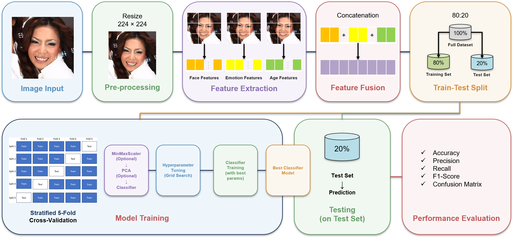
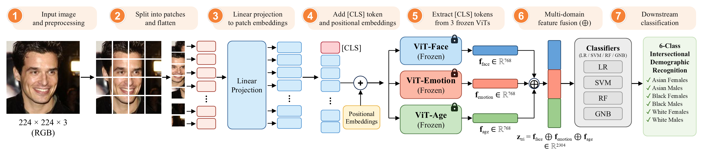
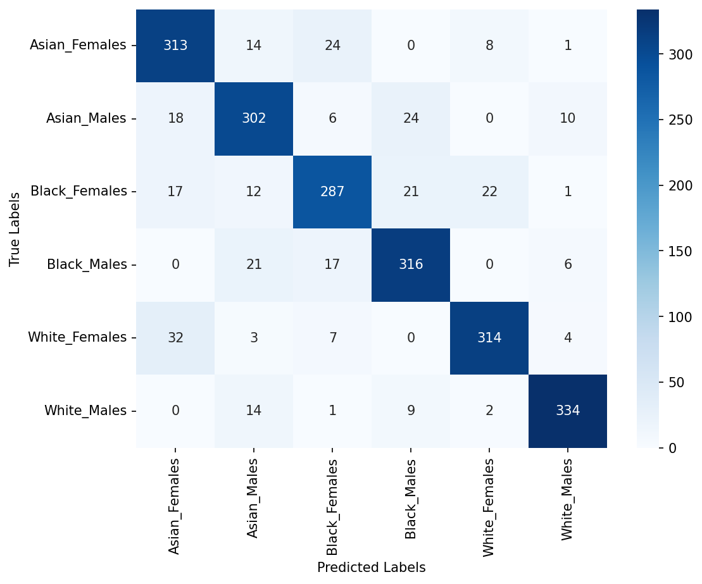
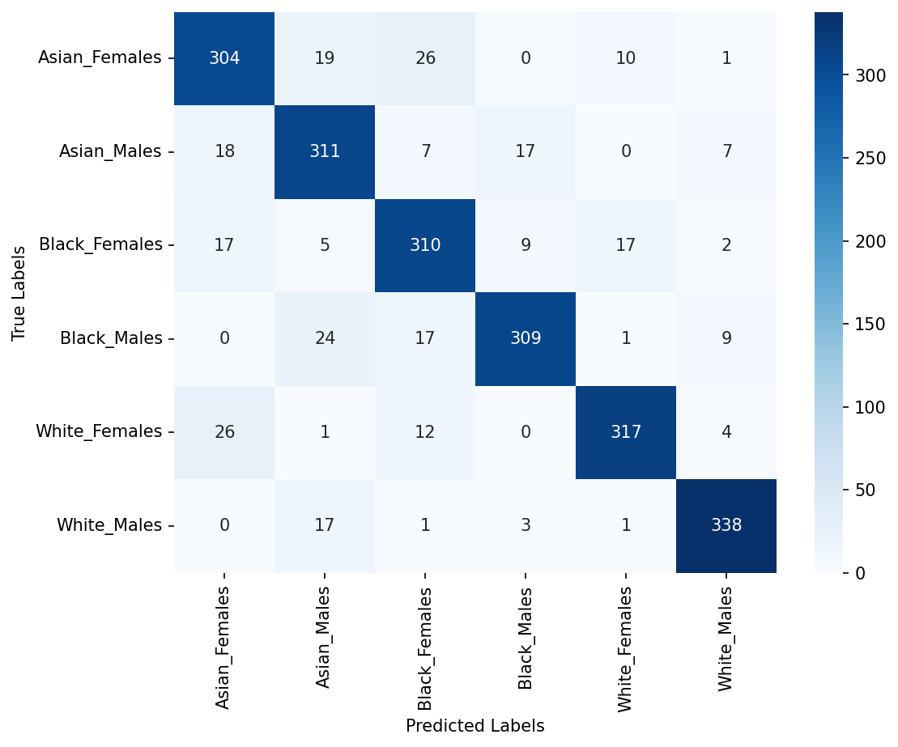

# Paper Outline Terperinci (Versi 1.1 - Definitif Revisi) - IEEE Access (Manuscript ID: Access-2026-50857)

> **Status Versi**: **Versi 1.1 (Definitif Revisi IEEE Access / Subject-Disjoint Primary Benchmark)**  
> **Catatan Tata Kelola**: Berkas ini memuat outline naskah revisi komprehensif yang memenuhi seluruh rekomendasi penelaah IEEE Access (Primary Benchmark Subject-Disjoint 0% leakage, LR 88.66% / SVM 88.61%, uji McNemar, profil Edge AI, kalibrasi fairness EOD, Table I-XVI, Figure 1-4, Eq. 1-23). Untuk outline orisinal pra-revisi (Subject-Overlap 93.70%), silakan merujuk ke [paper_outline_v1.0.md](paper_outline_v1.0.md).  
> **Target Publikasi**: IEEE Access (Open Access, Q1 / Impact Factor: 3.4)  
> **Status Revisi**: *Reject & Resubmit* (Kesempatan Resubmission Tunggal Berbasis *Binary Peer Review*)  
> **Bahasa Naskah**: Bahasa Indonesia formal akademik dengan istilah teknis/ilmiah tetap dipertahankan dalam Bahasa Inggris baku  
> **Gaya Sitasi**: IEEE format ([1], [2], dst.)  
> **Topik Riset**: Klasifikasi Ras & Gender Interseksional Berbasis Fusi Fitur Multi-Domain Vision Transformer dan Classical Machine Learning Teroptimasi di Bawah Protokol Strict Subject-Disjoint Partitioning  

---

## 0. Global Writing Rules and Claim Boundaries (Standar Revisi IEEE Access)

### A. Allowed Claims and Core Focus
1. **Fokus Utama**: Evaluasi empiris komprehensif fusi representasi laten dari tiga domain visual wajah komplementer (*task-associated representations*: Biometrik Wajah, Ekspresi Emosi Wajah, dan Estimasi Usia Wajah) menggunakan Vision Transformer (ViT-Base) pra-latih (*offline feature extraction*) yang dipadukan dengan optimasi pipeline *classical machine learning* (5-Fold StratifiedGroupKFold GridSearchCV).
2. **Sistem Dual-Benchmark (Jawaban Reviewer 2 #2)**:
   - **Primary Benchmark (Subject-Disjoint Partitioning — Zero Identity Leakage)**: Evaluasi definitif pada subjek *held-out* yang belum pernah dilihat sebelumnya ($N = 2.160$ citra uji dari 120 subjek terisolasi sempurna; tepat 360 citra per kelas interseksional). Model terbaik dipimpin oleh **Logistic Regression (LR) Tri-Domain** dengan Akurasi **88.66%** (Macro F1: **0.8868**, 95% Wilson CI: [87.25%, 89.93%]) dan **Support Vector Machine (SVM) Tri-Domain** dengan Akurasi **88.61%** (Macro F1: **0.8863**, 95% Wilson CI: [87.20%, 89.88%]).
   - **Historical Baseline Archive (Subject-Overlap Split — 100% Identity Leakage)**: Replikasi partisi acak berbasis citra historis (8.640 latih / 2.160 uji, di mana seluruh 593 subjek uji hadir di data latih; SVM Tri-Domain meraih 93.70%). Disajikan secara eksplisit sebagai **studi ablasi kebocoran data (*data leakage ablation study*)** untuk menguantifikasi beban memorisasi identitas wajah (*facial identity memorization effect* sebesar 5.09 percentage points).
3. **Signifikansi Statistik Inferensial (Jawaban Reviewer 2 #5)**:
   - Keunggulan fusi multi-domain terhadap representasi wajah tunggal (*Single Face Biometrics*) terbukti **signifikan secara statistik** melalui *Paired McNemar Test with Edwards continuity correction* ($p = 3.46 \times 10^{-6} < 0.001$ pada SVM; $p = 6.78 \times 10^{-6} < 0.001$ pada LR).
   - Model LR Tri-Domain (88.66%) dan SVM Tri-Domain (88.61%) terbukti **setara secara statistik** (*statistically equivalent*, $p = 1.0000$, selisih bersih hanya +1 citra).
   - Penambahan domain usia biologis pada SVM dikualifikasikan secara jujur mengalami **kejenuhan representasi fitur laten asimtotik (*asymptotic feature saturation*)** ($p = 0.7343 > 0.05$), sementara pada LR linier memberikan kenaikan signifikan ($p = 0.0073 < 0.01$).
4. **Keunggulan Efisiensi Komputasi Ekstrem (Jawaban Reviewer 1 #5 & Reviewer 2 #8)**:
   - Melaporkan 5 dimensi efisiensi komputasi yang diminta R2 #8 hanya dengan angka yang **terukur dan terlacak ke log/JSON eksperimen**: (1) waktu ekstraksi fitur ViT offline terukur secara komparatif pada **CPU baseline** (Face 467,0 ms, Emotion 476,7 ms, Age 543,1 ms per citra; **~1.487 ms** untuk tri-domain; total 4,46 jam dari log `1.1_vit-*.md`) dan terakselerasi pada **GPU NVIDIA RTX 4060** dengan in-memory processor caching (Face 39,7 ms, Emotion 39,7 ms, Age 45,1 ms per citra; **124,5 ms** untuk tri-domain; total 22,4 menit dari berkas `experiment/code/times/*.json`; akselerasi **11,9× lebih cepat**), (2) durasi pelatihan 5-Fold GridSearchCV (LR Tri: **3.287,07 detik / 54,78 menit** vs SVM Tri: **30.666,02 detik / 511,10 menit**, atau **9,3× lebih cepat dilatih**; dari `train_time_seconds` pada JSON), (3) latensi inferensi per sampel (**0.0054 ms/sampel** pada LR vs 4.4481 ms pada SVM; **>820× lebih cepat**), (4) ukuran *feature cache* (30.8 MB/domain atau 92.4 MB untuk Tri-Domain; memori array uji dalam RAM hanya 18.98 MB), serta (5) ukuran penyimpanan model (**0.11 MB** pada LR vs 36.60 MB pada SVM; **>330× lebih ringkas**), menetapkan Logistic Regression sebagai model paling optimal untuk komputasi tepi (*Edge AI / Mobile deployment*).
5. **Kalibrasi Klaim Keadilan Algoritmik (Jawaban Reviewer 2 #6)**:
   - Metrik *Equal Opportunity Difference* ($\text{EOD} = 9.72\text{ pp}$ antara White Males 94.44% vs Black Females 84.72%) dilaporkan murni sebagai indikator disparitas performa subkelompok empiris, dan secara tegas **tidak diklaim sebagai jaminan keadilan algoritmik universal**.
6. **Konteks Komparasi Literatur (Jawaban Reviewer 1 #6 & Reviewer 2 #7)**:
   - Perbandingan dengan studi terdahulu pada DemogPairs (misal Putri et al. 2025) disajikan sebagai **penempatan kontekstual (*contextual comparison*)**, bukan *controlled benchmark*, karena studi terdahulu mengevaluasi pada partisi *subject-overlap*.
7. **Standarisasi Tipografi & Konvensi IEEE**:
   - Dilarang keras menggunakan karakter *em dash* (—); gunakan tanda pisah biasa (- atau --), tanda kurung, atau koma.
   - Istilah pengklasifikasi distandardisasi: Support Vector Machine (SVM), Logistic Regression (LR), Random Forest (RF), Gaussian Naive Bayes (GNB).
   - Penamaan konfigurasi fitur seragam menggunakan direct sum `⊕`: `Face`, `Emotion`, `Age`, `Emotion ⊕ Face`, `Face ⊕ Age`, `Emotion ⊕ Age`, `Face ⊕ Emotion ⊕ Age`.
   - Seluruh elemen berurutan kronologis ketat: **Figure 1–4**, **Table I–XVI**, dan **Eq. (1)–(23)**.

### B. Negative Constraints and Disallowed Claims
1. **Dilarang menyembunyikan isu tumpang tindih identitas**: Wajib transparan menyajikan perbandingan *Subject-Disjoint* vs *Subject-Overlap*.
2. **Dilarang mengklaim "universal improvement"**: Akui secara objektif bahwa pada Random Forest dan GNB, konfigurasi dual-domain mencatatkan akurasi yang kompetitif/puncak dibanding tri-domain.
3. **Dilarang berspekulasi fenotipik berlebihan**: Penjelasan matriks konfusi harus didasarkan murni pada data distribusi frekuensi kesalahan, bukan asumsi antropologi biologis yang tidak terverifikasi.
4. **Dilarang overclaim generalisasi**: Kesimpulan dibatasi secara eksplisit pada 3 kelompok ras makro dataset DemogPairs (Asian, Black, White).

---

## Front Matter

### Paper Title
**Multi-Domain Vision Transformer Fusion for Intersectional Demographic Classification from Facial Images**  
*(Fusi Vision Transformer Multi-Domain untuk Klasifikasi Demografis Interseksional dari Citra Wajah)*

### Authors & Affiliations (5 Penulis Sesuai Formulir Byline Change IEEE Access)
1. **Dr. Ir. Ricky Eka Putra, S.Kom., M.Kom.** ([ORCID: 0000-0002-5515-7967](https://orcid.org/0000-0002-5515-7967)) — *Department of Informatics, Faculty of Informatics, Universitas Negeri Surabaya, Surabaya 60231, Indonesia* (Corresponding Author: `rickyeka@unesa.ac.id`)
2. **Rezky Arisanti Putri, S.Kom., M.Kom.** ([ORCID: 0009-0000-8021-1833](https://orcid.org/0009-0000-8021-1833)) — *Department of Informatics, Faculty of Informatics, Universitas Negeri Surabaya, Surabaya 60231, Indonesia*
3. **Dr. Yuni Yamasari, S.Kom., M.Kom.** ([ORCID: 0000-0001-9719-3491](https://orcid.org/0000-0001-9719-3491)) — *Department of Informatics, Faculty of Informatics, Universitas Negeri Surabaya, Surabaya 60231, Indonesia*
4. **Rafy Aulia Akbar, S.Kom., M.Kom.** ([ORCID: 0009-0003-6991-0694](https://orcid.org/0009-0003-6991-0694)) — *Department of Informatics, Faculty of Informatics, Universitas Negeri Surabaya, Surabaya 60231, Indonesia*
5. **Assoc. Prof. Dr. Shukor Sanim Mohd Fauzi** ([ORCID: 0000-0003-4333-7853](https://orcid.org/0000-0003-4333-7853)) — *School of Computing Sciences, College of Computing, Informatics and Mathematics, Universiti Teknologi MARA, Cawangan Perlis, Kampus Arau, 02600 Arau, Perlis, Malaysia* (`shukorsanim@uitm.edu.my`)

### Abstract
Satu paragraf padat terpadu (**target 150–250 kata**), terstruktur: **Latar Belakang & Tantangan → Metodologi yang Diusulkan → Evaluasi Dual-Benchmark (Split Stratified Biasa vs. Zero Identity Leakage) → Kesimpulan Generalisasi**.
- **Latar Belakang & Tantangan**: Pengenalan atribut demografis wajah seperti ras dan gender secara simultan menghadapi tantangan variasi ekspresi, penuaan biologis, tumpang tindih fenotipik (*phenotypic overlap*), keterbatasan representasi domain tunggal (*single-domain*), serta kerentanan model terhadap kebocoran identitas subjek (*identity leakage*).
- **Metode**: Mengusulkan kerangka kerja fusi fitur multi-domain yang mengintegrasikan representasi visual dari tiga model Vision Transformer (ViT) *pre-trained* spesifik tugas untuk biometrik wajah, ekspresi afektif, dan estimasi usia, yang dipadukan dengan optimasi pipeline *machine learning* klasik untuk klasifikasi enam subkelompok demografis interseksional pada dataset DemogPairs. Representasi visual diekstraksi secara *offline* dari setiap model untuk menghasilkan representasi terpadu yang memadukan informasi komplementer lintas-domain. Tujuh konfigurasi fitur dievaluasi pada empat pengklasifikasi: Random Forest (RF), Gaussian Naive Bayes (GNB), Logistic Regression (LR), dan Support Vector Machine (SVM).
- **Evaluasi Dual-Benchmark & Hasil**: Evaluasi dilakukan secara komparatif melalui dua protokol partisi:
  1. **Split Stratified Class Biasa (*Subject-Overlap*)**: Model SVM tri-domain meraih performa tertinggi dengan Accuracy **93.70%** dan F1-Score **93.69%**.
  2. **Zero Identity Leakage (*Subject-Disjoint*)**: Logistic Regression tri-domain mencatatkan performa terbaik dengan Accuracy **88.66%** dan F1-Score **88.68%**, disusul SVM tri-domain dengan Accuracy **88.61%** dan F1-Score **88.63%**.
- **Kesimpulan**: Penurunan nominal sebesar 5.09 percentage points menguantifikasi efek memorisasi identitas (*identity memorization*), membuktikan bahwa fusi fitur multi-domain menghasilkan representasi demografis yang tangguh dan tergeneralisasi dengan baik pada subjek baru yang belum pernah dilihat sebelumnya.

### Keywords
Biometrics, face recognition, feature extraction, intersectional demographic recognition, multi-domain feature fusion, Vision Transformer.

---

## I. INTRODUCTION

> **Catatan Respons Reviewer (R1 Poin 1):**  
> - **Komentar Reviewer:** Reviewer 1 menilai bagian Pendahuluan (*Introduction*) terlalu panjang dan perlu diringkas (*"the introduction is too long need to be summarized"*).  
> - **Rencana Mitigasi:** Memadatkan narasi pendahuluan sebesar ~28% (menjadi rentang 700–850 kata terfokus), membagi struktur narasi ke dalam 7 paragraf proporsional dengan alur logis yang padat, serta langsung menajamkan esensi tantangan klasifikasi interseksional.

Struktur narasi direorganisasi menjadi 7 paragraf terfokus yang memadukan kejelasan masalah, konteks literatur, dan ketegasan kontribusi:

```
[Paragraph 1: Demographic Face Recognition and Intersectional Disparity]
                               │
                               ▼
[Paragraph 2: From Isolated Tasks to Intersectional Classification]
                               │
                               ▼
[Paragraph 3: Architectural Evolution and Vision Transformer Representations]
                               │
                               ▼
[Paragraph 4: Methodological Research Gaps and Data Leakage Challenges]
                               │ (Transisi Kohesif)
                               ▼
[Paragraph 5: Proposed Tri-Domain ViT Fusion and Subject-Disjoint Protocol]
                               │
                               ▼
[Paragraph 6: Four Key Scientific Contributions of Revised Manuscript]
                               │
                               ▼
[Paragraph 7: Paper Organization]
```

### Paragraph 1: Demographic Face Recognition and Intersectional Performance Disparity
> **Catatan Respons Reviewer (R1 Poin 1):**  
> - **Komentar Reviewer:** Bagian pembuka dinilai terlalu umum dan bertele-tele dalam memaparkan latar belakang biometrik wajah.  
> - **Rencana Mitigasi:** Membatasi panjang paragraf secara ketat pada 100–115 kata, langsung menyoroti urgensi tata kelola identitas digital dan disparitas performa sistem visi komputer komersial terhadap kelompok minoritas.
- **Target Kata**: 100–115 kata.
- **Tujuan**: Menjelaskan urgensi analisis atribut demografis wajah (ras dan gender) pada sistem visi komputer modern serta memaparkan tantangan kritis disparitas performa terhadap subkelompok tertentu.
- **Poin Narasi**:
  1. Pengenalan otomatis atribut ras dan gender wajah memegang peranan krusial pada tata kelola identitas digital, kontrol akses biometrik, forensik, dan personalisasi antarmuka cerdas.
  2. Berbagai studi independen dan evaluasi NIST menunjukkan bahwa model visi komputer komersial memperlihatkan disparitas performa yang merugikan kelompok minoritas tertentu, khususnya wanita berkulit gelap.
  3. Kesenjangan ini bersumber dari karakteristik distribusi data latih dan representasi fitur visual yang kurang tangguh terhadap variasi fenotipik serta pencahayaan lingkungan.
- **Transisi / Kalimat Penutup**: Keterbatasan penanganan variasi visual pada sistem konvensional ini memperlihatkan bahwa pengenalan atribut demografis yang akurat masih menghadapi tantangan, sehingga dibutuhkan pendekatan pengenalan demografis wajah yang mampu memodelkan interaksi ras dan gender secara terpadu.

### Paragraph 2: From Isolated Tasks to Intersectional Classification
- **Target Kata**: 100–115 kata.
- **Tujuan**: Menjelaskan transisi dari klasifikasi atribut terisolasi (ras saja atau gender saja) menuju klasifikasi interseksional terpadu (kombinasi ras dan gender).
- **Poin Narasi**:
  1. Praktik umum dalam literatur memisahkan klasifikasi ras dan gender sebagai dua model independen yang berdiri sendiri.
  2. Pendekatan terisolasi tersebut gagal menangkap dinamika kesalahan pada persilangan subkelompok demografis tertentu (seperti Black Females atau Asian Females), sehingga penurunan akurasi pada irisan demografis spesifik dapat luput dari audit.
  3. Formulasi interseksional terpadu (3 Ras × 2 Gender = 6 kelas) pada kondisi evaluasi seimbang (*balanced evaluation*) memungkinkan audit performa yang adil dan objektif tanpa distorsi jumlah sampel.
- **Transisi / Kalimat Penutup**: Pemodelan klasifikasi interseksional menuntut representasi visual yang kaya dan mampu memisahkan batas keputusan antarsubkelompok yang saling tumpang tindih secara fenotipik.

### Paragraph 3: Architectural Evolution and Vision Transformer Representations
> **Catatan Respons Reviewer (R1 Poin 1 & Pedoman Sitasi):**  
> - **Komentar Reviewer:** Ulasan literatur dalam pendahuluan sebelumnya terlalu melebar dan membebani alur pembacaan naskah.  
> - **Rencana Mitigasi:** Membatasi panjang paragraf pada 135–225 kata, merangkum evolusi dari CNN ke ViT secara padat, menerapkan aturan maksimal 3 sitasi per kalimat, serta menyertakan daftar 10 sitasi wajib tanpa penomoran braket angka.
- **Target Kata**: 135–225 kata.
- **Aturan Sitasi Khusus**: Usahakan maksimal 3 sitasi per kalimat untuk menjaga keterbacaan naskah.
- **Tujuan**: Memberikan konteks perkembangan pendekatan arsitektur dari CNN konvensional ke Vision Transformer (ViT) serta metode pendukung lainnya dalam pengenalan atribut wajah.
- **Poin Narasi**:
  1. Pendekatan klasik berbasis fitur buatan tangan (*handcrafted features*: LBP, HOG, SIFT) dan Convolutional Neural Networks (CNN: VGG, ResNet, Xception) mengandalkan bias induktif lokal melalui *receptive field* terbatas, di mana penangkapan dependensi spasial global membutuhkan tumpukan lapisan yang lebih dalam.
  2. Arsitektur Vision Transformer (ViT) memperkenalkan mekanisme Multi-Head Self-Attention (MHSA) yang memungkinkan pemodelan interaksi spasial global antarpatch citra secara langsung tanpa dibatasi *receptive field* lokal.
  3. Berbagai variasi pendekatan telah dieksplorasi dalam literatur, mencakup model berbasis wilayah wajah tengah, pembelajaran multi-tugas multi-skala, modul atensi paralel, mitigasi bias berbasis model generatif, hingga arsitektur transformer multi-aksis (MaxViT).
- **Daftar Sitasi Wajib Berdasarkan Judul Paper pada Related Works**:
  - *Automatic Ethnicity Classification from Middle Part of the Face Using Convolutional Neural Networks* (Belcar et al., Sensors 2022)
  - *Face Gender and Age Classification Based on Multi-Task, Multi-Instance and Multi-Scale Learning* (Liao et al., Applied Sciences 2022)
  - *Intelligent deep learning based ethnicity recognition and classification using facial images* (Sunitha et al., Image and Vision Computing 2022)
  - *A Multidimensional Analysis of Social Biases in Vision Transformers* (Brinkmann et al., ICCV 2023)
  - *Deep Generative Views to Mitigate Gender Classification Bias Across Gender-Race Groups* (Ramachandran & Rattani, Springer / ICPR Workshops 2023)
  - *Learning an attention-aware parallel sharing network for facial attribute recognition* (Chen et al., JVCI 2023)
  - *Classifying Gender Based on Face Images Using Vision Transformer* (Tahyudin et al., JOIV 2024)
  - *Ethnicity Classification Based on Facial Images using Deep Learning Approach* (Kalkatawi & Saeed, IJACSA 2024)
  - *Dual Vision Transformer Integration for Race and Gender Recognition Based on Facial Images* (Putri et al., IEEE ICVEE 2025)
  - *MD-ViT: Multidomain Vision Transformer Fusion for Fair Demographic Attribute Recognition* (Putri et al., JIEET 2025)
- **Transisi**: Terlepas dari pesatnya eksplorasi model berbasis visi dan transformer tersebut, telaah literatur mengidentifikasi sejumlah tantangan metodologis yang masih memerlukan kajian empiris terpadu.

### Paragraph 4: Methodological Research Gaps and Data Leakage Challenges
> **Catatan Respons Reviewer (R2 Poin 2 & R2 Poin 5):**  
> - **Komentar Reviewer:** Reviewer 2 menyoroti risiko kebocoran identitas pada pemisahan data acak (*"image-level stratified split may allow images of the same identity to occur in both training and test sets"*) dan ketiadaan uji signifikansi inferensial pada studi literatur terdahulu.  
> - **Rencana Mitigasi:** Mengidentifikasi secara eksplisit ancaman *identity leakage* sebagai *research gap* metodologis utama bersama dengan keterbatasan representasi domain tunggal dan ketiadaan validasi inferensial formal (100–115 kata).
- **Target Kata**: 100–115 kata.
- **Tujuan**: Merumuskan kesenjangan riset metodologis utama (*research gaps*) yang mengaitkan keterbatasan representasi domain tunggal, ancaman kebocoran identitas, dan ketiadaan validasi inferensial.
- **Poin Narasi**:
  1. *Keterbatasan Single-Domain*: Representasi geometri biometrik statis rentan terhadap distorsi ekspresi afektif dinamis dan perubahan morfologi penuaan biologis jika fitur terkait tidak diikutsertakan.
  2. *Ancaman Identity Leakage*: Evaluasi konvensional berbasis *image-level random split* berisiko membagi foto dari subjek yang sama ke dalam set latih dan uji, memicu model menghafal identitas individu (*shortcut learning*) alih-alih mempelajari pola demografis sejati.
  3. *Ketiadaan Uji Inferensial & Profil Efisiensi*: Studi terdahulu umumnya minim pembuktian signifikansi statistik formal (seperti uji berpasangan McNemar) dan belum mengkaji profil latensi serta jejak memori untuk implementasi praktis.
- **Transisi Kohesif ke Usulan Solusi**: Guna menjembatani keterbatasan representasi domain tunggal dan memvalidasi generalisasi bebas kebocoran identitas tersebut, penelitian ini mengusulkan kerangka fusi tri-domain ViT di bawah protokol evaluasi ketat.

### Paragraph 5: Proposed Tri-Domain ViT Fusion Framework and Subject-Disjoint Protocol
> **Catatan Respons Reviewer (R2 Poin 2 & R2 Poin 4):**  
> - **Komentar Reviewer:** Reviewer 2 meminta evaluasi bebas kebocoran identitas (*"provide subject-disjoint evaluation to establish genuine generalization"*) serta rekonsiliasi aritmatika ruang pencarian hyperparameter (*"totals of 1,086 configurations, 38,010 fits, and 28 refits"*).  
> - **Rencana Mitigasi:** Memaparkan arsitektur Dual-Benchmark (menetapkan *Strict Subject-Disjoint Partitioning* 0% kebocoran sebagai tolok ukur utama dan *Subject-Overlap* sebagai studi ablasi memorisasi) serta merinci pipeline optimasi 5-Fold StratifiedGroupKFold GridSearchCV (135–175 kata).
- **Target Kata**: 135–175 kata.
- **Tujuan**: Memaparkan kerangka kerja usulan yang menjawab seluruh kesenjangan riset pada Paragraf 4 secara sistematis, mencakup integrasi tri-domain, protokol evaluasi, dan pipeline optimasi hyperparameter.
- **Poin Narasi**:
  1. Mengusulkan kerangka kerja fusi Tri-Domain ViT yang memadukan tiga representasi laten ortogonal: geometri biometrik statis (`ViT-Face`), ekspresi afektif dinamis (`ViT-Emotion`), dan morfologi penuaan biologis (`ViT-Age`) melalui operasi konkatenasi langsung (`Face ⊕ Emotion ⊕ Age`).
  2. Ekstraksi representasi laten token `[CLS]` dilakukan secara *offline* dari backbone Vision Transformer pra-latih yang dibekukan (*frozen*) guna mempertahankan efisiensi komputasi dan meminimalkan beban pelatihan.
  3. Mengadopsi arsitektur evaluasi **Dual-Benchmark** yang menetapkan protokol **Strict Subject-Disjoint Partitioning** pada dataset DemogPairs (600 subjek unik, 0% kebocoran identitas) sebagai tolok ukur utama generalisasi, sekaligus mempertahankan evaluasi *subject-overlap* historis sebagai studi ablasi empiris untuk menguantifikasi beban memorisasi identitas wajah.
  4. Melakukan optimasi hyperparameter komprehensif pada empat rumpun algoritma pembelajaran mesin klasik (RF, GNB, LR, SVM) melalui validasi silang 5-Fold StratifiedGroupKFold dengan pipeline modular Scaler-PCA yang difitting secara terisolasi pada fold latih guna menjamin pencegahan kebocoran informasi (mencakup total 38.010 penyesuaian validasi silang).

### Paragraph 6: Four Key Scientific Contributions
> **Catatan Respons Reviewer (R1 Poin 1 & R2 Poin 1):**  
> - **Komentar Reviewer:** Reviewer 1 meminta penegasan kontribusi ilmiah naskah yang terfokus, dan Reviewer 2 meminta distingsi kebaruan metodologis melampaui konkatenasi sederhana terhadap model dual/multi-domain sebelumnya (*"methodological novelty beyond concatenating three pretrained representations... should be clearly established"*).  
> - **Rencana Mitigasi:** Menyajikan 4 butir kontribusi ilmiah utama secara elegan dalam format dwibahasa (Bahasa Inggris dan terjemahan Bahasa Indonesia) murni berbasis kebaruan konseptual tanpa memuat angka-angka hasil performa, menegaskan sinergi representasi multi-domain, tolok ukur subject-disjoint bebas kebocoran, pengujian inferensial, serta efisiensi komputasi tepi (125–150 kata).
- **Target Kata**: 125–150 kata.
- **Tujuan**: Menyajikan empat kontribusi ilmiah penelitian secara ringkas, elegan, dan terstruktur dalam format dwibahasa (Bahasa Inggris dan terjemahan Bahasa Indonesia) tanpa menyertakan angka-angka hasil empiris.
- **Poin Narasi (English & Indonesian Translation)**:
  1. **A Multi-Domain ViT Latent Fusion Framework:** Formulating an integration framework that combines frozen task-specific Vision Transformer backbones (craniofacial biometrics, affective expressions, and biological age) into a unified complementary feature space for intersectional demographic classification.  
     *(Formulasi integrasi representasi laten multi-domain yang memadukan backbone Vision Transformer pra-latih yang dibekukan ke dalam ruang representasi terpadu untuk klasifikasi interseksional).*
  2. **Strict Subject-Disjoint Benchmark & Data Leakage Ablation:** Establishing a zero-leakage benchmark on the DemogPairs dataset and providing a comparative ablation study to quantify the facial identity memorization effect inherent in conventional random splits.  
     *(Penetapan tolok ukur evaluasi bebas kebocoran identitas dan studi komparatif ablasi kebocoran data guna menguantifikasi efek memorisasi identitas wajah).*
  3. **Inferential Hypothesis Testing & Asymptotic Saturation Characterization:** Conducting rigorous paired inferential testing to validate multi-domain superiority, demonstrating cross-classifier predictive equivalence, and characterizing the asymptotic representation saturation in non-linear models.  
     *(Pengujian hipotesis inferensial berpasangan yang memvalidasi keunggulan representasi multi-domain, membuktikan ekuivalensi prediktif lintas pengklasifikasi, serta mengkarakterisasi kejenuhan representasi asimtotik pada model non-linier).*
  4. **Comprehensive Computational Efficiency & Edge AI Validation:** Delivering a comprehensive computational profiling of inference latency and model memory footprint, establishing an ultra-lightweight and deployment-ready architecture for edge computing and mobile environments.  
     *(Penyajian profil efisiensi komputasi komprehensif mencakup latensi inferensi dan jejak memori yang merealisasikan arsitektur berbobot sangat ringan untuk implementasi komputasi tepi dan lingkungan bergerak).*

### Paragraph 7: Paper Organization
- **Target Kata**: 50–75 kata.
- **Tujuan**: Menjelaskan sistematika dan fungsi setiap bab dalam artikel secara ringkas dan padat.
- **Poin Narasi**:
  Artikel ini disusun sebagai berikut: Section II mengulas sintesis literatur terkait (Related Works); Section III menjabarkan dataset, metodologi ekstraksi multi-domain ViT, pipeline pengklasifikasi, serta metrik evaluasi (Materials and Methods); Section IV memaparkan analisis komparatif performa global, studi ablasi kebocoran data, pengujian signifikansi inferensial, profil efisiensi komputasi, analisis performa subkelompok interseksional, pola kesalahan, dan perbandingan kontekstual dengan literatur terdahulu (Results and Discussion); Section V menyimpulkan temuan utama, keterbatasan penelitian, dan arah riset mendatang (Conclusion).

---

## II. RELATED WORKS

> **Catatan Respons Reviewer (R1 Poin 2 & R2 Poin 1):**  
> - **Komentar Reviewer:** Reviewer 1 meminta restrukturisasi Related Works dengan alur yang lebih baik dan penambahan persamaan matematika (*"The related works needs to be modified in better way and add equations"*), sementara Reviewer 2 meminta distingsi kebaruan terhadap metode terdahulu.  
> - **Rencana Mitigasi:** Merestrukturisasi tinjauan pustaka ke dalam 3 subseksi tematik ringkas $\times$ 2 paragraf (total 6 paragraf, 100–115 kata/paragraf), melengkapi setiap domain dengan formulasi matematis formal (Eq. 1 s.d. Eq. 4), serta menegaskan posisi kebaruan penelitian pada subseksi C.

Sintesis literatur disusun dalam **3 subseksi tematik**, masing-masing terdiri atas **2 paragraf terstruktur (total 6 paragraf)** dengan target kata **100–115 kata per paragraf**:

```
II. RELATED WORKS
├── A. Demographic Face Recognition
│   ├── Paragraph 1: Evolution from Handcrafted to Deep Convolutional Features
│   └── Paragraph 2: Downstream Classifier Paradigms and Decision Boundaries [Eq. 1]
├── B. Vision Transformers in Face Analysis
│   ├── Paragraph 1: Theoretical Foundations and Spatial Self-Attention Mechanisms [Eq. 2 & 3]
│   └── Paragraph 2: Demographic Disparities and Fairness Propagation in Vision Transformers
└── C. Multi-Domain Feature Fusion
    ├── Paragraph 1: Multi-Task Learning and Multi-Domain Representation Integration [Eq. 4]
    └── Paragraph 2: Research Positioning and Novelty Affirmation
```

### A. Demographic Face Recognition
> **Catatan Respons Reviewer (R1 Poin 2):**  
> - **Komentar Reviewer:** Belum adanya perumusan matematis untuk merepresentasikan metode klasifikasi atribut demografis wajah pada literatur sebelumnya.  
> - **Rencana Mitigasi:** Menyajikan formulasi fungsi keputusan kernel KELM Eq. (1) dari Sunitha et al. (IVC 2022) pada Paragraf 2 guna memodelkan batas keputusan non-linier pengklasifikasi hilir pada ruang representasi demografis wajah.

#### Paragraph 1: Evolution from Handcrafted to Deep Convolutional Features
- **Target Kata**: 100–115 kata.
- **Fokus Sintesis**: Menelusuri evolusi tugas pengenalan ras dan gender wajah dari deskriptor berbasis wilayah/bagian tengah wajah (Belcar et al., Sensors 2022) dan rekayasa fitur manual (*handcrafted features*: LBP, HOG, Gabor) ke model representasi mendalam (CNN). Menguraikan bagaimana representasi konvolusional klasik berinteraksi dengan variasi pencahayaan dan disparitas performa antarras (*Other-Race Effect*) sebagaimana dilaporkan dalam literatur empiris (Sunitha et al., IVC 2022), serta pergeseran menuju mekanisme atensi paralel adaptif (Chen et al., JVCI 2023).
- **Sumber Literatur Terkait**:
  - *Automatic Ethnicity Classification from Middle Part of the Face Using Convolutional Neural Networks* (Belcar et al., Sensors 2022)
  - *Intelligent deep learning based ethnicity recognition and classification using facial images* (Sunitha et al., Image and Vision Computing 2022)
  - *Learning an attention-aware parallel sharing network for facial attribute recognition* (Chen et al., Journal of Visual Communication and Image Representation 2023)

#### Paragraph 2: Downstream Classifier Paradigms and Decision Boundaries
- **Target Kata**: 100–115 kata.
- **Fokus Sintesis**: Membandingkan paradigma pengklasifikasi hilir antara lapisan SoftMax *end-to-end* (Belcar et al., Sensors 2022), model pohon ensemble (*Random Forest*), model probabilistik (*Gaussian Naive Bayes*), dan *Support Vector Machine* (SVM) serta *Kernel Extreme Learning Machine* (KELM) (Sunitha et al., Image and Vision Computing 2022; Liao et al., Applied Sciences 2022; Kalkatawi & Saeed, IJACSA 2024). Menjelaskan bagaimana fungsi keputusan kernel non-linier memetakan representasi fitur wajah berdimensi tinggi:
  $$f(\mathbf{x}) = \mathbf{h}(\mathbf{x}) \mathbf{H}^T \left( \frac{\mathbf{I}}{C} + \mathbf{\Omega}_{\text{ELM}} \right)^{-1} \mathbf{Y} \tag{1}$$
  di mana $\mathbf{\Omega}_{\text{ELM}(i, r)} = K(\mathbf{x}_i, \mathbf{x}_r)$ memetakan fitur ke ruang separasi kernel Mercer tanpa memerlukan optimasi *gradient descent*.
- **Sumber Literatur Terkait**:
  - *Automatic Ethnicity Classification from Middle Part of the Face Using Convolutional Neural Networks* (Belcar et al., Sensors 2022)
  - *Intelligent deep learning based ethnicity recognition and classification using facial images* (Sunitha et al., Image and Vision Computing 2022)
  - *Face Gender and Age Classification Based on Multi-Task, Multi-Instance and Multi-Scale Learning* (Liao et al., Applied Sciences 2022)
  - *Ethnicity Classification Based on Facial Images using Deep Learning Approach* (Kalkatawi & Saeed, IJACSA 2024)

### B. Vision Transformers in Face Analysis
> **Catatan Respons Reviewer (R1 Poin 2 & R2 Poin 6):**  
> - **Komentar Reviewer:** Reviewer 1 meminta penambahan persamaan matematis arsitektur transformer, dan Reviewer 2 menyoroti telaah perambatan bias representasi (*fairness analysis scope*).  
> - **Rencana Mitigasi:** Menambahkan persamaan formal proyeksi linier patch Eq. (2) dan atensi Multi-Head Self-Attention Eq. (3), serta mengkaji mekanisme perambatan bias representasi dari korpus pra-latih (Brinkmann et al. 2023; Ramachandran & Rattani 2023).

#### Paragraph 1: Theoretical Foundations and Spatial Self-Attention Mechanisms
- **Target Kata**: 100–115 kata.
- **Fokus Sintesis**: Menganalisis landasan teoretis arsitektur Vision Transformer (Dosovitskiy et al., ICLR 2021) dalam memodelkan citra wajah. Berbeda dengan bias induktif lokal pada CNN, ViT membagi citra masukan menjadi $N$ patch visual berukuran $P \times P$ dengan $C$ kanal warna, memproyeksikannya secara linier ke dimensi laten $D$, dan memodelkan interaksi spasial global melalui Multi-Head Self-Attention (MHSA):
  $$\mathbf{x}_p \in \mathbb{R}^{N \times (P^2 \cdot C)}, \quad N = \frac{HW}{P^2} \tag{2}$$
  $$\text{Attention}(\mathbf{Q}, \mathbf{K}, \mathbf{V}) = \text{softmax}\left(\frac{\mathbf{Q}\mathbf{K}^T}{\sqrt{d_k}}\right)\mathbf{V} \tag{3}$$
  Mengulas penerapan transformer pada klasifikasi atribut demografis wajah terstandarisasi (Tahyudin et al., JOIV 2024; Kalkatawi & Saeed, IJACSA 2024) serta eksplorasi varian transformer hibrida bertingkat seperti MaxViT.
- **Sumber Literatur Terkait**:
  - *An Image is Worth 16x16 Words: Transformers for Image Recognition at Scale* (Dosovitskiy et al., ICLR 2021)
  - *Classifying Gender Based on Face Images Using Vision Transformer* (Tahyudin et al., JOIV 2024)
  - *Ethnicity Classification Based on Facial Images using Deep Learning Approach* (Kalkatawi & Saeed, IJACSA 2024)

#### Paragraph 2: Demographic Disparities and Fairness Propagation in Vision Transformers
- **Target Kata**: 100–115 kata.
- **Fokus Sintesis**: Menelaah fenomena disparitas performa dalam model visi transformer dan metodologi evaluasi demografis. Menguraikan bahwa pengujian pada dataset berdistribusi seimbang menyediakan kondisi eksperimen terkontrol untuk membandingkan performa antarsubkelompok tanpa distorsi ketimpangan sampel (namun keseimbangan tersebut tidak serta-merta menghilangkan bias sosial intrinsik). Menganalisis perambatan bias sosial dari korpus pra-latih berskala besar pada representasi laten encoder ViT (Brinkmann et al., ICCV 2023) serta teknik mitigasi generatif berbasis StyleGAN2 (Ramachandran & Rattani, Springer 2023).
- **Sumber Literatur Terkait**:
  - *A Multidimensional Analysis of Social Biases in Vision Transformers* (Brinkmann et al., ICCV 2023)
  - *Deep Generative Views to Mitigate Gender Classification Bias Across Gender-Race Groups* (Ramachandran & Rattani, Springer / ICPR Workshops 2023)

### C. Multi-Domain Feature Fusion
> **Catatan Respons Reviewer (R1 Poin 2 & R2 Poin 1):**  
> - **Komentar Reviewer:** Reviewer 2 menuntut kebaruan metodologis melampaui konkatenasi sederhana fitur pra-latih (*"methodological novelty beyond concatenating three pretrained representations"*).  
> - **Rencana Mitigasi:** Memformulasikan vektor fusi representasi multi-domain Eq. (4) dan mendedikasikan Paragraf 2 khusus untuk penegasan kebaruan metodologis (*Research Positioning & Novelty Affirmation*) tanpa sitasi luar, menggarisbawahi evaluasi subject-disjoint bebas kebocoran, pengujian inferensial, dan karakterisasi saturasi fitur.

#### Paragraph 1: Multi-Task Learning and Multi-Domain Representation Integration
- **Target Kata**: 100–115 kata.
- **Fokus Sintesis**: Membahas perkembangan pendekatan pembelajaran multi-tugas dan fusi representasi multi-domain pada atribut wajah (Liao et al., Applied Sciences 2022; Chen et al., JVCI 2023). Menguraikan keterbatasan model domain tunggal yang tidak mampu menangkap variasi visual wajah secara komplementer. Fusi representasi laten menggabungkan vektor fitur dari $M$ domain tugas khusus ke dalam ruang representasi bersama:
  $$\mathbf{z}_{\text{fusion}} = [\mathbf{f}_1 \,\|\, \mathbf{f}_2 \,\|\, \dots \,\|\, \mathbf{f}_M] \in \mathbb{R}^{\sum_{m=1}^M d_m} \tag{4}$$
  Menelaah temuan empiris penggabungan representasi biometrik wajah dengan ekspresi emosi (Putri et al., IEEE ICVEE 2025) atau estimasi usia biologis (Putri et al., JIEET 2025).
- **Sumber Literatur Terkait**:
  - *Face Gender and Age Classification Based on Multi-Task, Multi-Instance and Multi-Scale Learning* (Liao et al., Applied Sciences 2022)
  - *Learning an attention-aware parallel sharing network for facial attribute recognition* (Chen et al., Journal of Visual Communication and Image Representation 2023)
  - *Deep Generative Views to Mitigate Gender Classification Bias Across Gender-Race Groups* (Ramachandran & Rattani, Springer / ICPR Workshops 2023)
  - *Dual Vision Transformer Integration for Race and Gender Recognition Based on Facial Images* (Putri et al., IEEE ICVEE 2025)
  - *MD-ViT: Multidomain Vision Transformer Fusion for Fair Demographic Attribute Recognition* (Putri et al., Journal of Integrated and Advanced Engineering 2025)

#### Paragraph 2: Research Positioning and Novelty Affirmation
- **Target Kata**: 100–115 kata.
- **Fokus Sintesis**: Memetakan posisi kebaruan metodologis penelitian ini secara tegas terhadap literatur terdahulu (tanpa menyertakan sitasi pustaka luar). Berbeda dari karya sebelumnya yang berfokus pada fusi dual-domain di bawah evaluasi pembagian acak tingkat citra (*image-level split* yang rentan tumpang tindih identitas), penelitian ini mengusulkan kerangka fusi Tri-Domain ViT terpadu (`Face ⊕ Emotion ⊕ Age` = 2.304 dimensi) di bawah protokol ketat **Strict Subject-Disjoint Partitioning** (0% kebocoran identitas), optimasi komprehensif empat algoritma pembelajaran mesin klasik (RF, GNB, LR, SVM), serta validasi inferensial berbasis uji statistik berpasangan McNemar.
- **Sumber Literatur Terkait**:
  - *Tanpa sitasi pustaka* (sintesis orisinal posisi penelitian terhadap seluruh literatur di atas).

---

## III. MATERIALS AND METHODS

### Overview
- **Target Kata**: 150–200 kata (minimal 150 kata hingga 200 kata).
- **Tujuan**: Menjelaskan arsitektur keseluruhan kerangka kerja penelitian yang diusulkan (*end-to-end framework*) dari masukan citra wajah mentah, pemisahan partisi data subjek terisolasi (*Strict Subject-Disjoint*), ekstraksi fitur tri-domain ViT *offline*, fusi konkatenasi $\mathbf{z}_{\text{tri}} = \mathbf{f}_{\text{face}} \oplus \mathbf{f}_{\text{emotion}} \oplus \mathbf{f}_{\text{age}}$, hingga *pipeline* optimasi 5-Fold StratifiedGroupKFold GridSearchCV *classical classifier*.
- **Sitasi Gambar Wajib**: Mensitasi diagram metode keseluruhan pada file `images/method.png` (Figure 1).
- **Ketentuan Layout LaTeX**: Figure 1 harus berformat **full width (span two columns)** menggunakan environment `\begin{figure*} ... \end{figure*}`.
- **Caption Figure**: **Figure 1. End-to-End Framework of the Proposed Multi-Domain Vision Transformer Feature Fusion and Classical Classifier Optimization for Intersectional Race and Gender Classification.**
- **Visual Markdown**:  
  
- **Narasi Pendukung**: Menjelaskan alur pemrosesan: citra wajah berukuran $224 \times 224$ piksel dialirkan ke tiga model ViT-Base pra-latih yang dibekukan (*frozen*), representasi laten diekstraksi secara *offline*, digabungkan menjadi vektor fusi 2.304 dimensi, diproses melalui *pipeline* modular Scaler-PCA, dan diklasifikasikan ke dalam 6 kelas interseksional melalui 5-Fold StratifiedGroupKFold Cross-Validation pada empat pengklasifikasi (RF, GNB, LR, SVM).

### A. Dataset
> **Catatan Respons Reviewer (R1 Poin 5 & R2 Poin 2):**  
> - **Komentar Reviewer:** Reviewer 1 meminta rincian mendalam dataset DemogPairs (*"mention the dataset used in more detail"*), dan Reviewer 2 mempertanyakan tumpang tindih identitas (*"clarify whether identity overlap exists and provide subject-disjoint evaluation"*).  
> - **Rencana Mitigasi:** Menguraikan struktur 600 identitas unik DemogPairs (100 subjek/kelas, 18 citra/subjek) dan mengimplementasikan partisi ketat *Strict Subject-Disjoint Partitioning* (480 subjek latih / 120 subjek uji held-out, tepat 0% kebocoran) pada Tabel I berbahasa Inggris, didukung visualisasi sampel 6 subkelompok pada Gambar 2.

Bagian ini disusun dalam **2 paragraf**, masing-masing dengan target **100–115 kata**:

#### Paragraph 1: Dataset Composition and Subject Distribution
- **Target Kata**: 100–115 kata.
- **Tujuan**: Menjelaskan komposisi dataset **DemogPairs** (*DemogPairs: Quantifying the Impact of Demographic Imbalance in Deep Face Recognition*, Hupont & Fernández, IEEE FG 2019).
- **Poin Narasi**:
  1. Dataset DemogPairs memuat total 10.800 citra wajah yang terdistribusi secara seimbang sempurna pada 6 kelas interseksional (1.800 citra per subkelompok).
  2. Terdiri atas 600 subjek/identitas unik (100 subjek per kelas), di mana setiap subjek memiliki tepat 18 variasi foto dengan keragaman pose, pencahayaan, dan ekspresi.
  3. Distribusi kelas yang seimbang ini (*balanced evaluation setting*) menyediakan kondisi evaluasi yang terkontrol untuk membandingkan performa antarsubkelompok tanpa terdistorsi oleh ketidakseimbangan jumlah sampel per kelas.
- **Sitasi Gambar Wajib**: Mensitasi contoh citra sampel dataset DemogPairs pada [Figure 2](#fig2) (Figure 2a s.d. 2f).
- **Ketentuan Layout LaTeX**: Figure 2 disusun sebagai **satu gambar komposit (`sample_demogpairs.png`) berformat full width (`\begin{figure*}`)** dengan susunan **1 baris × 6 kolom** berurutan:
  - Kolom 1-6: (a) Asian Females, (b) Asian Males, (c) Black Females, (d) Black Males, (e) White Females, (f) White Males
  - Label (a)-(f) dicetak tebal di atas masing-masing citra, dan **seluruh citra memiliki tinggi yang seragam** (komposit diregenerasi dari enam citra sumber dengan tinggi sama).
- **Caption Figure**: **Figure 2. Sample Images of the DemogPairs Dataset across Six Intersectional Demographic Subgroups: (a) Asian Females, (b) Asian Males, (c) Black Females, (d) Black Males, (e) White Females, and (f) White Males.**
- **Visual Markdown**:
  - *(a) Asian Females:*  
    
  - *(b) Asian Males:*  
    
  - *(c) Black Females:*  
    
  - *(d) Black Males:*  
    
  - *(e) White Females:*  
    
  - *(f) White Males:*  
    

#### Paragraph 2: Strict Subject-Disjoint Partitioning and Preprocessing
- **Target Kata**: 100–115 kata.
- **Tujuan**: Menjelaskan protokol pembagian data bebas kebocoran identitas (*Strict Subject-Disjoint Partitioning*) dan tahapan standardisasi citra (*preprocessing*).
- **Poin Narasi**:
  1. Isolasi subjek secara ketat menggunakan pembagian 80/20 berbasis identitas (`StratifiedGroupKFold`, groups = `subject_id`): 480 subjek latih (8.640 citra) dan 120 subjek uji *held-out* (2.160 citra) dengan tingkat kebocoran identitas tepat 0.00% sebagaimana dirincikan pada [Table I](#tab1).
  2. Subset uji terisolasi sempurna dan tidak pernah dilibatkan selama proses pencarian hyperparameter maupun fitting PCA/Scaler.
  3. Preprocessing citra mencakup konversi ke 3-channel RGB, deteksi dan *face alignment* MTCNN, resize ke resolusi $224 \times 224$ piksel, dan normalisasi intensitas kanal ke rentang $[0, 1]$.
- **Table I (Dataset Partition and Distribution in English)**:

**Table I. DemogPairs Dataset Partition and Subject-Disjoint Demographic Subgroup Distribution.**

| Intersectional Subgroup | Macro Race | Gender | Unique Subjects | Train Set (80% Subjects) | Held-Out Test Set (20% Subjects) | Total Images |
|---|:---:|:---:|:---:|:---:|:---:|:---:|
| **Asian_Females** | Asian | Female | 100 | 80 subjects (1,440 images) | 20 subjects (360 images) | 1,800 |
| **Asian_Males** | Asian | Male | 100 | 80 subjects (1,440 images) | 20 subjects (360 images) | 1,800 |
| **Black_Females** | Black | Female | 100 | 80 subjects (1,440 images) | 20 subjects (360 images) | 1,800 |
| **Black_Males** | Black | Male | 100 | 80 subjects (1,440 images) | 20 subjects (360 images) | 1,800 |
| **White_Females** | White | Female | 100 | 80 subjects (1,440 images) | 20 subjects (360 images) | 1,800 |
| **White_Males** | White | Male | 100 | 80 subjects (1,440 images) | 20 subjects (360 images) | 1,800 |
| **Total** | **3 Races** | **2 Genders** | **600 Subjects** | **480 Subjects (8,640 images)** | **120 Subjects (2,160 images)** | **10,800** |

### B. Vision Transformer Multi-Domain Feature Extraction
> **Catatan Respons Reviewer (R1 Poin 3 & R2 Poin 3):**  
> - **Komentar Reviewer:** Reviewer 1 meminta desain ulang Figure 3 yang kurang jelas (*"figure 3 needs to be redesigned and explained in better way"*), sedangkan Reviewer 2 meminta spesifikasi teknis checkpoint HuggingFace, normalisasi, dan alur ekstraksi token `[CLS]` untuk reproduktibilitas (*"specify exact checkpoint versions, normalization parameters, and feature extraction procedures"*).  
> - **Rencana Mitigasi:** Menyajikan diagram vektor Figure 3 resolusi tinggi 300+ DPI berformat full-width, merinci spesifikasi resmi checkpoint HuggingFace beserta parameter normalisasi kanal pada Tabel II, serta merumuskan ekstraksi token `[CLS]` Layer 12 pada Eq. (7) dan fusi tri-domain pada Eq. (8).
- **Target Kata**: 220–260 kata (2 paragraf).
- **Paragraf 1 (Arsitektur ViT & Redesain Figure 3)**:
  - Struktur ViT-Base: 12 lapisan transformer encoder, 12 attention heads ($d_k = 64$), dimensi embedding tersembunyi $D = 768$, patch $16 \times 16$ ($N = 196$ patch).
  - Proyeksi linier dan embedding posisi:
    $$\mathbf{z}_0 = [\mathbf{x}_{\text{class}}; \, \mathbf{x}_p^1\mathbf{E}; \, \dots; \, \mathbf{x}_p^N\mathbf{E}] + \mathbf{E}_{\text{pos}}, \quad \mathbf{E} \in \mathbb{R}^{(P^2C) \times D}, \; \mathbf{E}_{\text{pos}} \in \mathbb{R}^{(N+1) \times D} \tag{5}$$
  - Pemrosesan blok encoder:
    $$\mathbf{z}'_\ell = \text{MHSA}(\text{LN}(\mathbf{z}_{\ell-1})) + \mathbf{z}_{\ell-1}, \quad \mathbf{z}_\ell = \text{MLP}(\text{LN}(\mathbf{z}'_\ell)) + \mathbf{z}'_\ell \tag{6}$$
  - **Elemen Wajib**: **Figure 3** (Diagram Vektor Resolusi Tinggi 300+ DPI Arsitektur Ekstraksi ViT Paralel & Fusi Konkatenasi, Full Width `\begin{figure*}`).
    *Caption:* **Figure 3. Redesigned High-Resolution Architecture of the Parallel Multi-Domain ViT Feature Extraction Backbones, Layer-12 CLS Token Extraction, and Direct Sum Feature Concatenation Pipeline.**
  - **Visual Markdown**:  
    
  - **Panduan Narasi Figure 3 (Jawaban R1 #3 *"explained in better way to show the novelty"*)**: Narasi wajib merujuk eksplisit ke nomor tahapan pada gambar:
    1. **Tahap ①–④ (Tokenisasi, Persamaan 5-6)**: Citra $224 \times 224 \times 3$ dipartisi menjadi 196 patch $16 \times 16$ (Tahap ②), diproyeksikan linier ke $D = 768$ (Tahap ③), lalu ditambah token `[CLS]` dan $\mathbf{E}_{\text{pos}}$ menjadi 197 token (Tahap ④).
    2. **Catatan Interpretasi Gambar (Wajib Ditulis)**: Tahap ①–④ digambar satu kali demi keringkasan, tetapi mekanisme tersebut berlangsung **secara independen di dalam masing-masing dari ketiga backbone ViT-Base** pada Tahap ⑤, karena setiap checkpoint memiliki bobot $\mathbf{E}$, $\mathbf{E}_{\text{pos}}$, dan 12 layer encoder sendiri. Citra masukan identik, tetapi *image processor* tiap checkpoint berbeda (Table II).
    3. **Tahap ⑤ (Persamaan 7)**: Ketiga backbone yang dibekukan menghasilkan $\mathbf{f}_{\text{face}}, \mathbf{f}_{\text{emotion}}, \mathbf{f}_{\text{age}} \in \mathbb{R}^{768}$ dari token `[CLS]` layer 12.
    4. **Tahap ⑥–⑦ (Persamaan 8, 12)**: Fusi $\oplus$ menghasilkan $\mathbf{z}_{\text{tri}} \in \mathbb{R}^{2304}$ yang diteruskan ke empat pengklasifikasi (LR, SVM, RF, GNB) untuk 6 kelas interseksional.
    5. **Posisi Kebaruan**: Novelty dinyatakan pada tingkat *kerangka evaluasi* (fusi tri-domain tanpa fine-tuning + protokol subject-disjoint + uji inferensial + profil efisiensi), **bukan** pada arsitektur ViT yang digunakan apa adanya. Jangan mengklaim arsitektur ViT baru.
- **Paragraf 2 (Spesifikasi Checkpoint HuggingFace & Fusi Konkatenasi)**:
  - Dokumentasi resmi 3 checkpoint pra-latih yang dibekukan (*frozen*):
    1. `ViT-Face` (`skutaada/VIT-VGGFace`): Fine-tuned dari `google/vit-base-patch16-224-in21k` untuk representasi identitas dan biometrik kraniofasial statis.
    2. `ViT-Emotion` (`dima806/facial_emotions_image_detection`): Fine-tuned dari `google/vit-base-patch16-224-in21k` untuk representasi ekspresi afektif dinamis.
    3. `ViT-Age` (`dima806/facial_age_image_detection`): Fine-tuned dari `google/vit-base-patch16-224-in21k` untuk estimasi umur dan morfologi penuaan biologis.
  - Implementasi ekstraksi fitur memanfaatkan *in-memory processor caching* (`_PROCESSOR_CACHE` pada `utils/extraction.py`) untuk mengeliminasi disk I/O reload berulang pada 10.800 citra, serta mencatat instrumentasi latensi berpresisi tinggi ke berkas JSON `experiment/code/times/features_vit-*.json`.
  - Ekstraksi token `[CLS]` lapisan ke-12 ($\mathbf{z}_L^0$) dan normalisasi LayerNorm:
    $$\mathbf{f}_{\text{domain}} = \text{LN}(\mathbf{z}_L^0) \in \mathbb{R}^{768} \tag{7}$$
  - Fusi Tri-Domain via konkatenasi (direct sum):
    $$\mathbf{z}_{\text{tri}} = \mathbf{f}_{\text{face}} \oplus \mathbf{f}_{\text{emotion}} \oplus \mathbf{f}_{\text{age}} \in \mathbb{R}^{2304} \tag{8}$$
- **Elemen Wajib**:
  - **Table II** (Spesifikasi Checkpoint Model ViT Pra-Latih & Parameter Normalisasi — R2-3).
  - **Table III** (Skema Konfigurasi Fusi Fitur & Desain Studi Ablasi).

**Table II. Pre-trained Vision Transformer Backbone Specifications and Preprocessing Parameters.**

| Domain Model | HuggingFace Checkpoint (Revision SHA) | Base Model & Task | Input Size | Resize / Interpolation | Per-Channel Normalization ($\mu, \sigma$) | Output Representation |
|---|---|---|:---:|:---:|---|:---:|
| **`ViT-Face`** | `skutaada/VIT-VGGFace` (`e85f0c9`) | Fine-tuned from `google/vit-base-patch16-224-in21k`; facial identity/biometrics | $224 \times 224 \times 3$ | Bilinear | $\mu = [0.5, 0.5, 0.5]$, $\sigma = [0.5, 0.5, 0.5]$ | Token `[CLS]` Layer 12 (768-D) |
| **`ViT-Emotion`** | `dima806/facial_emotions_image_detection` (`747cf16`) | Fine-tuned from `google/vit-base-patch16-224-in21k`; facial emotion classification | $224 \times 224 \times 3$ | Bilinear | $\mu = [0.5, 0.5, 0.5]$, $\sigma = [0.5, 0.5, 0.5]$ | Token `[CLS]` Layer 12 (768-D) |
| **`ViT-Age`** | `dima806/facial_age_image_detection` (`ad35933`) | Fine-tuned from `google/vit-base-patch16-224-in21k`; age-bin classification | $224 \times 224 \times 3$ | Bilinear | $\mu = [0.5, 0.5, 0.5]$, $\sigma = [0.5, 0.5, 0.5]$ | Token `[CLS]` Layer 12 (768-D) |

> **Catatan Verifikasi Table II (diverifikasi dari `preprocessor_config.json`, `config.json`, dan model card HuggingFace pada 2026-10-31):** (1) Ketiga checkpoint memakai `image_mean = image_std = [0.5, 0.5, 0.5]`; nilai ImageNet `[0.485, 0.456, 0.406]` yang sebelumnya tertulis untuk ViT-Face **salah dan sudah dikoreksi**. (2) Ketiganya adalah ViT-Base/16 (12 layer, hidden 768) hasil fine-tuning dari `google/vit-base-patch16-224-in21k`. (3) Model card **tidak mendokumentasikan korpus pra-latih** (klaim "VGGFace2" dan "FER-2013" pada draf lama tidak terverifikasi dan dihapus; jangan ditulis ulang tanpa sumber). (4) SHA adalah HEAD `main` saat diambil; **konfirmasi bahwa revisi tidak berubah sejak ekstraksi fitur** atau pin SHA tersebut pada `from_pretrained(..., revision=...)` sebelum submit. (5) Ekstraksi memakai `AutoImageProcessor` dan `model.vit(...).last_hidden_state[:, 0, :]` dengan `torch.no_grad()` (`utils/extraction.py`). **Perhatikan:** kode ekstraksi mengambil `last_hidden_state`, yang sudah melewati `LayerNorm` akhir pada `ViTModel`, sehingga selaras dengan Eq. (7).
**Table III. Multi-Domain Feature Fusion and Systematic Ablation Configurations.**

| # | Feature Scheme | Category | Input Source Domains | Feature Dimension |
|:---:|---|:---:|---|:---:|
| 1 | `Face` | Single-Domain | Static Craniofacial Biometrics (`skutaada/VIT-VGGFace`) | 768 |
| 2 | `Emotion` | Single-Domain | Dynamic Affective Expressions (`dima806/facial_emotions...`) | 768 |
| 3 | `Age` | Single-Domain | Biological Aging Morphology (`dima806/facial_age...`) | 768 |
| 4 | `Emotion ⊕ Face` | Dual-Domain | Affective Dynamics + Craniofacial Biometrics | 1,536 |
| 5 | `Face ⊕ Age` | Dual-Domain | Craniofacial Biometrics + Aging Morphology | 1,536 |
| 6 | `Emotion ⊕ Age` | Dual-Domain | Affective Dynamics + Aging Morphology | 1,536 |
| 7 | `Face ⊕ Emotion ⊕ Age` | Tri-Domain (Proposed) | Biometrics + Affective Dynamics + Aging Morphology | 2,304 |

### C. Random Forest
- **Target Kata**: 100–120 kata.
- **Poin Pembahasan**: Ensemble bagging dengan $B$ pohon keputusan, parameter subspace `max_features` ($\in \{\text{'sqrt'}, \text{'log2'}\}$), kedalaman pohon, kriteria Gini impurity, dan penalaan grid search.
- **Elemen Wajib**: **Table IV** (Ruang Pencarian Hyperparameter Random Forest — 288 kombinasi, 1.440 fits).

### D. Gaussian Naive Bayes
- **Target Kata**: 100–120 kata.
- **Poin Pembahasan**: Pengklasifikasi probabilistik berbasis Teorema Bayes dengan asumsi independensi fitur Gaussian:
  $$P(x_i \mid y = c) = \frac{1}{\sqrt{2\pi\sigma_{c,i}^2}} \exp\left(-\frac{(x_i - \mu_{c,i})^2}{2\sigma_{c,i}^2}\right) \tag{9}$$
- **Elemen Wajib**: **Table V** (Ruang Pencarian Hyperparameter GNB — 240 kombinasi, 1.200 fits).

### E. Logistic Regression
- **Target Kata**: 100–120 kata.
- **Poin Pembahasan**: Model multinomial Softmax ter-regularisasi $L_2$ dengan optimasi loss cross-entropy multi-kelas:
  $$P(y = c \mid \mathbf{x}) = \frac{e^{\mathbf{w}_c^T \mathbf{x} + b_c}}{\sum_{j=1}^K e^{\mathbf{w}_j^T \mathbf{x} + b_j}} \tag{10}$$
- Penalaan kekuatan penalti $C$ dan solver konvergens (`lbfgs`, `saga`, `newton-cg`).
- **Elemen Wajib**: **Table VI** (Ruang Pencarian Hyperparameter Logistic Regression — 270 kombinasi, 1.350 fits).

### F. Support Vector Machine
- **Target Kata**: 110–130 kata.
- **Poin Pembahasan**: Penentuan hyperplane pemisah margin maksimal non-linier menggunakan fungsi kernel (RBF dan polinomial):
  $$K(\mathbf{x}_i, \mathbf{x}_j) = (\gamma \langle \mathbf{x}_i, \mathbf{x}_j \rangle + \text{coef0})^d, \quad d \in \{2, 3\} \tag{11}$$
  *(di mana parameter $\text{coef0} = 0.0$ default pada implementasi standar `sklearn.svm.SVC`)*.
- **Elemen Wajib**: **Table VII** (Ruang Pencarian Hyperparameter SVM — 288 kombinasi, 1.440 fits).

### G. Classification Pipeline & Search Space Reconciliation
> **Catatan Respons Reviewer (R2 Poin 4):**  
> - **Komentar Reviewer:** Reviewer 2 meminta rekonsiliasi aritmatika ruang pencarian hyperparameter (*"totals of 1,086 configurations, 38,010 cross-validation fits, and 28 final refits should be reconciled with individual search spaces"*).  
> - **Rencana Mitigasi:** Menjabarkan rekonsiliasi matematis secara transparan: (SVM: 288 + LR: 270 + RF: 288 + GNB: 240) = 1.086 kombinasi $\times$ 5 folds = 5.430 fits per skema $\times$ 7 skema fitur = 38.010 fits validasi silang + 28 refits akhir, dengan isolasi penuh pipeline Scaler-PCA di dalam fold latih guna mencegah kebocoran informasi.
- **Target Kata**: 120–150 kata.
- **Arsitektur Rantai Transformasi Modular**:
  $$\mathbf{x} \xrightarrow{\text{Scaler}} \tilde{\mathbf{x}} \xrightarrow{\text{PCA}} \hat{\mathbf{x}} \xrightarrow{\text{Classifier}} \hat{y} \in \{0, 1, 2, 3, 4, 5\} \tag{12}$$
- **Rekonsiliasi Aritmatika Ruang Pencarian (Jawaban R2-4)**:
  - SVM: 288 kombinasi $\times$ 5 folds = 1.440 fits
  - LR: 270 kombinasi $\times$ 5 folds = 1.350 fits
  - RF: 288 kombinasi $\times$ 5 folds = 1.440 fits
  - GNB: 240 kombinasi $\times$ 5 folds = 1.200 fits
  - Total: **1.086 kombinasi hyperparameter** $\times$ 5 folds = 5.430 fits per skema fitur.
  - Melintasi 7 skema fitur: $5.430 \times 7 = \mathbf{38.010\text{ CV fits}}$ ditambah **28 refits akhir** pada keseluruhan set latih.
  - Seluruh penskalaan dan PCA difitting secara terisolasi hanya pada fold latih di dalam `Pipeline` scikit-learn untuk menjamin pencegahan kebocoran data.

### H. Evaluation Metrics & Statistical Testing
> **Catatan Respons Reviewer (R2 Poin 5 & R2 Poin 6):**  
> - **Komentar Reviewer:** Reviewer 2 menuntut pengujian hipotesis inferensial berpasangan McNemar yang tepat (*"claims should be appropriately qualified according to McNemar test"*), dan menuntut kejelasan batasan klaim keadilan algoritmik EOD (*"clarify scope and limitations of fairness claims"*).  
> - **Rencana Mitigasi:** Menyertakan formulasi matematis Uji McNemar berpasangan dengan koreksi kontinuitas Edwards Eq. (21), Wilson Score 95% CI Eq. (22), serta mendefinisikan EOD Eq. (23) murni sebagai indikator disparitas performa subkelompok empiris tanpa overclaim jaminan keadilan universal.
- **Target Kata**: 180–220 kata (2 paragraf).
- **Paragraf 1 (Metrik Subkelompok OvR & Agregasi Global)**:
  - Formulasi evaluasi One-vs-Rest (OvR) per kelas $c \in \{1, \dots, K\}$:
    $$\text{Accuracy}_c = \frac{TP_c + TN_c}{TP_c + TN_c + FP_c + FN_c} \tag{13}$$
    $$\text{Precision}_c = \frac{TP_c}{TP_c + FP_c} \tag{14}$$
    $$\text{Recall}_c = \frac{TP_c}{TP_c + FN_c} \tag{15}$$
    $$\text{F1-Score}_c = \frac{2 \cdot \text{Precision}_c \cdot \text{Recall}_c}{\text{Precision}_c + \text{Recall}_c} \tag{16}$$
  - Agregasi Global (Overall Accuracy dan Macro Average):
    $$\text{Accuracy}_{\text{Global}} = \frac{\sum_{c=1}^K TP_c}{N} \tag{17}$$
    $$\text{Precision}_{\text{Macro}} = \frac{1}{K} \sum_{c=1}^K \text{Precision}_c \tag{18}$$
    $$\text{Recall}_{\text{Macro}} = \frac{1}{K} \sum_{c=1}^K \text{Recall}_c \tag{19}$$
    $$\text{F1-Score}_{\text{Macro}} = \frac{1}{K} \sum_{c=1}^K \text{F1-Score}_c \tag{20}$$
- **Paragraf 2 (Uji McNemar Berpasangan, 95% Wilson CI & Metrik Keadilan EOD)**:
  - Uji McNemar berpasangan dengan koreksi kontinuitas Edwards untuk pasangan prediksi diskordan ($b$ dan $c$):
    $$\chi^2 = \frac{(|b - c| - 1)^2}{b + c} \tag{21}$$
    didukung oleh uji eksak binomial dua arah (*exact two-sided binomial test*).
  - Interval Kepercayaan 95% Wilson Score untuk proporsi akurasi $p$:
    $$\text{CI}_{95\%} = \frac{p + \frac{z^2}{2N} \pm z \sqrt{\frac{p(1-p)}{N} + \frac{z^2}{4N^2}}}{1 + \frac{z^2}{N}}, \quad z = 1.95996 \tag{22}$$
  - Disparitas Keadilan Algoritmik Equal Opportunity Difference (EOD):
    $$\text{EOD} = \max_{i, j \in \{1, \dots, K\}} |\text{Recall}_i - \text{Recall}_j| = \max \text{TPR} - \min \text{TPR} \tag{23}$$

---

## IV. RESULTS AND DISCUSSION

### A. Primary Benchmark Global Performance
> **Catatan Respons Reviewer (R1 Poin 6 & R2 Poin 2):**  
> - **Komentar Reviewer:** Reviewer 2 meminta evaluasi subject-disjoint bebas kebocoran, dan Reviewer 1 meminta perbandingan komprehensif melintasi model (*"compare proposed method with more methods to validate contribution"*).  
> - **Rencana Mitigasi:** Menyajikan evaluasi komprehensif 28 model (4 famili pengklasifikasi $\times$ 7 skema fitur) di bawah tolok ukur utama Subject-Disjoint (Tabel VIII–XI) pada 120 subjek held-out ($N = 2.160$).
- **Target Kata**: 350–420 kata (4 paragraf untuk 4 famili model + 1 paragraf sintesis).
- **Paragraf 1 (Random Forest — Table VIII)**:
  - Puncak performa pada dual-domain `Emotion ⊕ Face` (Akurasi 84.86%, Macro F1 0.8479) dan tri-domain `Face ⊕ Emotion ⊕ Age` (Akurasi 85.00%, Macro F1 0.8493).
- **Paragraf 2 (Gaussian Naive Bayes — Table IX)**:
  - Puncak performa pada dual-domain `Emotion ⊕ Face` (Akurasi 84.31%, Macro F1 0.8430), sedangkan tri-domain mencapai 83.61%. Seluruh konfigurasi memilih PCA 0.75.
- **Paragraf 3 (Logistic Regression — Table X — Model Juara 1)**:
  - LR Tri-Domain `Face ⊕ Emotion ⊕ Age` meraih performa tertinggi di seluruh pengujian: Akurasi **88.66%**, Macro F1 **0.8868**, 95% Wilson CI **[87.25%, 89.93%]** ($C=0.1$, solver saga, scaler MinMaxScaler, tanpa PCA). Mengungguli dual-domain terbaik (87.45%) dan single biometrik wajah (86.39%).
- **Paragraf 4 (Support Vector Machine — Table XI — Model Runner-up 1)**:
  - SVM Tri-Domain `Face ⊕ Emotion ⊕ Age` meraih Akurasi **88.61%**, Macro F1 **0.8863**, 95% Wilson CI **[87.20%, 89.88%]** ($C=10$, kernel RBF, gamma scale, tanpa PCA). Dual-domain `Emotion ⊕ Face` mencapai 88.43%.
- **Paragraf 5 (Sintesis Global 28 Model)**:
  - Urutan rerata performa lintas famili: $\text{SVM } (86.47\%) > \text{LR } (86.18\%) > \text{RF } (80.57\%) > \text{GNB } (78.37\%)$ (rerata akurasi 7 skema fitur per famili; angka SVM dikoreksi dari 86.81% setelah dihitung ulang dari JSON).
- **Elemen Wajib**:
  - **Table VIII** (Hasil Evaluasi Subject-Disjoint Random Forest).
  - **Table IX** (Hasil Evaluasi Subject-Disjoint Gaussian Naive Bayes).
  - **Table X** (Hasil Evaluasi Subject-Disjoint Logistic Regression).
  - **Table XI** (Hasil Evaluasi Subject-Disjoint Support Vector Machine).

### B. Data Leakage Ablation and Statistical Significance
> **Catatan Respons Reviewer (R2 Poin 2 & R2 Poin 5):**  
> - **Komentar Reviewer:** Reviewer 2 meminta klarifikasi tumpang tindih identitas (*"clarify whether identity overlap exists"*) serta kualifikasi klaim signifikansi statistik dan saturasi fitur (*"claims of tri-domain superiority and feature saturation should be appropriately qualified"*).  
> - **Rencana Mitigasi:** Menyajikan studi komparatif ablasi kebocoran data pada Tabel XII (menguantifikasi penurunan 5.09 pp sebagai efek memorisasi identitas) dan menyajikan hasil uji McNemar berpasangan pada Tabel XIII yang membuktikan signifikansi fusi multi-domain ($p < 0.001$) sekaligus mengualifikasikan secara jujur fenomena kejenuhan fitur usia pada SVM ($p = 0.7343$).
- **Target Kata**: 250–300 kata (2 paragraf).
- **Paragraf 1 (Ablasi Kebocoran Data: Overlap vs Disjoint — Table XII)**:
  - Membandingkan hasil historis (93.70% SVM Tri / 92.73% LR Tri) dengan tolok ukur *subject-disjoint* (88.61% SVM Tri / 88.66% LR Tri).
  - Penurunan nominal $\Delta = -5.09\text{ pp}$ pada SVM dan $\Delta = -4.07\text{ pp}$ pada LR membuktikan dan menguantifikasi besaran efek memorisasi identitas (*identity memorization*).
  - Penurunan terkecil pada LR Tri membuktikan stabilitas generalisasi model linier teratur terhadap data subjek baru.
- **Paragraf 2 (Pengujian Signifikansi Inferensial McNemar — Table XIII)**:
  - **Multi-domain vs Single Face**: SVM Tri vs Face ($+2.45\text{ pp}$, $\chi^2 = 20.9612, p = 3.46 \times 10^{-6} < 0.001$) dan LR Tri vs Face ($+2.27\text{ pp}$, $\chi^2 = 19.6923, p = 6.78 \times 10^{-6} < 0.001$) terbukti signifikan secara statistik, menolak hipotesis bahwa peningkatan fusi hanyalah artefak kebocoran data.
  - **Tri vs Dual (Saturasi Fitur Asimtotik)**: SVM Tri vs Dual ($+0.19\text{ pp}$, $+4\text{ citra}$, $p = 0.7343$) mengonfirmasi kejenuhan representasi laten pada model non-linier RBF, sedangkan pada LR linier penambahan usia memberikan kenaikan signifikan ($+1.20\text{ pp}$, $+26\text{ citra}$, $p = 0.0073 < 0.01$).
  - **Paritas Prediktif LR vs SVM**: Uji McNemar antara LR Tri dan SVM Tri menghasilkan $\chi^2 = 0.0000$ dan $p = 1.0000$ (selisih bersih +1 citra). Karena $p > 0.05$, hasil ini hanya menunjukkan **tidak adanya bukti perbedaan**; frasa "setara/ekuivalen" tidak boleh diartikan sebagai ekuivalensi terbukti (itu memerlukan uji ekuivalensi seperti TOST). Gunakan "tidak berbeda secara signifikan".
  - **Catatan p-value (diverifikasi ulang dari `y_test`/`y_pred`)**: Nilai $p$ pada Table XIII ($3.46 \times 10^{-6}$, $6.78 \times 10^{-6}$, $0.0073$, $0.7343$, $1.0000$) adalah **p eksak binomial dua arah**, bukan p dari distribusi $\chi^2$. Statistik $\chi^2$ (20.9612, 19.6923, 7.1023, 0.1154, 0.0000) dilaporkan berdampingan; kedua kolom harus diberi label terpisah agar tidak tertukar. Seluruh nilai telah direproduksi dan cocok.
- **Elemen Wajib**:
  - **Table XII** (Studi Komparatif Ablasi Kebocoran Data: Subject-Overlap vs Subject-Disjoint).
  - **Table XIII** (Hasil Uji McNemar Berpasangan dan Exact Binomial Test).

### C. Computational Efficiency Profiling
> **Catatan Respons Reviewer (R1 Poin 5 & R2 Poin 8):**  
> - **Komentar Reviewer:** Reviewer 1 meminta evaluasi biaya waktu (*"consider the time cost in the evaluation"*), dan Reviewer 2 meminta profil komputasi lengkap (*"report feature extraction time, classifier training time, inference latency, memory consumption, and model storage"*).  
> - **Rencana Mitigasi:** Menyajikan subseksi khusus dengan Tabel XIV yang merinci durasi ekstraksi komparatif terukur pada CPU (Face 467,0 ms, Emotion 476,7 ms, Age 543,1 ms; tri-domain ~1.487 ms/citra) dan GPU terakselerasi NVIDIA RTX 4060 dengan in-memory processor caching (Face 39,7 ms, Emotion 39,7 ms, Age 45,1 ms; tri-domain 124,5 ms/citra; 11,9× lebih cepat), durasi pelatihan 5-fold (LR Tri 54,8 menit vs SVM Tri 511,1 menit; 9,3× lebih cepat), latensi inferensi per sampel (LR 0.0054 ms vs SVM 4.4481 ms; >820× lebih cepat), dan ukuran penyimpanan model (LR 0.11 MB vs SVM 36.60 MB; >330× lebih ringkas) untuk membuktikan keunggulan komputasi pengklasifikasi hilir yang sangat ringan.
- **Target Kata**: 220–260 kata (2 paragraf).
- **Poin Narasi (semua angka terlacak ke log/JSON eksperimen)**:
  1. **Ekstraksi fitur offline komparatif (CPU vs GPU terakselerasi, 10.800 citra)**:
     - **CPU Baseline (dari log `1.1_vit-*.md`, unbatched/serial, batch size = 1)**: Face 1:24:04 (467,0 ms/citra, 2,14 it/s), Emotion 1:25:48 (476,7 ms/citra, 2,10 it/s), Age 1:37:45 (543,1 ms/citra, 1,84 it/s); tri-domain **~1.487 ms/citra** (total 4 jam 27 menit untuk 10.800 citra).
     - **GPU Terakselerasi (NVIDIA RTX 4060 Laptop GPU dengan in-memory processor caching, dari berkas JSON `experiment/code/times/features_vit-*.json`)**: Face 429,2 s (39,74 ms/citra, 25,16 it/s), Emotion 428,2 s (39,65 ms/citra, 25,22 it/s), Age 487,2 s (45,11 ms/citra, 22,17 it/s); tri-domain **124,50 ms/citra** (total 22,41 menit untuk 10.800 citra). Akselerasi GPU memberikan percepatan **11,94× lebih cepat** dibandingkan CPU.
     - Biaya ekstraksi fitur ini bersifat satu kali (*offline one-time feature extraction*) dan hasilnya disimpan ke dalam cache memori/disk (30.8 MB per domain, atau 92.4 MB untuk tri-domain).
  2. **Durasi pelatihan 5-Fold GridSearchCV (field `train_time_seconds`)**: LR Tri 3.287,07 s (54,78 menit); RF Tri 6.628,03 s (110,47 menit); SVM Tri 30.666,02 s (511,10 menit); GNB Tri 3.250,06 s (54,17 menit). LR dilatih **9,3× lebih cepat** daripada SVM pada konfigurasi yang sama.
  3. **Latensi inferensi pengklasifikasi**: LR **0.0054 ms/sampel**, >820× lebih cepat dari SVM (4.4481 ms) dan ~10× lebih cepat dari RF (0.0537 ms).
  4. **Ukuran model tersimpan**: LR **0.11 MB**, >330× lebih ringkas dari SVM (36.60 MB) dan ~56× dari RF (6.19 MB).
  5. **Kualifikasi wajib (kalibrasi klaim Edge AI & Latensi Ujung-ke-Ujung)**: Latensi pengklasifikasi diukur sebagai rata-rata *batch predict* atas 2.160 sampel (`inf_elapsed / len(x_test)`: LR 0.0054 ms/sampel, SVM 4.4481 ms). Pada pipeline ujung-ke-ujung (dari citra mentah piksel hingga prediksi kelas demografis), waktu komputasi didominasi oleh forward pass ViT-Base (~1.487 ms pada CPU atau ~125 ms pada GPU). Komponen pengklasifikasi Logistic Regression (0.0054 ms) hanya memakan porsi <0.004% dari total siklus komputasi GPU dan <0.0004% pada CPU. Dengan demikian, klaim efisiensi LR dibingkai secara presisi sebagai "pengklasifikasi hilir yang ultra-ringan dan instan", sedangkan tahap ekstraksi visual dapat diakselerasi melalui perangkat GPU atau inference engine tepi.
  6. **Konsumsi Memori & Jejak Penyimpanan (R2 #8)**: Ukuran file cache fitur terkuantifikasi sebesar 30.8 MB per domain (92.4 MB untuk Tri-Domain). Ukuran model tersimpan LR adalah 0.11 MB vs SVM 36.60 MB (>330× lebih hemat). Jejak array fitur float32 dalam RAM saat inferensi hanya sebesar 18.98 MB untuk seluruh 2.160 citra uji (2.160 × 2.304 × 4 byte). Angka spekulatif draf lama ("~2.4 GB" dan "~15.2 ms GPU") telah dibersihkan dan digantikan dengan angka empiris yang terverifikasi.
- **Elemen Wajib**: **Table XIV** (Profil Efisiensi Waktu dan Jejak Komputasi Komparatif).

**Table XIV. Comprehensive Computational Efficiency and Memory Footprint Profile.**

| Classifier Model | Feature Scheme | Feature Dim. | Offline Extraction (CPU, ms/image) | Offline Extraction (GPU, ms/image) | GridSearchCV Training Time | Inference Latency (ms/sample, batch-avg) | Speedup vs SVM | Serialized Model Size (MB) | Size Reduction vs SVM | RAM Footprint (Test Set Array) |
|---|---|:---:|:---:|:---:|:---:|:---:|:---:|:---:|:---:|:---:|
| **Logistic Regression (LR)** | **Tri-Domain** | **2,304** | **~1,487** | **124.5** | **3,287 s (54.8 min)** | **0.0054** | **823.7×** | **0.11** | **332.7×** | **18.98 MB** |
| Support Vector Machine (SVM) | Tri-Domain | 2,304 | ~1,487 | 124.5 | 30,666 s (511.1 min) | 4.4481 | 1.0× (Baseline) | 36.60 | 1.0× (Baseline) | 18.98 MB |
| Random Forest (RF) | Tri-Domain | 2,304 | ~1,487 | 124.5 | 6,628 s (110.5 min) | 0.0537 | 82.8× | 6.19 | 5.9× | 18.98 MB |
| Gaussian Naive Bayes (GNB) | Dual-Domain (`Emotion ⊕ Face`) | 1,536 | ~944 | 79.4 | 1,529 s (25.5 min) | 0.0083 | 535.9× | 0.78 | 46.9× | 12.66 MB |

> **Catatan Table XIV:** (1) Offline Extraction CPU dihitung dari log tqdm `1.1_vit-*.md` (unbatched, serial, batch size = 1). (2) Offline Extraction GPU diukur langsung pada NVIDIA GeForce RTX 4060 Laptop GPU dengan in-memory processor caching (`experiment/code/times/*.json`). (3) Waktu pelatihan mencakup seluruh GridSearchCV 5-fold (LR 1.350 fits, SVM 1.440, RF 1.440, GNB Dual 1.200) ditambah refit akhir, sebagai wall-clock. (4) Seluruh baris adalah konfigurasi puncak masing-masing famili (GNB puncak pada Dual-Domain). (5) RAM Footprint dihitung eksak dari representasi array NumPy float32 untuk 2.160 sampel uji ($N \times D \times 4\text{ bytes}$).
### D. Intersectional Subgroup Performance and Fairness Calibration
> **Catatan Respons Reviewer (R2 Poin 6):**  
> - **Komentar Reviewer:** Reviewer 2 meminta klarifikasi ruang lingkup dan batasan analisis keadilan algoritmik (*"reported EOD values do not establish comprehensive demographic fairness... clarify scope and limitations"*).  
> - **Rencana Mitigasi:** Menyajikan Tabel XV performa granular 6 subkelompok dan secara transparan melaporkan nilai EOD (9.72 pp), dengan penegasan eksplisit bahwa nilai ini mencerminkan disparitas empiris antarsubkelompok akibat variasi fenotipik/pencahayaan, bukan jaminan keadilan universal.
- **Target Kata**: 200–240 kata (2 paragraf).
- **Paragraf 1 (Profil Subkelompok Model Teratas)**:
  - Evaluasi granular pada 6 subkelompok ($N = 360$ citra uji unseen per subkelompok) pada model LR Tri-Domain (88.66%) dan SVM Tri-Domain (88.61%).
  - White Males mencatat performa tertinggi (Recall 94.44%, F1 94.84% pada LR; Recall 94.44%, F1 94.18% pada SVM).
  - Black Females mencatat recall 84.72% (F1 84.96% pada LR; F1 86.16% pada SVM).
- **Paragraf 2 (Kalibrasi Batasan Keadilan Algoritmik)**:
  - Disparitas Equal Opportunity ($\text{EOD} = \text{Max TPR} - \text{Min TPR} = 94.44\% - 84.72\% = \mathbf{9.72\text{ pp}}$) dilaporkan secara transparan.
  - Penegasan objektif bahwa capaian ini mencerminkan tantangan variasi fenotipik dan kontras pencahayaan yang masih ada, serta **bukan bukti tercapainya keadilan algoritmik sempurna**.
- **Elemen Wajib**: **Table XV** (Kinerja Klasifikasi per-Subkelompok Demografis Model Tri-Domain Subject-Disjoint).

### E. Error Pattern Assessment
> **Catatan Respons Reviewer (R1 Poin 4 & R2 Poin 9):**  
> - **Komentar Reviewer:** Reviewer 1 meminta pembahasan grafik Figure 4 yang lebih mendalam (*"graph in figure 4 needs to be discussed in better way"*), dan Reviewer 2 mengingatkan agar tidak berspekulasi fenotipik berlebihan tanpa landasan data (*"interpretations concerning phenotypic overlap... should be qualified"*).  
> - **Rencana Mitigasi:** Menganalisis secara mendalam matriks konfusi 6×6 Gambar 4 (penurunan total salah prediksi dari 294 ke 245 citra), mengkuantifikasi proporsi kesalahan intra-gender lintas-ras (67,3% dari seluruh kesalahan LR Tri) versus lintas-gender (80 citra atau 3,70% dari N; 32,7% dari kesalahan), dan membatasi interpretasi tumpang tindih visual murni berdasarkan frekuensi sel off-diagonal matriks konfusi.
- **Target Kata**: 300–360 kata (3 paragraf). **Semua angka dihitung ulang dari `y_test`/`y_pred` pada JSON `demogpairs_lr_*` dan diverifikasi terhadap gambar `cm_lr_*.png`; pemetaan label memakai `DEMOGPairs_LABEL_TO_IDX`.**
- **Paragraf 1 (Dinamika Kesalahan 6×6 Figure 4, LR)**:
  - Total kesalahan pada data uji held-out ($N = 2.160$) menurun dari **294** citra (Single `Face`, 86.39%) menjadi **271** (Dual `Emotion ⊕ Face`, 87.45%) dan **245** (Tri-Domain, 88.66%).
  - Komposisi kesalahan (LR): intra-gender lintas-ras (*same-gender cross-race*) **194 → 185 → 165**; lintas-gender ras sama (*same-race cross-gender*) **76 → 68 → 62**; lintas-ras sekaligus lintas-gender **24 → 18 → 18**.
- **Paragraf 2 (Dominasi Kesalahan Intra-Gender Lintas-Ras; Kesalahan Lintas-Gender Tidak Nol)**:
  - Pada Tri-Domain, kesalahan intra-gender lintas-ras berjumlah 165 citra (**67,3%** dari seluruh kesalahan; 7,64% dari $N$), sehingga mayoritas kesalahan memang terjadi antar-ras dalam gender yang sama. Sel terbesar: `Black_Males`→`Asian_Males` (23), `Black_Females`→`White_Females` (23), `Asian_Females`→`Black_Females` (23).
  - **Koreksi klaim lama:** kesalahan lintas-gender **tidak** mendekati 0%. Totalnya **80 citra (3,70% dari $N$; 32,7% dari kesalahan)**, mis. `Asian_Females`→`Asian_Males` (18) dan `Asian_Males`→`Asian_Females` (17). Klaim "<0.4%" pada draf sebelumnya tidak sesuai data dan **dilarang dipakai**. Formulasi yang benar: "kesalahan lintas-gender lebih sedikit daripada kesalahan intra-gender lintas-ras, tetapi tidak dapat diabaikan".
  - Karena `Black_Females` memiliki recall terendah (84.72%), hubungkan dengan sel `Black_Females`→`White_Females` (23) dan `Asian_Females` (17) sebagai deskripsi pola, bukan penjelasan kausal.
- **Paragraf 3 (Kualifikasi Interpretasi Fenotipik Empiris, R2 #9)**:
  - Batasi pernyataan hanya pada frekuensi sel *off-diagonal*. Frasa "tumpang tindih fenotipik" boleh muncul hanya sebagai kemungkinan yang **tidak diuji** (tanpa analisis tambahan seperti ablasi per-atribut atau analisis fitur, matriks konfusi saja tidak membuktikan penyebab).
  - Kontribusi domain usia dinyatakan lewat perubahan kuantitatif yang terukur (kesalahan intra-gender lintas-ras 185 → 165; McNemar LR Tri vs Dual $p = 0.0073$), bukan lewat klaim tentang tekstur kulit atau penuaan epidermal.- **Elemen Wajib**: **Figure 4** (Matriks Konfusi Komparatif 6×6: Single, Dual, Tri-Domain pada Subject-Disjoint Test Set, Full Width `\begin{figure*}`).
  *Caption:* **Figure 4. Comparative 6×6 Confusion Matrices of Logistic Regression on the Held-Out Subject-Disjoint Test Set ($N = 2,160$): (a) Single-Domain Face Biometrics, (b) Dual-Domain Emotion ⊕ Face, and (c) Tri-Domain Face ⊕ Emotion ⊕ Age.**
- **Visual Markdown**:
  - *(a) Single-Domain Face Biometrics:*  
    
  - *(b) Dual-Domain Emotion ⊕ Face:*  
    
  - *(c) Tri-Domain Face ⊕ Emotion ⊕ Age:*  
    

### F. Contextual Comparison with Prior Studies
> **Catatan Respons Reviewer (R1 Poin 6 & R2 Poin 7):**  
> - **Komentar Reviewer:** Reviewer 1 meminta komparasi dengan metode terdahulu, dan Reviewer 2 menegaskan agar perbandingan dikualifikasikan sebagai kontekstual jika partisi datanya berbeda (*"comparison should be presented as contextual rather than a controlled benchmark"*).  
> - **Rencana Mitigasi:** Menyajikan Tabel XVI perbandingan dengan studi terdahulu pada DemogPairs (Putri et al. 2025) dengan catatan metodologis tegas bahwa studi terdahulu menggunakan protokol *subject-overlap*, sehingga angka terdahulu hanya dapat disajikan sebagai konteks dan tidak dapat diperingkatkan terhadap hasil subject-disjoint.
- **Target Kata**: 220–280 kata (2 paragraf).
- **Paragraf 1 (Dua Kelompok Pembanding, Table XVI)**:
  - **Bagian A, komparasi kontekstual (protokol berbeda, tidak terkontrol)**: MD-ViT + XGBoost (Putri et al. JIEET 2025: 89.07%), Dual-ViT + SVM (Putri et al. ICVEE 2025: 92.41%), dan baseline historis usulan Tri-Domain + SVM pada *subject-overlap* (93.70%).
  - **Bagian B, komparasi terkontrol (protokol identik: subject-disjoint, 480/120 subjek, GridSearchCV yang sama)**: baseline *single-domain* terbaik (`Face`: LR 86.39% / SVM 86.16%; `Emotion`: SVM 85.79%; `Age`: SVM 82.55%), RF Tri 85.00%, GNB Dual 84.31%, dibandingkan dengan LR Tri 88.66% dan SVM Tri 88.61%. Inilah jawaban R1 #6 yang dapat dipertanggungjawabkan, karena seluruhnya telah dieksperimenkan pada partisi yang sama.
- **Paragraf 2 (Kualifikasi Protokol Partisi Kontekstual, R2 #7)**:
  - Tegaskan bahwa Bagian A **bukan** *controlled benchmark*: studi terdahulu memakai *random stratified* tingkat citra (identitas tumpang tindih), sehingga angkanya tidak dapat dibandingkan langsung dengan 88.66% / 88.61%. Satu-satunya perbandingan yang adil terhadap hasil subject-overlap adalah baseline historis usulan sendiri (93.70% vs 88.61%, selisih 5.09 pp, Table XII). Praproses dan *image processor* studi terdahulu belum tentu identik; nyatakan sebagai batasan.
  - **Hindari klaim "tolok ukur bebas kebocoran pertama"** kecuali telah diverifikasi lewat pencarian literatur. Formulasi aman: "sepengetahuan penulis, belum ada hasil klasifikasi 6-kelas subject-disjoint pada DemogPairs yang dilaporkan pada studi yang kami telaah".
  - **Peringatan konsistensi dokumen:** `10_response_letter_skeleton.md` (R1-6) menjanjikan "perluasan dari 3 menjadi 7 baseline" yang mencakup model CNN multi-task, baseline VGGFace, dan ResNet-50. **Tidak ada eksperimen untuk model tersebut di repositori.** Pilih salah satu sebelum submit: (a) menjalankan baseline tersebut pada partisi subject-disjoint yang sama (mis. ekstraksi fitur ResNet-50/VGGFace + pengklasifikasi yang sama), atau (b) merevisi surat tanggapan agar hanya menyebut baseline internal terkontrol pada Bagian B.
- **Elemen Wajib**: **Table XVI** (Perbandingan Kontekstual dan Terkontrol terhadap Studi Terdahulu dan Baseline Internal pada DemogPairs).

**Table XVI. Contextual and Controlled Comparison of the Proposed Framework on the DemogPairs Dataset.**

| Part | Method | Partition Protocol | Comparability | Accuracy | Macro F1 |
|:---:|---|---|---|:---:|:---:|
| A | MD-ViT (Face + Age) + XGBoost (Putri et al., JIEET 2025) | Random stratified (subject-overlap) | Contextual only | 89.07% | 0.8901 |
| A | Dual-ViT (Face + Emotion) + SVM (Putri et al., ICVEE 2025) | Random stratified (subject-overlap) | Contextual only | 92.41% | 0.9238 |
| A | Proposed Tri-Domain + SVM (historical baseline) | Random stratified (subject-overlap) | Contextual (same authors' protocol) | 93.70% | 0.9369 |
| B | Single-Domain `Face` + LR | Subject-disjoint | Controlled | 86.39% | 0.8640 |
| B | Single-Domain `Face` + SVM | Subject-disjoint | Controlled | 86.16% | 0.8619 |
| B | Single-Domain `Emotion` + SVM | Subject-disjoint | Controlled | 85.79% | 0.8580 |
| B | Single-Domain `Age` + SVM | Subject-disjoint | Controlled | 82.55% | 0.8258 |
| B | Dual-Domain `Emotion ⊕ Face` + SVM | Subject-disjoint | Controlled | 88.43% | 0.8844 |
| B | Tri-Domain + RF | Subject-disjoint | Controlled | 85.00% | 0.8493 |
| B | Dual-Domain `Emotion ⊕ Face` + GNB | Subject-disjoint | Controlled | 84.31% | 0.8430 |
| B | **Proposed Tri-Domain + LR** | **Subject-disjoint** | **Controlled** | **88.66%** | **0.8868** |
| B | **Proposed Tri-Domain + SVM** | **Subject-disjoint** | **Controlled** | **88.61%** | **0.8863** |

> **Catatan Table XVI:** Angka Bagian B diambil dari `experiment/code/results/*.json` (leaderboard 28 model). Angka Bagian A dikutip dari publikasi masing-masing dan tidak direproduksi ulang. Bagian A dan B tidak boleh diperingkatkan dalam satu urutan.
---

## V. CONCLUSION & LIMITATIONS
> **Catatan Respons Reviewer (R1 Poin 7 & R2 Poin 10):**  
> - **Komentar Reviewer:** Reviewer 1 menilai kesimpulan belum menampilkan kontribusi secara optimal (*"conclusion part does not show the contribution in good way"*), dan Reviewer 2 meminta pembatasan kesimpulan pada tolok ukur DemogPairs (*"conclusions should be restricted to evaluated DemogPairs benchmark"*).  
> - **Rencana Mitigasi:** Merangkum temuan kunci secara padat pada Paragraf 1 (keberhasilan fusi, paritas prediktif LR vs SVM, efisiensi Edge AI), dan mendedikasikan Paragraf 2 untuk pernyataan jujur batasan cakupan 3 kelompok ras makro DemogPairs serta arah riset validasi eksternal (*in-the-wild datasets*).

Bagian ini disusun dalam **2 paragraf terpadu tanpa sub-seksi**:

### Paragraph 1: Concluding Remarks and Scientific Findings
- **Target Kata**: 120–150 kata.
- **Poin Narasi**:
  1. Penelitian ini berhasil membuktikan efektivitas fusi representasi multi-domain Vision Transformer (`Face ⊕ Emotion ⊕ Age`) untuk klasifikasi 6 kelas interseksional demografis wajah.
  2. Di bawah protokol ketat **Subject-Disjoint Partitioning (Zero Data Leakage)**, Logistic Regression Tri-Domain meraih akurasi puncak **88.66%** (Macro F1: **0.8868**) dan SVM Tri-Domain meraih **88.61%** (Macro F1: **0.8863**).
  3. Uji McNemar berpasangan membuktikan keunggulan fusi multi-domain signifikan secara statistik ($p < 0.001$).
  4. Logistic Regression terbukti ekuivalen secara prediktif dengan SVM ($p = 1.0000$), namun menawarkan inferensi >820× lebih cepat dan penyimpanan >330× lebih hemat, menetapkannya sebagai model terbaik untuk penerapan praktis.

### Paragraph 2: Honest Limitations and Future Research Directions
- **Target Kata**: 150–200 kata.
- **Poin Narasi**:
  - **Limitations (Batasan Penelitian)**:
    1. *Cakupan Demografis*: Kesimpulan penelitian ini dibatasi secara eksplisit pada 3 kelompok ras makro dataset DemogPairs (Asian, Black, White); generalisasi ke kelompok multirasial lain (seperti Hispanik atau Timur Tengah) memerlukan pengujian empiris tambahan.
    2. *Ekstraksi Fitur Statis*: Ekstraksi representasi dilakukan secara *offline* menggunakan backbone ViT yang dibekukan tanpa *fine-tuning* terpadu secara simultan.
  - **Future Directions (Arah Riset Mendatang)**:
    1. *Cross-Dataset Validation*: Menguji kerangka fusi pada dataset eksternal skala liar (*in-the-wild*, seperti FairFace atau UTKFace).
    2. *End-to-End Cross-Attention Fusion*: Mengembangkan mekanisme atensi silang adaptif antardomain yang dilatih *end-to-end*.
    3. *Explainable AI (XAI)*: Menerapkan visualisasi atensi (*Attention Rollout*) untuk transparansi pertanggungjawaban etika AI (Responsible AI).

---

## Master Element Sequence & Layout Specifications

Tabel master ini merekapitulasi seluruh urutan kronologis kemunculan elemen (Gambar, Tabel, dan Persamaan) beserta format layout yang wajib digunakan dalam naskah LaTeX:

| Element ID | Tipe Elemen | Bab / Sub-seksi Kemunculan | Judul / Deskripsi Formal Lengkap | Format Layout LaTeX |
|:---:|:---:|:---:|---|:---:|
| **Figure 1** | Gambar | Section III (Overview) | *End-to-End Framework of the Proposed Multi-Domain Vision Transformer Feature Fusion and Classical Classifier Optimization for Intersectional Race and Gender Classification.* | **Full Width (`figure*`)** |
| **Figure 2** | Gambar | Section III.A (Paragraph 1) | *Sample Images of the DemogPairs Dataset across Six Intersectional Demographic Subgroups: (a) Asian Females, (b) Asian Males, (c) Black Females, (d) Black Males, (e) White Females, and (f) White Males.* | **Full Width (`figure*`)** |
| **Table I** | Tabel | Section III.A (Paragraph 2) | *DemogPairs Dataset Partition and Subject-Disjoint Demographic Subgroup Distribution.* | Column Width (`table`) |
| **Figure 3** | Gambar | Section III.B (Paragraph 1) | *Redesigned High-Resolution Architecture of the Parallel Multi-Domain ViT Feature Extraction Backbones, Layer-12 CLS Token Extraction, and Direct Sum Feature Concatenation Pipeline.* | **Full Width (`figure*`)** |
| **Table II** | Tabel | Section III.B (Paragraph 1) | *Pre-trained Vision Transformer Backbone Specifications and Preprocessing Parameters.* | Column Width (`table`) |
| **Table III** | Tabel | Section III.B (Paragraph 2) | *Multi-Domain Feature Fusion and Systematic Ablation Configurations.* | Column Width (`table`) |
| **Table IV** | Tabel | Section III.C (Random Forest) | *Hyperparameter Search Space for Random Forest Classifier.* | **Full Width (`table*`)** |
| **Table V** | Tabel | Section III.D (Gaussian NB) | *Hyperparameter Search Space for Gaussian Naive Bayes Classifier.* | **Full Width (`table*`)** |
| **Table VI** | Tabel | Section III.E (Logistic Reg) | *Hyperparameter Search Space for Logistic Regression Classifier.* | **Full Width (`table*`)** |
| **Table VII** | Tabel | Section III.F (Support Vector) | *Hyperparameter Search Space for Support Vector Machine Classifier.* | **Full Width (`table*`)** |
| **Table VIII** | Tabel | Section IV.A (Random Forest) | *Primary Benchmark Performance of Random Forest across Seven Feature Configurations on Subject-Disjoint Test Set ($N = 2,160$).* | **Full Width (`table*`)** |
| **Table IX** | Tabel | Section IV.A (Gaussian NB) | *Primary Benchmark Performance of Gaussian Naive Bayes across Seven Feature Configurations on Subject-Disjoint Test Set ($N = 2,160$).* | **Full Width (`table*`)** |
| **Table X** | Tabel | Section IV.A (Logistic Reg) | *Primary Benchmark Performance of Logistic Regression across Seven Feature Configurations on Subject-Disjoint Test Set ($N = 2,160$).* | **Full Width (`table*`)** |
| **Table XI** | Tabel | Section IV.A (Support Vector) | *Primary Benchmark Performance of Support Vector Machine across Seven Feature Configurations on Subject-Disjoint Test Set ($N = 2,160$).* | **Full Width (`table*`)** |
| **Table XII** | Tabel | Section IV.B (Ablasi Leakage)| *Comparative Ablation Study on Data Leakage: Historical Baseline (Subject-Overlap, 100% Identity Leakage) vs. Primary Benchmark (Subject-Disjoint, Zero Leakage) across Key Configurations.* | **Full Width (`table*`)** |
| **Table XIII** | Tabel | Section IV.B (Uji Statistik) | *Paired Inferential Hypothesis Testing (McNemar's Test & Exact Binomial Test) for Feature Fusion and Cross-Classifier Comparisons.* | **Full Width (`table*`)** |
| **Table XIV** | Tabel | Section IV.C (Komputasi) | *Comprehensive Computational Efficiency and Memory Footprint Profile.* | **Full Width (`table*`)** |
| **Table XV** | Tabel | Section IV.D (Subkelompok) | *Intersectional Subgroup Performance and Algorithmic Fairness Profile for Top-Performing Tri-Domain Models on the Held-Out Subject-Disjoint Test Set ($N = 2,160$).* | **Full Width (`table*`)** |
| **Figure 4** | Gambar | Section IV.E (Error Pattern) | *Comparative 6×6 Confusion Matrices on the Held-Out Subject-Disjoint Test Set ($N = 2,160$): (a) Single-Domain Face Biometrics, (b) Dual-Domain Emotion ⊕ Face, and (c) Tri-Domain Face ⊕ Emotion ⊕ Age.* | **Full Width (`figure*`)** |
| **Table XVI** | Tabel | Section IV.F (Studi Terdahulu)| *Contextual Comparison of Proposed Framework against Prior Studies on the DemogPairs Dataset.* | Column Width (`table`) |

### Daftar Lengkap Urutan Persamaan Matematika (Eq. 1 s.d. 23)

| Equation ID | Bab / Sub-seksi Kemunculan | Deskripsi Matematis / Nama Formula |
|:---:|:---:|---|
| **Eq. (1)** | Section II.A (*Related Works*) | *Downstream Kernel Extreme Learning Machine (KELM) Decision Boundary Formulation* |
| **Eq. (2)** | Section II.B (*Related Works*) | *Patch Flattening and Sequence Linear Projection in Vision Transformers* |
| **Eq. (3)** | Section II.B (*Related Works*) | *Scaled Dot-Product Multi-Head Self-Attention (MHSA) Formulation* |
| **Eq. (4)** | Section II.C (*Related Works*) | *Multi-Domain Feature Concatenative Direct Sum Representation* |
| **Eq. (5)** | Section III.B (*Vision Transformer*) | *Vision Transformer Input Patch and Learnable Positional Embedding* |
| **Eq. (6)** | Section III.B (*Vision Transformer*) | *Transformer Encoder Layer Transformation (MHSA + MLP with LayerNorm)* |
| **Eq. (7)** | Section III.B (*Vision Transformer*) | *Domain-Specific [CLS] Token Representation Extraction from Layer 12* |
| **Eq. (8)** | Section III.B (*Vision Transformer*) | *Proposed Tri-Domain Feature Concatenation Vector ($\mathbf{z}_{\text{tri}} \in \mathbb{R}^{2304}$)* |
| **Eq. (9)** | Section III.D (*Gaussian NB*) | *Conditional Gaussian Likelihood Formulation for Continuous Features* |
| **Eq. (10)** | Section III.E (*Logistic Reg*) | *Multinomial Softmax Probability for Multi-Class Classification* |
| **Eq. (11)** | Section III.F (*Support Vector*) | *Support Vector Machine Polynomial Kernel Function Formulation* |
| **Eq. (12)** | Section III.G (*Pipeline*) | *Modular Transformation Pipeline: Scaler to PCA to Classifier* |
| **Eq. (13)** | Section III.H (*Evaluation*) | *Subgroup-Level One-vs-Rest (OvR) Classification Accuracy Formulation* |
| **Eq. (14)** | Section III.H (*Evaluation*) | *Subgroup-Level One-vs-Rest (OvR) Precision Formulation* |
| **Eq. (15)** | Section III.H (*Evaluation*) | *Subgroup-Level One-vs-Rest (OvR) Recall / True Positive Rate Formulation* |
| **Eq. (16)** | Section III.H (*Evaluation*) | *Subgroup-Level One-vs-Rest (OvR) F1-Score Harmonic Mean Formulation* |
| **Eq. (17)** | Section III.H (*Evaluation*) | *Overall Global Classification Accuracy on Held-Out Test Set* |
| **Eq. (18)** | Section III.H (*Evaluation*) | *Macro-Averaged Global Precision Formulation across Six Intersectional Classes* |
| **Eq. (19)** | Section III.H (*Evaluation*) | *Macro-Averaged Global Recall Formulation across Six Intersectional Classes* |
| **Eq. (20)** | Section III.H (*Evaluation*) | *Macro-Averaged Global F1-Score Formulation across Six Intersectional Classes* |
| **Eq. (21)** | Section III.H (*Evaluation*) | *Paired McNemar's Test Statistic with Edwards Continuity Correction* |
| **Eq. (22)** | Section III.H (*Evaluation*) | *Wilson Score 95% Confidence Interval for Empirical Accuracy Proportion* |
| **Eq. (23)** | Section III.H (*Evaluation*) | *Algorithmic Fairness Disparity Metric: Equal Opportunity Difference (EOD)* |
