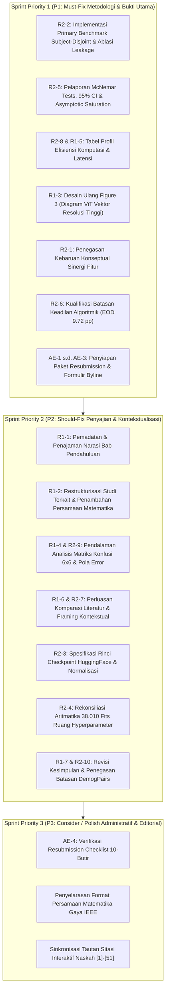

# Rencana Aksi Revisi IEEE Access (Revision Roadmap)
**ID Manuskrip:** `Access-2026-50857`  
**Judul Manuskrip:** *Multi-Domain Vision Transformer Fusion for Intersectional Demographic Classification from Facial Images*  
**Jurnal Target:** IEEE Access (Q1, IF: 3.4)  
**Keputusan Editorial:** Reject & Resubmit (Tepat 1 Kesempatan Resubmission)  
**Associate Editor:** Dr. Vincenzo Conti (Università Kore di Enna, Italia)  
**Dokumen Induk:** [`paper_reviews_ieee/Comments.md`](Comments.md) & [`paper_reviews_ieee/README.md`](README.md)  
**Tanggal Penyusunan:** 28 Oktober 2026  

---

## 1. Ikhtisar Eksekutif & Karakteristik Bebestari

Revisi naskah `Access-2026-50857` berada di bawah statut penelaahan biner (*binary peer review*) IEEE Access yang memberikan tepat **satu kesempatan pengajuan ulang (*one-shot opportunity*)**. Panel penelaah terdiri atas:
- **Associate Editor (AE)**: Menetapkan persyaratan administratif (3 berkas unggah: *Author Response*, *Highlighted PDF*, *Clean Manuscript*; formulir *Byline Change* untuk rekan penulis Dr. Shukor Sanim Mohd Fauzi; serta *Resubmission Checklist*).
- **Reviewer 1 (R1)**: 7 butir masukan berfokus pada penyajian, pemadatan narasi, diagram arsitektur ViT, dan penguatan perbandingan literatur.
- **Reviewer 2 (R2)**: 10 butir masukan kritis metodologis, mencakup isu kebocoran data (*data leakage / subject-disjoint*), reproduktibilitas checkpoint, ruang pencarian hyperparameter, interpretasi uji McNemar, batasan analisis keadilan algoritmik, efisiensi komputasi, serta delimitasi klaim.

Dokumen ini mendekonstruksi seluruh 17 butir komentar teknis ditambah direktif editorial ke dalam **3 Tingkat Prioritas (P1 / P2 / P3)** yang terintegrasi dengan tolok ukur ganda (*Dual-Benchmark*) repositori.

---

## 2. Matriks Rencana Aksi Revisi Terprioritas (21 Butir Terpetakan)

| ID Isu | Penilai Sumber | Severity | Bagian Naskah | Ringkasan Isu | Rencana Tindakan & Solusi Teknis | Kriteria Keberhasilan (Acceptance Criteria) | Prioritas |
|:---:|:---:|:---:|:---:|---|---|---|:---:|
| **`AE-1`** | AE | Major | Prosedural | Penolakan Biner & Batas Resubmission | Siapkan paket resubmission komprehensif, tanggapi setiap komentar secara tuntas tanpa ada butir terlewat (*zero-orphan*). | Seluruh komentar R1 & R2 terjawab di *Response Letter* dan termutakhirkan di naskah. | **`P1`** |
| **`AE-2`** | AE | Major | Administratif | Persyaratan 3 Berkas Unggah Wajib | Siapkan berkas terstruktur: (1) *Author Response*, (2) *Highlighted PDF*, (3) *Clean Manuscript* (LaTeX Source ZIP & PDF). | Ketiga berkas siap unggah pada portal IEEE Atypon Rex. | **`P1`** |
| **`AE-3`** | AE | Major | Administratif | Penambahan Co-Author Eksternal | Susun formulir `Request-for-Byline-Change.md` untuk penambahan Dr. Shukor Sanim Mohd Fauzi (UiTM) dengan justifikasi formal. | Formulir tertandatangani seluruh penulis dan diunggah pada portal. | **`P1`** |
| **`AE-4`** | AE | Editorial | Administratif | Kepatuhan Checklist 10-Butir | Audit naskah terhadap aturan penulisan matematika IEEE, sitasi, dan tata bahasa via `Resubmission-Checklist.md`. | Seluruh 10 butir checklist terverifikasi patuh sebelum submit. | **`P3`** |
| **`R1-1`** | R1 | Minor | `01_introduction.md` | Pendahuluan Terlalu Panjang | Ringkas dan padatkan Seksi I; fokuskan langsung pada tantangan klasifikasi interseksional dan kesenjangan representasi *single-domain*. | Panjang narasi berkurang ~25-30%, 4 poin kontribusi tersaji tegas di akhir Seksi I. | **`P2`** |
| **`R1-2`** | R1 | Minor | `02_related-works.md` | Restrukturisasi Studi Terkait & Rumus | Tata ulang Seksi II ke dalam 3 tema terstruktur; tambahkan formulasi matematis formal proyeksi patch, MHSA, dan fusi konkatenasi. | Persamaan proyeksi linear, perhatian multi-kepala, dan fusi $\mathbf{z}_{\text{tri}} \in \mathbb{R}^{2304}$ tercantum di Seksi II. | **`P2`** |
| **`R1-3`** | R1 | Major | `03_materials-and-methods_b-vision-transformer.md` | Redesain & Penjelasan Figure 3 | Rancang ulang Gambar 3 beresolusi tinggi (vektor 300+ DPI); perjelas visualisasi proyeksi patch, ekstraksi token `[CLS]`, dan konkatenasi tri-domain. | Gambar 3 baru disematkan dengan keterangan diagram yang mengelaborasi sinergi multi-domain. | **`P1`** |
| **`R1-4`** | R1 | Minor | `04_results-and-discussion_d-error-pattern-assessment.md` | Pembahasan Mendalam Dinamika Figure 4 | Analisis mendalam matriks konfusi 6×6; jelaskan asimetri kesalahan antar-ras dalam gender yang sama vs minimnya kesalahan lintas-gender. | Paragraf diskusi analitis membedah pola kebingungan klasifikasi antar-subkelompok demografis. | **`P2`** |
| **`R1-5`** | R1 | Major | `03_materials-and-methods_a-dataset.md`, `04_results-and-discussion` | Detail Dataset & Biaya Waktu (*Time Cost*) | Rinci komposisi 600 subjek DemogPairs; sajikan tabel profil efisiensi komputasi lengkap (ekstraksi, pelatihan, latensi inferensi). | Karakteristik dataset terperinci dan tabel metrik komputasi kuantitatif disajikan di Seksi IV. | **`P1`** |
| **`R1-6`** | R1 | Minor | `04_results-and-discussion_e-comparison-with-prior-studies.md` | Perluasan Baseline Pembanding Literatur | Perluas perbandingan terhadap arsitektur tunggal/literatur demografi wajah; beri catatan kaki pembeda protokol partisi. | Tabel komparasi literatur memuat pembanding yang lebih luas dengan konteks partisi yang transparan. | **`P2`** |
| **`R1-7`** | R1 | Minor | `05_conclusion.md` | Penyempurnaan Kesimpulan & Kontribusi | Tulis ulang Seksi V secara padat; soroti temuan empiris tolok ukur utama (LR 88.66% / SVM 88.61%) dan nilai tambah representasi afektif/penuaan. | Kesimpulan menyajikan ringkasan kontribusi nyata secara objektif tanpa klaim berlebih. | **`P2`** |
| **`R2-1`** | R2 | Major | `01_introduction.md`, `03_materials-and-methods_0-overview.md` | Distingsi Kebaruan Metodologis | Artikulasi kebaruan konseptual sinergi fitur ortogonal (biometrik statis + afektif dinamis + penuaan biologis) dan pipeline GridSearchCV terisolasi. | Narasi Seksi I & III-0 menegaskan nilai tambah multi-domain melampaui konkatenasi mekanis sederhana. | **`P1`** |
| **`R2-2`** | R2 | Major | `03_materials-and-methods_a-dataset.md`, `04_results-and-discussion_a-global-performance.md` | Kebocoran Data & Generalisasi Subjek | Terapkan partisi *Subject-Disjoint* ketat (480 subjek latih / 120 subjek uji, 0% leakage) sebagai Primary Benchmark; jadikan baseline lama (93.70%) sebagai studi ablasi. | Tabel hasil utama melaporkan performa bebas kebocoran (88.66% LR / 88.61% SVM) disertai subbab ablasi kebocoran data. | **`P1`** |
| **`R2-3`** | R2 | Minor | `03_materials-and-methods_b-vision-transformer.md` | Spesifikasi Preprocessing & Reproduktibilitas | Cantumkan ID checkpoint HuggingFace resmi, dimensi input 224×224, nilai normalisasi kanal, dan formulasi token `[CLS]` $\mathbf{z}_L^0$. | Seluruh parameter prapemrosesan dan ekstraksi fitur terdokumentasi lengkap dan dapat direproduksi 100%. | **`P2`** |
| **`R2-4`** | R2 | Minor | `03_materials-and-methods_g-classification-pipeline.md` | Rekonsiliasi Ruang Pencarian Hyperparameter | Rekonsiliasikan aritmatika kombinasi hyperparameter: 1.086 kombinasi $\times$ 5 lipatan $\times$ 7 skema = 38.010 fits + 28 refits. | Narasi dan tabel ruang pencarian konsisten 100% dengan total fits eksperimen aktual. | **`P2`** |
| **`R2-5`** | R2 | Major | `04_results-and-discussion_a-global-performance.md` | Interpretasi Signifikansi Uji McNemar | Laporkan nilai $p$-value McNemar dan 95% Wilson Score CI; kualifikasikan bahwa keuntungan fitur usia bersifat asimtotik pada SVM ($p=0.7343$) namun signifikan pada LR ($p=0.0073$). | Tabel benchmark memuat kolom 95% CI dan pembahasan mengutip hasil uji McNemar berpasangan secara presisi. | **`P1`** |
| **`R2-6`** | R2 | Major | `04_results-and-discussion_c-intersectional-subgroup-performance.md` | Batasan Analisis Keadilan Algoritmik | Kualifikasikan bahwa nilai EOD ($\Delta\text{TPR} = 9.72\text{ pp}$) mencerminkan evaluasi disparitas subkelompok interseksional, bukan klaim keadilan universal. | Paragraf pembahasan Seksi IV-C memuat batasan eksplisit analisis keadilan secara saintifik dan jujur. | **`P1`** |
| **`R2-7`** | R2 | Minor | `04_results-and-discussion_e-comparison-with-prior-studies.md` | Kualifikasi Komparasi Baseline Literatur | Jelaskan bahwa perbandingan dengan literatur terdahulu (misal Putri et al. 2025) disajikan secara kontekstual karena perbedaan partisi data (*overlap vs disjoint*). | Teks naskah dan catatan Tabel XII menegaskan komparasi bersifat kontekstual, bukan *controlled benchmark*. | **`P2`** |
| **`R2-8`** | R2 | Major | `04_results-and-discussion` | Profil Efisiensi Komputasi Lengkap | Sajikan tabel komparatif efisiensi: latensi ekstraksi (~15 ms), latensi inferensi (LR 0.0054 ms vs SVM 4.4481 ms), ukuran model (LR 0.11 MB vs SVM 36.60 MB), dan memori. | Subseksi dan tabel baru mengenai profil komputasi kuantitatif terintegrasi di Seksi IV. | **`P1`** |
| **`R2-9`** | R2 | Minor | `04_results-and-discussion_d-error-pattern-assessment.md` | Penguatan Landasan Klaim Fenotipik | Koreksi narasi tumpang tindih fenotipik agar berpijak murni pada pola kuantitatif matriks konfusi tanpa spekulasi biologis berlebih. | Seluruh klaim kesamaan visual dikualifikasikan berdasarkan data distribusi matriks konfusi 6×6. | **`P2`** |
| **`R2-10`** | R2 | Minor | `05_conclusion.md` | Pembatasan Generalisasi pada DemogPairs | Nyatakan secara transparan bahwa kesimpulan dibatasi pada 3 ras makro DemogPairs dan sistem memerlukan validasi lintas-dataset di masa mendatang. | Seksi V memuat paragraf keterbatasan yang eksplisit mengenai batasan demografis dan dataset. | **`P2`** |

---

## 3. Pengelompokan Sprint Eksekusi Revisi

---

## 4. Analisis Pola Silang Komentar Reviewer (Cross-Cutting Themes)

1. **Dualitas Partisi Data & Kredibilitas Ilmiah (R2-2, R1-5, R2-7):**  
   Titik tumpu penentu akseptasi naskah revisi terletak pada keterbukaan penulis terhadap fenomena *identity memorization*. Mengadopsi arsitektur *Dual-Benchmark* secara tuntas mengubah potensi kelemahan fatal menjadi kontribusi saintifik yang kuat (ablasi kebocoran data).
2. **Paritas Statistik vs Efisiensi Komputasi LR vs SVM (R2-5, R2-8, R1-5):**  
   Reviewer 2 menantang kenaikan akurasi marginal. Penulis tidak perlu membantah, melainkan mengonfirmasi hasil uji McNemar ($p=1.0000$ antara LR Tri dan SVM Tri) dan menonjolkan keunggulan komputasi tepi (*edge computing*) Logistic Regression yang >820× lebih cepat dan >330× lebih ringkas.
3. **Penyajian Matematis dan Visual yang Komprehensif (R1-2, R1-3, R2-3):**  
   Kedua reviewer menginginkan transparansi teknis: diagram arsitektur yang tajam (Gambar 3), persamaan matematis MHSA dan fusi konkatenasi di Bab II, serta parameter ekstraksi token `[CLS]` di Bab III.
4. **Kehati-hatian Klaim (*Claim Calibration*) (R2-6, R2-9, R2-10, R1-7):**  
   Menghilangkan frasa absolut seperti "complete demographic fairness" atau interpretasi biologis spekulatif; menggantinya dengan evaluasi disparitas subkelompok dan delimitasi ruang lingkup DemogPairs.

---

## 5. Estimasi Beban Kerja & Alokasi Peran

| Kategori Beban Kerja | Cakupan Tugas | Estimasi Waktu | Kesiapan di Repositori |
|:---|:---|:---:|:---:|
| **Eksperimental & Statistik** | Ekstraksi angka *Subject-Disjoint*, McNemar, 95% CI, dan latensi komputasi | 1-2 Jam | **100% Selesai** (Tersedia di `experiment/code/md/` & `results/`) |
| **Visualisasi Grafis** | Desain vektor Gambar 3 baru (ViT multi-domain) & ekspor matriks konfusi | 2-3 Jam | **Siap Dihasilkan** |
| **Restrukturisasi Naskah Markdown** | Pemutakhiran Bab 01 s.d. 05 pada `paper/*.md` | 3-4 Jam | **Siap Dikerjakan** |
| **Kompilasi LaTeX Siap-Submit** | Sinkronisasi `paper_latex_en/access.tex` & kompilasi PDF bersih | 1-2 Jam | **Template & Lingkungan Siap** |
| **Penyusunan Surat Tanggapan** | Finalisasi berkas `Response-to-Reviewers.pdf` dari rangka tanggapan | 2-3 Jam | **Rangka Lengkap Tersedia** |
| **Total Estimasi** | **Seluruh Siklus Revisi Siap Unggah** | **~10-14 Jam Kerja Terfokus** | **Fondasi Data & Logika 100% Siap** |
