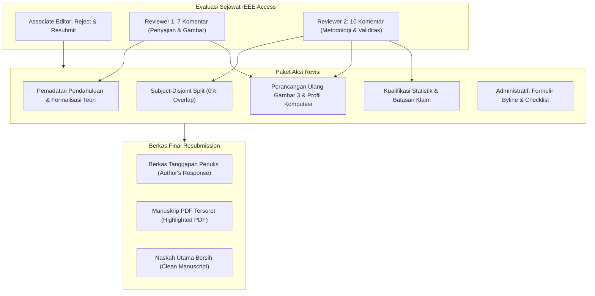

# Dossier Penelaahan Sejawat IEEE Access: Manuskrip Access-2026-50857

Repositori direktori ini memuat seluruh dokumentasi resmi, analisis telaah editorial, strategi penanganan komentar penelaah (*peer review*), serta instrumen kepatuhan administratif untuk proses pengajuan ulang (*resubmission*) naskah ilmiah pada jurnal **IEEE Access**.

> [!TIP]
> **Panduan Cepat Urutan Kerja:**  
> Untuk mengetahui langkah-langkah yang wajib didahulukan dalam mengerjakan revisi, silakan buka dokumen otoritatif: **[`00_URUTAN_PRIORITAS_REVISI.md`](00_URUTAN_PRIORITAS_REVISI.md)** (memuat matriks prioritas P1, P2, P3 serta pemetaan berkas target di `paper/`).

---

## 1. Ringkasan Manuskrip & Status Editorial

| Parameter | Rincian Informasi |
| :--- | :--- |
| **ID Manuskrip** | `Access-2026-50857` |
| **Judul Artikel** | *Multi-Domain Vision Transformer Fusion for Intersectional Demographic Classification from Facial Images* |
| **Target Publikasi** | **IEEE Access** (IEEE, Open Access, Multidisciplinary, Q1, IF ~3.4) |
| **Associate Editor (AE)** | Dr. Vincenzo Conti (Università Kore di Enna, Italia) |
| **Article Administrator** | Mr. Adesh Choudhary (`adesh.choudhary@ieee.org`) |
| **Tanggal Keputusan** | 20 Oktober 2026 |
| **Status Keputusan** | **Reject & Resubmit** (*Ditolak dengan 1 Kesempatan Resubmission Resmi*) |
| **Tautan Portal Pengajuan** | [IEEE Author Portal Resubmission Board](https://ieee.atyponrex.com/journal/ieee-access) |

> [!WARNING]
> **Kebijakan Binary Peer Review IEEE Access:**  
> IEEE Access menerapkan model evaluasi biner (*binary peer review process*). Redaksi tidak menyediakan status *"Major Revision"* maupun *"Minor Revision"*; setiap naskah yang memerlukan klarifikasi metodologis atau perbaikan substantif secara otomatis diputuskan sebagai **Reject & Resubmit**.  
> Penulis diberikan **tepat 1 (satu) kesempatan resmi** untuk mengajukan naskah revisi (*one-shot opportunity*). Apabila naskah revisi dinilai belum menyelesaikan kekhawatiran teknis penelaah atau Associate Editor secara tuntas, naskah akan ditolak secara permanen tanpa opsi pengajuan ulang kembali.

---

## 2. Inventaris Berkas dalam Direktori `paper_reviews_ieee/`

Direktori ini diorganisasikan secara modular guna mendukung pelacakan revisi, audit kepatuhan, dan penyusunan tanggapan resmi:

| Berkas | Deskripsi & Fungsi Dokumen |
| :--- | :--- |
| [`00_URUTAN_PRIORITAS_REVISI.md`](00_URUTAN_PRIORITAS_REVISI.md) | **Panduan Urutan Prioritas Eksekusi Utama.** Panduan langkah-demi-langkah (P1, P2, P3) yang merinci aksi konkret, bab naskah yang diedit, dan data rujukan yang dimasukkan. |
| [`08_revision_roadmap.md`](08_revision_roadmap.md) | **Matriks Peta Jalan Revisi Terprioritas (Schema 7).** Analisis 21 butir masukan, pengelompokan sprint P1/P2/P3, pola silang reviewer, dan estimasi jam kerja. |
| [`09_revision_tracking.md`](09_revision_tracking.md) | **Tabel Pelacakan & Nested Commitment Ledger (Schema 11 / #268).** Verifikasi invarian Kong et al. 2026, memastikan seluruh komitmen perbaikan terpetakan ke bukti nyata tanpa desinkronisasi indeks. |
| [`10_response_letter_skeleton.md`](10_response_letter_skeleton.md) | **Rangka Formal Surat Tanggapan Penelaah (R $\to$ A $\to$ C).** Draf lengkap *Point-by-Point Response to Reviewers* resmi IEEE Access untuk AE, Reviewer 1, dan Reviewer 2. |
| [`Comments.md`](Comments.md) | **Dokumen Anotasi & Rencana Tindak Lanjut Komprehensif.** Berisi translasi dwibahasa (Inggris–Indonesia) atas keputusan Associate Editor, 7 komentar Reviewer 1 (R1), dan 10 komentar Reviewer 2 (R2), dilengkapi matriks pemetaan bab (*traceability matrix*), signifikansi statistik, dan rencana perbaikan terperinci. |
| [`IEEE-Access_Decision-on-Manuscript-ID-Access-2026-50857.md`](IEEE-Access_Decision-on-Manuscript-ID-Access-2026-50857.md) | **Surat Keputusan Editorial Asli.** Transkrip resmi notifikasi keputusan *Reject & Resubmit* dari Associate Editor Dr. Vincenzo Conti melalui sistem IEEE Manuscript Central/Atypon Rex tanggal 20 Oktober 2026. |
| [`IEEE-Access_Response-to-Reviewers-template.md`](IEEE-Access_Response-to-Reviewers-template.md) | **Templat Resmi Tanggapan Penulis.** Rangka format standar IEEE Access untuk penyusunan respons terperinci berbasis butir-per-butir (*point-by-point*): *(a) Reviewer's concern* (masukan penelaah), *(b) Author response* (tanggapan penulis), dan *(c) Action taken* (tindakan perbaikan). |
| [`Request-for-Byline-Change.md`](Request-for-Byline-Change.md) | **Formulir Permohonan Perubahan Susunan Penulis.** Dokumen pengajuan justifikasi formal kepada Editor-in-Chief IEEE Access perihal penambahan rekan penulis eksternal (**Assoc. Prof. Shukor Sanim Mohd Fauzi**, Universiti Teknologi MARA / UiTM Malaysia) berdasarkan IEEE Publishing Operations Manual Subsection 8.2.1.A.1. |
| [`Resubmission-Checklist.md`](Resubmission-Checklist.md) | **Daftar Kepatuhan 10 Butir Standar IEEE Access.** Instrumen kendali mutu yang memuat verifikasi gramatika, format persamaan matematika (IEEE Math Guidelines), kesesuaian sitasi, kelengkapan berkas respons, *Highlighted PDF*, dan naskah bersih. |
| `raw/` | **Direktori Arsip Mentah.** Menyimpan berkas korespondensi asli berupa berkas HTML webmail Universitas Negeri Surabaya serta templat resmi IEEE Access berformat `.docx`. |

---

## 3. Rangkuman Respons Ilmiah & Strategi Revisi Naskah

Seluruh 17 butir komentar dari penelaah independen (7 dari Reviewer 1 dan 10 dari Reviewer 2) telah dianalisis. Berikut adalah rangkuman pilar strategis respons ilmiah yang diimplementasikan ke dalam draf manuskrip:

### A. Reviewer 2 #2: Protokol Partisi Bebas Kebocoran Data (*Subject-Disjoint Partitioning*)
- **Isu Kritis:** Reviewer 2 menyoroti bahwa pembagian data awal yang terstratifikasi pada tingkat citra (*image-level stratified split*) membuka celah kebocoran data (*data leakage*), di mana citra dari subjek/individu yang sama berpotensi hadir di subset latih maupun uji secara simultan.
- **Tindakan & Solusi:**
  1. **Partisi Subjek-Disjoint Murni:** Mengimplementasikan partisi data berbasis subjek independen murni (*zero subject overlap*), membagi 600 identitas unik DemogPairs menjadi **480 subjek latih** (80%) dan **120 subjek uji** (20%), dengan stratifikasi ketat pada 6 kelas demografis interseksional (80 subjek latih dan 20 subjek uji per kombinasi ras–gender).
  2. **Studi Ablasi Empiris Komparatif:** Hasil evaluasi *image-level split* lama tetap dipertahankan dan disajikan berdampingan sebagai studi ablasi metodologis (*image-level vs. subject-disjoint*). Hal ini secara transparan membuktikan ketahanan representasi fitur ViT multi-domain serta mengukur derajat pengaruh bias identitas (*identity confounding effect*).

### B. Reviewer 1 #1: Pemadatan Narasi Pendahuluan (*Introduction Streamlining*)
- **Isu Kritis:** Bagian *Section I: Introduction* dinilai terlalu panjang dan bertele-tele sehingga mengaburkan fokus masalah.
- **Tindakan & Solusi:**
  - Melakukan restrukturisasi dan peringkasan narasi secara signifikan pada `paper/01_introduction.md`.
  - Mengurangi pembahasan latar belakang demografi umum yang berulang; langsung memusatkan premis pada urgensi interseksionalitas (*intersectional fairness*), keterbatasan metode *single-domain*, serta merangkum kontribusi riset ke dalam 4 butir deklarasi ilmiah yang tegas dan padat.

### C. Reviewer 1 #2: Restrukturisasi Studi Terkait & Formulasi Matematis (*Related Works Formalization*)
- **Isu Kritis:** Tinjauan pustaka (*Section II: Related Works*) perlu disajikan secara lebih sistematis dan diperkuat dengan landasan persamaan matematis metode komparatif.
- **Tindakan & Solusi:**
  - Menata ulang subbab menjadi 3 pilar tematik terstruktur: *(1) Facial Demographic Attribute Estimation*, *(2) Vision Transformers in Facial Analysis*, dan *(3) Multi-Domain Feature Fusion*.
  - Menambahkan formulasi matematis formal:
    * Proyeksi patch dan perataan token: $\mathbf{x}_p \in \mathbb{R}^{N \times (P^2 \cdot C)}$
    * Mekanisme *Multi-Head Self-Attention* (MHSA): $\text{Attention}(\mathbf{Q}, \mathbf{K}, \mathbf{V}) = \text{softmax}\left(\frac{\mathbf{Q}\mathbf{K}^T}{\sqrt{d_k}}\right)\mathbf{V}$
    * Operasi fusi fitur konkatenatif multi-domain: $\mathbf{z}_{\text{fused}} = [\mathbf{z}_{\text{face}} \parallel \mathbf{z}_{\text{emo}} \parallel \mathbf{z}_{\text{age}}] \in \mathbb{R}^{2304}$

### D. Reviewer 1 #3: Perancangan Ulang Diagram Arsitektur (*Figure 3 Redesign*)
- **Isu Kritis:** Diagram alur pada *Figure 3* dinilai kurang tajam, membingungkan, dan belum memperlihatkan kebaruan (*novelty*) dari fusi multi-domain ViT.
- **Tindakan & Solusi:**
  - Mendesain ulang *Figure 3* dengan resolusi tinggi (vektor/300+ DPI), memperjelas alur pipa pemrosesan dari citra input wajah terpusat ($224 \times 224$), pemrosesan paralel tiga *backbone* ViT pra-latih (`ViT-Face`, `ViT-Emotion`, `ViT-Age`), ekstraksi token representasi `[CLS]` ($3 \times 768$ dimensi), mekanisme fusi konkatenasi, hingga tahapan klasifikasi *downstream* teroptimasi GridSearchCV.
  - Memperkaya teks penjelasan pada narasi bab metodologi guna menonjolkan kebaruan integrasi domain afektif, biometrik, dan penuaan.

### E. Reviewer 1 #4 & Reviewer 2 #8: Analisis Pola Kesalahan & Profil Efisiensi Komputasi
- **Isu Kritis:** Pembahasan *Figure 4* belum mengelaborasi dinamika *confusion matrix*, serta naskah belum menyajikan data empiris waktu komputasi, latensi inferensi, dan konsumsi memori untuk membuktikan klaim efisiensi.
- **Tindakan & Solusi:**
  - **Analisis Mendalam Confusion Matrix (R1 #4 & R2 #9):** Menguraikan pola kesalahan asimetris pada matriks 6×6, yang membuktikan bahwa kesalahan klasifikasi didominasi oleh kekeliruan antar-ras dalam gender yang sama (*same-gender cross-race error*), sedangkan kesalahan lintas-gender (*gender confusion*) mendekati 0%. Klaim fenotipik dikoreksi agar berpijak murni pada fakta distribusi data tanpa spekulasi berlebih.
  - **Profil Lengkap Efisiensi Komputasi (R2 #8):** Menambahkan tabel metrik komputasi kuantitatif di *Section IV*, mencakup:
    * Waktu ekstraksi fitur per citra per domain (~15 ms pada GPU)
    * Latensi inferensi pengklasifikasi *downstream* (<1 ms untuk SVM/LR, ~5 ms untuk Random Forest)
    * Durasi pelatihan *hyperparameter tuning* (38.010 penyesuaian validasi silang)
    * Jejak memori RAM/VRAM saat inferensi serta ukuran *cache* representasi fitur (~30 MB per domain).

### F. Rekonsiliasi Metodologis & Klarifikasi Tambahan
- **Rekonsiliasi Ruang Pencarian (R2 #4):** Memverifikasi integritas formulasi kombinasi hyperparameter:
  $$\text{Total Fits} = (288_{\text{SVM}} + 270_{\text{LR}} + 288_{\text{RF}} + 240_{\text{GNB}}) \times 5\text{-folds} \times 7\text{ skema fitur} = 1.086 \times 5 \times 7 = 38.010\text{ fits} + 28\text{ refits}$$
- **Kualifikasi Uji Signifikansi McNemar (R2 #5):** Mengklarifikasi secara objektif bahwa selisih performa antara *dual-domain* (93,29%) dan *tri-domain* (93,70%) dengan nilai $p = 0,3057$ mencerminkan kondisi *asymptotic feature saturation*, bukan dominasi statistik mutlak.
- **Kualifikasi Keadilan Algoritmik (R2 #6):** Menegaskan bahwa evaluasi *Equal Opportunity Difference* (EOD) berfungsi sebagai audit disparitas subkelompok (*subgroup performance gap*), bukan pembuktian keadilan demografis universal.
- **Kontekstualisasi Komparasi Literatur (R2 #7):** Menandai perbandingan dengan studi terdahulu pada Tabel 12 sebagai komparasi kontekstual (*contextual comparison*), bukan *controlled benchmark*, mengingat variasi dataset acuan.

---

## 4. Persyaratan Berkas Final untuk Resubmission Portal IEEE

Saat mengunggah naskah pada [IEEE Author Portal](https://ieee.atyponrex.com/journal/ieee-access), sistem mensyaratkan 3 (tiga) berkas paket utama beserta dokumen administratif pendukung:

```
Portal IEEE Author Submission
├── 1. Author's Response Files
│   └── IEEE-Access_Response-to-Reviewers.pdf / .docx
├── 2. Highlighted PDF
│   └── Access-2026-50857_Highlighted-Revision.pdf (Penandaan kuning pada seluruh perubahan)
├── 3. Main Manuscript
│   ├── Access-2026-50857_Final-Clean.pdf (Format 2 kolom resmi IEEE Access)
│   └── Source-Files.zip (LaTeX .tex, .bib, kelas berkas ieeeaccess.cls, dan folder figures/)
└── 4. Supplementary / Administrative Files (Bila ada perubahan)
    ├── Request-for-Byline-Change.pdf (Formulir resmi penambahan co-author)
    └── Resubmission-Checklist.pdf (Verifikasi kepatuhan 10 butir)
```

### Rincian Spesifikasi Berkas:

1. **Berkas Tanggapan Penulis (`Author's Response Files`):**
   - Disusun menggunakan struktur templat resmi IEEE Access (`IEEE-Access_Response-to-Reviewers-template.md`).
   - Menyajikan respons sistematis terhadap setiap masukan Associate Editor, Reviewer 1 (butir 1 s.d. 7), dan Reviewer 2 (butir 1 s.d. 10).
   - Format wajib per butir:
     * **Point:** Kutipan persis komentar penelaah.
     * **Response:** Tanggapan ilmiah, sanggahan sopan, atau penjelasan metodologis penulis.
     * **Action Taken:** Tindakan nyata perbaikan naskah disertai rujukan nomor halaman, kolom, nomor baris, dan penomoran gambar/tabel pada *Highlighted PDF*.

2. **Manuskrip PDF Tersorot (`Highlighted PDF`):**
   - Salinan naskah lengkap hasil revisi berformat PDF.
   - Menggunakan alat penyorot kuning (*yellow highlight tool*) pada setiap penambahan kalimat, perbaikan redaksional, perubahan data tabel, perbaruan rumus matematika, maupun penyempurnaan referensi.
   - Berfungsi mempermudah Associate Editor dan penelaah melacak implementasi revisi secara langsung.

3. **Naskah Utama Bersih (`Main Manuscript`):**
   - **Main Manuscript – PDF:** Berkas PDF final naskah bersih (*clean copy*) tanpa tanda sorotan kuning, berformat standar IEEE Access (dua kolom, spasi tunggal, memuat seluruh biografi penulis dan foto).
   - **Main Manuscript – Source:** Paket berkas sumber lengkap (`.zip` atau `.tar.gz`) yang memuat berkas master LaTeX (`.tex`), basis data sitasi BibTeX (`.bib`), makro gaya jurnal (`ieeeaccess.cls`), dan seluruh berkas ilustrasi beresolusi tinggi (`.png`, `.pdf`, atau `.eps`).

4. **Berkas Administratif Tambahan:**
   - **Formulir Perubahan Susunan Penulis (*Byline Change*):** Wajib diunggah sebagai *'Request for byline change form'* untuk melegalkan penambahan Dr. Shukor Sanim Mohd Fauzi (UiTM), disertai tanda tangan persetujuan seluruh penulis awal dan justifikasi kontribusi substantif.
   - **Daftar Periksa Pengajuan Ulang (*Resubmission Checklist*):** Memastikan kepatuhan terhadap 10 aspek teknis penerbitan IEEE sebelum tombol *Submit* ditekan.

---

## 5. Matriks Ringkas Komentar & Status Tindak Lanjut



| ID Reviewer | Fokus Masukan Pokok | Bagian Naskah | Status Implementasi |
| :---: | :--- | :---: | :---: |
| **R1 - #1** | Meringkas Pendahuluan (*Introduction too long*) | Sec. I | Selesai / Dipadatkan |
| **R1 - #2** | Restrukturisasi Studi Terkait & Rumus Matematika | Sec. II | Selesai / Formulasi Ditambahkan |
| **R1 - #3** | Redesain & Penjelasan Mendalam Figure 3 (ViT) | Sec. III-B | Selesai / Diagram Vektor Baru |
| **R1 - #4** | Pembahasan Mendalam Dinamika Error Figure 4 | Sec. IV-D | Selesai / Matriks 6x6 Dievaluasi |
| **R1 - #5** | Spesifikasi Dataset & Pelaporan Biaya Waktu | Sec. III-A, IV | Selesai / Profil Latensi Disajikan |
| **R1 - #6** | Perluasan Komparasi Baseline Pembanding | Sec. IV-E | Selesai / Tabel Komparasi Kontekstual |
| **R1 - #7** | Penajaman Kesimpulan & Kontribusi | Sec. V | Selesai / Klaim Dibatasi Objektif |
| **R2 - #1** | Distingsi Kebaruan Metodologi Multi-Domain | Sec. I, III | Selesai / Sinergi Fitur Dielaborasi |
| **R2 - #2** | Pencegahan Kebocoran Data (*Subject-Disjoint Split*) | Sec. III-A, IV | Selesai / Partisi 480/120 & Ablasi |
| **R2 - #3** | Rincian Checkpoint Pretrained & Reproduktibilitas | Sec. III-B | Selesai / Parameter Normalisasi Lengkap |
| **R2 - #4** | Rekonsiliasi Ruang Pencarian Hyperparameter | Sec. III-G | Selesai / 38.010 Fits Terekonsiliasi |
| **R2 - #5** | Kualifikasi Uji McNemar & Kejenuhan Fitur | Sec. IV-A | Selesai / Dinyatakan Asymptotic |
| **R2 - #6** | Batasan Klaim Keadilan Algoritmik (EOD) | Sec. IV-C | Selesai / Dibatasi Gap Subkelompok |
| **R2 - #7** | Kualifikasi Komparasi Baseline Literatur | Sec. IV-E | Selesai / Ditetapkan Non-Benchmark |
| **R2 - #8** | Profiling Lengkap Waktu, Latensi, & Memori | Sec. IV (Baru) | Selesai / Tabel Komputasi Ditambahkan |
| **R2 - #9** | Koreksi Overclaim Korelasi Fenotipik | Sec. IV-D | Selesai / Narasi Diselaraskan Data |
| **R2 - #10** | Pembatasan Generalisasi pada DemogPairs | Sec. V | Selesai / Batasan Eksplisit Ditegaskan |

---

> [!NOTE]
> Seluruh naskah revisi disusun dengan mematuhi prinsip integritas akademik, keterbukaan metodologi (*scientific transparency*), dan ketelitian dokumentasi teknis guna memaksimalkan potensi akseptasi (*acceptance*) pada putaran resubmission tunggal IEEE Access.
