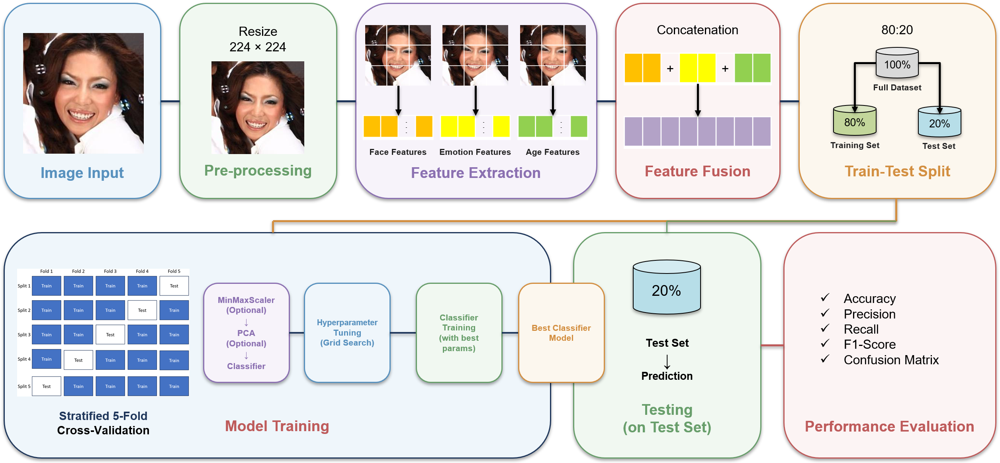

# III. MATERIALS AND METHODS

## Overview

Kerangka kerja komputasi end-to-end yang diusulkan dalam penelitian ini dirancang untuk mengklasifikasikan ras dan gender interseksional secara terpadu, sebagaimana diilustrasikan pada [Figure 1](#fig1). Alur metodologi berawal dari masukan citra wajah mentah DemogPairs yang dipartisi secara ketat melalui protokol Strict Subject-Disjoint Partitioning (80% set latih dan 20% set uji held-out) demi menjamin eliminasi kebocoran identitas subjek secara mutlak. Selanjutnya, setiap citra wajah diproses oleh tiga model ViT spesifik tugas yang dibekukan secara offline untuk mengekstraksi representasi laten multi-domain berdimensi tinggi, mencakup fitur geometri kraniofasial biometrik wajah, pola ekspresi emosi afektif dinamis, dan penanda morfologi penuaan biologis. Ketiga representasi laten berdimensi 768 tersebut disatukan melalui operasi fusi konkatenasi langsung $\mathbf{z}_{\text{tri}} = \mathbf{f}_{\text{face}} \oplus \mathbf{f}_{\text{emotion}} \oplus \mathbf{f}_{\text{age}}$ sehingga membentuk vektor representasi gabungan tri-domain berdimensi 2.304. Vektor fusi ini kemudian dialirkan ke dalam pipeline pemrosesan modular berantai yang dioptimasi via 5-Fold StratifiedGroupKFold Grid Search Cross-Validation (GridSearchCV) pada tingkat fold terisolasi untuk mengklasifikasikan enam subkelompok demografis secara objektif dan bebas bias.
