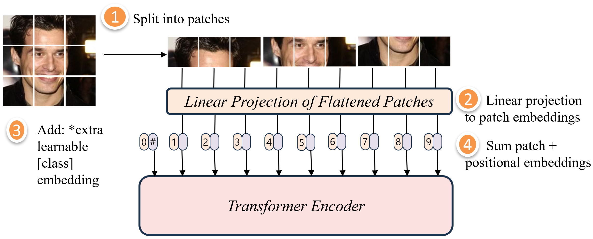

## B. Vision Transformer

**Figure 3. Redesigned High-Resolution Architecture of the Parallel Multi-Domain ViT Feature Extraction Backbones, Layer-12 CLS Token Extraction, and Direct Sum Feature Concatenation Pipeline.**

Arsitektur pengekstraksi representasi visual pada penelitian ini mengadopsi model Vision Transformer baku rancangan Dosovitskiy et al. [[26]](06_references.md#ref26) sebagaimana diilustrasikan pada [Figure 3](#fig3). Setiap citra wajah masukan beresolusi 224 × 224 piksel dengan $C = 3$ kanal warna dibagi menjadi $N = 196$ patch spasial non-overlapping berdimensi $P \times P$ dengan $P = 16$ [[27]](06_references.md#ref27). Setiap patch diratakan menjadi $\mathbf{x}_p \in \mathbb{R}^{P^2 \cdot C}$ lalu diproyeksikan secara linier melalui matriks $\mathbf{E} \in \mathbb{R}^{(P^2 \cdot C) \times D}$ ke ruang laten berdimensi $D = 768$. Vektor patch tersebut dirangkaikan dengan token kelas $\mathbf{x}_{\text{class}} \in \mathbb{R}^D$ dan embedding posisi $\mathbf{E}_{\text{pos}} \in \mathbb{R}^{(N+1) \times D}$ sesuai perumusan [(5)](#eq5) [[27]](06_references.md#ref27). Sekuens vektor token awal $\mathbf{z}_0$ selanjutnya diumpankan ke tumpukan $L = 12$ lapisan transformer encoder identik. Pada setiap lapisan encoder $\ell$ ($\ell = 1, \dots, L$), representasi fitur diproses melalui Multi-Head Self-Attention (MHSA) setelah operasi Layer Normalization (LN), lalu dialirkan menuju Multi-Layer Perceptron (MLP) dua lapis dengan fungsi aktivasi Gaussian Error Linear Unit (GeLU) berdasarkan [(6)](#eq6) [[28]](06_references.md#ref28). Mekanisme self-attention memungkinkan pemodelan relasi spasial global antarpatch wajah tanpa batasan receptive field lokal [[29]](06_references.md#ref29).

$$
\mathbf{z}_0 = [\mathbf{x}_{\text{class}}; \, \mathbf{x}_p^1\mathbf{E}; \dots; \, \mathbf{x}_p^N\mathbf{E}] + \mathbf{E}_{\text{pos}} \tag{5}
$$

$$
\mathbf{z}'_\ell = \text{MHSA}(\text{LN}(\mathbf{z}_{\ell-1})) + \mathbf{z}_{\ell-1}, \quad \mathbf{z}_\ell = \text{MLP}(\text{LN}(\mathbf{z}'_\ell)) + \mathbf{z}'_\ell \tag{6}
$$

Untuk memperoleh representasi visual wajah yang komplementer, kerangka kerja ini memanfaatkan tiga model backbone ViT-Base pra-latih yang dibekukan (frozen weights) secara terpisah. Model pertama merupakan `ViT-Face` (`skutaada/VIT-VGGFace`) yang memetakan pola geometri kraniofasial statis berbasis korpus VGGFace2. Model kedua adalah `ViT-Emotion` (`dima806/facial_emotions_image_detection`) untuk mengekstraksi dinamika ekspresi afektif wajah berdasarkan fine-tuning korpus FER-2013. Model ketiga yaitu `ViT-Age` (`dima806/facial_age_image_detection`) yang memetakan penanda morfologi usia biologis subjek berbasis dataset UTKFace dan IMDB-WIKI. Seluruh model domain mengadopsi struktur ViT-Base/16 dengan dimensi tersembunyi 768 dan 12 lapisan encoder. Citra masukan diformat ke ruang warna RGB, disesuaikan ke resolusi 224 × 224 piksel, serta dinormalisasi secara seragam lewat parameter statistik $\mu = [0.5, 0.5, 0.5]$ dan $\sigma = [0.5, 0.5, 0.5]$. Ekstraksi fitur memanfaatkan in-memory processor caching tanpa pembaruan gradien (frozen weights) demi menjamin efisiensi komputasi dan reproduktibilitas representasi.

Representasi fitur laten tingkat tinggi diekstraksi dari setiap model domain melalui aktivasi token $[\text{CLS}]$ pada lapisan encoder terakhir ($\ell = 12$). Vektor keluaran token kelas tersebut kemudian distandardisasi melalui operasi Layer Normalization akhir untuk menghasilkan representasi domain teranormalisasi $\mathbf{f}_{\text{domain}} \in \mathbb{R}^{768}$ sesuai perumusan [(7)](#eq7), di mana $\mathbf{z}_{12}^0$ melambangkan representasi token pertama pada lapisan kedua belas yang diekstraksi tanpa perhitungan gradien. Selanjutnya, ketiga representasi domain tunggal digabungkan melalui operasi fusi konkatenasi langsung (direct sum) $\oplus$ menjadi vektor representasi gabungan tri-domain $\mathbf{z}_{\text{tri}} \in \mathbb{R}^{2304}$ berdasarkan formulasi [(8)](#eq8). Ruang representasi gabungan ini memadukan informasi biometrik kraniofasial $\mathbf{f}_{\text{face}}$, ekspresi emosional afektif $\mathbf{f}_{\text{emotion}}$, serta estimasi usia biologis $\mathbf{f}_{\text{age}}$ secara simultan. Eksplorasi empiris dilakukan melalui pengujian ablasi sistematis yang mencakup tujuh skema konfigurasi fitur, meliputi tiga konfigurasi domain tunggal berdimensi 768, tiga konfigurasi domain ganda berdimensi 1.536, dan satu konfigurasi tri-domain usulan berdimensi 2.304 sebagaimana disajikan pada [Table II](#tab2).

$$
\mathbf{f}_{\text{domain}} = \text{LN}(\mathbf{z}_{12}^0) \in \mathbb{R}^{768} \tag{7}
$$

$$
\mathbf{z}_{\text{tri}} = \mathbf{f}_{\text{face}} \oplus \mathbf{f}_{\text{emotion}} \oplus \mathbf{f}_{\text{age}} \in \mathbb{R}^{2304} \tag{8}
$$

**Table II. Multi-Domain Feature Fusion and Systematic Ablation Configurations.**

| # | Feature Scheme | Category | Input Source Domains | Feature Dimension |
| :---: | :--- | :---: | :--- | :---: |
| 1 | `Face` | Single-Domain | Static Craniofacial Biometrics (`skutaada/VIT-VGGFace`) | 768 |
| 2 | `Emotion` | Single-Domain | Dynamic Affective Expressions (`dima806/facial_emotions_image_detection`) | 768 |
| 3 | `Age` | Single-Domain | Biological Aging Morphology (`dima806/facial_age_image_detection`) | 768 |
| 4 | `Emotion ⊕ Face` | Dual-Domain | Affective Dynamics + Craniofacial Biometrics | 1,536 |
| 5 | `Face ⊕ Age` | Dual-Domain | Craniofacial Biometrics + Aging Morphology | 1,536 |
| 6 | `Emotion ⊕ Age` | Dual-Domain | Affective Dynamics + Aging Morphology | 1,536 |
| 7 | `Face ⊕ Emotion ⊕ Age` | Tri-Domain (Proposed) | Biometrics + Affective Dynamics + Aging Morphology | 2,304 |
