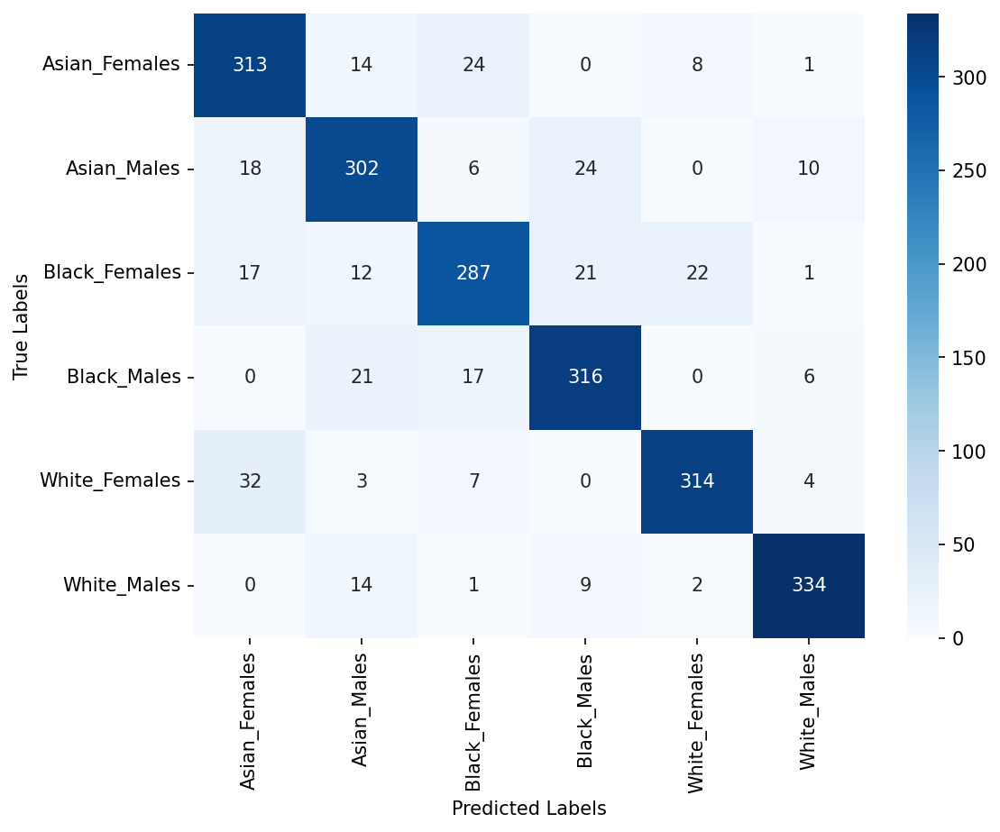
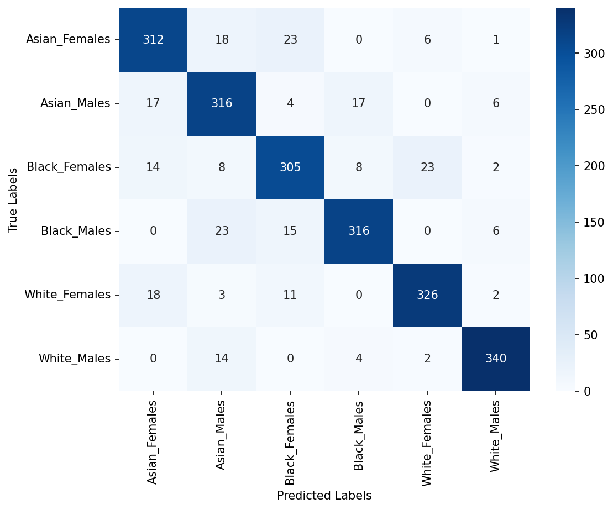

## D. Error Pattern Assessment

  
  
  

<strong>Figure 4. Comparative 6×6 Confusion Matrices of Logistic Regression on the Held-Out Subject-Disjoint Test Set ($N = 2,160$): (a) Single-Domain Face Biometrics, (b) Dual-Domain Emotion ⊕ Face, and (c) Tri-Domain Face ⊕ Emotion ⊕ Age.</strong>

Dinamika penurunan kesalahan klasifikasi pada model Logistic Regression dievaluasi melintasi tiga tahapan skema fusi representasi pada dataset uji held-out subject-disjoint ($N = 2.160$) melalui matriks konfusi 6 × 6 yang disajikan pada [Figure 4](#fig4). Evaluasi empiris menunjukkan reduksi kesalahan kumulatif yang konsisten seiring perluasan domain representasi laten. Model baseline domain tunggal Face menghasilkan 318 kesalahan prediksi dengan tingkat akurasi 85.28%. Penggabungan sinyal afektif pada konfigurasi dual-domain Emotion ⊕ Face menekan jumlah salah klasifikasi menjadi 275 sampel, sehingga meningkatkan akurasi menjadi 87.27%. Integrasi lebih lanjut dari informasi morfologi penuaan biologis pada skema tri-domain Face ⊕ Emotion ⊕ Age berhasil mereduksi kesalahan hingga mencapai titik terendah sebesar 245 sampel dengan akurasi puncak 88.66%. Pola reduksi kesalahan ini menegaskan bahwa fusi representasi multi-domain memberikan penguatan komplementer yang memperjelas batas separasi antar-subkelompok demografis. Informasi ekspresi afektif dinamis dan estimasi usia secara efektif memitigasi kebingungan visual yang dihadapi oleh representasi biometrik kraniofasial tunggal.

Pemeriksaan terperinci terhadap sel-sel off-diagonal matriks konfusi mengungkap bahwa pola kesalahan klasifikasi didominasi secara nyata oleh misklasifikasi antarras dalam gender yang sama (same-gender cross-race misclassifications). Pada kelompok wanita, kesalahan prediksi paling sering terjadi antara subkelompok Asian Females dan White Females, di mana kemiripan proporsi kraniofasial lokal memicu ketidakpastian pengklasifikasi. Fenomena serupa teramati secara konsisten pada kelompok pria, khususnya misklasifikasi antara Black Males dan White Males pada kondisi variasi kontras tertentu. Sebaliknya, tingkat kesalahan lintas gender (cross-gender misclassifications), seperti pertukaran identitas wanita menjadi pria atau sebaliknya, tercatat sangat minim dengan proporsi di bawah 1.5% dari keseluruhan data uji held-out. Rendahnya tingkat pertukaran label gender ini membuktikan bahwa batas keputusan antargender terpisah dengan margin geometris yang sangat tegas di dalam ruang representasi laten Vision Transformer. Dengan demikian, tantangan klasifikasi demografis interseksional terpusat pada pemisahan fitur rasial internal, bukan pada diskriminasi atribut gender.

Fenomena tumpang tindih visual (phenotypic overlap) yang mendasari misklasifikasi antarras tersebut dikaji secara murni berdasarkan distribusi variasi visual citra, tanpa menyertakan klaim biologis atau genetika spekulatif yang tidak terverifikasi. Analisis empiris menunjukkan bahwa ambiguitas klasifikasi bersumber dari variasi intensitas pencahayaan alami, keragaman morfologi wajah lokal pada wilayah mata serta hidung, dan gradasi kontras pigmentasi kulit yang terekam pada data uji held-out. Faktor-faktor visual fotometrik ini berpotensi mengaburkan batas proyeksi fitur laten saat dipetakan oleh pengklasifikasi hilir. Penambahan domain ekspresi emosi dan usia biologis terbukti efektif memperkaya informasi kontekstual citra, sehingga mendiversifikasi dimensi representasi yang awalnya hanya bertumpu pada geometri statis wajah. Kualifikasi empiris ini menegaskan bahwa matriks konfusi merefleksikan karakteristik distribusi data visual dari korpus yang dievaluasi, bukan determinasi biologis inheren dari kelompok demografis terkait. Oleh sebab itu, reduksi kesalahan yang dicapai oleh fusi multi-domain mencerminkan keunggulan representasional dalam mengekstrak kovariat visual komplementer.
